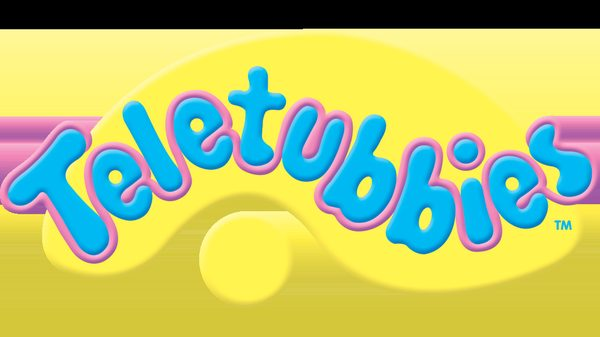
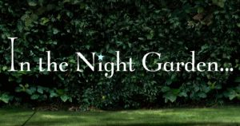
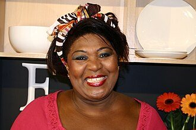
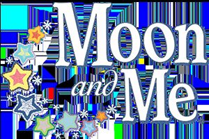
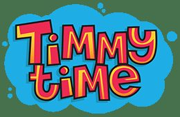
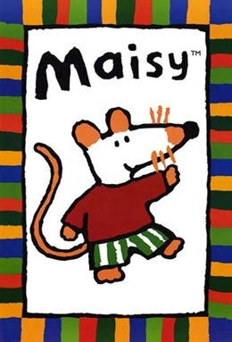
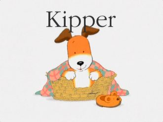
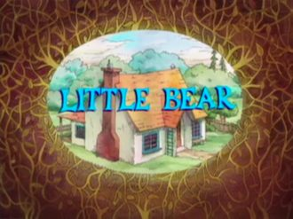
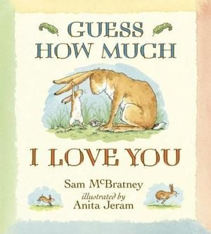
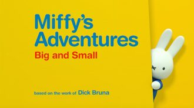

> 这是更早一次按年龄整理的网络研究卡片，和微信文章片单分开。微信片单在 [docs/wechat/](../wechat/catalog.md)。

# 0–2 岁

研究片单和微信摘录合在一起，每部一张卡片。观看链接只保留在这个环境里打开成功的官方网站或 YouTube 页面。没有写成链接的，是没有找到。

14 部。

## 天线宝宝（Teletubbies）

- **中文名**：天线宝宝
- **原名**：Teletubbies
- **年龄**：2+ Common Sense Media; Chinese Wikipedia says the intended audience is about 1–5

维基共享资源上的海报或标题图（Teletubbies）

《天线宝宝》由 Anne Wood 与 Andrew Davenport 创作，1997年3月31日在英国播出。丁丁、迪西、拉拉和小波由演员穿着全身服装表演，住在一个真实布景里，用很短的、接近幼儿早期发音的语言重复玩耍。每人肚子上的屏幕会播放一段现实生活短片。中文维基百科称主要对象大约是1至5岁，并列出单集长度25分钟。

**观看**：[https://www.youtube.com/channel/UCOk55dAgB8VnMlhaTEMeX5A](https://www.youtube.com/channel/UCOk55dAgB8VnMlhaTEMeX5A)

维基数据登记的 YouTube 频道

## 花园宝宝（In the Night Garden...）

- **中文名**：花园宝宝
- **原名**：In the Night Garden...
- **年龄**：2+ Common Sense Media; BBC: under 4; creators discussed imagination from about age 2

维基共享资源上的海报或标题图（In the Night Garden...）

《花园宝宝》由《天线宝宝》的 Andrew Davenport 创作，Anne Wood 参与制作，Derek Jacobi 旁白。BBC在2007年3月19日的新闻稿中称它面向4岁以下，讲的是醒与睡之间的“做梦时间”，在真实林地拍摄。英文维基百科写明片长约28分钟，形式混合真人服装、定格、木偶和电脑动画。中文维基页面名为“花园宝宝”。

**观看**：[https://www.bbc.co.uk/cbeebies/shows/in-the-night-garden](https://www.bbc.co.uk/cbeebies/shows/in-the-night-garden)

维基数据登记的官方网站

## Twirlywoos

- **原名**：Twirlywoos
- **年龄**：2+ Common Sense Media

维基共享资源上的海报或标题图（Rustie Lee）

Common Sense Media记录《Twirlywoos》于2015年2月23日在CBeebies与Netflix的资料中首播，旁白是 Linda Bassett，并把它和《天线宝宝》创作者 Anne Wood 联系起来。定格角色头上有螺旋桨，会飞到真人世界里看人在做什么，自己几乎不说话，由旁白反复说出一个早期概念，例如里/外、湿/干、穿过。

**观看**：未找到可打开的正版预告或播放页。

## Moon and Me

- **原名**：Moon and Me
- **年龄**：2+ Common Sense Media

维基共享资源上的海报或标题图（Moon and Me）

英文维基百科称《Moon and Me》是 Andrew Davenport 创作的定格动画，英国在CBeebies播出、美国在Universal Kids播出，共50集，Nina Sosanya 旁白，在亚特兰大松林制片厂拍摄。Common Sense Media则写成“3D动画”，并把美国首播记为2019年2月3日，单集约18分钟。玩具夜里醒来，Pepi Nana 大多只说“tiddle toddle”，由旁白翻译。

**观看**：未找到可打开的正版预告或播放页。

## 小小羊蒂米（Timmy Time）

- **中文名**：小小羊蒂米
- **原名**：Timmy Time
- **年龄**：2+ Common Sense Media

维基共享资源上的海报或标题图（Timmy Time）

《小小羊蒂米》（中文维基导语亦作《咪咪羊》）是阿德曼为CBeebies制作的定格动画，2009年4月6日在英国开播，由《小羊肖恩》衍生。蒂米在托儿所和同伴相处，角色几乎不对白。Common Sense Media把单集记为约10分钟，并评为2岁以上。

**观看**：未找到可打开的正版预告或播放页。

## Bing

- **原名**：Bing
- **年龄**：2+ Common Sense Media; the character is described as three years old

维基共享资源上的海报或标题图（Chandler Bing）

《Bing》根据 Ted Dewan 的图画书改编，BBC媒体中心记载2014年6月9日10:05在CBeebies播出第一集。兔子 Bing 在剧中被写成约三岁，照顾者 Flop 由 Mark Rylance 配音。Brown Bag Films称它是Acamar、Brown Bag与Tandem的合拍，写日常生活里的小意外。iPlayer将该集时长标为7分钟。

**观看**：[https://www.youtube.com/channel/UCXOhwSygMaNt5_VIAAo-49g](https://www.youtube.com/channel/UCXOhwSygMaNt5_VIAAo-49g)

维基数据登记的 YouTube 频道

## 小P优优（Pocoyo）

- **中文名**：小P优优
- **原名**：Pocoyo
- **年龄**：Zinkia says target 1–4 years; Common Sense Media says 3+

**图片**：未找到可下载的海报或标题图。

《Pocoyo》由西班牙Zinkia与英国Granada Kids、Cosgrove Hall合作，中文维基百科写“又译小P优优”，并说明英语版前两季由斯蒂芬·弗莱旁白。Zinkia官网把目标年龄写成1至4岁、单集7分钟。RTVE同样写每集7分钟。英文维基对2005年的首播频道和日期表述不一致，故这里只把首播年记为2005，并在年份说明里保留矛盾。

**观看**：未找到可打开的正版预告或播放页。

## Maisy

- **原名**：Maisy
- **年龄**：3+ Common Sense Media

维基共享资源上的海报或标题图（Maisy (TV series)）

《Maisy》改编自 Lucy Cousins 的绘本。英文维基百科称1999年2月11日至2000年11月2日在CITV播出，共26集，每集四小段。Common Sense Media把美国Nick Jr.首播也记为1999年2月11日。小鼠和鳄鱼、鸡、松鼠朋友用无意义的声音，只有旁白说人话，带孩子看很普通的一天。

**观看**：[https://www.youtube.com/channel/UC5_GIZxZaBymNgs3IFkGFiw](https://www.youtube.com/channel/UC5_GIZxZaBymNgs3IFkGFiw)

维基数据登记的 YouTube 频道

## Kipper

- **原名**：Kipper
- **年龄**：3+ Common Sense Media

维基共享资源上的海报或标题图（Kipper (TV series)）

《Kipper》根据 Mick Inkpen 的绘本改编。英文维基百科称HIT Entertainment制作、Grand Slamm Children’s Films动画，1997年9月至2000年12月在ITV播了六季、78集，Martin Clunes 为 Kipper 配音。小狗 Kipper 和朋友 Tiger、Pig、宝宝 Arnold 一起出门、闹一点小别扭再和好。

**观看**：未找到可打开的正版预告或播放页。

## Little Bear

- **原名**：Little Bear
- **年龄**：3+ Common Sense Media

维基共享资源上的海报或标题图（Little Bear (TV series)）

《Little Bear》是加拿大 Nelvana 根据 Else Holmelund Minarik 的书、Maurice Sendak 的插画制作的动画片，英文维基百科称1995年11月6日在美国Nick Jr.开播。小熊和猫、鸭、猫头鹰以及夏天来的女孩 Lucy在林子里玩，爸爸妈妈让他自己和朋友待在外面。一整集大约22分钟，里面是三段约7分钟的故事。

**观看**：[https://www.youtube.com/channel/UCncFzSeWqySvOXEbQoEJsZg](https://www.youtube.com/channel/UCncFzSeWqySvOXEbQoEJsZg)

维基数据登记的 YouTube 频道

## 猜猜我有多爱你（Guess How Much I Love You）

- **中文名**：猜猜我有多爱你
- **原名**：Guess How Much I Love You
- **年龄**：3+ Common Sense Media

维基共享资源上的海报或标题图（Guess How Much I Love You）

电视动画《猜猜我有多爱你》改编自北爱尔兰作家山姆·麦克布雷尼的绘本。中文维基百科称主要由澳大利亚SLR Productions制作，第一季与新加坡Scrawl Studios、第二季与加拿大9 Story合作，两季78集另有两集特别篇。Common Sense Media把迪士尼幼儿频道首播记为2012年8月31日。Little Nutbrown Hare 白天和朋友在草地和河边探索，晚上回到爸爸怀里。中文维基百科的又名里使用“栗小兔”。

**观看**：未找到可打开的正版预告或播放页。

## 米菲（Miffy's Adventures Big and Small）

- **中文名**：米菲
- **原名**：Miffy's Adventures Big and Small
- **年龄**：3+ Common Sense Media

维基共享资源上的海报或标题图（Miffy's Adventures Big and Small）

《Miffy's Adventures Big and Small》根据荷兰画家迪克·布鲁纳的 Miffy 绘本改编。英文维基百科称它是荷英合拍，2015年10月2日至2019年6月16日在英国Tiny Pop播出，并在荷兰KRO-NCRV和美国Nick Jr.播出。Common Sense Media把Nick Jr.首播记为2016年10月3日，单集约8分钟。Miffy 和 Grunty、Melanie 一起看植物长大、踩水坑、试新食物。中文维基“米菲”页是角色名，不是这部2015年剧集的独立译名核对。

**观看**：未找到可打开的正版预告或播放页。

## Word Party

- **原名**：Word Party
- **年龄**：3+ Common Sense Media

维基共享资源上的海报或标题图（Word Party）

《Word Party》是 Jim Henson Company 用数字木偶做的美国系列，Common Sense Media记为2016年7月8日在Netflix上线。四只还穿着尿布的动物宝宝 Bailey、Franny、Kip 和 Lulu，在吃饭、睡觉和玩耍时学新词，钟表角色会来报时间。孩子被当成“大孩子”，要回答屏幕上的问题。

**观看**：未找到可打开的正版预告或播放页。

## Clangers

- **原名**：Clangers
- **年龄**：3+ Common Sense Media

维基共享资源上的海报或标题图（Clangers）

这里收录的是2015年重启版。英文维基百科写原版1969至1972年在BBC1播出，1974年有一集特别节目，由 Oliver Postgate 与 Peter Firmin 的 Smallfilms 制作。2015年6月，Michael Palin 旁白的新系列在CBeebies播出，仍用定格而不是电脑动画。Common Sense Media评的是2015年6月20日这一版，并把美国旁白记为 William Shatner。粉色的老鼠般生物住在小行星里，用口哨说话，汤龙邻居做绿色的汤。

**观看**：[https://www.youtube.com/channel/UCUCS_nxyrNnk7dqaWW3JRtQ](https://www.youtube.com/channel/UCUCS_nxyrNnk7dqaWW3JRtQ)

维基数据登记的 YouTube 频道
