> 这是更早一次按年龄整理的网络研究卡片，和微信文章片单分开。微信片单在 [docs/wechat/](../wechat/catalog.md)。

# 13 岁以上

研究片单和微信摘录合在一起，每部一张卡片。观看链接只保留在这个环境里打开成功的官方网站或 YouTube 页面。没有写成链接的，是没有找到。

16 部。

## 降世神通：科拉传奇（The Legend of Korra）

- **中文名**：降世神通：科拉传奇
- **原名**：The Legend of Korra
- **年龄**：12+

维基共享资源上的海报或标题图（The Legend of Korra）

安死后的下一代神通是南方水族的少女科拉。她已经会土、火、水，到共和城跟丹增学气，碰上反御术运动和城市里的阶级矛盾。它是《降世神通》的续作，但科拉17岁登场，政治和身份认同比前作更靠前。

**观看**：未找到可打开的正版预告或播放页。

## 国王排名（王様ランキング）

- **中文名**：国王排名
- **原名**：王様ランキング
- **英文名**：Ranking of Kings
- **年龄**：13+

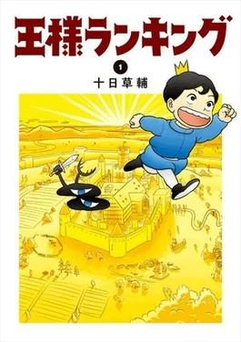

维基共享资源上的海报或标题图（Ranking of Kings）

波吉是巨人国王的儿子，却又小又聋，国民拿他开玩笑。国王排名看的是骑士、人口和国王本人强不强，没人觉得他能继位。他和影子族幸存的卡克一起找变强的办法。画风像绘本，情节并不软。

**观看**：未找到可打开的正版预告或播放页。

## 间谍过家家（SPY×FAMILY）

- **中文名**：间谍过家家
- **原名**：SPY×FAMILY
- **英文名**：Spy x Family
- **年龄**：13+

**图片**：未找到可下载的海报或标题图。

西国间谍“黄昏”为了接近目标，必须组建家庭、把孩子送进名校。他领养了能读心的阿尼亚，又和其实是杀手的约尔结婚。三个人互相瞒着身份，假家庭慢慢变成真的。背景是冷战式的东西阵营。

**观看**：未找到可打开的正版预告或播放页。

## 排球少年！！（ハイキュー!!）

- **中文名**：排球少年！！
- **原名**：ハイキュー!!
- **英文名**：Haikyu!!
- **年龄**：13+

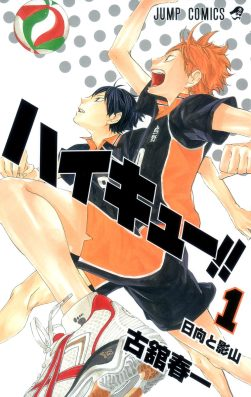

维基共享资源上的海报或标题图（Haikyu!!）

矮个子日向翔阳因为看见“小巨人”打球，死磕排球，高中进入乌野，和初中宿敌影山组队。目标是全国大赛。比赛占满全剧，输球被写成该学的一课，而不是必须把身体练废。

**观看**：未找到可打开的正版预告或播放页。

## 英雄联盟：双城之战（Arcane: League of Legends）

- **中文名**：英雄联盟：双城之战
- **原名**：Arcane: League of Legends
- **英文名**：Arcane
- **年龄**：16+

**图片**：未找到可下载的海报或标题图。

《英雄联盟：双城之战》讲皮尔特沃夫与祖安这对上下城之间的阶级冲突，核心是姐妹蔚与爆爆（后来的金克丝）如何被同一场悲剧拆开。不用玩过游戏也能看，故事把发明、权力和家庭创伤绑在一起。画面是法国Fortiche做的绘画感动画，两季都在Netflix发行。

**观看**：未找到可打开的正版预告或播放页。

## 钢之炼金术师FA（鋼の錬金術師 FULLMETAL ALCHEMIST）

- **中文名**：钢之炼金术师FA
- **原名**：鋼の錬金術師 FULLMETAL ALCHEMIST
- **英文名**：Fullmetal Alchemist: Brotherhood
- **年龄**：13+

**图片**：未找到可下载的海报或标题图。

爱德华和阿尔冯斯为复活母亲触犯人体炼成，一个失去肢体，一个只剩封在盔甲里的灵魂。他们加入军队寻找贤者之石，一路撞上战争、种族迫害和国家谎言。这是荒川弘漫画的第二版电视动画，由Bones制作，按原作路线讲完。

**观看**：未找到可打开的正版预告或播放页。

## 葬送的芙莉莲（葬送のフリーレン）

- **中文名**：葬送的芙莉莲
- **原名**：葬送のフリーレン
- **英文名**：Frieren: Beyond Journey's End
- **年龄**：13+

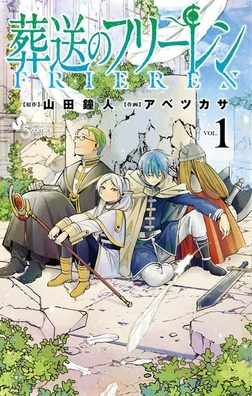

维基共享资源上的海报或标题图（Frieren）

精灵魔法使芙莉莲和同伴打败魔王之后，才发现人类寿命短得她几乎没看清。勇者欣梅尔的葬礼让她后悔没有了解同伴，于是带上新徒弟重新上路。战斗还在，但节奏更像送别和回忆，不是升级打怪。

**观看**：未找到可打开的正版预告或播放页。

## 紫罗兰永恒花园（ヴァイオレット・エヴァーガーデン）

- **中文名**：紫罗兰永恒花园
- **原名**：ヴァイオレット・エヴァーガーデン
- **英文名**：Violet Evergarden
- **年龄**：13+

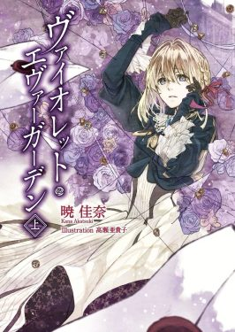

维基共享资源上的海报或标题图（Violet Evergarden）

战争结束后，被当成武器养大的少女薇尔莉特装上义肢，到邮政公司做“自动手记人偶”，替不会写信的人把心情写成文字。她想弄懂长官最后对她说的“我爱你”。每集多半是一封信、一段别人的人生，主线是她自己慢慢长出感情。

**观看**：未找到可打开的正版预告或播放页。

## 灵能百分百（モブサイコ100）

- **中文名**：灵能百分百
- **原名**：モブサイコ100
- **英文名**：Mob Psycho 100
- **年龄**：13+

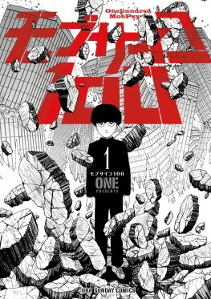

维基共享资源上的海报或标题图（Mob Psycho 100）

中学生影山茂夫外号“龙套”，超能力强到可怕，却一心想过普通生活：锻炼身体、谈恋爱、别伤人。感情冲到100%时力量会失控。他的师父灵幻新隆是个没灵力的骗子，戏很多，也意外地在教他怎么做人。

**观看**：未找到可打开的正版预告或播放页。

## 冥王（PLUTO）

- **中文名**：冥王
- **原名**：PLUTO
- **英文名**：Pluto
- **年龄**：15+

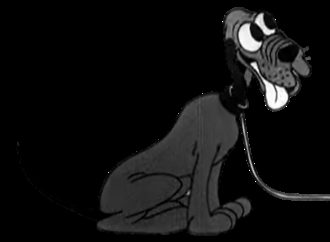

维基共享资源上的海报或标题图（Pluto (Disney)）

在人与机器人共存的战后世界，机器人刑警盖吉特调查一连串谋杀：被害者是机器人权利倡导者，以及世界上最先进的七个机器人。故事改编自手冢治虫《铁臂阿童木》的篇章，由浦泽直树重写成悬疑漫画，再做成Netflix动画。阿童木在里面，但视角不是热血少年英雄。

**观看**：未找到可打开的正版预告或播放页。

## 四月是你的谎言（四月は君の嘘）

- **中文名**：四月是你的谎言
- **原名**：四月は君の嘘
- **英文名**：Your Lie in April
- **年龄**：13+

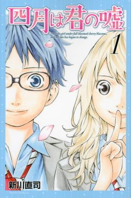

维基共享资源上的海报或标题图（Your Lie in April）

钢琴少年有马公生在母亲病逝后听不见钢琴的声音，直到遇见拉小提琴的宫园薰。音乐比赛、友情和初恋把他从“人体节拍器”里拖出来。中文维基写薰长期住院，手术失败后去世，并留下一封信。

**观看**：未找到可打开的正版预告或播放页。

## 比宇宙更远的地方（宇宙よりも遠い場所）

- **中文名**：比宇宙更远的地方
- **原名**：宇宙よりも遠い場所
- **英文名**：A Place Further Than the Universe
- **年龄**：13+

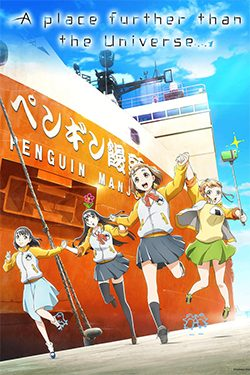

维基共享资源上的海报或标题图（A Place Further than the Universe）

高中生玉木真理不想把青春耗在犹豫里，遇见一直攒钱要去南极的小渊泽报濑。报濑的母亲三年前在南极失踪。加上日向和偶像结月，四个女孩挤进民间观测队，坐船去昭和基地那边的冰原。

**观看**：未找到可打开的正版预告或播放页。

## 3月的狮子（3月のライオン）

- **中文名**：3月的狮子
- **原名**：3月のライオン
- **英文名**：March Comes In like a Lion
- **年龄**：13+

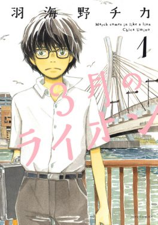

维基共享资源上的海报或标题图（March Comes In like a Lion）

17岁的职业将棋棋士桐山零从小在事故里失去家人，又觉得自己的才能拆散了养父母家，于是一个人住。川本家三姐妹把他拉进饭桌和日常。将棋是职业，也是他躲避和面对自己的方式。

**观看**：未找到可打开的正版预告或播放页。

## 药屋少女的呢喃（薬屋のひとりごと）

- **中文名**：药屋少女的呢喃
- **原名**：薬屋のひとりごと
- **英文名**：The Apothecary Diaries
- **年龄**：14+

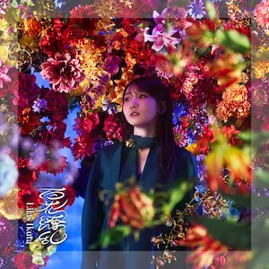

维基共享资源上的海报或标题图（百花缭乱 (几田莉拉歌曲)）

懂药的少女猫猫在红灯区长大，被拐卖进宫当差。她靠知识查出妃嫔和皇子中毒、发病的原因，被宦官壬氏盯上，从洗衣女变成侍女。故事发生在架空的明朝式宫廷，一集一个医案。

**观看**：未找到可打开的正版预告或播放页。

## 中国奇谭

- **中文名**：中国奇谭
- **原名**：中国奇谭
- **英文名**：Yao-Chinese Folktales
- **年龄**：12+

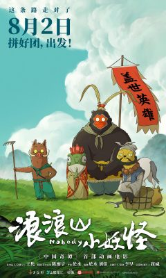

维基共享资源上的海报或标题图（Nobody (2025 film)）

上海美术电影制片厂和哔哩哔哩做的八个独立短片，从西游底层小妖、志怪狐狸，到狼、乡村巴士和太空玉兔。总导演陈廖宇，每集换导演和画风。它接的是美影厂美术片传统，但故事是给现在的观众写的。

**观看**：未找到可打开的正版预告或播放页。

## 时光代理人

- **中文名**：时光代理人
- **原名**：时光代理人
- **英文名**：Link Click
- **年龄**：13+

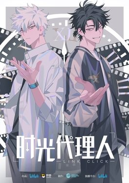

维基共享资源上的海报或标题图（Link Click）

程小时能进入照片，附身在拍摄者身上；陆光能看见拍照之后12小时里会发生什么。两人在时光照相馆接委托，改过去的一个动作，常常把现在搞得更糟。第一季像单元委托，后面几季把父母失踪和连环死亡收成悬疑。

**观看**：未找到可打开的正版预告或播放页。
