> 这是更早一次按年龄整理的网络研究卡片，和微信文章片单分开。微信片单在 [docs/wechat/](../wechat/catalog.md)。

# 3–5 岁

研究片单和微信摘录合在一起，每部一张卡片。观看链接只保留在这个环境里打开成功的官方网站或 YouTube 页面。没有写成链接的，是没有找到。

22 部。

## 莎拉与乖乖鸭（Sarah & Duck）

- **中文名**：莎拉与乖乖鸭
- **原名**：Sarah & Duck
- **年龄**：3+

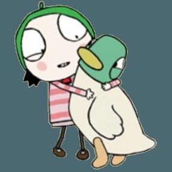

维基共享资源上的海报或标题图（Sarah & Duck）

《莎拉与乖乖鸭》由Karrot Entertainment为CBeebies制作，2013年开播。BBC的委托稿说它跟随一个七岁女孩和她的鸭子朋友；Common Sense Media补充旁白是罗杰·阿拉姆，莎拉由塔莎·劳伦斯配音。第三季为40×7的规格，累计120集。中文名《莎拉与乖乖鸭》出现在《小猪佩奇》中文维基条目对Karrot的说明里。

**观看**：[https://www.youtube.com/channel/UC3OUMU3s7Oy6Ta0wnpZFBWw](https://www.youtube.com/channel/UC3OUMU3s7Oy6Ta0wnpZFBWw)

维基数据登记的 YouTube 频道

## 嗨 道奇（Hey Duggee）

- **中文名**：嗨 道奇
- **原名**：Hey Duggee
- **年龄**：3+

维基共享资源上的海报或标题图（List of Hey Duggee episodes）

《嗨 道奇》由格兰特·奥查德创作，Studio AKA与CBeebies、BBC Studios制作，2014年开播，每集约7分钟。一只棕色大狗道奇主持松鼠俱乐部，五个小动物完成一项活动就得到一枚徽章。中文维基百科的条目标题是“嗨 道奇”（没有感叹号），并写明面向2至5岁；同一页也把俱乐部叫作阿奇幼幼园。

**观看**：未找到可打开的正版预告或播放页。

## 布鲁伊（Bluey）

- **中文名**：布鲁伊
- **原名**：Bluey
- **年龄**：4+

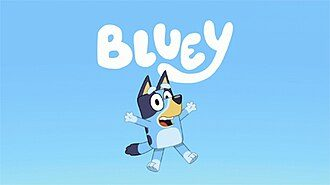

维基共享资源上的海报或标题图（Bluey (TV series)）

《布鲁伊》是澳大利亚Ludo Studio为ABC制作的学前动画，2018年10月1日在ABC KIDS首播。主角是一只六岁的蓝色澳大利亚牧牛犬，和四岁的妹妹宾果以及父母班底特、奇莉生活在以布里斯班为蓝本的社区里。每集约7分钟，她把超市、等待、家务这类日常变成游戏。

**观看**：[https://www.bluey.tv/](https://www.bluey.tv/)

维基数据登记的官方网站

## 小猪佩奇（Peppa Pig）

- **中文名**：小猪佩奇
- **原名**：Peppa Pig
- **年龄**：3+

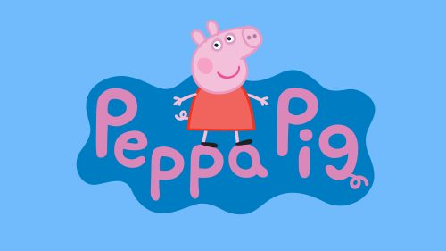

维基共享资源上的海报或标题图（Peppa Pig）

《小猪佩奇》由内维尔·阿斯特利和马克·贝克创作，2004年5月31日在英国第五台开播，单集约5分钟。故事是一只拟人小猪和弟弟乔治、父母以及一群动物朋友的日常：游戏小组、骑车、看望亲戚。中文维基百科记录中国大陆译名为《小猪佩奇》，2015年6月23日在央视少儿频道首播。

**观看**：[https://www.youtube.com/channel/UCAOtE1V7Ots4DjM8JLlrYgg](https://www.youtube.com/channel/UCAOtE1V7Ots4DjM8JLlrYgg)

维基数据登记的 YouTube 频道

## Daniel Tiger's Neighborhood

- **原名**：Daniel Tiger's Neighborhood
- **年龄**：3+

维基共享资源上的海报或标题图（Daniel Tiger's Neighborhood）

《丹尼尔老虎邻居》由弗雷德·罗杰斯制作公司出品，安吉拉·桑托梅罗参与创作，2012年9月3日在PBS Kids首播。四岁的老虎丹尼尔住在“假装邻里”里，每一整集约30分钟，里面是两个11分钟故事，中间插匹兹堡实拍的小朋友片段。故事用歌曲把失望、等待、友谊说成可以跟着唱的办法。

**观看**：[https://pbskids.org/daniel](https://pbskids.org/daniel)

维基数据登记的官方网站

## 芝麻街（Sesame Street）

- **中文名**：芝麻街
- **原名**：Sesame Street
- **年龄**：2+

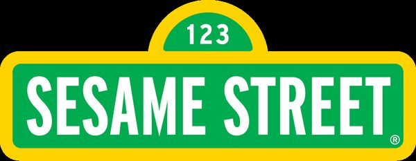

维基共享资源上的海报或标题图（芝麻街）

《芝麻街》1969年11月10日在美国PBS首播，由琼·甘兹·库尼和劳埃德·莫里塞特创办，芝麻街工作室（早年儿童电视工作室）制作。它不是纯动画：街景是真人演员和吉姆·亨森的布偶同台，中间插入动画、歌曲和短片。课程从字母、数字扩展到科学、健康和情绪。

**观看**：[https://www.youtube.com/channel/UCoookXUzPciGrEZEXmh4Jjg](https://www.youtube.com/channel/UCoookXUzPciGrEZEXmh4Jjg)

维基数据登记的 YouTube 频道

## 数字积木（Numberblocks）

- **中文名**：数字积木
- **原名**：Numberblocks
- **年龄**：2+
- **内容类型**：学习类

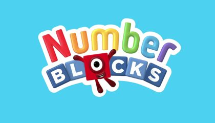

维基共享资源上的海报或标题图（Numberblocks）

《数字积木》2017年1月23日在CBeebies首播，乔·埃利奥特与Blue Zoo创作，每集5分钟。每个数字是由相应数量的方块拼成的角色，一块叠到另一块上就会变成新的数字。百度百科的中文名是《数字积木》，并把它写成《字母积木》的姊妹篇。

**观看**：[https://www.bbc.co.uk/cbeebies/shows/numberblocks](https://www.bbc.co.uk/cbeebies/shows/numberblocks)

BBC CBeebies 节目页。

## 字母积木（Alphablocks）

- **中文名**：字母积木
- **原名**：Alphablocks
- **年龄**：2+

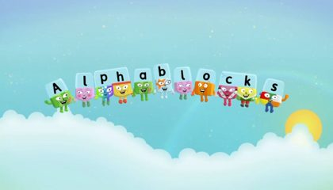

维基共享资源上的海报或标题图（Alphablocks）

《字母积木》由乔·埃利奥特创作，2010年1月25日在CBeebies播出第一集，BBC iPlayer显示该集时长2:59。26个字母是方块角色，牵手就能拼出单词；“e”会伪装来表示不发音，“q”总拖着“u”。中文名《字母积木》见于百度百科《数字积木》条目，该条目称二者出自同一团队。

**观看**：[https://www.bbc.co.uk/cbeebies/shows/alphablocks](https://www.bbc.co.uk/cbeebies/shows/alphablocks)

维基数据登记的官方网站

## Puffin Rock

- **原名**：Puffin Rock
- **年龄**：3+

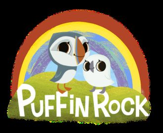

维基共享资源上的海报或标题图（Puffin Rock）

《Puffin Rock》由爱尔兰Cartoon Saloon、北爱尔兰Dog Ears和Penguin Books联合制作，2015年1月在RTÉjr首播，每集7分钟，面向2–5岁。小海鹦乌娜和弟弟巴巴在海岛上认识海豹、猫头鹰和倭鼩，克里斯·奥多德旁白。Common Sense Media称它出自《凯尔经的秘密》《海洋之歌》同一团队。

**观看**：[https://www.youtube.com/channel/UCpF_pjPj0wujDwbeN6NP6yQ](https://www.youtube.com/channel/UCpF_pjPj0wujDwbeN6NP6yQ)

维基数据登记的 YouTube 频道

## 海底小纵队（Octonauts）

- **中文名**：海底小纵队
- **原名**：Octonauts
- **年龄**：4+

维基共享资源上的海报或标题图（Octonauts）

《海底小纵队》改编自加拿大Meomi的图画书，中文维基百科记载2010年10月4日在CBeebies首播，主体是65集×11分钟。八个拟人动物住在章鱼堡里，去帮助遇到麻烦的海洋生物。中国大陆译名是《海底小纵队》，台湾迪士尼频道译名在该页写作“海洋小英雄”。

**观看**：未找到可打开的正版预告或播放页。

## 小医师大玩偶（Doc McStuffins）

- **中文名**：小医师大玩偶
- **原名**：Doc McStuffins
- **年龄**：4+

维基共享资源上的海报或标题图（Doc McStuffins）

《小医师大玩偶》由克里斯·尼创作、Brown Bag Films制作，2012年在Disney Junior开播。Common Sense Media说六岁的Doc在后院诊所里给玩具缝线、换电池，妈妈是给人看病的医生，爸爸在家照顾孩子。中文维基页标题是繁体“小醫師大玩偶”，这里写成对应的简体。

**观看**：[http://disneyjunior.com/doc-mcstuffins](http://disneyjunior.com/doc-mcstuffins)

维基数据登记的官方网站

## 好奇的乔治（Curious George）

- **中文名**：好奇的乔治
- **原名**：Curious George
- **年龄**：3+

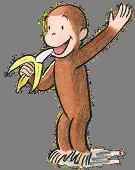

维基共享资源上的海报或标题图（Curious George）

《好奇的乔治》是根据H.A.雷伊与玛格丽特·雷伊的图画书改编的PBS Kids电视剧，2006年9月4日首播，不是同年的电影。乔治和戴黄帽子的人每天碰到一个具体问题，例如钟怎么走、船为什么浮着。中文维基简体页标题为《好奇的乔治》。前九季每个动画段落后还有儿童实拍的科学小实验。

**观看**：未找到可打开的正版预告或播放页。

## Ben & Holly's Little Kingdom

- **原名**：Ben & Holly's Little Kingdom
- **年龄**：3+

维基共享资源上的海报或标题图（Ben & Holly's Little Kingdom）

《Ben & Holly's Little Kingdom》由《小猪佩奇》的Astley Baker Davies在伦敦制作，Animation World Network报道2009年4月6日起在英国Nick Jr.首播。小仙女霍莉的魔法经常出错，小精灵本负责动手修好，瓢虫加斯顿跟着他们。Common Sense Media把画面比作图画书里的微型世界。

**观看**：未找到可打开的正版预告或播放页。

## Peg + Cat

- **原名**：Peg + Cat
- **年龄**：3+

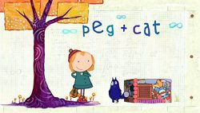

维基共享资源上的海报或标题图（Peg + Cat）

《Peg + Cat》2013年10月7日在PBS Kids首播。PBS家长页写明它面向3–5岁，每集12分钟：佩格和猫要解决一个“真正的大问题”，过程里会数数、测量、找形状和规律。Common Sense Media说它源自詹妮弗·奥克斯利和比尔·阿伦森的书《The Chicken Problem》，女孩用数学当工具。

**观看**：[http://pbskids.org/peg/](http://pbskids.org/peg/)

维基数据登记的官方网站

## Elinor Wonders Why

- **原名**：Elinor Wonders Why
- **年龄**：5+

维基共享资源上的海报或标题图（Elinor Wonders Why）

《Elinor Wonders Why》2020年9月7日在PBS Kids首播。小兔子艾莉诺和朋友奥利芙、阿里对看不懂的自然现象发问，社区里的大人带他们去看、去试。Common Sense Media把它同时称为学前节目，并把推荐年龄写成5+。

**观看**：[https://pbskids.org/elinor](https://pbskids.org/elinor)

维基数据登记的官方网站

## Tumble Leaf

- **原名**：Tumble Leaf
- **年龄**：4+

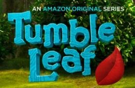

维基共享资源上的海报或标题图（Tumble Leaf）

《Tumble Leaf》在Common Sense Media页面上的首播日是2014年6月3日，平台为Prime Video。狐狸菲格在“发现之地”捡到一件东西，就和朋友去试影子、飞行、运动或放大这些概念。评论明确写出定格动画，船屋和森林是手作场景。

**观看**：未找到可打开的正版预告或播放页。

## Stillwater

- **原名**：Stillwater
- **年龄**：5+

维基共享资源上的海报或标题图（Stillwater, Oklahoma）

《Stillwater》2020年12月4日在Apple TV首播，改编自乔恩·J·穆特的绘本《Zen Shorts》。三个孩子遇到失望或难过时，去找邻居熊猫Stillwater，他用一个小故事把情绪讲慢。熊猫由华裔与意大利裔演员詹姆斯·谢配音。

**观看**：未找到可打开的正版预告或播放页。

## 月神

- **中文名**：月神
- **原名**：月神
- **年龄**：4岁以上
- **内容类型**：情感品格类

微信文章里的配图。不是单独核对过的官方海报。

文章写豆瓣9.0、适合4岁以上，是皮克斯约7分钟短片。男孩第一次跟爷爷和爸爸到月亮上清扫星辰。爷爷要用耙子，爸爸坚持用扫帚，男孩自己观察，敲开星辰。文章没有写英文名。

**观看**：未找到可打开的正版预告或播放页。

## 螺丝钉

- **中文名**：螺丝钉
- **原名**：螺丝钉
- **年龄**：3-6岁
- **内容类型**：学习类

微信文章里的配图。不是单独核对过的官方海报。

文章写豆瓣9.4、适合3–6岁，称它是俄罗斯动画：家电里住着修理小精灵，用故事讲冰箱为什么制冷、遥控器如何发信号、洗衣机怎样洗净衣服。文章没有英文名。

**观看**：未找到可打开的正版预告或播放页。

## 洞穴

- **中文名**：洞穴
- **原名**：洞穴
- **年龄**：4岁以上
- **内容类型**：情感品格类

微信文章里的配图。不是单独核对过的官方海报。

文章写豆瓣8.8、适合4岁以上，是皮克斯短片。怕社交的小兔子往地下挖洞，挖穿了鼹鼠、老鼠和蚂蚁的家，最后遇到麻烦才向邻居求助，大家一起把洞穴重建好。文章没有英文名。

**观看**：未找到可打开的正版预告或播放页。

## 中国唱诗班

- **中文名**：中国唱诗班
- **原名**：中国唱诗班
- **年龄**：4岁以上
- **内容类型**：人文类

微信文章里的配图。不是单独核对过的官方海报。

文章写豆瓣9.1、适合4岁以上，全系列6集，单集5至15分钟，用动画讲古诗背后的事：《元日》《相思》《游子吟》。文章没有给播放链接。

**观看**：未找到可打开的正版预告或播放页。

## 企鹅群里有特务（Penguins: Spy in the Huddle）

- **中文名**：企鹅群里有特务
- **原名**：Penguins: Spy in the Huddle
- **年龄**：3-6岁
- **内容类型**：自然类

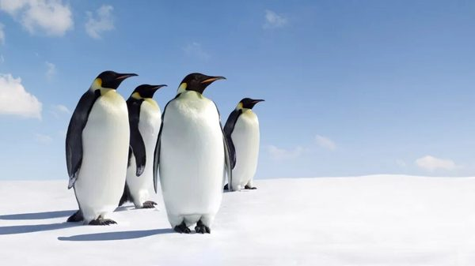

微信文章里的配图。不是单独核对过的官方海报。

文章写语言是汉语普通话，适合3–6岁。BBC 摄影队用近一年跟踪洪堡企鹅、跳岩企鹅和帝企鹅。三集标题被写成《漫漫长路》《蹒跚学步》《成长的烦恼》。BBC 纪录片页写2013年、3集，导演 John Downer。36部清单里也有这个名字。

**观看**：[https://www.bbc.com/video/docs/series/10167741](https://www.bbc.com/video/docs/series/10167741)

BBC 纪录片系列页，列出3集。能否播放取决于地区。
