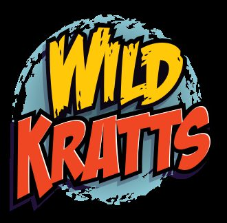
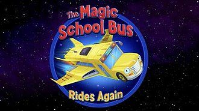
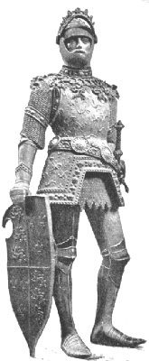
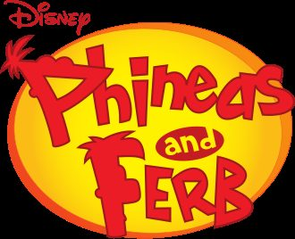
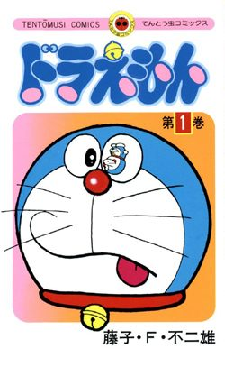
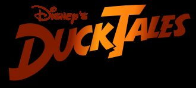
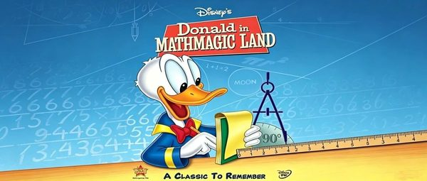
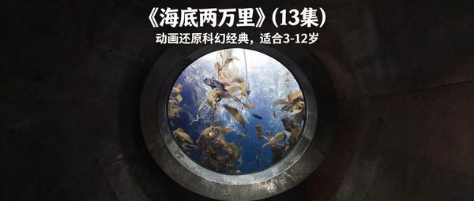
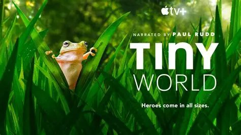

> 这是更早一次按年龄整理的网络研究卡片，和微信文章片单分开。微信片单在 [docs/wechat/](../wechat/catalog.md)。

# 6–8 岁

研究片单和微信摘录合在一起，每部一张卡片。观看链接只保留在这个环境里打开成功的官方网站或 YouTube 页面。没有写成链接的，是没有找到。

25 部。

## 小羊肖恩（Shaun the Sheep）

- **中文名**：小羊肖恩
- **原名**：Shaun the Sheep
- **年龄**：5+

维基共享资源上的海报或标题图（Shaun the Sheep）

黑脸羊肖恩在农夫转身之后带领羊群捣蛋，牧羊犬Bitzer负责在主人发现前把场面收拾回去。Common Sense Media写到，它们会用卷心菜当球踢，也会把农夫的房子弄乱，但结尾会把事情改回来。羊直立走路、狗戴手表，明确不是现实农场。

**观看**：未找到可打开的正版预告或播放页。

## 希尔达（Hilda）

- **中文名**：希尔达
- **原名**：Hilda
- **年龄**：6+

维基共享资源上的海报或标题图（Hilda Furacão）

蓝发女孩希尔达原本住在精灵、巨人和巨魔出没的荒野，后与妈妈搬到特罗尔堡。她把陌生人与非人生物当成可以讲和的邻居，而不是要打败的怪物。豆瓣简介写到，她会碰到“奇怪甚至危险”的神秘生物，宠物是小鹿狐枝枝。

**观看**：[https://www.youtube.com/watch?v=xRR2G8t3KDU](https://www.youtube.com/watch?v=xRR2G8t3KDU)

维基数据登记的 YouTube 视频

## Wild Kratts

- **原名**：Wild Kratts
- **年龄**：6+

维基共享资源上的海报或标题图（Wild Kratts）

Chris和Martin兄弟开着海龟形飞行器，和工程师Aviva、Koki、Jimmy Z一起寻找真实动物，再用动物的适应能力解决当集危机。每集围绕一种动物的行为、栖息地或生存威胁，并插入真人在野外看到的画面。

**观看**：[http://pbskids.org/wildkratts/](http://pbskids.org/wildkratts/)

维基数据登记的官方网站

## 神奇校巴（The Magic School Bus）

- **中文名**：神奇校巴
- **原名**：The Magic School Bus
- **年龄**：5+

维基共享资源上的海报或标题图（The Magic School Bus Rides Again）

弗瑞兹老师让校车变成任意大小和形状，带学生进入太空、海底或人体。Common Sense Media写，从恐龙到蜂巢，节目沿用原书的“先提问、再进去看”结构。豆瓣英文简介同样写Ms. Frizzle用魔法校车把课堂讨论变成实地旅行。

**观看**：未找到可打开的正版预告或播放页。

## Arthur

- **原名**：Arthur
- **年龄**：5+

维基共享资源上的海报或标题图（Arthur）

8岁的亚瑟是一只土豚，朋友们是其他动物，行为却完全像小学生。故事从孩子的视角讲学校、兄弟姐妹和朋友分歧，不先抛出道德结论。Common Sense Media举过一例：Brain怕水，朋友们误以为他架子大，最后承认害怕是可以的。

**观看**：[https://pbskids.org/arthur/](https://pbskids.org/arthur/)

维基数据登记的官方网站

## 飞哥与小佛（Phineas and Ferb）

- **中文名**：飞哥与小佛
- **原名**：Phineas and Ferb
- **年龄**：5+

维基共享资源上的海报或标题图（Phineas and Ferb）

继兄弟飞哥和安静的小佛在暑假每天做一件过大的工程，姐姐Candace总想向父母告发。宠物鸭嘴兽Perry同时是特工，对手是Dr. Doofenshmirtz。发明在大人回家前消失，所以父母一直不知道。

**观看**：[http://disneychannel.disney.com/phineas-and-ferb](http://disneychannel.disney.com/phineas-and-ferb)

维基数据登记的官方网站

## 小溪仔克雷格（Craig of the Creek）

- **中文名**：小溪仔克雷格
- **原名**：Craig of the Creek
- **年龄**：6+

维基共享资源上的海报或标题图（Noël Wells）

克雷格和朋友Kelsey、J.P.把家附近的小溪当成只按孩子规则运转的旷野。克雷格是家里常被忽略的中间孩子，小溪让他可以认真，也可以胡闹。Common Sense Media强调想象游戏、忠诚，以及一个失聪角色教克雷格美国手语。

**观看**：未找到可打开的正版预告或播放页。

## 咱们裸熊（We Bare Bears）

- **中文名**：咱们裸熊
- **原名**：We Bare Bears
- **年龄**：8+

维基共享资源上的海报或标题图（We Bare Bears）

灰熊、熊猫和北极熊三兄弟住在旧金山一带，学人类自拍、做视频、开餐车，却总是学不像。人类朋友Chloe会帮他们。笑点来自他们把自己的差异带进人群，再发现兄弟一起比单独模仿别人更站得住。

**观看**：未找到可打开的正版预告或播放页。

## 哆啦A梦（ドラえもん）

- **中文名**：哆啦A梦
- **原名**：ドラえもん
- **英文名**：Doraemon
- **年龄**：7+

维基共享资源上的海报或标题图（Doraemon）

来自22世纪的机器人猫回到野比大雄身边，用四维口袋里的道具应付作业、懒惰和邻居欺负。道具一到大雄手里通常会失控，哆啦A梦再把局面收回来。豆瓣简介里的配角译名是静儿、强夫和技安；CSM英语版用Noby、Big G。

**观看**：[https://www.youtube.com/channel/UChX6YTx96D5yEW7EUD7KdZQ](https://www.youtube.com/channel/UChX6YTx96D5yEW7EUD7KdZQ)

维基数据登记的 YouTube 频道

## 新唐老鸭俱乐部（DuckTales）

- **中文名**：新唐老鸭俱乐部
- **原名**：DuckTales
- **年龄**：6+

维基共享资源上的海报或标题图（DuckTales (1987 TV series)）

唐老鸭把辉儿、杜儿、路儿交给叔叔史高治。三兄弟和温比跟着史高治、Launchpad去找失落的城市和宝藏，对手包括Flintheart Glomgold。Disney+中文简介用的名字是辉儿、杜儿、路儿、温比和史高治。

**观看**：[https://shows.disney.com/ducktales](https://shows.disney.com/ducktales)

维基数据登记的官方网站

## 大神偷卡门（Carmen Sandiego）

- **中文名**：大神偷卡门
- **原名**：Carmen Sandiego
- **年龄**：7+

维基共享资源上的海报或标题图（Where in the World Is Carmen Sandiego? (game show)）

卡门在小偷训练岛V.I.L.E.长大，发现组织真名是Villains' International League of Evil后出走。她和黑客Player、Zack、Ivy把文物从反派手中拿走，再还给原主。每到一地，情节会用到地形、气候、食物和文化。

**观看**：未找到可打开的正版预告或播放页。

## Cyberchase

- **原名**：Cyberchase
- **年龄**：6+

**图片**：未找到可下载的海报或标题图。

Inez、Jackie、Matt和电子伙伴Digit被Motherboard召进赛博空间，阻止Hacker和他的手下Buzz、Delete接管系统。每一集把读地图、逆运算这类技能放进任务，节奏留出时间让观众自己先想。集末真人短片把同一技能搬回日常生活。

**观看**：未找到可打开的正版预告或播放页。

## Hero Elementary

- **原名**：Hero Elementary
- **年龄**：5+

维基共享资源上的海报或标题图（Hero Elementary）

Lucita Sky、Sara Snap、Benny Bubbles和AJ Gadgets在Sparks老师班上练习并不稳定的超能力。能力不够用时，他们改用观察、预测和试验来帮邻居解决问题。AJ是自闭症角色，怕大声时朋友会配合，而不是把这一点当成笑话。

**观看**：未找到可打开的正版预告或播放页。

## City of Ghosts

- **原名**：City of Ghosts
- **年龄**：5+

**图片**：未找到可下载的海报或标题图。

Zelda和Ghost Club的孩子在洛杉矶公共图书馆集合，帮社区处理闹鬼，方法是采访鬼魂。鬼魂讲的是小东京餐馆、Tongva原住民和其他街区的历史。Common Sense Media写，可爱造型后面是真实居民的声音，听起来常常像即兴聊天。

**观看**：未找到可打开的正版预告或播放页。

## 葫芦兄弟

- **中文名**：葫芦兄弟
- **原名**：葫芦兄弟
- **英文名**：Calabash Brothers
- **年龄**：7+

**图片**：未找到可下载的海报或标题图。

穿山甲打穿葫芦山，放走蛇精和蝎子精。老翁种出七色葫芦，七个兄弟依次去救被抓走的爷爷。豆瓣的简介只写到大娃独自闯蛇洞；百度百科的全剧包括各兄弟被骗、被抓，最后用七色莲子从炼丹炉里出来，把妖精压在山下。

**观看**：未找到可打开的正版预告或播放页。

## 罗小黑战记

- **中文名**：罗小黑战记
- **原名**：罗小黑战记
- **英文名**：The Legend of Luo Xiaohei
- **年龄**：6+

**图片**：未找到可下载的海报或标题图。

雨夜，少女罗小白把流浪小黑猫带回家，取名罗小黑。它会像人一样生活，尾巴能分成叫“嘿咻”的小生物。谛听派会变成鸟的狼寻找它。罗小白带小黑去乡下看堂哥和爷爷之后，故事进入妖精与人类共处的事件。

**观看**：未找到可打开的正版预告或播放页。

## 樱桃小丸子（ちびまる子ちゃん）

- **中文名**：樱桃小丸子
- **原名**：ちびまる子ちゃん
- **英文名**：Chibi Maruko-chan
- **年龄**：6+

**图片**：未找到可下载的海报或标题图。

小丸子上小学二年级，活泼、爱幻想，也懒，作业拖到最后，成绩普通，常和姐姐斗气。周围有神经质的班长丸尾、爱管事的副班长、一起胡闹的爷爷和讨人厌的宾治。豆瓣简介把这些写成每天发生的生活趣事。

**观看**：未找到可打开的正版预告或播放页。

## 黑猫警长

- **中文名**：黑猫警长
- **原名**：黑猫警长
- **英文名**：Black Cat Detective
- **年龄**：8+

**图片**：未找到可下载的海报或标题图。

黑猫警长带领警士侦破危害森林的案件。豆瓣按集概括：《痛歼搬仓鼠》用现代化武器歼灭夜袭粮仓的老鼠；《空中擒敌》用直升机逼怪兽现形；《吃红土的小偷》处罚偷吃红土的大象、河马和野猪；《吃丈夫的螳螂》处理螳螂“吃丈夫”的冤屈；《一网打尽》戴防毒面具对付吃猫鼠和一只耳。

**观看**：未找到可打开的正版预告或播放页。

## 万物运转的秘密（The Way Things Work）

- **中文名**：万物运转的秘密
- **原名**：The Way Things Work
- **年龄**：6岁以上
- **内容类型**：学习类

微信文章里的配图。不是单独核对过的官方海报。

文章说这部片根据大卫·麦考利的同名书改编，26集，每集约13分钟。故事发生在猛犸象小岛：挤奶时讲滑轮，打捞沉船铁轨时讲电磁铁。文章写它适合6岁以上，没有中文配音，是英文原声加中英文字幕。另一篇同样推荐了这部，并补充科学家旁白、每集13分钟。

**观看**：未找到可打开的正版预告或播放页。

## 唐老鸭漫游数学奇境（Donald in Mathmagic Land）

- **中文名**：唐老鸭漫游数学奇境
- **原名**：Donald in Mathmagic Land
- **年龄**：5-10岁
- **内容类型**：学习类

微信文章里的配图。不是单独核对过的官方海报。

文章写这是1集、约27分钟的迪士尼动画，中文和英文都有，适合5–10岁。它不把计算题搬进动画，而是讲数学有什么用、数学的美在哪里。迪士尼电影页写首映日期为1959年6月26日。

**观看**：[https://movies.disney.com/donald-in-mathmagic-land](https://movies.disney.com/donald-in-mathmagic-land)

迪士尼电影官方介绍页，页面标注有 DVD，不代表在线可播。

## 海底两万里

- **中文名**：海底两万里
- **原名**：海底两万里
- **年龄**：3-12岁
- **内容类型**：人文类

微信文章里的配图。不是单独核对过的官方海报。

文章推荐的是动画版，写明10集、每集10–15分钟，适合3–12岁。故事按原著：1866年海怪传闻引出追捕，阿龙纳斯、康塞尔和尼德兰落水后登上尼摩船长的潜艇，开始深海旅行。文章没有给出这一版动画的制作公司，也没有播放链接。

**观看**：未找到可打开的正版预告或播放页。

## 雨果带你看世界

- **中文名**：雨果带你看世界
- **原名**：雨果带你看世界
- **年龄**：3-8岁
- **内容类型**：益智动画类

微信文章里的配图。不是单独核对过的官方海报。

文章把它放在思维启蒙，写豆瓣9.2、适合3–8岁、BBC 出品、单集约5分钟。它问什么是朋友、什么是公平、害怕是什么、什么才算大，雨果不给标准答案。文章没有英文名。

**观看**：未找到可打开的正版预告或播放页。

## 失物招领

- **中文名**：失物招领
- **原名**：失物招领
- **年龄**：5岁以上
- **内容类型**：情感品格类

微信文章里的配图。不是单独核对过的官方海报。

文章写豆瓣8.4、适合5岁以上。失物招领箱里的小精灵发现爱欺负人的男孩 JJ 自己的东西也曾被抢走，于是帮他把抢走的东西还回去，并找回毛绒玩具。文章没有英文名。

**观看**：未找到可打开的正版预告或播放页。

## 三十六个字

- **中文名**：三十六个字
- **原名**：三十六个字
- **年龄**：5岁以上
- **内容类型**：人文类

微信文章里的配图。不是单独核对过的官方海报。

文章写豆瓣8.7、适合5岁以上，上海美术电影制片厂短片。父亲用36个象形字串成故事，日、月、山、水、木、林从字变成画面。文章写它得过萨格勒布国际动画电影节教育片奖。

**观看**：未找到可打开的正版预告或播放页。

## 小小世界（Tiny World）

- **中文名**：小小世界
- **原名**：Tiny World
- **年龄**：4-8岁
- **内容类型**：自然类

微信文章里的配图。不是单独核对过的官方海报。

文章写语言是英语，适合4–8岁，并写它在 Apple TV。用很小的动物走一段“英雄旅程”。列出的章节是草原、丛林、岛屿、内陆、林地。

**观看**：未找到可打开的正版预告或播放页。
