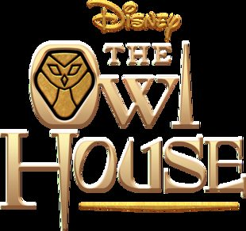
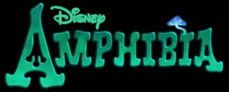
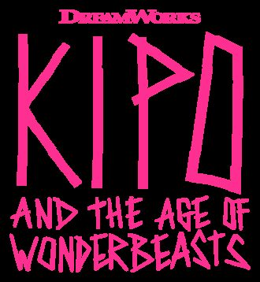
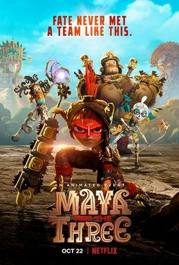
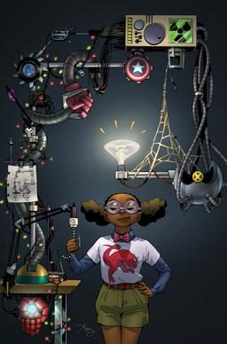
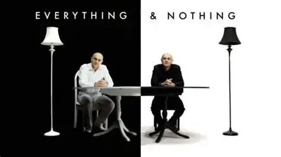

> 这是更早一次按年龄整理的网络研究卡片，和微信文章片单分开。微信片单在 [docs/wechat/](../wechat/catalog.md)。

# 9–12 岁

研究片单和微信摘录合在一起，每部一张卡片。观看链接只保留在这个环境里打开成功的官方网站或 YouTube 页面。没有写成链接的，是没有找到。

15 部。

## 降世神通：最后的气宗（Avatar: The Last Airbender）

- **中文名**：降世神通：最后的气宗
- **原名**：Avatar: The Last Airbender
- **年龄**：8+

**图片**：未找到可下载的海报或标题图。

尼克儿童频道2005年2月21日开播的美国奇幻动画，由迈克尔·但丁·迪马蒂诺与布赖恩·科尼祖克创作，至2008年7月19日完结，共三季61集，每集约23分钟。故事里一部分人能以武术式的“御术”操纵水、土、火、气；神通安与同伴要在百年战争中恢复平衡。中文维基百科条目名为《降世神通：最后的气宗》，正文亦用简称《降世神通》。

**观看**：未找到可打开的正版预告或播放页。

## 怪诞小镇（Gravity Falls）

- **中文名**：怪诞小镇
- **原名**：Gravity Falls
- **年龄**：8+

**图片**：未找到可下载的海报或标题图。

迪士尼频道2012年6月15日首播的美国悬疑喜剧动画，主创亚历克斯·赫希。双胞胎迪普与梅宝到俄勒冈州怪诞小镇，住在经营“神秘小屋”的叔公斯坦家，并顺着一本日志追查超自然现象。中文维基百科条目名为《怪诞小镇》，并注明中国大陆官方译名是《神秘小镇大冒险》，乐视网译名是《怪诞小镇》；全剧两季40集，2016年2月15日完结。

**观看**：未找到可打开的正版预告或播放页。

## 宇宙小子（Steven Universe）

- **中文名**：宇宙小子
- **原名**：Steven Universe
- **年龄**：8+

**图片**：未找到可下载的海报或标题图。

卡通频道2013年11月4日首播的美国动画，主创丽贝卡·休格，中文维基百科大陆译名《宇宙小子》。史蒂文继承已故母亲的宝石，与石榴石、紫水晶、珍珠一起守护地球。中文维基百科记全剧五季160集，每集约11分钟，播至2019年1月21日。

**观看**：未找到可打开的正版预告或播放页。

## 探险活宝（Adventure Time）

- **中文名**：探险活宝
- **原名**：Adventure Time
- **年龄**：10+

**图片**：未找到可下载的海报或标题图。

卡通频道2010年4月5日正式首播的美国动画，主创彭德尔顿·沃德，中文维基百科译名《探险活宝》。男孩芬恩与会说话的狗杰克在哇赛秘境冒险，朋友包括泡泡糖公主和吸血鬼女王玛瑟琳。中文维基百科记普通集约11分钟，全剧播至2018年9月3日。

**观看**：未找到可打开的正版预告或播放页。

## 花园墙外（Over the Garden Wall）

- **中文名**：花园墙外
- **原名**：Over the Garden Wall
- **年龄**：8+

**图片**：未找到可下载的海报或标题图。

卡通频道2014年11月3日播出的10集美国动画迷你剧。哥哥沃特与弟弟格雷格在名为“未知”的森林里找路回家，一只野兽尾随他们，同行的还有蓝鸟比阿特丽斯。电视艺术与科学学院把帕特里克·麦克黑尔署为执行制片人/故事。

**观看**：未找到可打开的正版预告或播放页。

## 猫头鹰魔法社（The Owl House）

- **中文名**：猫头鹰魔法社
- **原名**：The Owl House
- **年龄**：8+

维基共享资源上的海报或标题图（The Owl House）

迪士尼频道2020年1月10日首播的美国奇幻动画，主创达娜·特拉斯。少女卢兹没有去“现实检查营”，而是留在沸腾群岛，向女巫伊达学魔法，同伴还有小恶魔金。Common Sense Media称卢兹是迪士尼第一位双性恋主角，剧中也有第一个同性吻。

**观看**：未找到可打开的正版预告或播放页。

## 奇幻沼泽（Amphibia）

- **中文名**：奇幻沼泽
- **原名**：Amphibia
- **年龄**：8+

维基共享资源上的海报或标题图（Amphibia (TV series)）

迪士尼频道2019年6月17日首播的美国冒险动画。泰裔美国女孩安妮·本乔伊被音乐盒送到满是会说话的青蛙和巨型昆虫的世界，与青蛙斯普里格成为朋友，一边找回家的路，一边重学什么是友谊。安妮由布兰达·宋配音。

**观看**：未找到可打开的正版预告或播放页。

## Kipo and the Age of Wonderbeasts

- **原名**：Kipo and the Age of Wonderbeasts
- **年龄**：8+

维基共享资源上的海报或标题图（Kipo and the Age of Wonderbeasts）

Netflix 2020年1月14日上线的美国动画。少女基波从地下聚落来到变异动物统治的地表，与表面生存者沃尔夫、男孩本森、反复生死的虫子戴夫和变异猪曼杜结伴找路回家。基波由韩裔美国演员福原凯伦配音。

**观看**：未找到可打开的正版预告或播放页。

## She-Ra and the Princesses of Power

- **原名**：She-Ra and the Princesses of Power
- **年龄**：8+

**图片**：未找到可下载的海报或标题图。

Netflix 2018年11月13日上线的美国动画，是1980年代《希瑞》的重启，主创内特·史蒂文森。阿多拉在魔剑前发现自己是希瑞，离开邪教式的部落，与格莉玛、弓一起为埃塞莉亚而战，对手包括曾经的朋友凯特拉。

**观看**：未找到可打开的正版预告或播放页。

## The Dragon Prince

- **原名**：The Dragon Prince
- **年龄**：10+

**图片**：未找到可下载的海报或标题图。

Netflix 2018年9月14日上线的史诗奇幻动画，主创亚伦·埃哈兹，他曾参与《降世神通》。人类用黑暗魔法杀死龙王、毁掉龙蛋之后，王子卡勒姆、艾兹兰与精灵蕾拉一起试图阻止人类王国与扎迪亚的战争。

**观看**：[https://www.youtube.com/channel/UCPn8cnHhLHMQrGCmS0K5aBQ](https://www.youtube.com/channel/UCPn8cnHhLHMQrGCmS0K5aBQ)

维基数据登记的 YouTube 频道

## 玛雅与三勇士（Maya and the Three）

- **中文名**：玛雅与三勇士
- **原名**：Maya and the Three
- **年龄**：9+

维基共享资源上的海报或标题图（Maya and the Three）

Netflix 2021年10月22日上线的迷你剧，豪尔赫·R·古铁雷斯创作，佐伊·索尔达娜配音玛雅。特卡王国的少年公主在加冕之夜得知冥界的条件：若她不去冥界，神与人的战争就会爆发。她出发寻找预言中的三名战士。

**观看**：未找到可打开的正版预告或播放页。

## Infinity Train

- **原名**：Infinity Train
- **年龄**：10+

**图片**：未找到可下载的海报或标题图。

卡通频道2019年8月5日首播的美国动画。父母离婚后，少女图莉普误上了一列每一节车厢都是一个世界的火车，与球状机器人One-One一起找下车的办法。Common Sense Media的儿童评论汇总称全剧有四个不同故事，黑暗程度并不一样。

**观看**：[https://www.youtube.com/channel/UCJKEXnDmzARVxlt_OK4RLJA](https://www.youtube.com/channel/UCJKEXnDmzARVxlt_OK4RLJA)

维基数据登记的 YouTube 频道

## Marvel's Moon Girl and Devil Dinosaur

- **原名**：Marvel's Moon Girl and Devil Dinosaur
- **英文名**：Moon Girl and Devil Dinosaur
- **年龄**：8+

维基共享资源上的海报或标题图（Moon Girl And Devil Dinosaur）

迪士尼频道与Disney+ 2023年2月10日开播的美国动画。13岁的卢内拉·拉斐特在纽约下东区用发明变成超级英雄月亮女孩，搭档是从时空裂缝里来的魔鬼恐龙，好友凯西帮她保守身份。劳伦斯·菲什伯恩是制片人并参与配音。

**观看**：未找到可打开的正版预告或播放页。

## 人体奥奇实验室（Operation Ouch!）

- **中文名**：人体奥奇实验室
- **原名**：Operation Ouch!
- **年龄**：6-15岁
- **内容类型**：学习类

微信文章里的配图。不是单独核对过的官方海报。

文章推荐 BBC 的《Operation Ouch!》，中文译名《人体奥奇实验室》，并写一共14季、6到15岁都适合。主持人是双胞胎医生克里斯和克斯。文中举例：克里斯吞下带摄像头的药丸，镜头从嘴进入食道、胃和小肠，孩子因此说胃像搅拌机。这是真人医学节目，不是动画片。

**观看**：[https://www.bbc.co.uk/cbbc/shows/operation-ouch](https://www.bbc.co.uk/cbbc/shows/operation-ouch)

BBC CBBC 官方节目页，页内有短视频。完整季是否可看取决于地区。

## 万物与虚无（Everything and Nothing）

- **中文名**：万物与虚无
- **原名**：Everything and Nothing
- **年龄**：8岁以上
- **内容类型**：自然类

微信文章里的配图。不是单独核对过的官方海报。

文章写语言是英语，适合8岁以上。吉姆·阿尔-哈利里讲“万物是什么、虚无是什么”，分上部《万物》和下部《虚无》。BBC Four 节目页的介绍与此相符，并写目前不在 iPlayer 上。

**观看**：[https://www.bbc.co.uk/programmes/b00zw0n6](https://www.bbc.co.uk/programmes/b00zw0n6)

BBC 节目页。页面写 On iPlayer: Not available。
