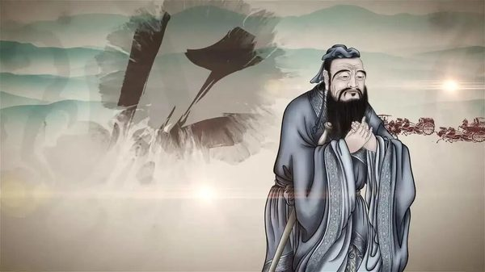
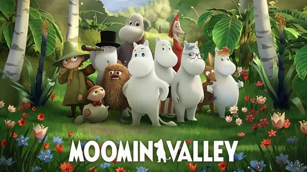
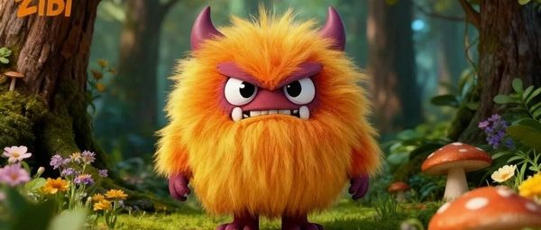
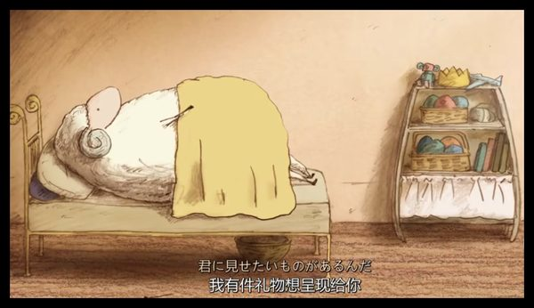
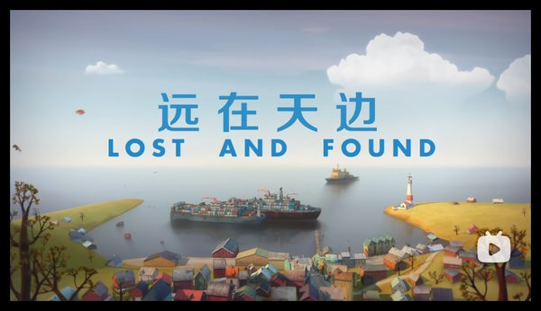
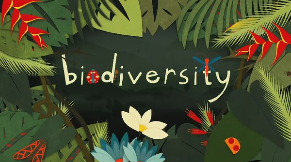
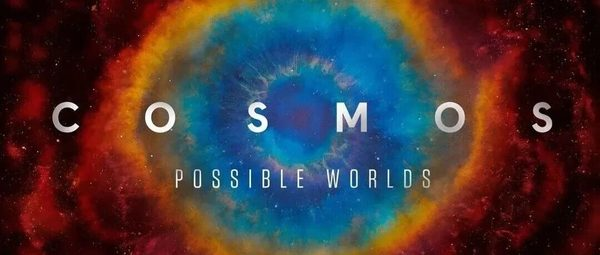
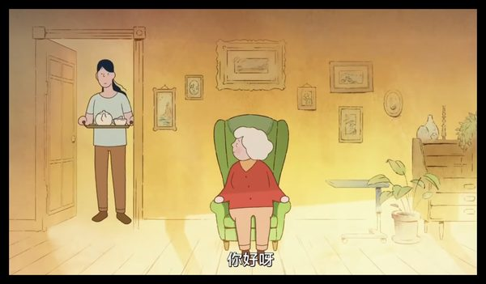
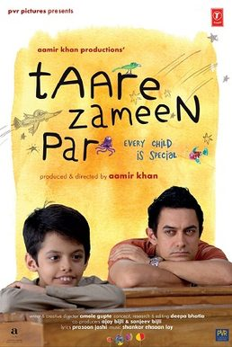
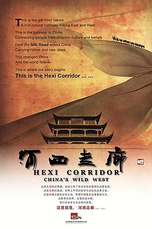

> 这是更早一次按年龄整理的网络研究卡片，和微信文章片单分开。微信片单在 [docs/wechat/](../wechat/catalog.md)。

# 文章没有写年龄

研究片单和微信摘录合在一起，每部一张卡片。观看链接只保留在这个环境里打开成功的官方网站或 YouTube 页面。没有写成链接的，是没有找到。

69 部。

## 你好中国（Hello China）

- **中文名**：你好中国
- **原名**：Hello China
- **年龄**：未标明年龄
- **内容类型**：人文类

微信文章里的配图。不是单独核对过的官方海报。

文章说这套片由国家广电总局牵头，100集，每集几分钟，用一个代表中国的词讲历史、文化、地理和经济，例子包括筷子、长城、饺子、七夕、功夫、算盘、孔子、火锅和糖葫芦。全英文配音，带中英双语字幕，画风被写成水墨。文章没有写年龄。

**观看**：未找到可打开的正版预告或播放页。

## 姆明山谷（Moominvalley）

- **中文名**：姆明山谷
- **原名**：Moominvalley
- **年龄**：未标明年龄
- **内容类型**：情感品格类

微信文章里的配图。不是单独核对过的官方海报。

文章推荐的是芬兰动画《姆明山谷》，并写豆瓣9.3。它说新版一共三季、每季13集、每集22分钟，讲害羞的白色小精灵姆明和家人、朋友在山谷里过日子，没有打打杀杀。姆明官网写这部剧由托芙·扬松的故事改编，第一季2019年播出。文章说成片是英文字幕，没有写明确年龄。

**观看**：[https://www.moomin.com/en/moominvalley/](https://www.moomin.com/en/moominvalley/)

姆明官方剧集介绍页，不是播放器。

## 小怪兽阿蒙（Love Monster）

- **中文名**：小怪兽阿蒙
- **原名**：Love Monster
- **年龄**：未标明年龄
- **内容类型**：情感品格类

微信文章里的配图。不是单独核对过的官方海报。

文章说这是 BBC 少儿频道的《Love Monster》，中文名《小怪兽阿蒙》，并在标题里写75集、中英文。毛茸茸的小怪兽住在可爱村，一直希望有人喜欢他、陪着他、接受他本来的样子。文章用分食物等很小的事讲爱，没有写数字年龄。

**观看**：[https://www.bbc.co.uk/cbeebies/shows/love-monster](https://www.bbc.co.uk/cbeebies/shows/love-monster)

BBC CBeebies 官方节目页。能否点播取决于地区。

## 尽管我们的手中空无一物

- **中文名**：尽管我们的手中空无一物
- **原名**：尽管我们的手中空无一物
- **年龄**：未标明年龄
- **内容类型**：情感品格类

微信文章里的配图。不是单独核对过的官方海报。

文章介绍的短片：小羊去世后在去天堂的路上排队，过天河时身上的东西都会消失。它剃掉羊毛搓成绳子逃回家，又被狼守卫抓回去。羊妈妈一直在屋外织毛衣。结尾是狼守卫顺着绳子把毛衣送到小羊身边，绳子化作满天繁星。文章说它表面上讲死亡，落点是爱。没有写年龄，也没有英文名。

**观看**：未找到可打开的正版预告或播放页。

## 远在天边

- **中文名**：远在天边
- **原名**：远在天边
- **年龄**：未标明年龄
- **内容类型**：情感品格类

微信文章里的配图。不是单独核对过的官方海报。

文章说这是一个小男孩送企鹅回家的短片。男孩独自住在港口小镇，企鹅敲门而入。他起初厌烦，想把企鹅送到失物招领处或丢在宠物店，最后还是划船送它回南极。暴风雨里两人互相救援；章鱼没有攻击他们，只把行李放回船上，并把船推向企鹅的家。文章没有写年龄和英文名。另一篇在文末也点了这个名字。

**观看**：未找到可打开的正版预告或播放页。

## 了不起的自然

- **中文名**：了不起的自然
- **原名**：了不起的自然
- **年龄**：未标明年龄
- **内容类型**：学习类

微信文章里的配图。不是单独核对过的官方海报。

文章把一套128集、每集约五分钟的科普动画称为《了不起的自然》，并写制作方是 TED-Ed。选题来自中小学科学老师，由动物学家、海洋科学家、地质学家供稿，再做成手绘动画。例子包括树懒为什么慢、燕子如何找回家、静电、捕蝇草和壁虎断尾。文章没有给出对应的单一英文剧名，所以这里不把它安到某一套现成英文系列上。

**观看**：未找到可打开的正版预告或播放页。

## 宇宙时空之旅（Cosmos: A SpaceTime Odyssey）

- **中文名**：宇宙时空之旅
- **原名**：Cosmos: A SpaceTime Odyssey
- **年龄**：未标明年龄
- **内容类型**：自然类

微信文章里的配图。不是单独核对过的官方海报。

文章写解说是泰森，用“想象号飞船”从微观走到宇宙边缘，并把138亿年压成一年：1月1日大爆炸，人类文明只有这年的最后14秒。也讲了哈雷和彗星、法拉第让观众看见磁场。文章写豆瓣9.7、已播出两季，标题里写25集。主持者本人的节目页写2014年3月开播、共13集。集数以文章和该页各自的说法并列，这里不把两边合成一个数字。文章没有写年龄。36部纪录片清单里也有这个名字。

**观看**：[https://neildegrassetyson.com/shows/2014-03-cosmos-spacetime-odyssey/](https://neildegrassetyson.com/shows/2014-03-cosmos-spacetime-odyssey/)

主持者 Neil deGrasse Tyson 官网的节目介绍，不是播放器。该页写13集、2014年3月由国家地理与福克斯首播。

## 午后时光

- **中文名**：午后时光
- **原名**：午后时光
- **年龄**：未标明年龄
- **内容类型**：情感品格类

微信文章里的配图。不是单独核对过的官方海报。

文章说这是一部约9分钟、几乎没有对白的动画。穿红衣服的老奶奶在客厅喝下午茶，她患有阿尔茨海默症，不断掉进回忆：海边的父亲、少女时代的朋友、热恋、有了女儿。结尾她想起照顾自己的人就是女儿，两人相拥。文章特别写到回忆中的老奶奶没有脖子，用来表现记忆和身体的连接断了。没有写年龄和英文名。

**观看**：未找到可打开的正版预告或播放页。

## 喜马拉雅

- **中文名**：喜马拉雅
- **原名**：喜马拉雅
- **年龄**：未标明年龄
- **内容类型**：自然类

**图片**：未找到可下载的海报或标题图。

文章写豆瓣9.6。雪豹在岩壁上等猎物，金雕迎风飞，用来讲高原上的坚持。文章没有英文名，也没有年龄。

**观看**：未找到可打开的正版预告或播放页。

## 亚马逊深渊

- **中文名**：亚马逊深渊
- **原名**：亚马逊深渊
- **年龄**：未标明年龄
- **内容类型**：自然类

**图片**：未找到可下载的海报或标题图。

文章写豆瓣9.3。镜头进到亚马逊雨林和水下，用来讲好奇和探索。没有英文名，也没有年龄。

**观看**：未找到可打开的正版预告或播放页。

## 大堡礁

- **中文名**：大堡礁
- **原名**：大堡礁
- **年龄**：未标明年龄
- **内容类型**：自然类

**图片**：未找到可下载的海报或标题图。

文章写豆瓣9.4。珊瑚礁和海洋生物，并写到珊瑚白化。正文这一条没有单独配图。没有英文名，也没有年龄。

**观看**：未找到可打开的正版预告或播放页。

## 野性非洲

- **中文名**：野性非洲
- **原名**：野性非洲
- **年龄**：未标明年龄
- **内容类型**：自然类

**图片**：未找到可下载的海报或标题图。

文章写豆瓣9.7。草原上的迁徙、捕猎和抢领地。没有英文名，也没有年龄。

**观看**：未找到可打开的正版预告或播放页。

## 黄石公园

- **中文名**：黄石公园
- **原名**：黄石公园
- **年龄**：未标明年龄
- **内容类型**：自然类

**图片**：未找到可下载的海报或标题图。

文章写豆瓣9.5。间歇泉、森林、野生动物和四季。没有英文名，也没有年龄。

**观看**：未找到可打开的正版预告或播放页。

## 鸟瞰地球

- **中文名**：鸟瞰地球
- **原名**：鸟瞰地球
- **年龄**：未标明年龄
- **内容类型**：自然类

**图片**：未找到可下载的海报或标题图。

文章的推荐理由是换一种视角看世界：航拍飞越六大洲，记录动物迁徙和地貌。没有英文名，也没有年龄。

**观看**：未找到可打开的正版预告或播放页。

## 隐形世界

- **中文名**：隐形世界
- **原名**：隐形世界
- **年龄**：未标明年龄
- **内容类型**：自然类

**图片**：未找到可下载的海报或标题图。

文章写用高速摄影和显微镜头看昆虫翅膀、碎掉的水滴和植物的细小结构。没有英文名，也没有年龄。

**观看**：未找到可打开的正版预告或播放页。

## 南太平洋

- **中文名**：南太平洋
- **原名**：南太平洋
- **年龄**：未标明年龄
- **内容类型**：自然类

**图片**：未找到可下载的海报或标题图。

文章写镜头去南太平洋孤岛，看生命在隔绝环境里长成别的样子。没有英文名，也没有年龄。

**观看**：未找到可打开的正版预告或播放页。

## 地球一年

- **中文名**：地球一年
- **原名**：地球一年
- **年龄**：未标明年龄
- **内容类型**：自然类

**图片**：未找到可下载的海报或标题图。

文章写跟着四季看动植物生长、繁殖和蛰伏。没有英文名，也没有年龄。

**观看**：未找到可打开的正版预告或播放页。

## 极地

- **中文名**：极地
- **原名**：极地
- **年龄**：未标明年龄
- **内容类型**：自然类

**图片**：未找到可下载的海报或标题图。

文章称它是国产纪录片，记录极寒地方的人怎样和自然一起生活。没有英文名，也没有年龄。

**观看**：未找到可打开的正版预告或播放页。

## 小鞋子

- **中文名**：小鞋子
- **原名**：小鞋子
- **年龄**：未标明年龄
- **内容类型**：情感品格类

**图片**：未找到可下载的海报或标题图。

文章用一句话推荐，没有写年龄和播放链接。文章写：清贫生活里兄妹互相体谅，想让孩子懂得知足和共情。

**观看**：未找到可打开的正版预告或播放页。

## 地球上的星星

- **中文名**：地球上的星星
- **原名**：地球上的星星
- **年龄**：未标明年龄
- **内容类型**：情感品格类

维基共享资源上的海报或标题图（心中的小星星）

文章用一句话推荐，没有写年龄和播放链接。文章写：每个孩子都是不一样的星星，不必跟风比较。

**观看**：未找到可打开的正版预告或播放页。

## 放牛班的春天

- **中文名**：放牛班的春天
- **原名**：放牛班的春天
- **年龄**：未标明年龄
- **内容类型**：情感品格类

**图片**：未找到可下载的海报或标题图。

文章用一句话推荐，没有写年龄和播放链接。文章写：没有真正的坏孩子，只有需要被看见的孩子。

**观看**：未找到可打开的正版预告或播放页。

## 听见天堂

- **中文名**：听见天堂
- **原名**：听见天堂
- **年龄**：未标明年龄
- **内容类型**：情感品格类

**图片**：未找到可下载的海报或标题图。

文章用一句话推荐，没有写年龄和播放链接。文章写：生活有缺憾，仍然可以用心感受世界。文章没有写这是哪一版电影的英文名。

**观看**：未找到可打开的正版预告或播放页。

## 追风筝的人

- **中文名**：追风筝的人
- **原名**：追风筝的人
- **年龄**：未标明年龄
- **内容类型**：情感品格类

**图片**：未找到可下载的海报或标题图。

文章用一句话推荐，没有写年龄和播放链接。文章写：成长是直面过错、弥补遗憾。

**观看**：未找到可打开的正版预告或播放页。

## 何以为家

- **中文名**：何以为家
- **原名**：何以为家
- **年龄**：未标明年龄
- **内容类型**：情感品格类

**图片**：未找到可下载的海报或标题图。

文章用一句话推荐，没有写年龄和播放链接。文章写：幸福不是理所当然，要珍惜被爱和被守护。

**观看**：未找到可打开的正版预告或播放页。

## 天堂电影院

- **中文名**：天堂电影院
- **原名**：天堂电影院
- **年龄**：未标明年龄
- **内容类型**：情感品格类

**图片**：未找到可下载的海报或标题图。

文章用一句话推荐，没有写年龄和播放链接。文章写：童年的光会照亮以后的路。

**观看**：未找到可打开的正版预告或播放页。

## 大卫·科波菲尔

- **中文名**：大卫·科波菲尔
- **原名**：大卫·科波菲尔
- **年龄**：未标明年龄
- **内容类型**：情感品格类

**图片**：未找到可下载的海报或标题图。

文章用一句话推荐，没有写年龄和播放链接。文章写：生活有风雨，本心不能丢。文章没有写是哪一个改编版本。

**观看**：未找到可打开的正版预告或播放页。

## 地球脉动

- **中文名**：地球脉动
- **原名**：地球脉动
- **年龄**：未标明年龄
- **内容类型**：自然类

**图片**：未找到可下载的海报或标题图。

文章用一句话推荐，没有写年龄和播放链接。文章写：万物生长各有快慢，孩子的成长也一样。36部清单里也有这个名字。

**观看**：未找到可打开的正版预告或播放页。

## 爆笑物理

- **中文名**：爆笑物理
- **原名**：爆笑物理
- **年龄**：未标明年龄
- **内容类型**：学习类

微信文章里的配图。不是单独核对过的官方海报。

只在《万物运转的秘密》文末作为往期推荐出现，原文是：清华附《爆笑物理》（144集），孩子趣味学物理。没有进一步介绍，也没有链接。

**观看**：未找到可打开的正版预告或播放页。

## 趣味科学

- **中文名**：趣味科学
- **原名**：趣味科学
- **年龄**：未标明年龄
- **内容类型**：学习类

微信文章里的配图。不是单独核对过的官方海报。

只在同一篇文末作为往期推荐出现，原文是：央视推荐《趣味科学》（1–8季，中英文）。没有进一步介绍，也没有链接。

**观看**：未找到可打开的正版预告或播放页。

## 逃跑机器人

- **中文名**：逃跑机器人
- **原名**：逃跑机器人
- **年龄**：未标明年龄
- **内容类型**：情感品格类

微信文章里的配图。不是单独核对过的官方海报。

只在《尽管我们的手中空无一物》文末被点名。原文说它改编自国际大奖小说，并写到和平与两难时的抉择。没有年龄、集数和链接。

**观看**：未找到可打开的正版预告或播放页。

## 悠悠长假

- **中文名**：悠悠长假
- **原名**：悠悠长假
- **年龄**：未标明年龄
- **内容类型**：情感品格类

微信文章里的配图。不是单独核对过的官方海报。

只在《远在天边》文末被点名。原文写豆瓣9.5，画风明媚，并说它让孩子想到生活在和平环境里。没有年龄和链接。

**观看**：未找到可打开的正版预告或播放页。

## 超级肥皂

- **中文名**：超级肥皂
- **原名**：超级肥皂
- **年龄**：未标明年龄
- **内容类型**：情感品格类

微信文章里的配图。不是单独核对过的官方海报。

只在《午后时光》文末作为往期出现。原文写：40年前的国产动画，讲消费主义、营销套路和群体盲从。没有链接。

**观看**：未找到可打开的正版预告或播放页。

## 雨后

- **中文名**：雨后
- **原名**：雨后
- **年龄**：未标明年龄
- **内容类型**：情感品格类

微信文章里的配图。不是单独核对过的官方海报。

只在《午后时光》文末作为往期出现。原文写：法国获奖动画，关于自然循环、责任与传承。没有链接。

**观看**：未找到可打开的正版预告或播放页。

## 宇宙的奇迹

- **中文名**：宇宙的奇迹
- **原名**：宇宙的奇迹
- **年龄**：只列片名
- **内容类型**：自然类

**图片**：未找到可下载的海报或标题图。

文章《强烈推荐36部儿童必看顶级纪录片》把它列在「宇宙探索」。全文只有名单和主题，没有这一部的剧情、年龄或播放链接。

**观看**：未找到可打开的正版预告或播放页。

## 生命的奇迹

- **中文名**：生命的奇迹
- **原名**：生命的奇迹
- **年龄**：只列片名
- **内容类型**：自然类

**图片**：未找到可下载的海报或标题图。

文章《强烈推荐36部儿童必看顶级纪录片》把它列在「宇宙探索」。全文只有名单和主题，没有这一部的剧情、年龄或播放链接。

**观看**：未找到可打开的正版预告或播放页。

## 从太空看地球

- **中文名**：从太空看地球
- **原名**：从太空看地球
- **年龄**：只列片名
- **内容类型**：自然类

**图片**：未找到可下载的海报或标题图。

文章《强烈推荐36部儿童必看顶级纪录片》把它列在「宇宙探索」。全文只有名单和主题，没有这一部的剧情、年龄或播放链接。

**观看**：未找到可打开的正版预告或播放页。

## 太阳系的奇迹

- **中文名**：太阳系的奇迹
- **原名**：太阳系的奇迹
- **年龄**：只列片名
- **内容类型**：自然类

**图片**：未找到可下载的海报或标题图。

文章《强烈推荐36部儿童必看顶级纪录片》把它列在「宇宙探索」。全文只有名单和主题，没有这一部的剧情、年龄或播放链接。

**观看**：未找到可打开的正版预告或播放页。

## 人类宇宙

- **中文名**：人类宇宙
- **原名**：人类宇宙
- **年龄**：只列片名
- **内容类型**：自然类

**图片**：未找到可下载的海报或标题图。

文章《强烈推荐36部儿童必看顶级纪录片》把它列在「宇宙探索」。全文只有名单和主题，没有这一部的剧情、年龄或播放链接。

**观看**：未找到可打开的正版预告或播放页。

## 生命之色

- **中文名**：生命之色
- **原名**：生命之色
- **年龄**：只列片名
- **内容类型**：自然类

**图片**：未找到可下载的海报或标题图。

文章《强烈推荐36部儿童必看顶级纪录片》把它列在「自然科普」。全文只有名单和主题，没有这一部的剧情、年龄或播放链接。

**观看**：未找到可打开的正版预告或播放页。

## 地球改变之年

- **中文名**：地球改变之年
- **原名**：地球改变之年
- **年龄**：只列片名
- **内容类型**：自然类

**图片**：未找到可下载的海报或标题图。

文章《强烈推荐36部儿童必看顶级纪录片》把它列在「自然科普」。全文只有名单和主题，没有这一部的剧情、年龄或播放链接。

**观看**：未找到可打开的正版预告或播放页。

## 绿色星球

- **中文名**：绿色星球
- **原名**：绿色星球
- **年龄**：只列片名
- **内容类型**：自然类

**图片**：未找到可下载的海报或标题图。

文章《强烈推荐36部儿童必看顶级纪录片》把它列在「自然科普」。全文只有名单和主题，没有这一部的剧情、年龄或播放链接。

**观看**：未找到可打开的正版预告或播放页。

## 家园

- **中文名**：家园
- **原名**：家园
- **年龄**：只列片名
- **内容类型**：自然类

**图片**：未找到可下载的海报或标题图。

文章《强烈推荐36部儿童必看顶级纪录片》把它列在「自然科普」。全文只有名单和主题，没有这一部的剧情、年龄或播放链接。

**观看**：未找到可打开的正版预告或播放页。

## 自然的力量

- **中文名**：自然的力量
- **原名**：自然的力量
- **年龄**：只列片名
- **内容类型**：自然类

**图片**：未找到可下载的海报或标题图。

文章《强烈推荐36部儿童必看顶级纪录片》把它列在「自然科普」。全文只有名单和主题，没有这一部的剧情、年龄或播放链接。

**观看**：未找到可打开的正版预告或播放页。

## 世界遗产在中国

- **中文名**：世界遗产在中国
- **原名**：世界遗产在中国
- **年龄**：只列片名
- **内容类型**：人文类

**图片**：未找到可下载的海报或标题图。

文章《强烈推荐36部儿童必看顶级纪录片》把它列在「历史文化」。全文只有名单和主题，没有这一部的剧情、年龄或播放链接。

**观看**：未找到可打开的正版预告或播放页。

## 南宋

- **中文名**：南宋
- **原名**：南宋
- **年龄**：只列片名
- **内容类型**：人文类

**图片**：未找到可下载的海报或标题图。

文章《强烈推荐36部儿童必看顶级纪录片》把它列在「历史文化」。全文只有名单和主题，没有这一部的剧情、年龄或播放链接。

**观看**：未找到可打开的正版预告或播放页。

## 从秦始皇到汉武帝

- **中文名**：从秦始皇到汉武帝
- **原名**：从秦始皇到汉武帝
- **年龄**：只列片名
- **内容类型**：人文类

**图片**：未找到可下载的海报或标题图。

文章《强烈推荐36部儿童必看顶级纪录片》把它列在「历史文化」。全文只有名单和主题，没有这一部的剧情、年龄或播放链接。

**观看**：未找到可打开的正版预告或播放页。

## 大明宫

- **中文名**：大明宫
- **原名**：大明宫
- **年龄**：只列片名
- **内容类型**：人文类

**图片**：未找到可下载的海报或标题图。

文章《强烈推荐36部儿童必看顶级纪录片》把它列在「历史文化」。全文只有名单和主题，没有这一部的剧情、年龄或播放链接。

**观看**：未找到可打开的正版预告或播放页。

## 故宫

- **中文名**：故宫
- **原名**：故宫
- **年龄**：只列片名
- **内容类型**：人文类

**图片**：未找到可下载的海报或标题图。

文章《强烈推荐36部儿童必看顶级纪录片》把它列在「历史文化」。全文只有名单和主题，没有这一部的剧情、年龄或播放链接。

**观看**：未找到可打开的正版预告或播放页。

## 三国的世界

- **中文名**：三国的世界
- **原名**：三国的世界
- **年龄**：只列片名
- **内容类型**：人文类

**图片**：未找到可下载的海报或标题图。

文章《强烈推荐36部儿童必看顶级纪录片》把它列在「历史文化」。全文只有名单和主题，没有这一部的剧情、年龄或播放链接。

**观看**：未找到可打开的正版预告或播放页。

## 航拍中国

- **中文名**：航拍中国
- **原名**：航拍中国
- **年龄**：只列片名
- **内容类型**：人文类

**图片**：未找到可下载的海报或标题图。

文章《强烈推荐36部儿童必看顶级纪录片》把它列在「中国东方神韵」。全文只有名单和主题，没有这一部的剧情、年龄或播放链接。

**观看**：未找到可打开的正版预告或播放页。

## 第三极

- **中文名**：第三极
- **原名**：第三极
- **年龄**：只列片名
- **内容类型**：人文类

**图片**：未找到可下载的海报或标题图。

文章《强烈推荐36部儿童必看顶级纪录片》把它列在「中国东方神韵」。全文只有名单和主题，没有这一部的剧情、年龄或播放链接。

**观看**：未找到可打开的正版预告或播放页。

## 了不起的村落

- **中文名**：了不起的村落
- **原名**：了不起的村落
- **年龄**：只列片名
- **内容类型**：人文类

**图片**：未找到可下载的海报或标题图。

文章《强烈推荐36部儿童必看顶级纪录片》把它列在「中国东方神韵」。全文只有名单和主题，没有这一部的剧情、年龄或播放链接。

**观看**：未找到可打开的正版预告或播放页。

## 河西走廊

- **中文名**：河西走廊
- **原名**：河西走廊
- **年龄**：只列片名
- **内容类型**：人文类

维基共享资源上的海报或标题图（河西走廊 (纪录片)）

文章《强烈推荐36部儿童必看顶级纪录片》把它列在「中国东方神韵」。全文只有名单和主题，没有这一部的剧情、年龄或播放链接。

**观看**：未找到可打开的正版预告或播放页。

## 美丽中国

- **中文名**：美丽中国
- **原名**：美丽中国
- **年龄**：只列片名
- **内容类型**：人文类

维基共享资源上的海报或标题图（美丽中国）

文章《强烈推荐36部儿童必看顶级纪录片》把它列在「中国东方神韵」。全文只有名单和主题，没有这一部的剧情、年龄或播放链接。

**观看**：未找到可打开的正版预告或播放页。

## 天山脚下

- **中文名**：天山脚下
- **原名**：天山脚下
- **年龄**：只列片名
- **内容类型**：人文类

**图片**：未找到可下载的海报或标题图。

文章《强烈推荐36部儿童必看顶级纪录片》把它列在「中国东方神韵」。全文只有名单和主题，没有这一部的剧情、年龄或播放链接。

**观看**：未找到可打开的正版预告或播放页。

## 此画怎讲

- **中文名**：此画怎讲
- **原名**：此画怎讲
- **年龄**：只列片名
- **内容类型**：人文类

**图片**：未找到可下载的海报或标题图。

文章《强烈推荐36部儿童必看顶级纪录片》把它列在「艺术美学」。全文只有名单和主题，没有这一部的剧情、年龄或播放链接。

**观看**：未找到可打开的正版预告或播放页。

## 啊！设计

- **中文名**：啊！设计
- **原名**：啊！设计
- **年龄**：只列片名
- **内容类型**：人文类

**图片**：未找到可下载的海报或标题图。

文章《强烈推荐36部儿童必看顶级纪录片》把它列在「艺术美学」。全文只有名单和主题，没有这一部的剧情、年龄或播放链接。

**观看**：未找到可打开的正版预告或播放页。

## 艺术创世记

- **中文名**：艺术创世记
- **原名**：艺术创世记
- **年龄**：只列片名
- **内容类型**：人文类

**图片**：未找到可下载的海报或标题图。

文章《强烈推荐36部儿童必看顶级纪录片》把它列在「艺术美学」。全文只有名单和主题，没有这一部的剧情、年龄或播放链接。

**观看**：未找到可打开的正版预告或播放页。

## 文明

- **中文名**：文明
- **原名**：文明
- **年龄**：只列片名
- **内容类型**：人文类

**图片**：未找到可下载的海报或标题图。

文章《强烈推荐36部儿童必看顶级纪录片》把它列在「艺术美学」。全文只有名单和主题，没有这一部的剧情、年龄或播放链接。

**观看**：[https://www.bbc.co.uk/programmes/p05xxp5j](https://www.bbc.co.uk/programmes/p05xxp5j)

维基数据登记的官方网站

## 现代艺术大师

- **中文名**：现代艺术大师
- **原名**：现代艺术大师
- **年龄**：只列片名
- **内容类型**：人文类

**图片**：未找到可下载的海报或标题图。

文章《强烈推荐36部儿童必看顶级纪录片》把它列在「艺术美学」。全文只有名单和主题，没有这一部的剧情、年龄或播放链接。

**观看**：未找到可打开的正版预告或播放页。

## 卢浮宫的珍宝

- **中文名**：卢浮宫的珍宝
- **原名**：卢浮宫的珍宝
- **年龄**：只列片名
- **内容类型**：人文类

**图片**：未找到可下载的海报或标题图。

文章《强烈推荐36部儿童必看顶级纪录片》把它列在「艺术美学」。全文只有名单和主题，没有这一部的剧情、年龄或播放链接。

**观看**：未找到可打开的正版预告或播放页。

## 七个世界，一个星球

- **中文名**：七个世界，一个星球
- **原名**：七个世界，一个星球
- **年龄**：只列片名
- **内容类型**：自然类

**图片**：未找到可下载的海报或标题图。

文章《强烈推荐36部儿童必看顶级纪录片》把它列在「植物动物世界」。全文只有名单和主题，没有这一部的剧情、年龄或播放链接。

**观看**：未找到可打开的正版预告或播放页。

## 王朝

- **中文名**：王朝
- **原名**：王朝
- **年龄**：只列片名
- **内容类型**：自然类

**图片**：未找到可下载的海报或标题图。

文章《强烈推荐36部儿童必看顶级纪录片》把它列在「植物动物世界」。全文只有名单和主题，没有这一部的剧情、年龄或播放链接。

**观看**：未找到可打开的正版预告或播放页。

## 植物王国

- **中文名**：植物王国
- **原名**：植物王国
- **年龄**：只列片名
- **内容类型**：自然类

**图片**：未找到可下载的海报或标题图。

文章《强烈推荐36部儿童必看顶级纪录片》把它列在「植物动物世界」。全文只有名单和主题，没有这一部的剧情、年龄或播放链接。

**观看**：未找到可打开的正版预告或播放页。

## 种出个地球

- **中文名**：种出个地球
- **原名**：种出个地球
- **年龄**：只列片名
- **内容类型**：自然类

**图片**：未找到可下载的海报或标题图。

文章《强烈推荐36部儿童必看顶级纪录片》把它列在「植物动物世界」。全文只有名单和主题，没有这一部的剧情、年龄或播放链接。

**观看**：未找到可打开的正版预告或播放页。

## 意大利花园

- **中文名**：意大利花园
- **原名**：意大利花园
- **年龄**：只列片名
- **内容类型**：人文类

**图片**：未找到可下载的海报或标题图。

文章《强烈推荐36部儿童必看顶级纪录片》把它列在「植物动物世界」。全文只有名单和主题，没有这一部的剧情、年龄或播放链接。

**观看**：未找到可打开的正版预告或播放页。

## What If

- **中文名**：What If
- **原名**：What If
- **年龄**：未标明年龄
- **内容类型**：学习类

微信文章里的配图。不是单独核对过的官方海报。

出现在《小怪兽阿蒙》文末的往期推荐。原文是：BBC 专为孩子拍的科普片《What If》（52 集，中英文），每个奇思妙想里都有一个科学答案。没有写年龄，也没有播放链接。

**观看**：未找到可打开的正版预告或播放页。

## 数学的故事

- **中文名**：数学的故事
- **原名**：数学的故事
- **年龄**：未标明年龄
- **内容类型**：学习类

微信文章里的配图。不是单独核对过的官方海报。

往期推荐里出现两次。原文是：BBC 科普《数学的故事》（4 集，中英文），跳出公式，换个角度看数字背后的逻辑。没有写年龄，也没有播放链接。

**观看**：未找到可打开的正版预告或播放页。

## 平博士密码

- **中文名**：平博士密码
- **原名**：平博士密码
- **年龄**：未标明年龄
- **内容类型**：学习类

微信文章里的配图。不是单独核对过的官方海报。

出现在《人体奥奇实验室》文末的往期推荐。原文是：全球首部诺贝尔科普题材动画《平博士密码》（52 集，中英文），把看不见的科学讲明白。没有写年龄，也没有播放链接。

**观看**：未找到可打开的正版预告或播放页。
