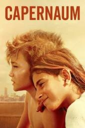
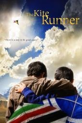

# 不推荐作为0—12岁儿童日常片单

[首页](../../README.md) · [审核方法](review-method.md)

7条。不是否定艺术价值。成熟青少年可以按各自年龄、经历与家庭选择另外讨论。

## 何以为家

**判断：不推荐** · 建议：16+（CSM；不列入0—12岁片单）

**简介**：文章用一句话推荐，没有写年龄和播放链接。文章写：幸福不是理所当然，要珍惜被爱和被守护。

**研判**：独立指南明确指出儿童虐待、童婚、人贩、性侵威胁与毒品交易。具有社会批判价值，不代表适合让小孩通过极端苦难来“受教育”。

**证据状态**：作品级证据初审；置信度：中。

**视频链接**：未核实正版正片；不以同名页、预告、资源站或HTTP 200冒充可播正片。

**图片**：独立评测页所标本片海报（版权归原权利人）。 [图源](https://www.commonsensemedia.org/movie-reviews/capernaum)

原文年龄（不是本项目认可结论）：未标明年龄。

**独立依据**：[Common Sense Media](https://www.commonsensemedia.org/movie-reviews/capernaum)

豆瓣评分/人数：未核实；IMDb评分/人数：未核实。公众号里的评分仅为原文说法，不计作已验证数据。

**原文来源**：[文章11](https://mp.weixin.qq.com/s/oKG9Fhp_e-YAl2DMdq5_QQ)

---

## 猎魔人：深渊海妖 / The Witcher: Sirens of the Deep

**判断：不推荐** · 建议：15+

**简介**：猎魔人调查人类与海中族群冲突中的袭击。

**研判**：CSM建议15+；独立指南确认流血杀戮、性行为与频繁强烈粗口，不作为儿童英语材料，尽管存在接纳他人的主题。

**证据状态**：作品级证据初审；置信度：中。

**视频链接**：未核实正版正片；不以同名页、预告、资源站或HTTP 200冒充可播正片。

**图片**：独立评测页所标本片海报（版权归原权利人）。 [图源](https://www.commonsensemedia.org/movie-reviews/the-witcher-sirens-of-the-deep)

原文年龄（不是本项目认可结论）：文章28没有逐片标注适龄。

**独立依据**：[Common Sense Media](https://www.commonsensemedia.org/movie-reviews/the-witcher-sirens-of-the-deep)

豆瓣评分/人数：未核实；IMDb评分/人数：未核实。公众号里的评分仅为原文说法，不计作已验证数据。

**原文来源**：[文章28](https://mp.weixin.qq.com/s/kx7YqDwvnUhSYTM3Gh1f-Q)

---

## 真人快打传奇：牢笼对决 / Mortal Kombat Legends: Cage Match

**判断：不推荐** · 建议：16+

**简介**：动作明星卷入恶魔与邪教的暴力对抗。

**研判**：CSM建议16+、R级；斩首、剖腹、刺杀和强烈粗口已独立确认。成人向动作动画，不放进儿童英语优选。

**证据状态**：作品级证据初审；置信度：中。

**视频链接**：未核实正版正片；不以同名页、预告、资源站或HTTP 200冒充可播正片。

**图片**：独立评测页所标本片海报（版权归原权利人）。 [图源](https://www.commonsensemedia.org/movie-reviews/mortal-kombat-legends-cage-match)

原文年龄（不是本项目认可结论）：文章28没有逐片标注适龄。

**独立依据**：[Common Sense Media](https://www.commonsensemedia.org/movie-reviews/mortal-kombat-legends-cage-match)

豆瓣评分/人数：未核实；IMDb评分/人数：未核实。公众号里的评分仅为原文说法，不计作已验证数据。

**原文来源**：[文章28](https://mp.weixin.qq.com/s/kx7YqDwvnUhSYTM3Gh1f-Q)

---

## 蜗牛回忆录 / Memoir of a Snail

**判断：不推荐** · 建议：14+（CSM）；澳洲育儿指南建议16岁以上

**简介**：文章写豆瓣8.6，2024年安锡最佳动画长片，奥斯卡最佳动画长片提名。黏土动画。女孩格蕾丝因外貌被欺凌，把自己关在壳里，老奶奶萍奇用口头禅 BAGA 让她面对破碎。文章没有给英文名。 英文名来自豆瓣该条目的外文名，不是文章原文。

**研判**：性、裸露、药物、酗酒、虐待、电击与自杀情节已由独立指南确认。成人定格动画的艺术价值高，也不能按原文“10岁+治愈”放进儿童优选。

**证据状态**：作品级证据初审；置信度：中。

**视频链接**：未核实正版正片；不以同名页、预告、资源站或HTTP 200冒充可播正片。

**图片**：独立评测页所标本片海报（版权归原权利人）。 [图源](https://www.commonsensemedia.org/movie-reviews/memoir-of-a-snail)

原文年龄（不是本项目认可结论）：10岁+。

**独立依据**：[Common Sense Media](https://www.commonsensemedia.org/movie-reviews/memoir-of-a-snail)；[Raising Children Network](https://raisingchildren.net.au/guides/movie-reviews/memoir-of-a-snail)

豆瓣评分/人数：未核实；IMDb评分/人数：未核实。公众号里的评分仅为原文说法，不计作已验证数据。

**原文来源**：[文章26](https://mp.weixin.qq.com/s/FrkyAZYpTEqOreapJ-f3UA)；[文章28](https://mp.weixin.qq.com/s/kx7YqDwvnUhSYTM3Gh1f-Q)

---

## 蝙蝠侠：黑暗骑士归来(上) / Batman: The Dark Knight Returns, Part 1

**判断：不推荐** · 建议：14+

**简介**：年老的蝙蝠侠重返哥谭，面对黑暗的社会与暴力。

**研判**：CSM建议14+，独立指南明确“极度暴力”。私刑与道德模糊适合成熟青少年讨论，不进入0—12岁儿童优选。

**证据状态**：作品级证据初审；置信度：中。

**视频链接**：未核实正版正片；不以同名页、预告、资源站或HTTP 200冒充可播正片。

**图片**：独立评测页所标本片海报（版权归原权利人）。 [图源](https://www.commonsensemedia.org/movie-reviews/batman-the-dark-knight-returns-part-1)

原文年龄（不是本项目认可结论）：文章28没有逐片标注适龄。

**独立依据**：[Common Sense Media](https://www.commonsensemedia.org/movie-reviews/batman-the-dark-knight-returns-part-1)

豆瓣评分/人数：未核实；IMDb评分/人数：未核实。公众号里的评分仅为原文说法，不计作已验证数据。

**原文来源**：[文章28](https://mp.weixin.qq.com/s/kx7YqDwvnUhSYTM3Gh1f-Q)

---

## 蝙蝠侠：黑暗骑士归来(下) / Batman: The Dark Knight Returns, Part 2

**判断：不推荐** · 建议：14+

**简介**：蝙蝠侠故事的后半部继续走向暴力与政治冲突。

**研判**：CSM建议14+；持续枪击、刺杀、流血、死亡及性交易情节。不能因是超级英雄动画而当普通儿童冒险。

**证据状态**：作品级证据初审；置信度：中。

**视频链接**：未核实正版正片；不以同名页、预告、资源站或HTTP 200冒充可播正片。

**图片**：独立评测页所标本片海报（版权归原权利人）。 [图源](https://www.commonsensemedia.org/movie-reviews/batman-the-dark-knight-returns-part-2)

原文年龄（不是本项目认可结论）：文章28没有逐片标注适龄。

**独立依据**：[Common Sense Media](https://www.commonsensemedia.org/movie-reviews/batman-the-dark-knight-returns-part-2)

豆瓣评分/人数：未核实；IMDb评分/人数：未核实。公众号里的评分仅为原文说法，不计作已验证数据。

**原文来源**：[文章28](https://mp.weixin.qq.com/s/kx7YqDwvnUhSYTM3Gh1f-Q)

---

## 追风筝的人

**判断：不推荐** · 建议：15+（CSM；不列入0—12岁片单）

**简介**：文章用一句话推荐，没有写年龄和播放链接。文章写：成长是直面过错、弥补遗憾。

**研判**：独立指南记录儿童遭性暴力、战争、公开处刑与强烈粗口。可供成熟青少年讨论历史与责任，但不是文章所称的普适儿童成长治愈片；艺术价值与儿童适合度分开判断。

**证据状态**：作品级证据初审；置信度：中。

**视频链接**：未核实正版正片；不以同名页、预告、资源站或HTTP 200冒充可播正片。

**图片**：独立评测页所标本片海报（版权归原权利人）。 [图源](https://www.commonsensemedia.org/movie-reviews/the-kite-runner)

原文年龄（不是本项目认可结论）：未标明年龄。

**独立依据**：[Common Sense Media](https://www.commonsensemedia.org/movie-reviews/the-kite-runner)

豆瓣评分/人数：未核实；IMDb评分/人数：未核实。公众号里的评分仅为原文说法，不计作已验证数据。

**原文来源**：[文章11](https://mp.weixin.qq.com/s/oKG9Fhp_e-YAl2DMdq5_QQ)

---
