# 不推荐作为0—12岁儿童日常片单

<!-- Generated by scripts/render_wechat_tables.py; edit data/catalog.json instead. -->

[返回首页](../../README.md) · [审核方法](review-method.md) · [不推荐](not-recommended.md) · [文章28待核验](pending-article-28.md)

本页 22 条。不是否定艺术价值。成熟青少年可按各自年龄、经历与家庭选择另外讨论。

每行一部，名称下的文章编号链接原文。适龄为审核建议；折叠的“原文说法”不代表采信。缩略图可点开放大，图下注明海报、旧图或文字封面；长简介可展开。

未注明已核实的豆瓣/IMDb评分和人数一律视为未核实；公众号评分不作独立证据。独立评测不等于教育效果证明，相关App/合集也不是单片认证。视频列仅保留官方入口等已记录地址，**不代表免费、完整或当地可播正片**；候选地址不展示。完整字段见[主目录数据](../../data/catalog.json)。

| 图片 | 名称 | 判断 | 适龄 | 简介 | 研判 | 证据状态 | 视频链接 |
| --- | --- | --- | --- | --- | --- | --- | --- |
| <a href="../../images/review/wx30-pantheon.jpg">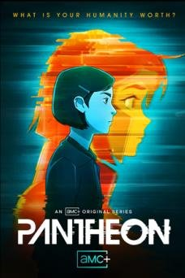</a> [评测页海报](<https://www.commonsensemedia.org/tv-reviews/pantheon>) | 万神殿 Pantheon [文章30](<https://mp.weixin.qq.com/s/OBgoqIb8s3gZRfIcpUhLSw>) | 不推荐 | 13+（CSM） 

原文说法
文章分组：脑洞科幻
 | 文章30把它列入“脑洞科幻”组（1-2季），只列片名，没有剧情、年龄或播放链接；该文以出售“超清纯英字视频+MP3+台词本”资源包为主。 | CSM评13+，意识上传、死亡与危险主题沉重；适合青少年讨论科技伦理，不列入儿童片单。 | 作品级证据初审 置信度：中 [Common Sense Media](<https://www.commonsensemedia.org/tv-reviews/pantheon>) | 未核实正版正片 |
|  [评测页海报](<https://www.commonsensemedia.org/movie-reviews/capernaum>) | 何以为家 [文章11](<https://mp.weixin.qq.com/s/oKG9Fhp_e-YAl2DMdq5_QQ>) | 不推荐 | 16+（CSM；不列入0—12岁片单） 

原文说法
未标明年龄
 | 文章用一句话推荐，没有写年龄和播放链接。文章写：幸福不是理所当然，要珍惜被爱和被守护。 | 独立指南明确指出儿童虐待、童婚、人贩、性侵威胁与毒品交易。具有社会批判价值，不代表适合让小孩通过极端苦难来“受教育”。 | 作品级证据初审 置信度：中 [Common Sense Media](<https://www.commonsensemedia.org/movie-reviews/capernaum>) | 未核实正版正片 |
| <a href="../../images/review/wx40-gattaca.jpg">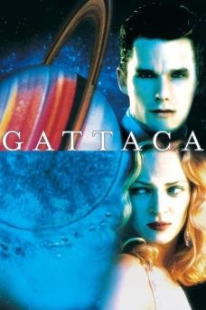</a> [评测页海报](<https://www.commonsensemedia.org/movie-reviews/gattaca>) | 千钧一发 Gattaca [文章40](<https://mp.weixin.qq.com/s/ySOlBb_APh8QBi6UUOZ9hg>) | 不推荐 | 14+（CSM；原文12+） 

原文说法
12岁+
 | 文章写豆瓣8.8、适合12岁+：基因决定论的未来社会，“基因有缺陷”的文森特借用完美基因身份追求太空梦。 | CSM评14+，有成熟主题、暴力（含谋杀调查）、饮酒吸烟等。科幻与生命伦理讨论价值高，适合初中以上，不列入0—12岁日常片单。 | 作品级证据初审 置信度：中 [Common Sense Media](<https://www.commonsensemedia.org/movie-reviews/gattaca>) | 未核实正版正片 |
| <a href="../../images/review/wx30-hazbin-hotel.jpg">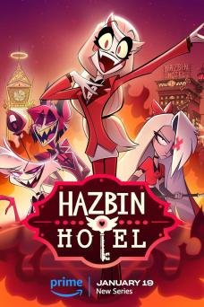</a> [评测页海报](<https://www.commonsensemedia.org/tv-reviews/hazbin-hotel>) | 地狱客栈 Hazbin Hotel [文章30](<https://mp.weixin.qq.com/s/OBgoqIb8s3gZRfIcpUhLSw>) | 不推荐 | 17+（CSM） 

原文说法
文章分组：成人向高分
 | 文章30把它列入“成人向高分”组（1-2季），只列片名，没有剧情、年龄或播放链接；该文以出售“超清纯英字视频+MP3+台词本”资源包为主。 | CSM评17+：泛滥的性内容、粗口与暴力。文章自己也归入成人向。 | 作品级证据初审 置信度：中 [Common Sense Media](<https://www.commonsensemedia.org/tv-reviews/hazbin-hotel>) | 未核实正版正片 |
| <a href="../../images/review/wx30-paradise-pd.jpg">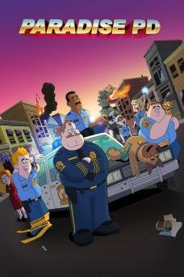</a> [评测页海报](<https://www.commonsensemedia.org/tv-reviews/paradise-pd>) | 天堂镇警局 Paradise PD [文章30](<https://mp.weixin.qq.com/s/OBgoqIb8s3gZRfIcpUhLSw>) | 不推荐 | 16+（CSM） 

原文说法
文章分组：成人向高分
 | 文章30把它列入“成人向高分”组（1-4季），只列片名，没有剧情、年龄或播放链接；该文以出售“超清纯英字视频+MP3+台词本”资源包为主。 | CSM评16+，编辑3/5，粗口、毒品与低俗笑料；文章称“成人向高分”也缺乏依据。 | 作品级证据初审 置信度：中 [Common Sense Media](<https://www.commonsensemedia.org/tv-reviews/paradise-pd>) | 未核实正版正片 |
| <a href="../../images/review/wx30-bobs-burgers.jpg">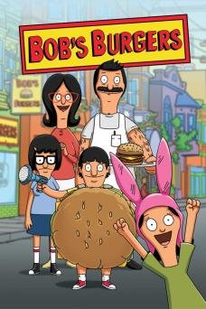</a> [评测页海报](<https://www.commonsensemedia.org/tv-reviews/bobs-burgers>) | 开心汉堡店 Bob&#x27;s Burgers [文章30](<https://mp.weixin.qq.com/s/OBgoqIb8s3gZRfIcpUhLSw>) | 不推荐 | 13+（CSM） 

原文说法
文章分组：成人向高分
 | 文章30把它列入“成人向高分”组（1-14季），只列片名，没有剧情、年龄或播放链接；该文以出售“超清纯英字视频+MP3+台词本”资源包为主。 | CSM评13+，讽刺幽默有时冒犯，含性暗示笑话；适合青少年以上。 | 作品级证据初审 置信度：中 [Common Sense Media](<https://www.commonsensemedia.org/tv-reviews/bobs-burgers>) | 未核实正版正片 |
| <a href="../../images/review/wx30-family-guy.jpg">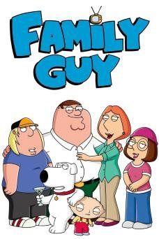</a> [评测页海报](<https://www.commonsensemedia.org/tv-reviews/family-guy>) | 恶搞之家 Family Guy [文章30](<https://mp.weixin.qq.com/s/OBgoqIb8s3gZRfIcpUhLSw>) | 不推荐 | 14+（CSM） 

原文说法
文章分组：成人向高分
 | 文章30把它列入“成人向高分”组（1-24季），只列片名，没有剧情、年龄或播放链接；该文以出售“超清纯英字视频+MP3+台词本”资源包为主。 | CSM评14+，称“这不是家庭节目”；粗俗与冒犯性笑话密集。 | 作品级证据初审 置信度：中 [Common Sense Media](<https://www.commonsensemedia.org/tv-reviews/family-guy>) | 未核实正版正片 |
| <a href="../../images/review/wx30-invincible.jpg">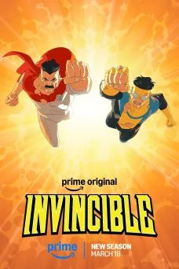</a> [评测页海报](<https://www.commonsensemedia.org/tv-reviews/invincible>) | 无敌少侠 Invincible [文章30](<https://mp.weixin.qq.com/s/OBgoqIb8s3gZRfIcpUhLSw>) | 不推荐 | 16+（CSM） 

原文说法
文章分组：成人向高分
 | 文章30把它列入“成人向高分”组（1-4季），只列片名，没有剧情、年龄或播放链接；该文以出售“超清纯英字视频+MP3+台词本”资源包为主。 | CSM评16+，极度血腥的超级英雄暴力。卡通画风不代表儿童向。 | 作品级证据初审 置信度：中 [Common Sense Media](<https://www.commonsensemedia.org/tv-reviews/invincible>) | 未核实正版正片 |
| <a href="../../images/review/wx28-db566937a262.jpg">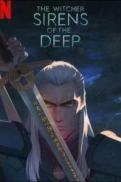</a> [评测页海报](<https://www.commonsensemedia.org/movie-reviews/the-witcher-sirens-of-the-deep>) | 猎魔人：深渊海妖 The Witcher: Sirens of the Deep 原文年份：2025（未核实） [文章28](<https://mp.weixin.qq.com/s/kx7YqDwvnUhSYTM3Gh1f-Q>) | 不推荐 | 15+ 

原文说法
文章28没有逐片标注适龄
 | 猎魔人调查人类与海中族群冲突中的袭击。 | CSM建议15+；独立指南确认流血杀戮、性行为与频繁强烈粗口，不作为儿童英语材料，尽管存在接纳他人的主题。 | 作品级证据初审 置信度：中 [Common Sense Media](<https://www.commonsensemedia.org/movie-reviews/the-witcher-sirens-of-the-deep>) | 未核实正版正片 |
| <a href="../../images/review/wx30-pacific-rim-black.jpg">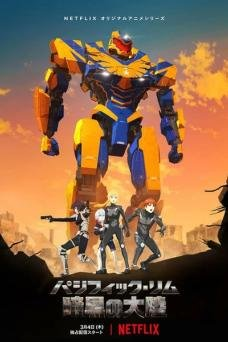</a> [评测页海报](<https://www.commonsensemedia.org/tv-reviews/pacific-rim-the-black>) | 环太平洋：黑色禁区 Pacific Rim: The Black [文章30](<https://mp.weixin.qq.com/s/OBgoqIb8s3gZRfIcpUhLSw>) | 不推荐 | 13+（CSM） 

原文说法
文章分组：脑洞科幻
 | 文章30把它列入“脑洞科幻”组（1-2季），只列片名，没有剧情、年龄或播放链接；该文以出售“超清纯英字视频+MP3+台词本”资源包为主。 | CSM评13+，怪兽杀戮与死亡较多，虽有家庭情感主题，不进0—12岁日常片单。 | 作品级证据初审 置信度：中 [Common Sense Media](<https://www.commonsensemedia.org/tv-reviews/pacific-rim-the-black>) | 未核实正版正片 |
| <a href="../../images/review/wx30-rick-and-morty.jpg">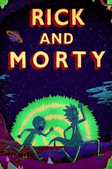</a> [评测页海报](<https://www.commonsensemedia.org/tv-reviews/rick-and-morty>) | 瑞克和莫蒂 Rick and Morty [文章30](<https://mp.weixin.qq.com/s/OBgoqIb8s3gZRfIcpUhLSw>) | 不推荐 | 16+（CSM） 

原文说法
文章分组：脑洞科幻
 | 文章30把它列入“脑洞科幻”组（1-9季），只列片名，没有剧情、年龄或播放链接；该文以出售“超清纯英字视频+MP3+台词本”资源包为主。 | CSM评16+，称其粗俗、酗酒，对多数青少年都太过；成人动画，不适合儿童。 | 作品级证据初审 置信度：中 [Common Sense Media](<https://www.commonsensemedia.org/tv-reviews/rick-and-morty>) | 未核实正版正片 |
| <a href="../../images/review/wx28-8f88e758b4f9.jpg">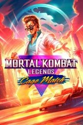</a> [评测页海报](<https://www.commonsensemedia.org/movie-reviews/mortal-kombat-legends-cage-match>) | 真人快打传奇：牢笼对决 Mortal Kombat Legends: Cage Match 原文年份：2023（未核实） [文章28](<https://mp.weixin.qq.com/s/kx7YqDwvnUhSYTM3Gh1f-Q>) | 不推荐 | 16+ 

原文说法
文章28没有逐片标注适龄
 | 动作明星卷入恶魔与邪教的暴力对抗。 | CSM建议16+、R级；斩首、剖腹、刺杀和强烈粗口已独立确认。成人向动作动画，不放进儿童英语优选。 | 作品级证据初审 置信度：中 [Common Sense Media](<https://www.commonsensemedia.org/movie-reviews/mortal-kombat-legends-cage-match>) | 未核实正版正片 |
| <a href="../../images/review/wx30-arcane.jpg">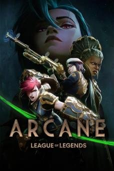</a> [评测页海报](<https://www.commonsensemedia.org/tv-reviews/arcane>) | 英雄联盟：双城之战 Arcane [文章30](<https://mp.weixin.qq.com/s/OBgoqIb8s3gZRfIcpUhLSw>) | 不推荐 | 14+（CSM） 

原文说法
文章分组：脑洞科幻
 | 文章30把它列入“脑洞科幻”组（1-2季），只列片名，没有剧情、年龄或播放链接；该文以出售“超清纯英字视频+MP3+台词本”资源包为主。 | CSM编辑5/5，但评14+：暴力、药物、死亡与粗口。高质量不等于适合儿童。 | 作品级证据初审 置信度：中 [Common Sense Media](<https://www.commonsensemedia.org/tv-reviews/arcane>) | 未核实正版正片 |
| <a href="../../images/review/wx30-bee-and-puppycat.jpg">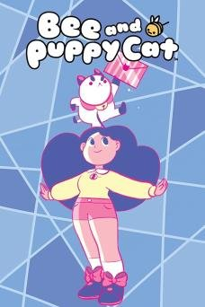</a> [评测页海报](<https://www.commonsensemedia.org/tv-reviews/bee-and-puppycat>) | 蜂妹与狗狗猫 Bee and PuppyCat [文章30](<https://mp.weixin.qq.com/s/OBgoqIb8s3gZRfIcpUhLSw>) | 不推荐 | 13+（CSM；非原文“零基础启蒙”） 

原文说法
文章分组：零基础启蒙
 | 文章30把它列入“零基础启蒙”组（1季），只列片名，没有剧情、年龄或播放链接；该文以出售“超清纯英字视频+MP3+台词本”资源包为主。 | CSM评13+，节奏怪诞，含成人向笑话与较复杂情绪；文章把它放进“零基础启蒙”是明显错配，不列入0—12岁日常片单。 | 作品级证据初审 置信度：中 [Common Sense Media](<https://www.commonsensemedia.org/tv-reviews/bee-and-puppycat>) | 未核实正版正片 |
| <a href="../../images/review/memoir-snail.jpg">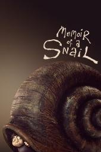</a> [评测页海报](<https://www.commonsensemedia.org/movie-reviews/memoir-of-a-snail>) | 蜗牛回忆录 Memoir of a Snail [文章26](<https://mp.weixin.qq.com/s/FrkyAZYpTEqOreapJ-f3UA>) · [文章28](<https://mp.weixin.qq.com/s/kx7YqDwvnUhSYTM3Gh1f-Q>) | 不推荐 | 14+（CSM）；澳洲育儿指南建议16岁以上 

原文说法
10岁+
 | 

文章写豆瓣8.6，2024年安锡最佳动画长片，奥斯卡最佳动画长片提名。黏土动画。女孩格蕾丝因外貌被欺凌，把自己关在壳里，老奶奶萍奇用口头禅 BAGA 让她面对破…（展开）
文章写豆瓣8.6，2024年安锡最佳动画长片，奥斯卡最佳动画长片提名。黏土动画。女孩格蕾丝因外貌被欺凌，把自己关在壳里，老奶奶萍奇用口头禅 BAGA 让她面对破碎。文章没有给英文名。 英文名来自豆瓣该条目的外文名，不是文章原文。
 | 性、裸露、药物、酗酒、虐待、电击与自杀情节已由独立指南确认。成人定格动画的艺术价值高，也不能按原文“10岁+治愈”放进儿童优选。 | 作品级证据初审 置信度：中 [Common Sense Media](<https://www.commonsensemedia.org/movie-reviews/memoir-of-a-snail>) [Raising Children Network](<https://raisingchildren.net.au/guides/movie-reviews/memoir-of-a-snail>) | 未核实正版正片 |
| <a href="../../images/review/wx28-7499de9bf1ce.jpg">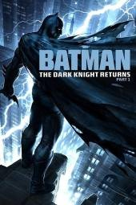</a> [评测页海报](<https://www.commonsensemedia.org/movie-reviews/batman-the-dark-knight-returns-part-1>) | 蝙蝠侠：黑暗骑士归来(上) Batman: The Dark Knight Returns, Part 1 原文年份：2012（未核实） [文章28](<https://mp.weixin.qq.com/s/kx7YqDwvnUhSYTM3Gh1f-Q>) | 不推荐 | 14+ 

原文说法
文章28没有逐片标注适龄
 | 年老的蝙蝠侠重返哥谭，面对黑暗的社会与暴力。 | CSM建议14+，独立指南明确“极度暴力”。私刑与道德模糊适合成熟青少年讨论，不进入0—12岁儿童优选。 | 作品级证据初审 置信度：中 [Common Sense Media](<https://www.commonsensemedia.org/movie-reviews/batman-the-dark-knight-returns-part-1>) | 未核实正版正片 |
| <a href="../../images/review/wx28-4312938e9673.jpg">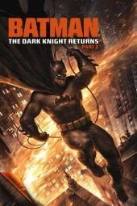</a> [评测页海报](<https://www.commonsensemedia.org/movie-reviews/batman-the-dark-knight-returns-part-2>) | 蝙蝠侠：黑暗骑士归来(下) Batman: The Dark Knight Returns, Part 2 原文年份：2013（未核实） [文章28](<https://mp.weixin.qq.com/s/kx7YqDwvnUhSYTM3Gh1f-Q>) | 不推荐 | 14+ 

原文说法
文章28没有逐片标注适龄
 | 蝙蝠侠故事的后半部继续走向暴力与政治冲突。 | CSM建议14+；持续枪击、刺杀、流血、死亡及性交易情节。不能因是超级英雄动画而当普通儿童冒险。 | 作品级证据初审 置信度：中 [Common Sense Media](<https://www.commonsensemedia.org/movie-reviews/batman-the-dark-knight-returns-part-2>) | 未核实正版正片 |
| <a href="../../images/review/wx30-cyberpunk-edgerunners.jpg">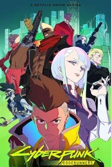</a> [评测页海报](<https://www.commonsensemedia.org/tv-reviews/cyberpunk-edgerunners>) | 赛博朋克：边缘行者 Cyberpunk: Edgerunners [文章30](<https://mp.weixin.qq.com/s/OBgoqIb8s3gZRfIcpUhLSw>) | 不推荐 | 17+（CSM） 

原文说法
文章分组：脑洞科幻
 | 文章30把它列入“脑洞科幻”组（1季），只列片名，没有剧情、年龄或播放链接；该文以出售“超清纯英字视频+MP3+台词本”资源包为主。 | CSM评17+，明确“isn&#x27;t for kids”：血腥暴力、裸露与药物。 | 作品级证据初审 置信度：中 [Common Sense Media](<https://www.commonsensemedia.org/tv-reviews/cyberpunk-edgerunners>) | 未核实正版正片 |
|  [评测页海报](<https://www.commonsensemedia.org/movie-reviews/the-kite-runner>) | 追风筝的人 [文章11](<https://mp.weixin.qq.com/s/oKG9Fhp_e-YAl2DMdq5_QQ>) | 不推荐 | 15+（CSM；不列入0—12岁片单） 

原文说法
未标明年龄
 | 文章用一句话推荐，没有写年龄和播放链接。文章写：成长是直面过错、弥补遗憾。 | 独立指南记录儿童遭性暴力、战争、公开处刑与强烈粗口。可供成熟青少年讨论历史与责任，但不是文章所称的普适儿童成长治愈片；艺术价值与儿童适合度分开判断。 | 作品级证据初审 置信度：中 [Common Sense Media](<https://www.commonsensemedia.org/movie-reviews/the-kite-runner>) | 未核实正版正片 |
| <a href="../../images/review/wx30-haunted-hotel.jpg">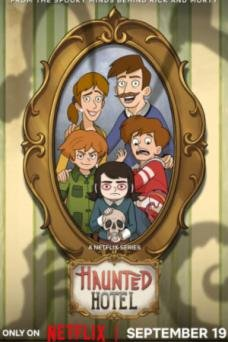</a> [评测页海报](<https://www.commonsensemedia.org/tv-reviews/haunted-hotel>) | 闹鬼酒店 Haunted Hotel [文章30](<https://mp.weixin.qq.com/s/OBgoqIb8s3gZRfIcpUhLSw>) | 不推荐 | 14+（CSM；非原文“合家欢”） 

原文说法
文章分组：合家欢常青
 | 文章30把它列入“合家欢常青”组（1季），只列片名，没有剧情、年龄或播放链接；该文以出售“超清纯英字视频+MP3+台词本”资源包为主。 | CSM评14+，指出血腥画面与流血死亡；文章称“大人小孩坐一起看也不尴尬”与独立评测相反。 | 作品级证据初审 置信度：中 [Common Sense Media](<https://www.commonsensemedia.org/tv-reviews/haunted-hotel>) | 未核实正版正片 |
| <a href="../../images/review/wx30-futurama.jpg">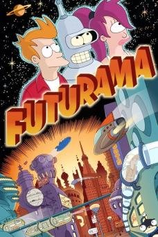</a> [评测页海报](<https://www.commonsensemedia.org/tv-reviews/futurama>) | 飞出个未来 Futurama [文章30](<https://mp.weixin.qq.com/s/OBgoqIb8s3gZRfIcpUhLSw>) | 不推荐 | 13+（CSM） 

原文说法
文章分组：脑洞科幻
 | 文章30把它列入“脑洞科幻”组（1-13季），只列片名，没有剧情、年龄或播放链接；该文以出售“超清纯英字视频+MP3+台词本”资源包为主。 | CSM评13+，有暴力、饮酒与性笑话；成人讽刺喜剧，不列入0—12岁片单。 | 作品级证据初审 置信度：中 [Common Sense Media](<https://www.commonsensemedia.org/tv-reviews/futurama>) | 未核实正版正片 |
| <a href="../../images/review/wx30-bojack-horseman.jpg">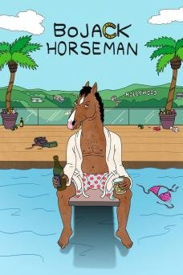</a> [评测页海报](<https://www.commonsensemedia.org/tv-reviews/bojack-horseman>) | 马男波杰克 BoJack Horseman [文章30](<https://mp.weixin.qq.com/s/OBgoqIb8s3gZRfIcpUhLSw>) | 不推荐 | 15+（CSM） 

原文说法
文章分组：成人向高分
 | 文章30把它列入“成人向高分”组（1-6季），只列片名，没有剧情、年龄或播放链接；该文以出售“超清纯英字视频+MP3+台词本”资源包为主。 | CSM评15+：药物、性与存在主义的黑暗。艺术价值高，但不是儿童内容。 | 作品级证据初审 置信度：中 [Common Sense Media](<https://www.commonsensemedia.org/tv-reviews/bojack-horseman>) | 未核实正版正片 |
