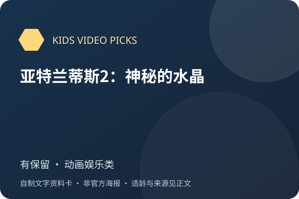
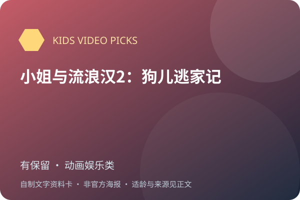

# 文章28：仅片名留档，待独立核验

<!-- Generated by scripts/render_wechat_tables.py; edit data/catalog.json instead. -->

[返回首页](../../README.md) · [审核方法](review-method.md) · [不推荐](not-recommended.md) · [文章28待核验](pending-article-28.md)

本页 224 条，全部暂为有保留，**不进入精选**。原文未逐片标龄，年份仅为原文说法。未核实的简介、原名、评分、视频和海报不编造。

每行一部，名称下的文章编号或“全网检索”链接到来源。适龄为审核建议；折叠的“原文说法”不代表采信。缩略图可点开放大，图下注明海报、旧图或文字封面；长简介可展开。

未注明已核实的豆瓣/IMDb评分和人数一律视为未核实；公众号评分不作独立证据。独立评测不等于教育效果证明，相关App/合集也不是单片认证。视频列仅保留官方入口等已记录地址，**不代表免费、完整或当地可播正片**；候选地址不展示。完整字段见[主目录数据](../../data/catalog.json)。

| 图片 | 名称 | 判断 | 适龄 | 简介 | 研判 | 证据状态 | 视频链接 |
| --- | --- | --- | --- | --- | --- | --- | --- |
|  文字封面（非官方海报） | 101忠狗1 原文年份：1961（未核实） [文章28](<https://mp.weixin.qq.com/s/kx7YqDwvnUhSYTM3Gh1f-Q>) | 有保留 | 未核实 | 原文主要列出片名与年份，没有足够的独立剧情或教育信息；本轮尚未建立此版本的作品级独立证据。 | 暂不进入儿童优选。未核实准确版本、适龄、暴力/惊吓、语言负荷及教育效果，不能因为动画、老片、英语字幕或资源数量多而认定优质。 | 待核验，未作正向推荐 置信度：低 未取得作品级独立依据 | 未核实正版正片 |
|  文字封面（非官方海报） | 101忠狗续集：伦敦大冒险 原文年份：2003（未核实） [文章28](<https://mp.weixin.qq.com/s/kx7YqDwvnUhSYTM3Gh1f-Q>) | 有保留 | 未核实 | 原文主要列出片名与年份，没有足够的独立剧情或教育信息；本轮尚未建立此版本的作品级独立证据。 | 暂不进入儿童优选。未核实准确版本、适龄、暴力/惊吓、语言负荷及教育效果，不能因为动画、老片、英语字幕或资源数量多而认定优质。 | 待核验，未作正向推荐 置信度：低 未取得作品级独立依据 | 未核实正版正片 |
|  文字封面（非官方海报） | 三傻闹地球 原文年份：2018（未核实） [文章28](<https://mp.weixin.qq.com/s/kx7YqDwvnUhSYTM3Gh1f-Q>) | 有保留 | 未核实 | 原文主要列出片名与年份，没有足够的独立剧情或教育信息；本轮尚未建立此版本的作品级独立证据。 | 暂不进入儿童优选。未核实准确版本、适龄、暴力/惊吓、语言负荷及教育效果，不能因为动画、老片、英语字幕或资源数量多而认定优质。 | 待核验，未作正向推荐 置信度：低 未取得作品级独立依据 | 未核实正版正片 |
|  文字封面（非官方海报） | 三骑士 原文年份：1944（未核实） [文章28](<https://mp.weixin.qq.com/s/kx7YqDwvnUhSYTM3Gh1f-Q>) | 有保留 | 未核实 | 原文主要列出片名与年份，没有足够的独立剧情或教育信息；本轮尚未建立此版本的作品级独立证据。 | 暂不进入儿童优选。未核实准确版本、适龄、暴力/惊吓、语言负荷及教育效果，不能因为动画、老片、英语字幕或资源数量多而认定优质。 | 待核验，未作正向推荐 置信度：低 未取得作品级独立依据 | 未核实正版正片 |
|  文字封面（非官方海报） | 丛林大反攻1 原文年份：2006（未核实） [文章28](<https://mp.weixin.qq.com/s/kx7YqDwvnUhSYTM3Gh1f-Q>) | 有保留 | 未核实 | 原文主要列出片名与年份，没有足够的独立剧情或教育信息；本轮尚未建立此版本的作品级独立证据。 | 暂不进入儿童优选。未核实准确版本、适龄、暴力/惊吓、语言负荷及教育效果，不能因为动画、老片、英语字幕或资源数量多而认定优质。 | 待核验，未作正向推荐 置信度：低 未取得作品级独立依据 | 未核实正版正片 |
|  文字封面（非官方海报） | 丛林大反攻2 原文年份：2008（未核实） [文章28](<https://mp.weixin.qq.com/s/kx7YqDwvnUhSYTM3Gh1f-Q>) | 有保留 | 未核实 | 原文主要列出片名与年份，没有足够的独立剧情或教育信息；本轮尚未建立此版本的作品级独立证据。 | 暂不进入儿童优选。未核实准确版本、适龄、暴力/惊吓、语言负荷及教育效果，不能因为动画、老片、英语字幕或资源数量多而认定优质。 | 待核验，未作正向推荐 置信度：低 未取得作品级独立依据 | 未核实正版正片 |
|  文字封面（非官方海报） | 丛林大反攻3 原文年份：2010（未核实） [文章28](<https://mp.weixin.qq.com/s/kx7YqDwvnUhSYTM3Gh1f-Q>) | 有保留 | 未核实 | 原文主要列出片名与年份，没有足够的独立剧情或教育信息；本轮尚未建立此版本的作品级独立证据。 | 暂不进入儿童优选。未核实准确版本、适龄、暴力/惊吓、语言负荷及教育效果，不能因为动画、老片、英语字幕或资源数量多而认定优质。 | 待核验，未作正向推荐 置信度：低 未取得作品级独立依据 | 未核实正版正片 |
|  文字封面（非官方海报） | 丛林大反攻4：吓傻了 原文年份：2015（未核实） [文章28](<https://mp.weixin.qq.com/s/kx7YqDwvnUhSYTM3Gh1f-Q>) | 有保留 | 未核实 | 原文主要列出片名与年份，没有足够的独立剧情或教育信息；本轮尚未建立此版本的作品级独立证据。 | 暂不进入儿童优选。未核实准确版本、适龄、暴力/惊吓、语言负荷及教育效果，不能因为动画、老片、英语字幕或资源数量多而认定优质。 | 待核验，未作正向推荐 置信度：低 未取得作品级独立依据 | 未核实正版正片 |
|  文字封面（非官方海报） | 了不起的莫里斯 原文年份：2022（未核实） [文章28](<https://mp.weixin.qq.com/s/kx7YqDwvnUhSYTM3Gh1f-Q>) | 有保留 | 未核实 | 原文主要列出片名与年份，没有足够的独立剧情或教育信息；本轮尚未建立此版本的作品级独立证据。 | 暂不进入儿童优选。未核实准确版本、适龄、暴力/惊吓、语言负荷及教育效果，不能因为动画、老片、英语字幕或资源数量多而认定优质。 | 待核验，未作正向推荐 置信度：低 未取得作品级独立依据 | 未核实正版正片 |
|  文字封面（非官方海报） | 了不起的菲丽西 原文年份：2016（未核实） [文章28](<https://mp.weixin.qq.com/s/kx7YqDwvnUhSYTM3Gh1f-Q>) | 有保留 | 未核实 | 原文主要列出片名与年份，没有足够的独立剧情或教育信息；本轮尚未建立此版本的作品级独立证据。 | 暂不进入儿童优选。未核实准确版本、适龄、暴力/惊吓、语言负荷及教育效果，不能因为动画、老片、英语字幕或资源数量多而认定优质。 | 待核验，未作正向推荐 置信度：低 未取得作品级独立依据 | 未核实正版正片 |
|  文字封面（非官方海报） | 亚当斯一家 原文年份：2019（未核实） [文章28](<https://mp.weixin.qq.com/s/kx7YqDwvnUhSYTM3Gh1f-Q>) | 有保留 | 未核实 | 原文主要列出片名与年份，没有足够的独立剧情或教育信息；本轮尚未建立此版本的作品级独立证据。 | 暂不进入儿童优选。未核实准确版本、适龄、暴力/惊吓、语言负荷及教育效果，不能因为动画、老片、英语字幕或资源数量多而认定优质。 | 待核验，未作正向推荐 置信度：低 未取得作品级独立依据 | 未核实正版正片 |
|  文字封面（非官方海报） | 亚当斯一家2 原文年份：2021（未核实） [文章28](<https://mp.weixin.qq.com/s/kx7YqDwvnUhSYTM3Gh1f-Q>) | 有保留 | 未核实 | 原文主要列出片名与年份，没有足够的独立剧情或教育信息；本轮尚未建立此版本的作品级独立证据。 | 暂不进入儿童优选。未核实准确版本、适龄、暴力/惊吓、语言负荷及教育效果，不能因为动画、老片、英语字幕或资源数量多而认定优质。 | 待核验，未作正向推荐 置信度：低 未取得作品级独立依据 | 未核实正版正片 |
|  文字封面（非官方海报） | 亚特兰蒂斯1：失落的帝国 原文年份：2001（未核实） [文章28](<https://mp.weixin.qq.com/s/kx7YqDwvnUhSYTM3Gh1f-Q>) | 有保留 | 未核实 | 原文主要列出片名与年份，没有足够的独立剧情或教育信息；本轮尚未建立此版本的作品级独立证据。 | 暂不进入儿童优选。未核实准确版本、适龄、暴力/惊吓、语言负荷及教育效果，不能因为动画、老片、英语字幕或资源数量多而认定优质。 | 待核验，未作正向推荐 置信度：低 未取得作品级独立依据 | 未核实正版正片 |
|  文字封面（非官方海报） | 亚特兰蒂斯2：神秘的水晶 原文年份：2003（未核实） [文章28](<https://mp.weixin.qq.com/s/kx7YqDwvnUhSYTM3Gh1f-Q>) | 有保留 | 未核实 | 原文主要列出片名与年份，没有足够的独立剧情或教育信息；本轮尚未建立此版本的作品级独立证据。 | 暂不进入儿童优选。未核实准确版本、适龄、暴力/惊吓、语言负荷及教育效果，不能因为动画、老片、英语字幕或资源数量多而认定优质。 | 待核验，未作正向推荐 置信度：低 未取得作品级独立依据 | 未核实正版正片 |
|  文字封面（非官方海报） | 亚瑟·圣诞 原文年份：2011（未核实） [文章28](<https://mp.weixin.qq.com/s/kx7YqDwvnUhSYTM3Gh1f-Q>) | 有保留 | 未核实 | 原文主要列出片名与年份，没有足够的独立剧情或教育信息；本轮尚未建立此版本的作品级独立证据。 | 暂不进入儿童优选。未核实准确版本、适龄、暴力/惊吓、语言负荷及教育效果，不能因为动画、老片、英语字幕或资源数量多而认定优质。 | 待核验，未作正向推荐 置信度：低 未取得作品级独立依据 | 未核实正版正片 |
|  文字封面（非官方海报） | 仙履奇缘1 原文年份：1950（未核实） [文章28](<https://mp.weixin.qq.com/s/kx7YqDwvnUhSYTM3Gh1f-Q>) | 有保留 | 未核实 | 原文主要列出片名与年份，没有足够的独立剧情或教育信息；本轮尚未建立此版本的作品级独立证据。 | 暂不进入儿童优选。未核实准确版本、适龄、暴力/惊吓、语言负荷及教育效果，不能因为动画、老片、英语字幕或资源数量多而认定优质。 | 待核验，未作正向推荐 置信度：低 未取得作品级独立依据 | 未核实正版正片 |
|  文字封面（非官方海报） | 仙履奇缘2：美梦成真 原文年份：2002（未核实） [文章28](<https://mp.weixin.qq.com/s/kx7YqDwvnUhSYTM3Gh1f-Q>) | 有保留 | 未核实 | 原文主要列出片名与年份，没有足够的独立剧情或教育信息；本轮尚未建立此版本的作品级独立证据。 | 暂不进入儿童优选。未核实准确版本、适龄、暴力/惊吓、语言负荷及教育效果，不能因为动画、老片、英语字幕或资源数量多而认定优质。 | 待核验，未作正向推荐 置信度：低 未取得作品级独立依据 | 未核实正版正片 |
|  文字封面（非官方海报） | 仙履奇缘3：时间魔法 原文年份：2007（未核实） [文章28](<https://mp.weixin.qq.com/s/kx7YqDwvnUhSYTM3Gh1f-Q>) | 有保留 | 未核实 | 原文主要列出片名与年份，没有足够的独立剧情或教育信息；本轮尚未建立此版本的作品级独立证据。 | 暂不进入儿童优选。未核实准确版本、适龄、暴力/惊吓、语言负荷及教育效果，不能因为动画、老片、英语字幕或资源数量多而认定优质。 | 待核验，未作正向推荐 置信度：低 未取得作品级独立依据 | 未核实正版正片 |
|  文字封面（非官方海报） | 僵尸新娘 原文年份：2005（未核实） [文章28](<https://mp.weixin.qq.com/s/kx7YqDwvnUhSYTM3Gh1f-Q>) | 有保留 | 未核实 | 原文主要列出片名与年份，没有足够的独立剧情或教育信息；本轮尚未建立此版本的作品级独立证据。 | 暂不进入儿童优选。未核实准确版本、适龄、暴力/惊吓、语言负荷及教育效果，不能因为动画、老片、英语字幕或资源数量多而认定优质。 | 待核验，未作正向推荐 置信度：低 未取得作品级独立依据 | 未核实正版正片 |
|  文字封面（非官方海报） | 克里斯托弗·罗宾 原文年份：2018（未核实） [文章28](<https://mp.weixin.qq.com/s/kx7YqDwvnUhSYTM3Gh1f-Q>) | 有保留 | 未核实 | 原文主要列出片名与年份，没有足够的独立剧情或教育信息；本轮尚未建立此版本的作品级独立证据。 | 暂不进入儿童优选。未核实准确版本、适龄、暴力/惊吓、语言负荷及教育效果，不能因为动画、老片、英语字幕或资源数量多而认定优质。 | 待核验，未作正向推荐 置信度：低 未取得作品级独立依据 | 未核实正版正片 |
|  文字封面（非官方海报） | 冰川时代1 原文年份：2002（未核实） [文章28](<https://mp.weixin.qq.com/s/kx7YqDwvnUhSYTM3Gh1f-Q>) · [文章49](<https://mp.weixin.qq.com/s/ooO5J4HPJerC3Ekccb0qJg>) | 有保留 | 未核实 | 原文主要列出片名与年份，没有足够的独立剧情或教育信息；本轮尚未建立此版本的作品级独立证据。 第49篇也列入片单。 | 暂不进入儿童优选。未核实准确版本、适龄、暴力/惊吓、语言负荷及教育效果，不能因为动画、老片、英语字幕或资源数量多而认定优质。 | 待核验，未作正向推荐 置信度：低 未取得作品级独立依据 | 未核实正版正片 |
|  文字封面（非官方海报） | 冰川时代2 原文年份：2006（未核实） [文章28](<https://mp.weixin.qq.com/s/kx7YqDwvnUhSYTM3Gh1f-Q>) · [文章49](<https://mp.weixin.qq.com/s/ooO5J4HPJerC3Ekccb0qJg>) | 有保留 | 未核实 | 原文主要列出片名与年份，没有足够的独立剧情或教育信息；本轮尚未建立此版本的作品级独立证据。 第49篇也列入片单。 | 暂不进入儿童优选。未核实准确版本、适龄、暴力/惊吓、语言负荷及教育效果，不能因为动画、老片、英语字幕或资源数量多而认定优质。 | 待核验，未作正向推荐 置信度：低 未取得作品级独立依据 | 未核实正版正片 |
|  文字封面（非官方海报） | 冰川时代3 原文年份：2009（未核实） [文章28](<https://mp.weixin.qq.com/s/kx7YqDwvnUhSYTM3Gh1f-Q>) · [文章49](<https://mp.weixin.qq.com/s/ooO5J4HPJerC3Ekccb0qJg>) | 有保留 | 未核实 | 原文主要列出片名与年份，没有足够的独立剧情或教育信息；本轮尚未建立此版本的作品级独立证据。 第49篇也列入片单。 | 暂不进入儿童优选。未核实准确版本、适龄、暴力/惊吓、语言负荷及教育效果，不能因为动画、老片、英语字幕或资源数量多而认定优质。 | 待核验，未作正向推荐 置信度：低 未取得作品级独立依据 | 未核实正版正片 |
|  文字封面（非官方海报） | 冰川时代4 原文年份：2012（未核实） [文章28](<https://mp.weixin.qq.com/s/kx7YqDwvnUhSYTM3Gh1f-Q>) · [文章49](<https://mp.weixin.qq.com/s/ooO5J4HPJerC3Ekccb0qJg>) | 有保留 | 未核实 | 原文主要列出片名与年份，没有足够的独立剧情或教育信息；本轮尚未建立此版本的作品级独立证据。 第49篇也列入片单。 | 暂不进入儿童优选。未核实准确版本、适龄、暴力/惊吓、语言负荷及教育效果，不能因为动画、老片、英语字幕或资源数量多而认定优质。 | 待核验，未作正向推荐 置信度：低 未取得作品级独立依据 | 未核实正版正片 |
|  文字封面（非官方海报） | 冰川时代5：星际碰撞 原文年份：2016（未核实） [文章28](<https://mp.weixin.qq.com/s/kx7YqDwvnUhSYTM3Gh1f-Q>) · [文章49](<https://mp.weixin.qq.com/s/ooO5J4HPJerC3Ekccb0qJg>) | 有保留 | 未核实 | 原文主要列出片名与年份，没有足够的独立剧情或教育信息；本轮尚未建立此版本的作品级独立证据。 第49篇也列入片单。 | 暂不进入儿童优选。未核实准确版本、适龄、暴力/惊吓、语言负荷及教育效果，不能因为动画、老片、英语字幕或资源数量多而认定优质。 | 待核验，未作正向推荐 置信度：低 未取得作品级独立依据 | 未核实正版正片 |
|  文字封面（非官方海报） | 冲浪企鹅1 原文年份：2007（未核实） [文章28](<https://mp.weixin.qq.com/s/kx7YqDwvnUhSYTM3Gh1f-Q>) | 有保留 | 未核实 | 原文主要列出片名与年份，没有足够的独立剧情或教育信息；本轮尚未建立此版本的作品级独立证据。 | 暂不进入儿童优选。未核实准确版本、适龄、暴力/惊吓、语言负荷及教育效果，不能因为动画、老片、英语字幕或资源数量多而认定优质。 | 待核验，未作正向推荐 置信度：低 未取得作品级独立依据 | 未核实正版正片 |
|  文字封面（非官方海报） | 冲浪企鹅2 原文年份：2017（未核实） [文章28](<https://mp.weixin.qq.com/s/kx7YqDwvnUhSYTM3Gh1f-Q>) | 有保留 | 未核实 | 原文主要列出片名与年份，没有足够的独立剧情或教育信息；本轮尚未建立此版本的作品级独立证据。 | 暂不进入儿童优选。未核实准确版本、适龄、暴力/惊吓、语言负荷及教育效果，不能因为动画、老片、英语字幕或资源数量多而认定优质。 | 待核验，未作正向推荐 置信度：低 未取得作品级独立依据 | 未核实正版正片 |
|  文字封面（非官方海报） | 别惹蚂蚁 原文年份：2006（未核实） [文章28](<https://mp.weixin.qq.com/s/kx7YqDwvnUhSYTM3Gh1f-Q>) | 有保留 | 未核实 | 原文主要列出片名与年份，没有足够的独立剧情或教育信息；本轮尚未建立此版本的作品级独立证据。 | 暂不进入儿童优选。未核实准确版本、适龄、暴力/惊吓、语言负荷及教育效果，不能因为动画、老片、英语字幕或资源数量多而认定优质。 | 待核验，未作正向推荐 置信度：低 未取得作品级独立依据 | 未核实正版正片 |
|  文字封面（非官方海报） | 刺猬索尼克1 原文年份：2020（未核实） [文章28](<https://mp.weixin.qq.com/s/kx7YqDwvnUhSYTM3Gh1f-Q>) | 有保留 | 未核实 | 原文主要列出片名与年份，没有足够的独立剧情或教育信息；本轮尚未建立此版本的作品级独立证据。 | 暂不进入儿童优选。未核实准确版本、适龄、暴力/惊吓、语言负荷及教育效果，不能因为动画、老片、英语字幕或资源数量多而认定优质。 | 待核验，未作正向推荐 置信度：低 未取得作品级独立依据 | 未核实正版正片 |
|  文字封面（非官方海报） | 刺猬索尼克2 原文年份：2022（未核实） [文章28](<https://mp.weixin.qq.com/s/kx7YqDwvnUhSYTM3Gh1f-Q>) | 有保留 | 未核实 | 原文主要列出片名与年份，没有足够的独立剧情或教育信息；本轮尚未建立此版本的作品级独立证据。 | 暂不进入儿童优选。未核实准确版本、适龄、暴力/惊吓、语言负荷及教育效果，不能因为动画、老片、英语字幕或资源数量多而认定优质。 | 待核验，未作正向推荐 置信度：低 未取得作品级独立依据 | 未核实正版正片 |
|  文字封面（非官方海报） | 刺猬索尼克3 原文年份：2024（未核实） [文章28](<https://mp.weixin.qq.com/s/kx7YqDwvnUhSYTM3Gh1f-Q>) | 有保留 | 未核实 | 原文主要列出片名与年份，没有足够的独立剧情或教育信息；本轮尚未建立此版本的作品级独立证据。 | 暂不进入儿童优选。未核实准确版本、适龄、暴力/惊吓、语言负荷及教育效果，不能因为动画、老片、英语字幕或资源数量多而认定优质。 | 待核验，未作正向推荐 置信度：低 未取得作品级独立依据 | 未核实正版正片 |
|  文字封面（非官方海报） | 功夫熊猫4 原文年份：2024（未核实） [文章28](<https://mp.weixin.qq.com/s/kx7YqDwvnUhSYTM3Gh1f-Q>) | 有保留 | 未核实 | 原文主要列出片名与年份，没有足够的独立剧情或教育信息；本轮尚未建立此版本的作品级独立证据。 | 暂不进入儿童优选。未核实准确版本、适龄、暴力/惊吓、语言负荷及教育效果，不能因为动画、老片、英语字幕或资源数量多而认定优质。 | 待核验，未作正向推荐 置信度：低 未取得作品级独立依据 | 未核实正版正片 |
|  文字封面（非官方海报） | 加菲猫1 原文年份：2004（未核实） [文章28](<https://mp.weixin.qq.com/s/kx7YqDwvnUhSYTM3Gh1f-Q>) | 有保留 | 未核实 | 原文主要列出片名与年份，没有足够的独立剧情或教育信息；本轮尚未建立此版本的作品级独立证据。 | 暂不进入儿童优选。未核实准确版本、适龄、暴力/惊吓、语言负荷及教育效果，不能因为动画、老片、英语字幕或资源数量多而认定优质。 | 待核验，未作正向推荐 置信度：低 未取得作品级独立依据 | 未核实正版正片 |
|  文字封面（非官方海报） | 加菲猫2 原文年份：2006（未核实） [文章28](<https://mp.weixin.qq.com/s/kx7YqDwvnUhSYTM3Gh1f-Q>) | 有保留 | 未核实 | 原文主要列出片名与年份，没有足够的独立剧情或教育信息；本轮尚未建立此版本的作品级独立证据。 | 暂不进入儿童优选。未核实准确版本、适龄、暴力/惊吓、语言负荷及教育效果，不能因为动画、老片、英语字幕或资源数量多而认定优质。 | 待核验，未作正向推荐 置信度：低 未取得作品级独立依据 | 未核实正版正片 |
|  文字封面（非官方海报） | 加菲猫家族 原文年份：2024（未核实） [文章28](<https://mp.weixin.qq.com/s/kx7YqDwvnUhSYTM3Gh1f-Q>) | 有保留 | 未核实 | 原文主要列出片名与年份，没有足够的独立剧情或教育信息；本轮尚未建立此版本的作品级独立证据。 | 暂不进入儿童优选。未核实准确版本、适龄、暴力/惊吓、语言负荷及教育效果，不能因为动画、老片、英语字幕或资源数量多而认定优质。 | 待核验，未作正向推荐 置信度：低 未取得作品级独立依据 | 未核实正版正片 |
|  文字封面（非官方海报） | 勇敢传说 原文年份：2012（未核实） [文章28](<https://mp.weixin.qq.com/s/kx7YqDwvnUhSYTM3Gh1f-Q>) | 有保留 | 未核实 | 原文主要列出片名与年份，没有足够的独立剧情或教育信息；本轮尚未建立此版本的作品级独立证据。 | 暂不进入儿童优选。未核实准确版本、适龄、暴力/惊吓、语言负荷及教育效果，不能因为动画、老片、英语字幕或资源数量多而认定优质。 | 待核验，未作正向推荐 置信度：低 未取得作品级独立依据 | 未核实正版正片 |
|  文字封面（非官方海报） | 十条命 原文年份：2024（未核实） [文章28](<https://mp.weixin.qq.com/s/kx7YqDwvnUhSYTM3Gh1f-Q>) | 有保留 | 未核实 | 原文主要列出片名与年份，没有足够的独立剧情或教育信息；本轮尚未建立此版本的作品级独立证据。 | 暂不进入儿童优选。未核实准确版本、适龄、暴力/惊吓、语言负荷及教育效果，不能因为动画、老片、英语字幕或资源数量多而认定优质。 | 待核验，未作正向推荐 置信度：低 未取得作品级独立依据 | 未核实正版正片 |
|  文字封面（非官方海报） | 变形金刚：起源 原文年份：2024（未核实） [文章28](<https://mp.weixin.qq.com/s/kx7YqDwvnUhSYTM3Gh1f-Q>) | 有保留 | 未核实 | 原文主要列出片名与年份，没有足够的独立剧情或教育信息；本轮尚未建立此版本的作品级独立证据。 | 暂不进入儿童优选。未核实准确版本、适龄、暴力/惊吓、语言负荷及教育效果，不能因为动画、老片、英语字幕或资源数量多而认定优质。 | 待核验，未作正向推荐 置信度：低 未取得作品级独立依据 | 未核实正版正片 |
|  文字封面（非官方海报） | 变身国王1 原文年份：2000（未核实） [文章28](<https://mp.weixin.qq.com/s/kx7YqDwvnUhSYTM3Gh1f-Q>) | 有保留 | 未核实 | 原文主要列出片名与年份，没有足够的独立剧情或教育信息；本轮尚未建立此版本的作品级独立证据。 | 暂不进入儿童优选。未核实准确版本、适龄、暴力/惊吓、语言负荷及教育效果，不能因为动画、老片、英语字幕或资源数量多而认定优质。 | 待核验，未作正向推荐 置信度：低 未取得作品级独立依据 | 未核实正版正片 |
|  文字封面（非官方海报） | 变身国王2：高刚外传 原文年份：2005（未核实） [文章28](<https://mp.weixin.qq.com/s/kx7YqDwvnUhSYTM3Gh1f-Q>) | 有保留 | 未核实 | 原文主要列出片名与年份，没有足够的独立剧情或教育信息；本轮尚未建立此版本的作品级独立证据。 | 暂不进入儿童优选。未核实准确版本、适龄、暴力/惊吓、语言负荷及教育效果，不能因为动画、老片、英语字幕或资源数量多而认定优质。 | 待核验，未作正向推荐 置信度：低 未取得作品级独立依据 | 未核实正版正片 |
|  文字封面（非官方海报） | 变身特工 原文年份：2019（未核实） [文章28](<https://mp.weixin.qq.com/s/kx7YqDwvnUhSYTM3Gh1f-Q>) | 有保留 | 未核实 | 原文主要列出片名与年份，没有足够的独立剧情或教育信息；本轮尚未建立此版本的作品级独立证据。 | 暂不进入儿童优选。未核实准确版本、适龄、暴力/惊吓、语言负荷及教育效果，不能因为动画、老片、英语字幕或资源数量多而认定优质。 | 待核验，未作正向推荐 置信度：低 未取得作品级独立依据 | 未核实正版正片 |
|  文字封面（非官方海报） | 吉诺密欧与朱丽叶 原文年份：2011（未核实） [文章28](<https://mp.weixin.qq.com/s/kx7YqDwvnUhSYTM3Gh1f-Q>) | 有保留 | 未核实 | 原文主要列出片名与年份，没有足够的独立剧情或教育信息；本轮尚未建立此版本的作品级独立证据。 | 暂不进入儿童优选。未核实准确版本、适龄、暴力/惊吓、语言负荷及教育效果，不能因为动画、老片、英语字幕或资源数量多而认定优质。 | 待核验，未作正向推荐 置信度：低 未取得作品级独立依据 | 未核实正版正片 |
|  文字封面（非官方海报） | 哪吒之魔童闹海 原文年份：2025（未核实） [文章28](<https://mp.weixin.qq.com/s/kx7YqDwvnUhSYTM3Gh1f-Q>) | 有保留 | 未核实 | 原文主要列出片名与年份，没有足够的独立剧情或教育信息；本轮尚未建立此版本的作品级独立证据。 | 暂不进入儿童优选。未核实准确版本、适龄、暴力/惊吓、语言负荷及教育效果，不能因为动画、老片、英语字幕或资源数量多而认定优质。 | 待核验，未作正向推荐 置信度：低 未取得作品级独立依据 | 未核实正版正片 |
|  文字封面（非官方海报） | 四眼天鸡 原文年份：2005（未核实） [文章28](<https://mp.weixin.qq.com/s/kx7YqDwvnUhSYTM3Gh1f-Q>) | 有保留 | 未核实 | 原文主要列出片名与年份，没有足够的独立剧情或教育信息；本轮尚未建立此版本的作品级独立证据。 | 暂不进入儿童优选。未核实准确版本、适龄、暴力/惊吓、语言负荷及教育效果，不能因为动画、老片、英语字幕或资源数量多而认定优质。 | 待核验，未作正向推荐 置信度：低 未取得作品级独立依据 | 未核实正版正片 |
|  文字封面（非官方海报） | 圣诞星 原文年份：2017（未核实） [文章28](<https://mp.weixin.qq.com/s/kx7YqDwvnUhSYTM3Gh1f-Q>) | 有保留 | 未核实 | 原文主要列出片名与年份，没有足够的独立剧情或教育信息；本轮尚未建立此版本的作品级独立证据。 | 暂不进入儿童优选。未核实准确版本、适龄、暴力/惊吓、语言负荷及教育效果，不能因为动画、老片、英语字幕或资源数量多而认定优质。 | 待核验，未作正向推荐 置信度：低 未取得作品级独立依据 | 未核实正版正片 |
|  文字封面（非官方海报） | 圣诞颂歌 原文年份：2009（未核实） [文章28](<https://mp.weixin.qq.com/s/kx7YqDwvnUhSYTM3Gh1f-Q>) | 有保留 | 未核实 | 原文主要列出片名与年份，没有足够的独立剧情或教育信息；本轮尚未建立此版本的作品级独立证据。 | 暂不进入儿童优选。未核实准确版本、适龄、暴力/惊吓、语言负荷及教育效果，不能因为动画、老片、英语字幕或资源数量多而认定优质。 | 待核验，未作正向推荐 置信度：低 未取得作品级独立依据 | 未核实正版正片 |
|  文字封面（非官方海报） | 地球特派员 原文年份：2025（未核实） [文章28](<https://mp.weixin.qq.com/s/kx7YqDwvnUhSYTM3Gh1f-Q>) | 有保留 | 未核实 | 原文主要列出片名与年份，没有足够的独立剧情或教育信息；本轮尚未建立此版本的作品级独立证据。 | 暂不进入儿童优选。未核实准确版本、适龄、暴力/惊吓、语言负荷及教育效果，不能因为动画、老片、英语字幕或资源数量多而认定优质。 | 待核验，未作正向推荐 置信度：低 未取得作品级独立依据 | 未核实正版正片 |
|  文字封面（非官方海报） | 坏蛋联盟1 原文年份：2022（未核实） [文章28](<https://mp.weixin.qq.com/s/kx7YqDwvnUhSYTM3Gh1f-Q>) | 有保留 | 未核实 | 原文主要列出片名与年份，没有足够的独立剧情或教育信息；本轮尚未建立此版本的作品级独立证据。 | 暂不进入儿童优选。未核实准确版本、适龄、暴力/惊吓、语言负荷及教育效果，不能因为动画、老片、英语字幕或资源数量多而认定优质。 | 待核验，未作正向推荐 置信度：低 未取得作品级独立依据 | 未核实正版正片 |
|  文字封面（非官方海报） | 坏蛋联盟2 原文年份：2025（未核实） [文章28](<https://mp.weixin.qq.com/s/kx7YqDwvnUhSYTM3Gh1f-Q>) | 有保留 | 未核实 | 原文主要列出片名与年份，没有足够的独立剧情或教育信息；本轮尚未建立此版本的作品级独立证据。 | 暂不进入儿童优选。未核实准确版本、适龄、暴力/惊吓、语言负荷及教育效果，不能因为动画、老片、英语字幕或资源数量多而认定优质。 | 待核验，未作正向推荐 置信度：低 未取得作品级独立依据 | 未核实正版正片 |
|  文字封面（非官方海报） | 大力士 原文年份：1997（未核实） [文章28](<https://mp.weixin.qq.com/s/kx7YqDwvnUhSYTM3Gh1f-Q>) | 有保留 | 未核实 | 原文主要列出片名与年份，没有足够的独立剧情或教育信息；本轮尚未建立此版本的作品级独立证据。 | 暂不进入儿童优选。未核实准确版本、适龄、暴力/惊吓、语言负荷及教育效果，不能因为动画、老片、英语字幕或资源数量多而认定优质。 | 待核验，未作正向推荐 置信度：低 未取得作品级独立依据 | 未核实正版正片 |
|  文字封面（非官方海报） | 大卫 原文年份：2025（未核实） [文章28](<https://mp.weixin.qq.com/s/kx7YqDwvnUhSYTM3Gh1f-Q>) | 有保留 | 未核实 | 原文主要列出片名与年份，没有足够的独立剧情或教育信息；本轮尚未建立此版本的作品级独立证据。 | 暂不进入儿童优选。未核实准确版本、适龄、暴力/惊吓、语言负荷及教育效果，不能因为动画、老片、英语字幕或资源数量多而认定优质。 | 待核验，未作正向推荐 置信度：低 未取得作品级独立依据 | 未核实正版正片 |
|  文字封面（非官方海报） | 天才眼镜狗 原文年份：2014（未核实） [文章28](<https://mp.weixin.qq.com/s/kx7YqDwvnUhSYTM3Gh1f-Q>) | 有保留 | 未核实 | 原文主要列出片名与年份，没有足够的独立剧情或教育信息；本轮尚未建立此版本的作品级独立证据。 | 暂不进入儿童优选。未核实准确版本、适龄、暴力/惊吓、语言负荷及教育效果，不能因为动画、老片、英语字幕或资源数量多而认定优质。 | 待核验，未作正向推荐 置信度：低 未取得作品级独立依据 | 未核实正版正片 |
|  文字封面（非官方海报） | 天降美食1 原文年份：2009（未核实） [文章28](<https://mp.weixin.qq.com/s/kx7YqDwvnUhSYTM3Gh1f-Q>) | 有保留 | 未核实 | 原文主要列出片名与年份，没有足够的独立剧情或教育信息；本轮尚未建立此版本的作品级独立证据。 | 暂不进入儿童优选。未核实准确版本、适龄、暴力/惊吓、语言负荷及教育效果，不能因为动画、老片、英语字幕或资源数量多而认定优质。 | 待核验，未作正向推荐 置信度：低 未取得作品级独立依据 | 未核实正版正片 |
|  文字封面（非官方海报） | 天降美食2 原文年份：2013（未核实） [文章28](<https://mp.weixin.qq.com/s/kx7YqDwvnUhSYTM3Gh1f-Q>) | 有保留 | 未核实 | 原文主要列出片名与年份，没有足够的独立剧情或教育信息；本轮尚未建立此版本的作品级独立证据。 | 暂不进入儿童优选。未核实准确版本、适龄、暴力/惊吓、语言负荷及教育效果，不能因为动画、老片、英语字幕或资源数量多而认定优质。 | 待核验，未作正向推荐 置信度：低 未取得作品级独立依据 | 未核实正版正片 |
|  文字封面（非官方海报） | 奇异世界 原文年份：2022（未核实） [文章28](<https://mp.weixin.qq.com/s/kx7YqDwvnUhSYTM3Gh1f-Q>) | 有保留 | 未核实 | 原文主要列出片名与年份，没有足够的独立剧情或教育信息；本轮尚未建立此版本的作品级独立证据。 | 暂不进入儿童优选。未核实准确版本、适龄、暴力/惊吓、语言负荷及教育效果，不能因为动画、老片、英语字幕或资源数量多而认定优质。 | 待核验，未作正向推荐 置信度：低 未取得作品级独立依据 | 未核实正版正片 |
|  文字封面（非官方海报） | 奇迹少女 原文年份：2023（未核实） [文章28](<https://mp.weixin.qq.com/s/kx7YqDwvnUhSYTM3Gh1f-Q>) | 有保留 | 未核实 | 原文主要列出片名与年份，没有足够的独立剧情或教育信息；本轮尚未建立此版本的作品级独立证据。 | 暂不进入儿童优选。未核实准确版本、适龄、暴力/惊吓、语言负荷及教育效果，不能因为动画、老片、英语字幕或资源数量多而认定优质。 | 待核验，未作正向推荐 置信度：低 未取得作品级独立依据 | 未核实正版正片 |
|  文字封面（非官方海报） | 奇迹梦之队 原文年份：2026（未核实） [文章28](<https://mp.weixin.qq.com/s/kx7YqDwvnUhSYTM3Gh1f-Q>) | 有保留 | 未核实 | 原文主要列出片名与年份，没有足够的独立剧情或教育信息；本轮尚未建立此版本的作品级独立证据。 | 暂不进入儿童优选。未核实准确版本、适龄、暴力/惊吓、语言负荷及教育效果，不能因为动画、老片、英语字幕或资源数量多而认定优质。 | 待核验，未作正向推荐 置信度：低 未取得作品级独立依据 | 未核实正版正片 |
|  文字封面（非官方海报） | 奥丽华历险记 原文年份：1988（未核实） [文章28](<https://mp.weixin.qq.com/s/kx7YqDwvnUhSYTM3Gh1f-Q>) | 有保留 | 未核实 | 原文主要列出片名与年份，没有足够的独立剧情或教育信息；本轮尚未建立此版本的作品级独立证据。 | 暂不进入儿童优选。未核实准确版本、适龄、暴力/惊吓、语言负荷及教育效果，不能因为动画、老片、英语字幕或资源数量多而认定优质。 | 待核验，未作正向推荐 置信度：低 未取得作品级独立依据 | 未核实正版正片 |
|  文字封面（非官方海报） | 妙妙探 原文年份：1986（未核实） [文章28](<https://mp.weixin.qq.com/s/kx7YqDwvnUhSYTM3Gh1f-Q>) | 有保留 | 未核实 | 原文主要列出片名与年份，没有足够的独立剧情或教育信息；本轮尚未建立此版本的作品级独立证据。 | 暂不进入儿童优选。未核实准确版本、适龄、暴力/惊吓、语言负荷及教育效果，不能因为动画、老片、英语字幕或资源数量多而认定优质。 | 待核验，未作正向推荐 置信度：低 未取得作品级独立依据 | 未核实正版正片 |
|  文字封面（非官方海报） | 守护者联盟 原文年份：2012（未核实） [文章28](<https://mp.weixin.qq.com/s/kx7YqDwvnUhSYTM3Gh1f-Q>) | 有保留 | 未核实 | 原文主要列出片名与年份，没有足够的独立剧情或教育信息；本轮尚未建立此版本的作品级独立证据。 | 暂不进入儿童优选。未核实准确版本、适龄、暴力/惊吓、语言负荷及教育效果，不能因为动画、老片、英语字幕或资源数量多而认定优质。 | 待核验，未作正向推荐 置信度：低 未取得作品级独立依据 | 未核实正版正片 |
|  文字封面（非官方海报） | 守龙者 原文年份：2024（未核实） [文章28](<https://mp.weixin.qq.com/s/kx7YqDwvnUhSYTM3Gh1f-Q>) | 有保留 | 未核实 | 原文主要列出片名与年份，没有足够的独立剧情或教育信息；本轮尚未建立此版本的作品级独立证据。 | 暂不进入儿童优选。未核实准确版本、适龄、暴力/惊吓、语言负荷及教育效果，不能因为动画、老片、英语字幕或资源数量多而认定优质。 | 待核验，未作正向推荐 置信度：低 未取得作品级独立依据 | 未核实正版正片 |
|  文字封面（非官方海报） | 宝贝老板1 原文年份：2017（未核实） [文章28](<https://mp.weixin.qq.com/s/kx7YqDwvnUhSYTM3Gh1f-Q>) | 有保留 | 未核实 | 原文主要列出片名与年份，没有足够的独立剧情或教育信息；本轮尚未建立此版本的作品级独立证据。 | 暂不进入儿童优选。未核实准确版本、适龄、暴力/惊吓、语言负荷及教育效果，不能因为动画、老片、英语字幕或资源数量多而认定优质。 | 待核验，未作正向推荐 置信度：低 未取得作品级独立依据 | 未核实正版正片 |
|  文字封面（非官方海报） | 宝贝老板2 原文年份：2021（未核实） [文章28](<https://mp.weixin.qq.com/s/kx7YqDwvnUhSYTM3Gh1f-Q>) | 有保留 | 未核实 | 原文主要列出片名与年份，没有足够的独立剧情或教育信息；本轮尚未建立此版本的作品级独立证据。 | 暂不进入儿童优选。未核实准确版本、适龄、暴力/惊吓、语言负荷及教育效果，不能因为动画、老片、英语字幕或资源数量多而认定优质。 | 待核验，未作正向推荐 置信度：低 未取得作品级独立依据 | 未核实正版正片 |
|  文字封面（非官方海报） | 寻龙传说 原文年份：2021（未核实） [文章28](<https://mp.weixin.qq.com/s/kx7YqDwvnUhSYTM3Gh1f-Q>) | 有保留 | 未核实 | 原文主要列出片名与年份，没有足够的独立剧情或教育信息；本轮尚未建立此版本的作品级独立证据。 | 暂不进入儿童优选。未核实准确版本、适龄、暴力/惊吓、语言负荷及教育效果，不能因为动画、老片、英语字幕或资源数量多而认定优质。 | 待核验，未作正向推荐 置信度：低 未取得作品级独立依据 | 未核实正版正片 |
|  文字封面（非官方海报） | 小叮当与失去的宝藏 原文年份：2009（未核实） [文章28](<https://mp.weixin.qq.com/s/kx7YqDwvnUhSYTM3Gh1f-Q>) | 有保留 | 未核实 | 原文主要列出片名与年份，没有足够的独立剧情或教育信息；本轮尚未建立此版本的作品级独立证据。 | 暂不进入儿童优选。未核实准确版本、适龄、暴力/惊吓、语言负荷及教育效果，不能因为动画、老片、英语字幕或资源数量多而认定优质。 | 待核验，未作正向推荐 置信度：低 未取得作品级独立依据 | 未核实正版正片 |
|  文字封面（非官方海报） | 小叮当与海盗仙子 原文年份：2014（未核实） [文章28](<https://mp.weixin.qq.com/s/kx7YqDwvnUhSYTM3Gh1f-Q>) | 有保留 | 未核实 | 原文主要列出片名与年份，没有足够的独立剧情或教育信息；本轮尚未建立此版本的作品级独立证据。 | 暂不进入儿童优选。未核实准确版本、适龄、暴力/惊吓、语言负荷及教育效果，不能因为动画、老片、英语字幕或资源数量多而认定优质。 | 待核验，未作正向推荐 置信度：低 未取得作品级独立依据 | 未核实正版正片 |
|  文字封面（非官方海报） | 小叮当与精灵杯大赛 原文年份：2011（未核实） [文章28](<https://mp.weixin.qq.com/s/kx7YqDwvnUhSYTM3Gh1f-Q>) | 有保留 | 未核实 | 原文主要列出片名与年份，没有足够的独立剧情或教育信息；本轮尚未建立此版本的作品级独立证据。 | 暂不进入儿童优选。未核实准确版本、适龄、暴力/惊吓、语言负荷及教育效果，不能因为动画、老片、英语字幕或资源数量多而认定优质。 | 待核验，未作正向推荐 置信度：低 未取得作品级独立依据 | 未核实正版正片 |
|  文字封面（非官方海报） | 小叮当：拯救精灵大作战 原文年份：2010（未核实） [文章28](<https://mp.weixin.qq.com/s/kx7YqDwvnUhSYTM3Gh1f-Q>) | 有保留 | 未核实 | 原文主要列出片名与年份，没有足够的独立剧情或教育信息；本轮尚未建立此版本的作品级独立证据。 | 暂不进入儿童优选。未核实准确版本、适龄、暴力/惊吓、语言负荷及教育效果，不能因为动画、老片、英语字幕或资源数量多而认定优质。 | 待核验，未作正向推荐 置信度：低 未取得作品级独立依据 | 未核实正版正片 |
|  文字封面（非官方海报） | 小叮当：羽翼之谜 原文年份：2012（未核实） [文章28](<https://mp.weixin.qq.com/s/kx7YqDwvnUhSYTM3Gh1f-Q>) | 有保留 | 未核实 | 原文主要列出片名与年份，没有足够的独立剧情或教育信息；本轮尚未建立此版本的作品级独立证据。 | 暂不进入儿童优选。未核实准确版本、适龄、暴力/惊吓、语言负荷及教育效果，不能因为动画、老片、英语字幕或资源数量多而认定优质。 | 待核验，未作正向推荐 置信度：低 未取得作品级独立依据 | 未核实正版正片 |
|  文字封面（非官方海报） | 小姐与流浪汉2：狗儿逃家记 原文年份：2001（未核实） [文章28](<https://mp.weixin.qq.com/s/kx7YqDwvnUhSYTM3Gh1f-Q>) | 有保留 | 未核实 | 原文主要列出片名与年份，没有足够的独立剧情或教育信息；本轮尚未建立此版本的作品级独立证据。 | 暂不进入儿童优选。未核实准确版本、适龄、暴力/惊吓、语言负荷及教育效果，不能因为动画、老片、英语字幕或资源数量多而认定优质。 | 待核验，未作正向推荐 置信度：低 未取得作品级独立依据 | 未核实正版正片 |
|  文字封面（非官方海报） | 小屁孩日记1 原文年份：2021（未核实） [文章28](<https://mp.weixin.qq.com/s/kx7YqDwvnUhSYTM3Gh1f-Q>) | 有保留 | 未核实 | 原文主要列出片名与年份，没有足够的独立剧情或教育信息；本轮尚未建立此版本的作品级独立证据。 | 暂不进入儿童优选。未核实准确版本、适龄、暴力/惊吓、语言负荷及教育效果，不能因为动画、老片、英语字幕或资源数量多而认定优质。 | 待核验，未作正向推荐 置信度：低 未取得作品级独立依据 | 未核实正版正片 |
|  文字封面（非官方海报） | 小屁孩日记2 原文年份：2022（未核实） [文章28](<https://mp.weixin.qq.com/s/kx7YqDwvnUhSYTM3Gh1f-Q>) | 有保留 | 未核实 | 原文主要列出片名与年份，没有足够的独立剧情或教育信息；本轮尚未建立此版本的作品级独立证据。 | 暂不进入儿童优选。未核实准确版本、适龄、暴力/惊吓、语言负荷及教育效果，不能因为动画、老片、英语字幕或资源数量多而认定优质。 | 待核验，未作正向推荐 置信度：低 未取得作品级独立依据 | 未核实正版正片 |
|  文字封面（非官方海报） | 小屁孩日记3 原文年份：2023（未核实） [文章28](<https://mp.weixin.qq.com/s/kx7YqDwvnUhSYTM3Gh1f-Q>) | 有保留 | 未核实 | 原文主要列出片名与年份，没有足够的独立剧情或教育信息；本轮尚未建立此版本的作品级独立证据。 | 暂不进入儿童优选。未核实准确版本、适龄、暴力/惊吓、语言负荷及教育效果，不能因为动画、老片、英语字幕或资源数量多而认定优质。 | 待核验，未作正向推荐 置信度：低 未取得作品级独立依据 | 未核实正版正片 |
|  文字封面（非官方海报） | 小屁孩日记4 原文年份：2025（未核实） [文章28](<https://mp.weixin.qq.com/s/kx7YqDwvnUhSYTM3Gh1f-Q>) | 有保留 | 未核实 | 原文主要列出片名与年份，没有足够的独立剧情或教育信息；本轮尚未建立此版本的作品级独立证据。 | 暂不进入儿童优选。未核实准确版本、适龄、暴力/惊吓、语言负荷及教育效果，不能因为动画、老片、英语字幕或资源数量多而认定优质。 | 待核验，未作正向推荐 置信度：低 未取得作品级独立依据 | 未核实正版正片 |
|  文字封面（非官方海报） | 小熊维尼 原文年份：2011（未核实） [文章28](<https://mp.weixin.qq.com/s/kx7YqDwvnUhSYTM3Gh1f-Q>) | 有保留 | 未核实 | 原文主要列出片名与年份，没有足够的独立剧情或教育信息；本轮尚未建立此版本的作品级独立证据。 | 暂不进入儿童优选。未核实准确版本、适龄、暴力/惊吓、语言负荷及教育效果，不能因为动画、老片、英语字幕或资源数量多而认定优质。 | 待核验，未作正向推荐 置信度：低 未取得作品级独立依据 | 未核实正版正片 |
|  文字封面（非官方海报） | 小熊维尼历险记 原文年份：1977（未核实） [文章28](<https://mp.weixin.qq.com/s/kx7YqDwvnUhSYTM3Gh1f-Q>) | 有保留 | 未核实 | 原文主要列出片名与年份，没有足够的独立剧情或教育信息；本轮尚未建立此版本的作品级独立证据。 | 暂不进入儿童优选。未核实准确版本、适龄、暴力/惊吓、语言负荷及教育效果，不能因为动画、老片、英语字幕或资源数量多而认定优质。 | 待核验，未作正向推荐 置信度：低 未取得作品级独立依据 | 未核实正版正片 |
|  文字封面（非官方海报） | 小猪大行动 原文年份：2003（未核实） [文章28](<https://mp.weixin.qq.com/s/kx7YqDwvnUhSYTM3Gh1f-Q>) | 有保留 | 未核实 | 原文主要列出片名与年份，没有足够的独立剧情或教育信息；本轮尚未建立此版本的作品级独立证据。 | 暂不进入儿童优选。未核实准确版本、适龄、暴力/惊吓、语言负荷及教育效果，不能因为动画、老片、英语字幕或资源数量多而认定优质。 | 待核验，未作正向推荐 置信度：低 未取得作品级独立依据 | 未核实正版正片 |
|  文字封面（非官方海报） | 小王子 原文年份：2015（未核实） [文章28](<https://mp.weixin.qq.com/s/kx7YqDwvnUhSYTM3Gh1f-Q>) · [文章49](<https://mp.weixin.qq.com/s/ooO5J4HPJerC3Ekccb0qJg>) | 有保留 | 未核实 | 原文主要列出片名与年份，没有足够的独立剧情或教育信息；本轮尚未建立此版本的作品级独立证据。 第49篇也列入片单（文章未注明版本，暂按2015年动画版归并）。 | 暂不进入儿童优选。未核实准确版本、适龄、暴力/惊吓、语言负荷及教育效果，不能因为动画、老片、英语字幕或资源数量多而认定优质。 | 待核验，未作正向推荐 置信度：低 未取得作品级独立依据 | 未核实正版正片 |
|  文字封面（非官方海报） | 小羊肖恩2 原文年份：2019（未核实） [文章28](<https://mp.weixin.qq.com/s/kx7YqDwvnUhSYTM3Gh1f-Q>) | 有保留 | 未核实 | 原文主要列出片名与年份，没有足够的独立剧情或教育信息；本轮尚未建立此版本的作品级独立证据。 | 暂不进入儿童优选。未核实准确版本、适龄、暴力/惊吓、语言负荷及教育效果，不能因为动画、老片、英语字幕或资源数量多而认定优质。 | 待核验，未作正向推荐 置信度：低 未取得作品级独立依据 | 未核实正版正片 |
|  文字封面（非官方海报） | 小美人鱼 原文年份：1989（未核实） [文章28](<https://mp.weixin.qq.com/s/kx7YqDwvnUhSYTM3Gh1f-Q>) | 有保留 | 未核实 | 原文主要列出片名与年份，没有足够的独立剧情或教育信息；本轮尚未建立此版本的作品级独立证据。 | 暂不进入儿童优选。未核实准确版本、适龄、暴力/惊吓、语言负荷及教育效果，不能因为动画、老片、英语字幕或资源数量多而认定优质。 | 待核验，未作正向推荐 置信度：低 未取得作品级独立依据 | 未核实正版正片 |
|  文字封面（非官方海报） | 小美人鱼2：重返大海 原文年份：2000（未核实） [文章28](<https://mp.weixin.qq.com/s/kx7YqDwvnUhSYTM3Gh1f-Q>) | 有保留 | 未核实 | 原文主要列出片名与年份，没有足够的独立剧情或教育信息；本轮尚未建立此版本的作品级独立证据。 | 暂不进入儿童优选。未核实准确版本、适龄、暴力/惊吓、语言负荷及教育效果，不能因为动画、老片、英语字幕或资源数量多而认定优质。 | 待核验，未作正向推荐 置信度：低 未取得作品级独立依据 | 未核实正版正片 |
|  文字封面（非官方海报） | 小美人鱼3：爱丽儿的起源 原文年份：2008（未核实） [文章28](<https://mp.weixin.qq.com/s/kx7YqDwvnUhSYTM3Gh1f-Q>) | 有保留 | 未核实 | 原文主要列出片名与年份，没有足够的独立剧情或教育信息；本轮尚未建立此版本的作品级独立证据。 | 暂不进入儿童优选。未核实准确版本、适龄、暴力/惊吓、语言负荷及教育效果，不能因为动画、老片、英语字幕或资源数量多而认定优质。 | 待核验，未作正向推荐 置信度：低 未取得作品级独立依据 | 未核实正版正片 |
|  文字封面（非官方海报） | 小飞侠2：梦不落帝国 原文年份：2002（未核实） [文章28](<https://mp.weixin.qq.com/s/kx7YqDwvnUhSYTM3Gh1f-Q>) | 有保留 | 未核实 | 原文主要列出片名与年份，没有足够的独立剧情或教育信息；本轮尚未建立此版本的作品级独立证据。 | 暂不进入儿童优选。未核实准确版本、适龄、暴力/惊吓、语言负荷及教育效果，不能因为动画、老片、英语字幕或资源数量多而认定优质。 | 待核验，未作正向推荐 置信度：低 未取得作品级独立依据 | 未核实正版正片 |
|  文字封面（非官方海报） | 小鸡快跑2：鸡块新时代 原文年份：2023（未核实） [文章28](<https://mp.weixin.qq.com/s/kx7YqDwvnUhSYTM3Gh1f-Q>) | 有保留 | 未核实 | 原文主要列出片名与年份，没有足够的独立剧情或教育信息；本轮尚未建立此版本的作品级独立证据。 | 暂不进入儿童优选。未核实准确版本、适龄、暴力/惊吓、语言负荷及教育效果，不能因为动画、老片、英语字幕或资源数量多而认定优质。 | 待核验，未作正向推荐 置信度：低 未取得作品级独立依据 | 未核实正版正片 |
|  文字封面（非官方海报） | 小鹿斑比2 原文年份：2006（未核实） [文章28](<https://mp.weixin.qq.com/s/kx7YqDwvnUhSYTM3Gh1f-Q>) | 有保留 | 未核实 | 原文主要列出片名与年份，没有足够的独立剧情或教育信息；本轮尚未建立此版本的作品级独立证据。 | 暂不进入儿童优选。未核实准确版本、适龄、暴力/惊吓、语言负荷及教育效果，不能因为动画、老片、英语字幕或资源数量多而认定优质。 | 待核验，未作正向推荐 置信度：低 未取得作品级独立依据 | 未核实正版正片 |
|  文字封面（非官方海报） | 小黄人与大怪兽 原文年份：2026（未核实） [文章28](<https://mp.weixin.qq.com/s/kx7YqDwvnUhSYTM3Gh1f-Q>) | 有保留 | 未核实 | 原文主要列出片名与年份，没有足够的独立剧情或教育信息；本轮尚未建立此版本的作品级独立证据。 | 暂不进入儿童优选。未核实准确版本、适龄、暴力/惊吓、语言负荷及教育效果，不能因为动画、老片、英语字幕或资源数量多而认定优质。 | 待核验，未作正向推荐 置信度：低 未取得作品级独立依据 | 未核实正版正片 |
|  文字封面（非官方海报） | 小黄人大眼萌 原文年份：2015（未核实） [文章28](<https://mp.weixin.qq.com/s/kx7YqDwvnUhSYTM3Gh1f-Q>) · [文章49](<https://mp.weixin.qq.com/s/ooO5J4HPJerC3Ekccb0qJg>) | 有保留 | 未核实 | 原文主要列出片名与年份，没有足够的独立剧情或教育信息；本轮尚未建立此版本的作品级独立证据。 第49篇也列入片单。 | 暂不进入儿童优选。未核实准确版本、适龄、暴力/惊吓、语言负荷及教育效果，不能因为动画、老片、英语字幕或资源数量多而认定优质。 | 待核验，未作正向推荐 置信度：低 未取得作品级独立依据 | 未核实正版正片 |
|  文字封面（非官方海报） | 小黄人大眼萌：神偷奶爸前传 原文年份：2022（未核实） [文章28](<https://mp.weixin.qq.com/s/kx7YqDwvnUhSYTM3Gh1f-Q>) · [文章49](<https://mp.weixin.qq.com/s/ooO5J4HPJerC3Ekccb0qJg>) | 有保留 | 未核实 | 原文主要列出片名与年份，没有足够的独立剧情或教育信息；本轮尚未建立此版本的作品级独立证据。 第49篇也列入片单。 | 暂不进入儿童优选。未核实准确版本、适龄、暴力/惊吓、语言负荷及教育效果，不能因为动画、老片、英语字幕或资源数量多而认定优质。 | 待核验，未作正向推荐 置信度：低 未取得作品级独立依据 | 未核实正版正片 |
|  文字封面（非官方海报） | 巨怪猎人：泰坦的觉醒 原文年份：2021（未核实） [文章28](<https://mp.weixin.qq.com/s/kx7YqDwvnUhSYTM3Gh1f-Q>) | 有保留 | 未核实 | 原文主要列出片名与年份，没有足够的独立剧情或教育信息；本轮尚未建立此版本的作品级独立证据。 | 暂不进入儿童优选。未核实准确版本、适龄、暴力/惊吓、语言负荷及教育效果，不能因为动画、老片、英语字幕或资源数量多而认定优质。 | 待核验，未作正向推荐 置信度：低 未取得作品级独立依据 | 未核实正版正片 |
|  文字封面（非官方海报） | 希尔达与山丘之王 原文年份：2021（未核实） [文章28](<https://mp.weixin.qq.com/s/kx7YqDwvnUhSYTM3Gh1f-Q>) | 有保留 | 未核实 | 原文主要列出片名与年份，没有足够的独立剧情或教育信息；本轮尚未建立此版本的作品级独立证据。 | 暂不进入儿童优选。未核实准确版本、适龄、暴力/惊吓、语言负荷及教育效果，不能因为动画、老片、英语字幕或资源数量多而认定优质。 | 待核验，未作正向推荐 置信度：低 未取得作品级独立依据 | 未核实正版正片 |
|  文字封面（非官方海报） | 帕丁顿熊3：秘鲁大冒险 原文年份：2024（未核实） [文章28](<https://mp.weixin.qq.com/s/kx7YqDwvnUhSYTM3Gh1f-Q>) | 有保留 | 未核实 | 原文主要列出片名与年份，没有足够的独立剧情或教育信息；本轮尚未建立此版本的作品级独立证据。 | 暂不进入儿童优选。未核实准确版本、适龄、暴力/惊吓、语言负荷及教育效果，不能因为动画、老片、英语字幕或资源数量多而认定优质。 | 待核验，未作正向推荐 置信度：低 未取得作品级独立依据 | 未核实正版正片 |
|  文字封面（非官方海报） | 幻想曲2000 原文年份：1999（未核实） [文章28](<https://mp.weixin.qq.com/s/kx7YqDwvnUhSYTM3Gh1f-Q>) | 有保留 | 未核实 | 原文主要列出片名与年份，没有足够的独立剧情或教育信息；本轮尚未建立此版本的作品级独立证据。 | 暂不进入儿童优选。未核实准确版本、适龄、暴力/惊吓、语言负荷及教育效果，不能因为动画、老片、英语字幕或资源数量多而认定优质。 | 待核验，未作正向推荐 置信度：低 未取得作品级独立依据 | 未核实正版正片 |
|  文字封面（非官方海报） | 忍者神龟 原文年份：2007（未核实） [文章28](<https://mp.weixin.qq.com/s/kx7YqDwvnUhSYTM3Gh1f-Q>) | 有保留 | 未核实 | 原文主要列出片名与年份，没有足够的独立剧情或教育信息；本轮尚未建立此版本的作品级独立证据。 | 暂不进入儿童优选。未核实准确版本、适龄、暴力/惊吓、语言负荷及教育效果，不能因为动画、老片、英语字幕或资源数量多而认定优质。 | 待核验，未作正向推荐 置信度：低 未取得作品级独立依据 | 未核实正版正片 |
|  文字封面（非官方海报） | 快乐的大脚1 原文年份：2006（未核实） [文章28](<https://mp.weixin.qq.com/s/kx7YqDwvnUhSYTM3Gh1f-Q>) | 有保留 | 未核实 | 原文主要列出片名与年份，没有足够的独立剧情或教育信息；本轮尚未建立此版本的作品级独立证据。 | 暂不进入儿童优选。未核实准确版本、适龄、暴力/惊吓、语言负荷及教育效果，不能因为动画、老片、英语字幕或资源数量多而认定优质。 | 待核验，未作正向推荐 置信度：低 未取得作品级独立依据 | 未核实正版正片 |
|  文字封面（非官方海报） | 快乐的大脚2 原文年份：2011（未核实） [文章28](<https://mp.weixin.qq.com/s/kx7YqDwvnUhSYTM3Gh1f-Q>) | 有保留 | 未核实 | 原文主要列出片名与年份，没有足够的独立剧情或教育信息；本轮尚未建立此版本的作品级独立证据。 | 暂不进入儿童优选。未核实准确版本、适龄、暴力/惊吓、语言负荷及教育效果，不能因为动画、老片、英语字幕或资源数量多而认定优质。 | 待核验，未作正向推荐 置信度：低 未取得作品级独立依据 | 未核实正版正片 |
|  文字封面（非官方海报） | 怪兽大学 原文年份：2013（未核实） [文章28](<https://mp.weixin.qq.com/s/kx7YqDwvnUhSYTM3Gh1f-Q>) | 有保留 | 未核实 | 原文主要列出片名与年份，没有足够的独立剧情或教育信息；本轮尚未建立此版本的作品级独立证据。 | 暂不进入儿童优选。未核实准确版本、适龄、暴力/惊吓、语言负荷及教育效果，不能因为动画、老片、英语字幕或资源数量多而认定优质。 | 待核验，未作正向推荐 置信度：低 未取得作品级独立依据 | 未核实正版正片 |
|  文字封面（非官方海报） | 怪物史瑞克2 原文年份：2004（未核实） [文章28](<https://mp.weixin.qq.com/s/kx7YqDwvnUhSYTM3Gh1f-Q>) · [文章49](<https://mp.weixin.qq.com/s/ooO5J4HPJerC3Ekccb0qJg>) | 有保留 | 未核实 | 原文主要列出片名与年份，没有足够的独立剧情或教育信息；本轮尚未建立此版本的作品级独立证据。 第49篇也列入片单。 | 暂不进入儿童优选。未核实准确版本、适龄、暴力/惊吓、语言负荷及教育效果，不能因为动画、老片、英语字幕或资源数量多而认定优质。 | 待核验，未作正向推荐 置信度：低 未取得作品级独立依据 | 未核实正版正片 |
|  文字封面（非官方海报） | 怪物史瑞克3 原文年份：2007（未核实） [文章28](<https://mp.weixin.qq.com/s/kx7YqDwvnUhSYTM3Gh1f-Q>) · [文章49](<https://mp.weixin.qq.com/s/ooO5J4HPJerC3Ekccb0qJg>) | 有保留 | 未核实 | 原文主要列出片名与年份，没有足够的独立剧情或教育信息；本轮尚未建立此版本的作品级独立证据。 第49篇也列入片单。 | 暂不进入儿童优选。未核实准确版本、适龄、暴力/惊吓、语言负荷及教育效果，不能因为动画、老片、英语字幕或资源数量多而认定优质。 | 待核验，未作正向推荐 置信度：低 未取得作品级独立依据 | 未核实正版正片 |
|  文字封面（非官方海报） | 怪物史瑞克4 原文年份：2010（未核实） [文章28](<https://mp.weixin.qq.com/s/kx7YqDwvnUhSYTM3Gh1f-Q>) · [文章49](<https://mp.weixin.qq.com/s/ooO5J4HPJerC3Ekccb0qJg>) | 有保留 | 未核实 | 原文主要列出片名与年份，没有足够的独立剧情或教育信息；本轮尚未建立此版本的作品级独立证据。 第49篇也列入片单。 | 暂不进入儿童优选。未核实准确版本、适龄、暴力/惊吓、语言负荷及教育效果，不能因为动画、老片、英语字幕或资源数量多而认定优质。 | 待核验，未作正向推荐 置信度：低 未取得作品级独立依据 | 未核实正版正片 |
|  文字封面（非官方海报） | 怪物家族2：人无完人 原文年份：2021（未核实） [文章28](<https://mp.weixin.qq.com/s/kx7YqDwvnUhSYTM3Gh1f-Q>) | 有保留 | 未核实 | 原文主要列出片名与年份，没有足够的独立剧情或教育信息；本轮尚未建立此版本的作品级独立证据。 | 暂不进入儿童优选。未核实准确版本、适龄、暴力/惊吓、语言负荷及教育效果，不能因为动画、老片、英语字幕或资源数量多而认定优质。 | 待核验，未作正向推荐 置信度：低 未取得作品级独立依据 | 未核实正版正片 |
|  文字封面（非官方海报） | 恐龙 原文年份：2000（未核实） [文章28](<https://mp.weixin.qq.com/s/kx7YqDwvnUhSYTM3Gh1f-Q>) | 有保留 | 未核实 | 原文主要列出片名与年份，没有足够的独立剧情或教育信息；本轮尚未建立此版本的作品级独立证据。 | 暂不进入儿童优选。未核实准确版本、适龄、暴力/惊吓、语言负荷及教育效果，不能因为动画、老片、英语字幕或资源数量多而认定优质。 | 待核验，未作正向推荐 置信度：低 未取得作品级独立依据 | 未核实正版正片 |
|  文字封面（非官方海报） | 愤怒的小鸟1 原文年份：2016（未核实） [文章28](<https://mp.weixin.qq.com/s/kx7YqDwvnUhSYTM3Gh1f-Q>) | 有保留 | 未核实 | 原文主要列出片名与年份，没有足够的独立剧情或教育信息；本轮尚未建立此版本的作品级独立证据。 | 暂不进入儿童优选。未核实准确版本、适龄、暴力/惊吓、语言负荷及教育效果，不能因为动画、老片、英语字幕或资源数量多而认定优质。 | 待核验，未作正向推荐 置信度：低 未取得作品级独立依据 | 未核实正版正片 |
|  文字封面（非官方海报） | 愤怒的小鸟2 原文年份：2019（未核实） [文章28](<https://mp.weixin.qq.com/s/kx7YqDwvnUhSYTM3Gh1f-Q>) | 有保留 | 未核实 | 原文主要列出片名与年份，没有足够的独立剧情或教育信息；本轮尚未建立此版本的作品级独立证据。 | 暂不进入儿童优选。未核实准确版本、适龄、暴力/惊吓、语言负荷及教育效果，不能因为动画、老片、英语字幕或资源数量多而认定优质。 | 待核验，未作正向推荐 置信度：低 未取得作品级独立依据 | 未核实正版正片 |
|  文字封面（非官方海报） | 我的世界大电影 原文年份：2025（未核实） [文章28](<https://mp.weixin.qq.com/s/kx7YqDwvnUhSYTM3Gh1f-Q>) | 有保留 | 未核实 | 原文主要列出片名与年份，没有足够的独立剧情或教育信息；本轮尚未建立此版本的作品级独立证据。 | 暂不进入儿童优选。未核实准确版本、适龄、暴力/惊吓、语言负荷及教育效果，不能因为动画、老片、英语字幕或资源数量多而认定优质。 | 待核验，未作正向推荐 置信度：低 未取得作品级独立依据 | 未核实正版正片 |
|  文字封面（非官方海报） | 战鸽总动员 原文年份：2005（未核实） [文章28](<https://mp.weixin.qq.com/s/kx7YqDwvnUhSYTM3Gh1f-Q>) | 有保留 | 未核实 | 原文主要列出片名与年份，没有足够的独立剧情或教育信息；本轮尚未建立此版本的作品级独立证据。 | 暂不进入儿童优选。未核实准确版本、适龄、暴力/惊吓、语言负荷及教育效果，不能因为动画、老片、英语字幕或资源数量多而认定优质。 | 待核验，未作正向推荐 置信度：低 未取得作品级独立依据 | 未核实正版正片 |
|  文字封面（非官方海报） | 抢劫坚果店1 原文年份：2014（未核实） [文章28](<https://mp.weixin.qq.com/s/kx7YqDwvnUhSYTM3Gh1f-Q>) | 有保留 | 未核实 | 原文主要列出片名与年份，没有足够的独立剧情或教育信息；本轮尚未建立此版本的作品级独立证据。 | 暂不进入儿童优选。未核实准确版本、适龄、暴力/惊吓、语言负荷及教育效果，不能因为动画、老片、英语字幕或资源数量多而认定优质。 | 待核验，未作正向推荐 置信度：低 未取得作品级独立依据 | 未核实正版正片 |
|  文字封面（非官方海报） | 抢劫坚果店2 原文年份：2017（未核实） [文章28](<https://mp.weixin.qq.com/s/kx7YqDwvnUhSYTM3Gh1f-Q>) | 有保留 | 未核实 | 原文主要列出片名与年份，没有足够的独立剧情或教育信息；本轮尚未建立此版本的作品级独立证据。 | 暂不进入儿童优选。未核实准确版本、适龄、暴力/惊吓、语言负荷及教育效果，不能因为动画、老片、英语字幕或资源数量多而认定优质。 | 待核验，未作正向推荐 置信度：低 未取得作品级独立依据 | 未核实正版正片 |
|  文字封面（非官方海报） | 救难小英雄 原文年份：1977（未核实） [文章28](<https://mp.weixin.qq.com/s/kx7YqDwvnUhSYTM3Gh1f-Q>) | 有保留 | 未核实 | 原文主要列出片名与年份，没有足够的独立剧情或教育信息；本轮尚未建立此版本的作品级独立证据。 | 暂不进入儿童优选。未核实准确版本、适龄、暴力/惊吓、语言负荷及教育效果，不能因为动画、老片、英语字幕或资源数量多而认定优质。 | 待核验，未作正向推荐 置信度：低 未取得作品级独立依据 | 未核实正版正片 |
|  文字封面（非官方海报） | 救难小英雄：澳洲历险记 原文年份：1990（未核实） [文章28](<https://mp.weixin.qq.com/s/kx7YqDwvnUhSYTM3Gh1f-Q>) | 有保留 | 未核实 | 原文主要列出片名与年份，没有足够的独立剧情或教育信息；本轮尚未建立此版本的作品级独立证据。 | 暂不进入儿童优选。未核实准确版本、适龄、暴力/惊吓、语言负荷及教育效果，不能因为动画、老片、英语字幕或资源数量多而认定优质。 | 待核验，未作正向推荐 置信度：低 未取得作品级独立依据 | 未核实正版正片 |
|  文字封面（非官方海报） | 斑马总动员 原文年份：2013（未核实） [文章28](<https://mp.weixin.qq.com/s/kx7YqDwvnUhSYTM3Gh1f-Q>) | 有保留 | 未核实 | 原文主要列出片名与年份，没有足够的独立剧情或教育信息；本轮尚未建立此版本的作品级独立证据。 | 暂不进入儿童优选。未核实准确版本、适龄、暴力/惊吓、语言负荷及教育效果，不能因为动画、老片、英语字幕或资源数量多而认定优质。 | 待核验，未作正向推荐 置信度：低 未取得作品级独立依据 | 未核实正版正片 |
|  文字封面（非官方海报） | 新·驯龙高手 原文年份：2025（未核实） [文章28](<https://mp.weixin.qq.com/s/kx7YqDwvnUhSYTM3Gh1f-Q>) | 有保留 | 未核实 | 原文主要列出片名与年份，没有足够的独立剧情或教育信息；本轮尚未建立此版本的作品级独立证据。 | 暂不进入儿童优选。未核实准确版本、适龄、暴力/惊吓、语言负荷及教育效果，不能因为动画、老片、英语字幕或资源数量多而认定优质。 | 待核验，未作正向推荐 置信度：低 未取得作品级独立依据 | 未核实正版正片 |
|  文字封面（非官方海报） | 星愿 原文年份：2023（未核实） [文章28](<https://mp.weixin.qq.com/s/kx7YqDwvnUhSYTM3Gh1f-Q>) | 有保留 | 未核实 | 原文主要列出片名与年份，没有足够的独立剧情或教育信息；本轮尚未建立此版本的作品级独立证据。 | 暂不进入儿童优选。未核实准确版本、适龄、暴力/惊吓、语言负荷及教育效果，不能因为动画、老片、英语字幕或资源数量多而认定优质。 | 待核验，未作正向推荐 置信度：低 未取得作品级独立依据 | 未核实正版正片 |
|  文字封面（非官方海报） | 星际宝贝2：史迪奇有问题 原文年份：2005（未核实） [文章28](<https://mp.weixin.qq.com/s/kx7YqDwvnUhSYTM3Gh1f-Q>) | 有保留 | 未核实 | 原文主要列出片名与年份，没有足够的独立剧情或教育信息；本轮尚未建立此版本的作品级独立证据。 | 暂不进入儿童优选。未核实准确版本、适龄、暴力/惊吓、语言负荷及教育效果，不能因为动画、老片、英语字幕或资源数量多而认定优质。 | 待核验，未作正向推荐 置信度：低 未取得作品级独立依据 | 未核实正版正片 |
|  文字封面（非官方海报） | 星际宝贝史迪奇 原文年份：2003（未核实） [文章28](<https://mp.weixin.qq.com/s/kx7YqDwvnUhSYTM3Gh1f-Q>) | 有保留 | 未核实 | 原文主要列出片名与年份，没有足够的独立剧情或教育信息；本轮尚未建立此版本的作品级独立证据。 | 暂不进入儿童优选。未核实准确版本、适龄、暴力/惊吓、语言负荷及教育效果，不能因为动画、老片、英语字幕或资源数量多而认定优质。 | 待核验，未作正向推荐 置信度：低 未取得作品级独立依据 | 未核实正版正片 |
|  文字封面（非官方海报） | 星际宝贝史迪奇 原文年份：2025（未核实） [文章28](<https://mp.weixin.qq.com/s/kx7YqDwvnUhSYTM3Gh1f-Q>) | 有保留 | 未核实 | 原文主要列出片名与年份，没有足够的独立剧情或教育信息；本轮尚未建立此版本的作品级独立证据。 | 暂不进入儿童优选。未核实准确版本、适龄、暴力/惊吓、语言负荷及教育效果，不能因为动画、老片、英语字幕或资源数量多而认定优质。 | 待核验，未作正向推荐 置信度：低 未取得作品级独立依据 | 未核实正版正片 |
|  文字封面（非官方海报） | 机器人历险记 原文年份：2005（未核实） [文章28](<https://mp.weixin.qq.com/s/kx7YqDwvnUhSYTM3Gh1f-Q>) | 有保留 | 未核实 | 原文主要列出片名与年份，没有足够的独立剧情或教育信息；本轮尚未建立此版本的作品级独立证据。 | 暂不进入儿童优选。未核实准确版本、适龄、暴力/惊吓、语言负荷及教育效果，不能因为动画、老片、英语字幕或资源数量多而认定优质。 | 待核验，未作正向推荐 置信度：低 未取得作品级独立依据 | 未核实正版正片 |
|  文字封面（非官方海报） | 极速蜗牛 原文年份：2013（未核实） [文章28](<https://mp.weixin.qq.com/s/kx7YqDwvnUhSYTM3Gh1f-Q>) | 有保留 | 未核实 | 原文主要列出片名与年份，没有足够的独立剧情或教育信息；本轮尚未建立此版本的作品级独立证据。 | 暂不进入儿童优选。未核实准确版本、适龄、暴力/惊吓、语言负荷及教育效果，不能因为动画、老片、英语字幕或资源数量多而认定优质。 | 待核验，未作正向推荐 置信度：低 未取得作品级独立依据 | 未核实正版正片 |
|  文字封面（非官方海报） | 森林战士 原文年份：2013（未核实） [文章28](<https://mp.weixin.qq.com/s/kx7YqDwvnUhSYTM3Gh1f-Q>) | 有保留 | 未核实 | 原文主要列出片名与年份，没有足够的独立剧情或教育信息；本轮尚未建立此版本的作品级独立证据。 | 暂不进入儿童优选。未核实准确版本、适龄、暴力/惊吓、语言负荷及教育效果，不能因为动画、老片、英语字幕或资源数量多而认定优质。 | 待核验，未作正向推荐 置信度：低 未取得作品级独立依据 | 未核实正版正片 |
|  文字封面（非官方海报） | 森林王子1 原文年份：1967（未核实） [文章28](<https://mp.weixin.qq.com/s/kx7YqDwvnUhSYTM3Gh1f-Q>) | 有保留 | 未核实 | 原文主要列出片名与年份，没有足够的独立剧情或教育信息；本轮尚未建立此版本的作品级独立证据。 | 暂不进入儿童优选。未核实准确版本、适龄、暴力/惊吓、语言负荷及教育效果，不能因为动画、老片、英语字幕或资源数量多而认定优质。 | 待核验，未作正向推荐 置信度：低 未取得作品级独立依据 | 未核实正版正片 |
|  文字封面（非官方海报） | 森林王子2 原文年份：2003（未核实） [文章28](<https://mp.weixin.qq.com/s/kx7YqDwvnUhSYTM3Gh1f-Q>) | 有保留 | 未核实 | 原文主要列出片名与年份，没有足够的独立剧情或教育信息；本轮尚未建立此版本的作品级独立证据。 | 暂不进入儿童优选。未核实准确版本、适龄、暴力/惊吓、语言负荷及教育效果，不能因为动画、老片、英语字幕或资源数量多而认定优质。 | 待核验，未作正向推荐 置信度：低 未取得作品级独立依据 | 未核实正版正片 |
|  文字封面（非官方海报） | 欢乐好声音1 原文年份：2016（未核实） [文章28](<https://mp.weixin.qq.com/s/kx7YqDwvnUhSYTM3Gh1f-Q>) | 有保留 | 未核实 | 原文主要列出片名与年份，没有足够的独立剧情或教育信息；本轮尚未建立此版本的作品级独立证据。 | 暂不进入儿童优选。未核实准确版本、适龄、暴力/惊吓、语言负荷及教育效果，不能因为动画、老片、英语字幕或资源数量多而认定优质。 | 待核验，未作正向推荐 置信度：低 未取得作品级独立依据 | 未核实正版正片 |
|  文字封面（非官方海报） | 欢乐好声音2 原文年份：2021（未核实） [文章28](<https://mp.weixin.qq.com/s/kx7YqDwvnUhSYTM3Gh1f-Q>) | 有保留 | 未核实 | 原文主要列出片名与年份，没有足够的独立剧情或教育信息；本轮尚未建立此版本的作品级独立证据。 | 暂不进入儿童优选。未核实准确版本、适龄、暴力/惊吓、语言负荷及教育效果，不能因为动画、老片、英语字幕或资源数量多而认定优质。 | 待核验，未作正向推荐 置信度：低 未取得作品级独立依据 | 未核实正版正片 |
|  文字封面（非官方海报） | 母牛总动员 原文年份：2004（未核实） [文章28](<https://mp.weixin.qq.com/s/kx7YqDwvnUhSYTM3Gh1f-Q>) | 有保留 | 未核实 | 原文主要列出片名与年份，没有足够的独立剧情或教育信息；本轮尚未建立此版本的作品级独立证据。 | 暂不进入儿童优选。未核实准确版本、适龄、暴力/惊吓、语言负荷及教育效果，不能因为动画、老片、英语字幕或资源数量多而认定优质。 | 待核验，未作正向推荐 置信度：低 未取得作品级独立依据 | 未核实正版正片 |
|  文字封面（非官方海报） | 汪汪队立大功大电影3：勇闯恐龙岛 原文年份：2026（未核实） [文章28](<https://mp.weixin.qq.com/s/kx7YqDwvnUhSYTM3Gh1f-Q>) | 有保留 | 未核实 | 原文主要列出片名与年份，没有足够的独立剧情或教育信息；本轮尚未建立此版本的作品级独立证据。 | 暂不进入儿童优选。未核实准确版本、适龄、暴力/惊吓、语言负荷及教育效果，不能因为动画、老片、英语字幕或资源数量多而认定优质。 | 待核验，未作正向推荐 置信度：低 未取得作品级独立依据 | 未核实正版正片 |
|  文字封面（非官方海报） | 沉睡魔咒2 原文年份：2019（未核实） [文章28](<https://mp.weixin.qq.com/s/kx7YqDwvnUhSYTM3Gh1f-Q>) | 有保留 | 未核实 | 原文主要列出片名与年份，没有足够的独立剧情或教育信息；本轮尚未建立此版本的作品级独立证据。 | 暂不进入儿童优选。未核实准确版本、适龄、暴力/惊吓、语言负荷及教育效果，不能因为动画、老片、英语字幕或资源数量多而认定优质。 | 待核验，未作正向推荐 置信度：低 未取得作品级独立依据 | 未核实正版正片 |
|  文字封面（非官方海报） | 泰山1 原文年份：1999（未核实） [文章28](<https://mp.weixin.qq.com/s/kx7YqDwvnUhSYTM3Gh1f-Q>) | 有保留 | 未核实 | 原文主要列出片名与年份，没有足够的独立剧情或教育信息；本轮尚未建立此版本的作品级独立证据。 | 暂不进入儿童优选。未核实准确版本、适龄、暴力/惊吓、语言负荷及教育效果，不能因为动画、老片、英语字幕或资源数量多而认定优质。 | 待核验，未作正向推荐 置信度：低 未取得作品级独立依据 | 未核实正版正片 |
|  文字封面（非官方海报） | 泰山2 原文年份：2005（未核实） [文章28](<https://mp.weixin.qq.com/s/kx7YqDwvnUhSYTM3Gh1f-Q>) | 有保留 | 未核实 | 原文主要列出片名与年份，没有足够的独立剧情或教育信息；本轮尚未建立此版本的作品级独立证据。 | 暂不进入儿童优选。未核实准确版本、适龄、暴力/惊吓、语言负荷及教育效果，不能因为动画、老片、英语字幕或资源数量多而认定优质。 | 待核验，未作正向推荐 置信度：低 未取得作品级独立依据 | 未核实正版正片 |
|  文字封面（非官方海报） | 泰若星球 原文年份：2007（未核实） [文章28](<https://mp.weixin.qq.com/s/kx7YqDwvnUhSYTM3Gh1f-Q>) | 有保留 | 未核实 | 原文主要列出片名与年份，没有足够的独立剧情或教育信息；本轮尚未建立此版本的作品级独立证据。 | 暂不进入儿童优选。未核实准确版本、适龄、暴力/惊吓、语言负荷及教育效果，不能因为动画、老片、英语字幕或资源数量多而认定优质。 | 待核验，未作正向推荐 置信度：低 未取得作品级独立依据 | 未核实正版正片 |
|  文字封面（非官方海报） | 浪漫鼠德佩罗 原文年份：2008（未核实） [文章28](<https://mp.weixin.qq.com/s/kx7YqDwvnUhSYTM3Gh1f-Q>) | 有保留 | 未核实 | 原文主要列出片名与年份，没有足够的独立剧情或教育信息；本轮尚未建立此版本的作品级独立证据。 | 暂不进入儿童优选。未核实准确版本、适龄、暴力/惊吓、语言负荷及教育效果，不能因为动画、老片、英语字幕或资源数量多而认定优质。 | 待核验，未作正向推荐 置信度：低 未取得作品级独立依据 | 未核实正版正片 |
|  文字封面（非官方海报） | 海底总动员2：多莉去哪儿 原文年份：2016（未核实） [文章28](<https://mp.weixin.qq.com/s/kx7YqDwvnUhSYTM3Gh1f-Q>) | 有保留 | 未核实 | 原文主要列出片名与年份，没有足够的独立剧情或教育信息；本轮尚未建立此版本的作品级独立证据。 | 暂不进入儿童优选。未核实准确版本、适龄、暴力/惊吓、语言负荷及教育效果，不能因为动画、老片、英语字幕或资源数量多而认定优质。 | 待核验，未作正向推荐 置信度：低 未取得作品级独立依据 | 未核实正版正片 |
|  文字封面（非官方海报） | 海洋奇缘2 原文年份：2024（未核实） [文章28](<https://mp.weixin.qq.com/s/kx7YqDwvnUhSYTM3Gh1f-Q>) | 有保留 | 未核实 | 原文主要列出片名与年份，没有足够的独立剧情或教育信息；本轮尚未建立此版本的作品级独立证据。 | 暂不进入儿童优选。未核实准确版本、适龄、暴力/惊吓、语言负荷及教育效果，不能因为动画、老片、英语字幕或资源数量多而认定优质。 | 待核验，未作正向推荐 置信度：低 未取得作品级独立依据 | 未核实正版正片 |
|  文字封面（非官方海报） | 海绵宝宝2 原文年份：2015（未核实） [文章28](<https://mp.weixin.qq.com/s/kx7YqDwvnUhSYTM3Gh1f-Q>) | 有保留 | 未核实 | 原文主要列出片名与年份，没有足够的独立剧情或教育信息；本轮尚未建立此版本的作品级独立证据。 | 暂不进入儿童优选。未核实准确版本、适龄、暴力/惊吓、语言负荷及教育效果，不能因为动画、老片、英语字幕或资源数量多而认定优质。 | 待核验，未作正向推荐 置信度：低 未取得作品级独立依据 | 未核实正版正片 |
|  文字封面（非官方海报） | 海绵宝宝历险记1 原文年份：2004（未核实） [文章28](<https://mp.weixin.qq.com/s/kx7YqDwvnUhSYTM3Gh1f-Q>) | 有保留 | 未核实 | 原文主要列出片名与年份，没有足够的独立剧情或教育信息；本轮尚未建立此版本的作品级独立证据。 | 暂不进入儿童优选。未核实准确版本、适龄、暴力/惊吓、语言负荷及教育效果，不能因为动画、老片、英语字幕或资源数量多而认定优质。 | 待核验，未作正向推荐 置信度：低 未取得作品级独立依据 | 未核实正版正片 |
|  文字封面（非官方海报） | 海绵宝宝：深海大冒险 原文年份：2025（未核实） [文章28](<https://mp.weixin.qq.com/s/kx7YqDwvnUhSYTM3Gh1f-Q>) | 有保留 | 未核实 | 原文主要列出片名与年份，没有足够的独立剧情或教育信息；本轮尚未建立此版本的作品级独立证据。 | 暂不进入儿童优选。未核实准确版本、适龄、暴力/惊吓、语言负荷及教育效果，不能因为动画、老片、英语字幕或资源数量多而认定优质。 | 待核验，未作正向推荐 置信度：低 未取得作品级独立依据 | 未核实正版正片 |
|  文字封面（非官方海报） | 海绵宝宝：皮老板大电影 原文年份：2025（未核实） [文章28](<https://mp.weixin.qq.com/s/kx7YqDwvnUhSYTM3Gh1f-Q>) | 有保留 | 未核实 | 原文主要列出片名与年份，没有足够的独立剧情或教育信息；本轮尚未建立此版本的作品级独立证据。 | 暂不进入儿童优选。未核实准确版本、适龄、暴力/惊吓、语言负荷及教育效果，不能因为动画、老片、英语字幕或资源数量多而认定优质。 | 待核验，未作正向推荐 置信度：低 未取得作品级独立依据 | 未核实正版正片 |
|  文字封面（非官方海报） | 海绵宝宝：营救大冒险 [文章28](<https://mp.weixin.qq.com/s/kx7YqDwvnUhSYTM3Gh1f-Q>) | 有保留 | 未核实 | 原文主要列出片名，没有足够的独立剧情或教育信息；本轮尚未建立此版本的作品级独立证据。 | 暂不进入儿童优选。未核实准确版本、适龄、暴力/惊吓、语言负荷及教育效果，不能因为动画、老片、英语字幕或资源数量多而认定优质。 | 待核验，未作正向推荐 置信度：低 未取得作品级独立依据 | 未核实正版正片 |
|  文字封面（非官方海报） | 火鸡总动员 原文年份：2013（未核实） [文章28](<https://mp.weixin.qq.com/s/kx7YqDwvnUhSYTM3Gh1f-Q>) | 有保留 | 未核实 | 原文主要列出片名与年份，没有足够的独立剧情或教育信息；本轮尚未建立此版本的作品级独立证据。 | 暂不进入儿童优选。未核实准确版本、适龄、暴力/惊吓、语言负荷及教育效果，不能因为动画、老片、英语字幕或资源数量多而认定优质。 | 待核验，未作正向推荐 置信度：低 未取得作品级独立依据 | 未核实正版正片 |
|  文字封面（非官方海报） | 熊出没·重返地球 原文年份：2022（未核实） [文章28](<https://mp.weixin.qq.com/s/kx7YqDwvnUhSYTM3Gh1f-Q>) | 有保留 | 未核实 | 原文主要列出片名与年份，没有足够的独立剧情或教育信息；本轮尚未建立此版本的作品级独立证据。 | 暂不进入儿童优选。未核实准确版本、适龄、暴力/惊吓、语言负荷及教育效果，不能因为动画、老片、英语字幕或资源数量多而认定优质。 | 待核验，未作正向推荐 置信度：低 未取得作品级独立依据 | 未核实正版正片 |
|  文字封面（非官方海报） | 熊的传说1 原文年份：2003（未核实） [文章28](<https://mp.weixin.qq.com/s/kx7YqDwvnUhSYTM3Gh1f-Q>) | 有保留 | 未核实 | 原文主要列出片名与年份，没有足够的独立剧情或教育信息；本轮尚未建立此版本的作品级独立证据。 | 暂不进入儿童优选。未核实准确版本、适龄、暴力/惊吓、语言负荷及教育效果，不能因为动画、老片、英语字幕或资源数量多而认定优质。 | 待核验，未作正向推荐 置信度：低 未取得作品级独立依据 | 未核实正版正片 |
|  文字封面（非官方海报） | 熊的传说2 原文年份：2006（未核实） [文章28](<https://mp.weixin.qq.com/s/kx7YqDwvnUhSYTM3Gh1f-Q>) | 有保留 | 未核实 | 原文主要列出片名与年份，没有足够的独立剧情或教育信息；本轮尚未建立此版本的作品级独立证据。 | 暂不进入儿童优选。未核实准确版本、适龄、暴力/惊吓、语言负荷及教育效果，不能因为动画、老片、英语字幕或资源数量多而认定优质。 | 待核验，未作正向推荐 置信度：低 未取得作品级独立依据 | 未核实正版正片 |
|  文字封面（非官方海报） | 爱丽丝梦游仙境1 原文年份：1951（未核实） [文章28](<https://mp.weixin.qq.com/s/kx7YqDwvnUhSYTM3Gh1f-Q>) | 有保留 | 未核实 | 原文主要列出片名与年份，没有足够的独立剧情或教育信息；本轮尚未建立此版本的作品级独立证据。 | 暂不进入儿童优选。未核实准确版本、适龄、暴力/惊吓、语言负荷及教育效果，不能因为动画、老片、英语字幕或资源数量多而认定优质。 | 待核验，未作正向推荐 置信度：低 未取得作品级独立依据 | 未核实正版正片 |
|  文字封面（非官方海报） | 爱宠大机密1 原文年份：2016（未核实） [文章28](<https://mp.weixin.qq.com/s/kx7YqDwvnUhSYTM3Gh1f-Q>) | 有保留 | 未核实 | 原文主要列出片名与年份，没有足够的独立剧情或教育信息；本轮尚未建立此版本的作品级独立证据。 | 暂不进入儿童优选。未核实准确版本、适龄、暴力/惊吓、语言负荷及教育效果，不能因为动画、老片、英语字幕或资源数量多而认定优质。 | 待核验，未作正向推荐 置信度：低 未取得作品级独立依据 | 未核实正版正片 |
|  文字封面（非官方海报） | 爱宠大机密2 原文年份：2019（未核实） [文章28](<https://mp.weixin.qq.com/s/kx7YqDwvnUhSYTM3Gh1f-Q>) | 有保留 | 未核实 | 原文主要列出片名与年份，没有足够的独立剧情或教育信息；本轮尚未建立此版本的作品级独立证据。 | 暂不进入儿童优选。未核实准确版本、适龄、暴力/惊吓、语言负荷及教育效果，不能因为动画、老片、英语字幕或资源数量多而认定优质。 | 待核验，未作正向推荐 置信度：低 未取得作品级独立依据 | 未核实正版正片 |
|  文字封面（非官方海报） | 狐狸与猎狗1 原文年份：1981（未核实） [文章28](<https://mp.weixin.qq.com/s/kx7YqDwvnUhSYTM3Gh1f-Q>) | 有保留 | 未核实 | 原文主要列出片名与年份，没有足够的独立剧情或教育信息；本轮尚未建立此版本的作品级独立证据。 | 暂不进入儿童优选。未核实准确版本、适龄、暴力/惊吓、语言负荷及教育效果，不能因为动画、老片、英语字幕或资源数量多而认定优质。 | 待核验，未作正向推荐 置信度：低 未取得作品级独立依据 | 未核实正版正片 |
|  文字封面（非官方海报） | 狐狸与猎狗2：永远的朋友 原文年份：2006（未核实） [文章28](<https://mp.weixin.qq.com/s/kx7YqDwvnUhSYTM3Gh1f-Q>) | 有保留 | 未核实 | 原文主要列出片名与年份，没有足够的独立剧情或教育信息；本轮尚未建立此版本的作品级独立证据。 | 暂不进入儿童优选。未核实准确版本、适龄、暴力/惊吓、语言负荷及教育效果，不能因为动画、老片、英语字幕或资源数量多而认定优质。 | 待核验，未作正向推荐 置信度：低 未取得作品级独立依据 | 未核实正版正片 |
|  文字封面（非官方海报） | 独角兽塞尔玛 原文年份：2024（未核实） [文章28](<https://mp.weixin.qq.com/s/kx7YqDwvnUhSYTM3Gh1f-Q>) | 有保留 | 未核实 | 原文主要列出片名与年份，没有足够的独立剧情或教育信息；本轮尚未建立此版本的作品级独立证据。 | 暂不进入儿童优选。未核实准确版本、适龄、暴力/惊吓、语言负荷及教育效果，不能因为动画、老片、英语字幕或资源数量多而认定优质。 | 待核验，未作正向推荐 置信度：低 未取得作品级独立依据 | 未核实正版正片 |
|  文字封面（非官方海报） | 狮子王2：辛巴的荣耀 原文年份：1998（未核实） [文章28](<https://mp.weixin.qq.com/s/kx7YqDwvnUhSYTM3Gh1f-Q>) | 有保留 | 未核实 | 原文主要列出片名与年份，没有足够的独立剧情或教育信息；本轮尚未建立此版本的作品级独立证据。 | 暂不进入儿童优选。未核实准确版本、适龄、暴力/惊吓、语言负荷及教育效果，不能因为动画、老片、英语字幕或资源数量多而认定优质。 | 待核验，未作正向推荐 置信度：低 未取得作品级独立依据 | 未核实正版正片 |
|  文字封面（非官方海报） | 狮子王3 原文年份：2004（未核实） [文章28](<https://mp.weixin.qq.com/s/kx7YqDwvnUhSYTM3Gh1f-Q>) | 有保留 | 未核实 | 原文主要列出片名与年份，没有足够的独立剧情或教育信息；本轮尚未建立此版本的作品级独立证据。 | 暂不进入儿童优选。未核实准确版本、适龄、暴力/惊吓、语言负荷及教育效果，不能因为动画、老片、英语字幕或资源数量多而认定优质。 | 待核验，未作正向推荐 置信度：低 未取得作品级独立依据 | 未核实正版正片 |
|  文字封面（非官方海报） | 狮子王：木法沙传奇 原文年份：2024（未核实） [文章28](<https://mp.weixin.qq.com/s/kx7YqDwvnUhSYTM3Gh1f-Q>) | 有保留 | 未核实 | 原文主要列出片名与年份，没有足够的独立剧情或教育信息；本轮尚未建立此版本的作品级独立证据。 | 暂不进入儿童优选。未核实准确版本、适龄、暴力/惊吓、语言负荷及教育效果，不能因为动画、老片、英语字幕或资源数量多而认定优质。 | 待核验，未作正向推荐 置信度：低 未取得作品级独立依据 | 未核实正版正片 |
|  文字封面（非官方海报） | 玩具总动员：遗忘的时光 原文年份：2014（未核实） [文章28](<https://mp.weixin.qq.com/s/kx7YqDwvnUhSYTM3Gh1f-Q>) | 有保留 | 未核实 | 原文主要列出片名与年份，没有足够的独立剧情或教育信息；本轮尚未建立此版本的作品级独立证据。 | 暂不进入儿童优选。未核实准确版本、适龄、暴力/惊吓、语言负荷及教育效果，不能因为动画、老片、英语字幕或资源数量多而认定优质。 | 待核验，未作正向推荐 置信度：低 未取得作品级独立依据 | 未核实正版正片 |
|  文字封面（非官方海报） | 生命之书 原文年份：2014（未核实） [文章28](<https://mp.weixin.qq.com/s/kx7YqDwvnUhSYTM3Gh1f-Q>) | 有保留 | 未核实 | 原文主要列出片名与年份，没有足够的独立剧情或教育信息；本轮尚未建立此版本的作品级独立证据。 | 暂不进入儿童优选。未核实准确版本、适龄、暴力/惊吓、语言负荷及教育效果，不能因为动画、老片、英语字幕或资源数量多而认定优质。 | 待核验，未作正向推荐 置信度：低 未取得作品级独立依据 | 未核实正版正片 |
|  文字封面（非官方海报） | 疯狂动物城2 原文年份：2025（未核实） [文章28](<https://mp.weixin.qq.com/s/kx7YqDwvnUhSYTM3Gh1f-Q>) | 有保留 | 未核实 | 原文主要列出片名与年份，没有足够的独立剧情或教育信息；本轮尚未建立此版本的作品级独立证据。 | 暂不进入儿童优选。未核实准确版本、适龄、暴力/惊吓、语言负荷及教育效果，不能因为动画、老片、英语字幕或资源数量多而认定优质。 | 待核验，未作正向推荐 置信度：低 未取得作品级独立依据 | 未核实正版正片 |
|  文字封面（非官方海报） | 疯狂外星人 原文年份：2015（未核实） [文章28](<https://mp.weixin.qq.com/s/kx7YqDwvnUhSYTM3Gh1f-Q>) | 有保留 | 未核实 | 原文主要列出片名与年份，没有足够的独立剧情或教育信息；本轮尚未建立此版本的作品级独立证据。 | 暂不进入儿童优选。未核实准确版本、适龄、暴力/惊吓、语言负荷及教育效果，不能因为动画、老片、英语字幕或资源数量多而认定优质。 | 待核验，未作正向推荐 置信度：低 未取得作品级独立依据 | 未核实正版正片 |
|  文字封面（非官方海报） | 白日梦奇遇记 原文年份：2025（未核实） [文章28](<https://mp.weixin.qq.com/s/kx7YqDwvnUhSYTM3Gh1f-Q>) | 有保留 | 未核实 | 原文主要列出片名与年份，没有足够的独立剧情或教育信息；本轮尚未建立此版本的作品级独立证据。 | 暂不进入儿童优选。未核实准确版本、适龄、暴力/惊吓、语言负荷及教育效果，不能因为动画、老片、英语字幕或资源数量多而认定优质。 | 待核验，未作正向推荐 置信度：低 未取得作品级独立依据 | 未核实正版正片 |
|  文字封面（非官方海报） | 盒子怪 原文年份：2014（未核实） [文章28](<https://mp.weixin.qq.com/s/kx7YqDwvnUhSYTM3Gh1f-Q>) | 有保留 | 未核实 | 原文主要列出片名与年份，没有足够的独立剧情或教育信息；本轮尚未建立此版本的作品级独立证据。 | 暂不进入儿童优选。未核实准确版本、适龄、暴力/惊吓、语言负荷及教育效果，不能因为动画、老片、英语字幕或资源数量多而认定优质。 | 待核验，未作正向推荐 置信度：低 未取得作品级独立依据 | 未核实正版正片 |
|  文字封面（非官方海报） | 石中剑 原文年份：1963（未核实） [文章28](<https://mp.weixin.qq.com/s/kx7YqDwvnUhSYTM3Gh1f-Q>) | 有保留 | 未核实 | 原文主要列出片名与年份，没有足够的独立剧情或教育信息；本轮尚未建立此版本的作品级独立证据。 | 暂不进入儿童优选。未核实准确版本、适龄、暴力/惊吓、语言负荷及教育效果，不能因为动画、老片、英语字幕或资源数量多而认定优质。 | 待核验，未作正向推荐 置信度：低 未取得作品级独立依据 | 未核实正版正片 |
|  文字封面（非官方海报） | 祝你好运 原文年份：2022（未核实） [文章28](<https://mp.weixin.qq.com/s/kx7YqDwvnUhSYTM3Gh1f-Q>) | 有保留 | 未核实 | 原文主要列出片名与年份，没有足够的独立剧情或教育信息；本轮尚未建立此版本的作品级独立证据。 | 暂不进入儿童优选。未核实准确版本、适龄、暴力/惊吓、语言负荷及教育效果，不能因为动画、老片、英语字幕或资源数量多而认定优质。 | 待核验，未作正向推荐 置信度：低 未取得作品级独立依据 | 未核实正版正片 |
|  文字封面（非官方海报） | 神偷奶爸 原文年份：2010（未核实） [文章28](<https://mp.weixin.qq.com/s/kx7YqDwvnUhSYTM3Gh1f-Q>) · [文章49](<https://mp.weixin.qq.com/s/ooO5J4HPJerC3Ekccb0qJg>) | 有保留 | 未核实 | 原文主要列出片名与年份，没有足够的独立剧情或教育信息；本轮尚未建立此版本的作品级独立证据。 第49篇也列入片单。 | 暂不进入儿童优选。未核实准确版本、适龄、暴力/惊吓、语言负荷及教育效果，不能因为动画、老片、英语字幕或资源数量多而认定优质。 | 待核验，未作正向推荐 置信度：低 未取得作品级独立依据 | 未核实正版正片 |
|  文字封面（非官方海报） | 神偷奶爸2 原文年份：2013（未核实） [文章28](<https://mp.weixin.qq.com/s/kx7YqDwvnUhSYTM3Gh1f-Q>) · [文章49](<https://mp.weixin.qq.com/s/ooO5J4HPJerC3Ekccb0qJg>) | 有保留 | 未核实 | 原文主要列出片名与年份，没有足够的独立剧情或教育信息；本轮尚未建立此版本的作品级独立证据。 第49篇也列入片单。 | 暂不进入儿童优选。未核实准确版本、适龄、暴力/惊吓、语言负荷及教育效果，不能因为动画、老片、英语字幕或资源数量多而认定优质。 | 待核验，未作正向推荐 置信度：低 未取得作品级独立依据 | 未核实正版正片 |
|  文字封面（非官方海报） | 神偷奶爸3 原文年份：2017（未核实） [文章28](<https://mp.weixin.qq.com/s/kx7YqDwvnUhSYTM3Gh1f-Q>) · [文章49](<https://mp.weixin.qq.com/s/ooO5J4HPJerC3Ekccb0qJg>) | 有保留 | 未核实 | 原文主要列出片名与年份，没有足够的独立剧情或教育信息；本轮尚未建立此版本的作品级独立证据。 第49篇也列入片单。 | 暂不进入儿童优选。未核实准确版本、适龄、暴力/惊吓、语言负荷及教育效果，不能因为动画、老片、英语字幕或资源数量多而认定优质。 | 待核验，未作正向推荐 置信度：低 未取得作品级独立依据 | 未核实正版正片 |
|  文字封面（非官方海报） | 神偷奶爸4 原文年份：2024（未核实） [文章28](<https://mp.weixin.qq.com/s/kx7YqDwvnUhSYTM3Gh1f-Q>) · [文章49](<https://mp.weixin.qq.com/s/ooO5J4HPJerC3Ekccb0qJg>) | 有保留 | 未核实 | 原文主要列出片名与年份，没有足够的独立剧情或教育信息；本轮尚未建立此版本的作品级独立证据。 第49篇也列入片单。 | 暂不进入儿童优选。未核实准确版本、适龄、暴力/惊吓、语言负荷及教育效果，不能因为动画、老片、英语字幕或资源数量多而认定优质。 | 待核验，未作正向推荐 置信度：低 未取得作品级独立依据 | 未核实正版正片 |
|  文字封面（非官方海报） | 神奇海盗团 原文年份：2012（未核实） [文章28](<https://mp.weixin.qq.com/s/kx7YqDwvnUhSYTM3Gh1f-Q>) | 有保留 | 未核实 | 原文主要列出片名与年份，没有足够的独立剧情或教育信息；本轮尚未建立此版本的作品级独立证据。 | 暂不进入儿童优选。未核实准确版本、适龄、暴力/惊吓、语言负荷及教育效果，不能因为动画、老片、英语字幕或资源数量多而认定优质。 | 待核验，未作正向推荐 置信度：低 未取得作品级独立依据 | 未核实正版正片 |
|  文字封面（非官方海报） | 神探狗狗 原文年份：2025（未核实） [文章28](<https://mp.weixin.qq.com/s/kx7YqDwvnUhSYTM3Gh1f-Q>) | 有保留 | 未核实 | 原文主要列出片名与年份，没有足够的独立剧情或教育信息；本轮尚未建立此版本的作品级独立证据。 | 暂不进入儿童优选。未核实准确版本、适龄、暴力/惊吓、语言负荷及教育效果，不能因为动画、老片、英语字幕或资源数量多而认定优质。 | 待核验，未作正向推荐 置信度：低 未取得作品级独立依据 | 未核实正版正片 |
|  文字封面（非官方海报） | 秘鲁大冒险1 原文年份：2012（未核实） [文章28](<https://mp.weixin.qq.com/s/kx7YqDwvnUhSYTM3Gh1f-Q>) | 有保留 | 未核实 | 原文主要列出片名与年份，没有足够的独立剧情或教育信息；本轮尚未建立此版本的作品级独立证据。 | 暂不进入儿童优选。未核实准确版本、适龄、暴力/惊吓、语言负荷及教育效果，不能因为动画、老片、英语字幕或资源数量多而认定优质。 | 待核验，未作正向推荐 置信度：低 未取得作品级独立依据 | 未核实正版正片 |
|  文字封面（非官方海报） | 秘鲁大冒险2 原文年份：2017（未核实） [文章28](<https://mp.weixin.qq.com/s/kx7YqDwvnUhSYTM3Gh1f-Q>) | 有保留 | 未核实 | 原文主要列出片名与年份，没有足够的独立剧情或教育信息；本轮尚未建立此版本的作品级独立证据。 | 暂不进入儿童优选。未核实准确版本、适龄、暴力/惊吓、语言负荷及教育效果，不能因为动画、老片、英语字幕或资源数量多而认定优质。 | 待核验，未作正向推荐 置信度：低 未取得作品级独立依据 | 未核实正版正片 |
|  文字封面（非官方海报） | 穿靴子的猫 原文年份：2011（未核实） [文章28](<https://mp.weixin.qq.com/s/kx7YqDwvnUhSYTM3Gh1f-Q>) | 有保留 | 未核实 | 原文主要列出片名与年份，没有足够的独立剧情或教育信息；本轮尚未建立此版本的作品级独立证据。 | 暂不进入儿童优选。未核实准确版本、适龄、暴力/惊吓、语言负荷及教育效果，不能因为动画、老片、英语字幕或资源数量多而认定优质。 | 待核验，未作正向推荐 置信度：低 未取得作品级独立依据 | 未核实正版正片 |
|  文字封面（非官方海报） | 米奇的圣诞颂歌 原文年份：1983（未核实） [文章28](<https://mp.weixin.qq.com/s/kx7YqDwvnUhSYTM3Gh1f-Q>) | 有保留 | 未核实 | 原文主要列出片名与年份，没有足够的独立剧情或教育信息；本轮尚未建立此版本的作品级独立证据。 | 暂不进入儿童优选。未核实准确版本、适龄、暴力/惊吓、语言负荷及教育效果，不能因为动画、老片、英语字幕或资源数量多而认定优质。 | 待核验，未作正向推荐 置信度：低 未取得作品级独立依据 | 未核实正版正片 |
|  文字封面（非官方海报） | 精灵旅社1 原文年份：2012（未核实） [文章28](<https://mp.weixin.qq.com/s/kx7YqDwvnUhSYTM3Gh1f-Q>) | 有保留 | 未核实 | 原文主要列出片名与年份，没有足够的独立剧情或教育信息；本轮尚未建立此版本的作品级独立证据。 | 暂不进入儿童优选。未核实准确版本、适龄、暴力/惊吓、语言负荷及教育效果，不能因为动画、老片、英语字幕或资源数量多而认定优质。 | 待核验，未作正向推荐 置信度：低 未取得作品级独立依据 | 未核实正版正片 |
|  文字封面（非官方海报） | 精灵旅社2 原文年份：2015（未核实） [文章28](<https://mp.weixin.qq.com/s/kx7YqDwvnUhSYTM3Gh1f-Q>) | 有保留 | 未核实 | 原文主要列出片名与年份，没有足够的独立剧情或教育信息；本轮尚未建立此版本的作品级独立证据。 | 暂不进入儿童优选。未核实准确版本、适龄、暴力/惊吓、语言负荷及教育效果，不能因为动画、老片、英语字幕或资源数量多而认定优质。 | 待核验，未作正向推荐 置信度：低 未取得作品级独立依据 | 未核实正版正片 |
|  文字封面（非官方海报） | 精灵旅社3：疯狂假期 原文年份：2018（未核实） [文章28](<https://mp.weixin.qq.com/s/kx7YqDwvnUhSYTM3Gh1f-Q>) | 有保留 | 未核实 | 原文主要列出片名与年份，没有足够的独立剧情或教育信息；本轮尚未建立此版本的作品级独立证据。 | 暂不进入儿童优选。未核实准确版本、适龄、暴力/惊吓、语言负荷及教育效果，不能因为动画、老片、英语字幕或资源数量多而认定优质。 | 待核验，未作正向推荐 置信度：低 未取得作品级独立依据 | 未核实正版正片 |
|  文字封面（非官方海报） | 精灵旅社4：变身大冒险 原文年份：2022（未核实） [文章28](<https://mp.weixin.qq.com/s/kx7YqDwvnUhSYTM3Gh1f-Q>) | 有保留 | 未核实 | 原文主要列出片名与年份，没有足够的独立剧情或教育信息；本轮尚未建立此版本的作品级独立证据。 | 暂不进入儿童优选。未核实准确版本、适龄、暴力/惊吓、语言负荷及教育效果，不能因为动画、老片、英语字幕或资源数量多而认定优质。 | 待核验，未作正向推荐 置信度：低 未取得作品级独立依据 | 未核实正版正片 |
|  文字封面（非官方海报） | 罗小黑战记2 原文年份：2025（未核实） [文章28](<https://mp.weixin.qq.com/s/kx7YqDwvnUhSYTM3Gh1f-Q>) | 有保留 | 未核实 | 原文主要列出片名与年份，没有足够的独立剧情或教育信息；本轮尚未建立此版本的作品级独立证据。 | 暂不进入儿童优选。未核实准确版本、适龄、暴力/惊吓、语言负荷及教育效果，不能因为动画、老片、英语字幕或资源数量多而认定优质。 | 待核验，未作正向推荐 置信度：低 未取得作品级独立依据 | 未核实正版正片 |
|  文字封面（非官方海报） | 美女与野兽1 原文年份：1991（未核实） [文章28](<https://mp.weixin.qq.com/s/kx7YqDwvnUhSYTM3Gh1f-Q>) | 有保留 | 未核实 | 原文主要列出片名与年份，没有足够的独立剧情或教育信息；本轮尚未建立此版本的作品级独立证据。 | 暂不进入儿童优选。未核实准确版本、适龄、暴力/惊吓、语言负荷及教育效果，不能因为动画、老片、英语字幕或资源数量多而认定优质。 | 待核验，未作正向推荐 置信度：低 未取得作品级独立依据 | 未核实正版正片 |
|  文字封面（非官方海报） | 美女与野兽之贝儿的心愿 原文年份：1997（未核实） [文章28](<https://mp.weixin.qq.com/s/kx7YqDwvnUhSYTM3Gh1f-Q>) | 有保留 | 未核实 | 原文主要列出片名与年份，没有足够的独立剧情或教育信息；本轮尚未建立此版本的作品级独立证据。 | 暂不进入儿童优选。未核实准确版本、适龄、暴力/惊吓、语言负荷及教育效果，不能因为动画、老片、英语字幕或资源数量多而认定优质。 | 待核验，未作正向推荐 置信度：低 未取得作品级独立依据 | 未核实正版正片 |
|  文字封面（非官方海报） | 老虎的学徒 原文年份：2024（未核实） [文章28](<https://mp.weixin.qq.com/s/kx7YqDwvnUhSYTM3Gh1f-Q>) | 有保留 | 未核实 | 原文主要列出片名与年份，没有足够的独立剧情或教育信息；本轮尚未建立此版本的作品级独立证据。 | 暂不进入儿童优选。未核实准确版本、适龄、暴力/惊吓、语言负荷及教育效果，不能因为动画、老片、英语字幕或资源数量多而认定优质。 | 待核验，未作正向推荐 置信度：低 未取得作品级独立依据 | 未核实正版正片 |
|  文字封面（非官方海报） | 老雷斯的故事 原文年份：2012（未核实） [文章28](<https://mp.weixin.qq.com/s/kx7YqDwvnUhSYTM3Gh1f-Q>) | 有保留 | 未核实 | 原文主要列出片名与年份，没有足够的独立剧情或教育信息；本轮尚未建立此版本的作品级独立证据。 | 暂不进入儿童优选。未核实准确版本、适龄、暴力/惊吓、语言负荷及教育效果，不能因为动画、老片、英语字幕或资源数量多而认定优质。 | 待核验，未作正向推荐 置信度：低 未取得作品级独立依据 | 未核实正版正片 |
|  文字封面（非官方海报） | 芭比之圣诞颂歌 原文年份：2008（未核实） [文章28](<https://mp.weixin.qq.com/s/kx7YqDwvnUhSYTM3Gh1f-Q>) | 有保留 | 未核实 | 原文主要列出片名与年份，没有足够的独立剧情或教育信息；本轮尚未建立此版本的作品级独立证据。 | 暂不进入儿童优选。未核实准确版本、适龄、暴力/惊吓、语言负荷及教育效果，不能因为动画、老片、英语字幕或资源数量多而认定优质。 | 待核验，未作正向推荐 置信度：低 未取得作品级独立依据 | 未核实正版正片 |
|  文字封面（非官方海报） | 芭比之完美圣诞 原文年份：2011（未核实） [文章28](<https://mp.weixin.qq.com/s/kx7YqDwvnUhSYTM3Gh1f-Q>) | 有保留 | 未核实 | 原文主要列出片名与年份，没有足够的独立剧情或教育信息；本轮尚未建立此版本的作品级独立证据。 | 暂不进入儿童优选。未核实准确版本、适龄、暴力/惊吓、语言负荷及教育效果，不能因为动画、老片、英语字幕或资源数量多而认定优质。 | 待核验，未作正向推荐 置信度：低 未取得作品级独立依据 | 未核实正版正片 |
|  文字封面（非官方海报） | 花木兰2 原文年份：2004（未核实） [文章28](<https://mp.weixin.qq.com/s/kx7YqDwvnUhSYTM3Gh1f-Q>) | 有保留 | 未核实 | 原文主要列出片名与年份，没有足够的独立剧情或教育信息；本轮尚未建立此版本的作品级独立证据。 | 暂不进入儿童优选。未核实准确版本、适龄、暴力/惊吓、语言负荷及教育效果，不能因为动画、老片、英语字幕或资源数量多而认定优质。 | 待核验，未作正向推荐 置信度：低 未取得作品级独立依据 | 未核实正版正片 |
|  文字封面（非官方海报） | 蓝精灵1 原文年份：2011（未核实） [文章28](<https://mp.weixin.qq.com/s/kx7YqDwvnUhSYTM3Gh1f-Q>) | 有保留 | 未核实 | 原文主要列出片名与年份，没有足够的独立剧情或教育信息；本轮尚未建立此版本的作品级独立证据。 | 暂不进入儿童优选。未核实准确版本、适龄、暴力/惊吓、语言负荷及教育效果，不能因为动画、老片、英语字幕或资源数量多而认定优质。 | 待核验，未作正向推荐 置信度：低 未取得作品级独立依据 | 未核实正版正片 |
|  文字封面（非官方海报） | 蓝精灵2 原文年份：2013（未核实） [文章28](<https://mp.weixin.qq.com/s/kx7YqDwvnUhSYTM3Gh1f-Q>) | 有保留 | 未核实 | 原文主要列出片名与年份，没有足够的独立剧情或教育信息；本轮尚未建立此版本的作品级独立证据。 | 暂不进入儿童优选。未核实准确版本、适龄、暴力/惊吓、语言负荷及教育效果，不能因为动画、老片、英语字幕或资源数量多而认定优质。 | 待核验，未作正向推荐 置信度：低 未取得作品级独立依据 | 未核实正版正片 |
|  文字封面（非官方海报） | 蓝精灵3：寻找神秘村 原文年份：2017（未核实） [文章28](<https://mp.weixin.qq.com/s/kx7YqDwvnUhSYTM3Gh1f-Q>) | 有保留 | 未核实 | 原文主要列出片名与年份，没有足够的独立剧情或教育信息；本轮尚未建立此版本的作品级独立证据。 | 暂不进入儿童优选。未核实准确版本、适龄、暴力/惊吓、语言负荷及教育效果，不能因为动画、老片、英语字幕或资源数量多而认定优质。 | 待核验，未作正向推荐 置信度：低 未取得作品级独立依据 | 未核实正版正片 |
|  文字封面（非官方海报） | 虫虫危机 原文年份：1998（未核实） [文章28](<https://mp.weixin.qq.com/s/kx7YqDwvnUhSYTM3Gh1f-Q>) | 有保留 | 未核实 | 原文主要列出片名与年份，没有足够的独立剧情或教育信息；本轮尚未建立此版本的作品级独立证据。 | 暂不进入儿童优选。未核实准确版本、适龄、暴力/惊吓、语言负荷及教育效果，不能因为动画、老片、英语字幕或资源数量多而认定优质。 | 待核验，未作正向推荐 置信度：低 未取得作品级独立依据 | 未核实正版正片 |
|  文字封面（非官方海报） | 蜜蜂总动员 原文年份：2007（未核实） [文章28](<https://mp.weixin.qq.com/s/kx7YqDwvnUhSYTM3Gh1f-Q>) | 有保留 | 未核实 | 原文主要列出片名与年份，没有足够的独立剧情或教育信息；本轮尚未建立此版本的作品级独立证据。 | 暂不进入儿童优选。未核实准确版本、适龄、暴力/惊吓、语言负荷及教育效果，不能因为动画、老片、英语字幕或资源数量多而认定优质。 | 待核验，未作正向推荐 置信度：低 未取得作品级独立依据 | 未核实正版正片 |
|  文字封面（非官方海报） | 蟹群大比拼 原文年份：2023（未核实） [文章28](<https://mp.weixin.qq.com/s/kx7YqDwvnUhSYTM3Gh1f-Q>) | 有保留 | 未核实 | 原文主要列出片名与年份，没有足够的独立剧情或教育信息；本轮尚未建立此版本的作品级独立证据。 | 暂不进入儿童优选。未核实准确版本、适龄、暴力/惊吓、语言负荷及教育效果，不能因为动画、老片、英语字幕或资源数量多而认定优质。 | 待核验，未作正向推荐 置信度：低 未取得作品级独立依据 | 未核实正版正片 |
|  文字封面（非官方海报） | 蠢特夫妇 原文年份：2025（未核实） [文章28](<https://mp.weixin.qq.com/s/kx7YqDwvnUhSYTM3Gh1f-Q>) | 有保留 | 未核实 | 原文主要列出片名与年份，没有足够的独立剧情或教育信息；本轮尚未建立此版本的作品级独立证据。 | 暂不进入儿童优选。未核实准确版本、适龄、暴力/惊吓、语言负荷及教育效果，不能因为动画、老片、英语字幕或资源数量多而认定优质。 | 待核验，未作正向推荐 置信度：低 未取得作品级独立依据 | 未核实正版正片 |
|  文字封面（非官方海报） | 诺亚方舟漂流记1 原文年份：2015（未核实） [文章28](<https://mp.weixin.qq.com/s/kx7YqDwvnUhSYTM3Gh1f-Q>) | 有保留 | 未核实 | 原文主要列出片名与年份，没有足够的独立剧情或教育信息；本轮尚未建立此版本的作品级独立证据。 | 暂不进入儿童优选。未核实准确版本、适龄、暴力/惊吓、语言负荷及教育效果，不能因为动画、老片、英语字幕或资源数量多而认定优质。 | 待核验，未作正向推荐 置信度：低 未取得作品级独立依据 | 未核实正版正片 |
|  文字封面（非官方海报） | 超级大坏蛋 原文年份：2010（未核实） [文章28](<https://mp.weixin.qq.com/s/kx7YqDwvnUhSYTM3Gh1f-Q>) | 有保留 | 未核实 | 原文主要列出片名与年份，没有足够的独立剧情或教育信息；本轮尚未建立此版本的作品级独立证据。 | 暂不进入儿童优选。未核实准确版本、适龄、暴力/惊吓、语言负荷及教育效果，不能因为动画、老片、英语字幕或资源数量多而认定优质。 | 待核验，未作正向推荐 置信度：低 未取得作品级独立依据 | 未核实正版正片 |
|  文字封面（非官方海报） | 超级无敌掌门狗：人兔的诅咒 [文章28](<https://mp.weixin.qq.com/s/kx7YqDwvnUhSYTM3Gh1f-Q>) | 有保留 | 未核实 | 原文主要列出片名，没有足够的独立剧情或教育信息；本轮尚未建立此版本的作品级独立证据。 | 暂不进入儿童优选。未核实准确版本、适龄、暴力/惊吓、语言负荷及教育效果，不能因为动画、老片、英语字幕或资源数量多而认定优质。 | 待核验，未作正向推荐 置信度：低 未取得作品级独立依据 | 未核实正版正片 |
|  文字封面（非官方海报） | 超级无敌掌门狗：剃刀边缘 原文年份：1995（未核实） [文章28](<https://mp.weixin.qq.com/s/kx7YqDwvnUhSYTM3Gh1f-Q>) | 有保留 | 未核实 | 原文主要列出片名与年份，没有足够的独立剧情或教育信息；本轮尚未建立此版本的作品级独立证据。 | 暂不进入儿童优选。未核实准确版本、适龄、暴力/惊吓、语言负荷及教育效果，不能因为动画、老片、英语字幕或资源数量多而认定优质。 | 待核验，未作正向推荐 置信度：低 未取得作品级独立依据 | 未核实正版正片 |
|  文字封面（非官方海报） | 超级无敌掌门狗：引鹅入室 [文章28](<https://mp.weixin.qq.com/s/kx7YqDwvnUhSYTM3Gh1f-Q>) | 有保留 | 未核实 | 原文主要列出片名，没有足够的独立剧情或教育信息；本轮尚未建立此版本的作品级独立证据。 | 暂不进入儿童优选。未核实准确版本、适龄、暴力/惊吓、语言负荷及教育效果，不能因为动画、老片、英语字幕或资源数量多而认定优质。 | 待核验，未作正向推荐 置信度：低 未取得作品级独立依据 | 未核实正版正片 |
|  文字封面（非官方海报） | 超级无敌掌门狗：月球野餐记 原文年份：1989（未核实） [文章28](<https://mp.weixin.qq.com/s/kx7YqDwvnUhSYTM3Gh1f-Q>) | 有保留 | 未核实 | 原文主要列出片名与年份，没有足够的独立剧情或教育信息；本轮尚未建立此版本的作品级独立证据。 | 暂不进入儿童优选。未核实准确版本、适龄、暴力/惊吓、语言负荷及教育效果，不能因为动画、老片、英语字幕或资源数量多而认定优质。 | 待核验，未作正向推荐 置信度：低 未取得作品级独立依据 | 未核实正版正片 |
|  文字封面（非官方海报） | 超级无敌掌门狗：面包与死亡事件 [文章28](<https://mp.weixin.qq.com/s/kx7YqDwvnUhSYTM3Gh1f-Q>) | 有保留 | 未核实 | 原文主要列出片名，没有足够的独立剧情或教育信息；本轮尚未建立此版本的作品级独立证据。 | 暂不进入儿童优选。未核实准确版本、适龄、暴力/惊吓、语言负荷及教育效果，不能因为动画、老片、英语字幕或资源数量多而认定优质。 | 待核验，未作正向推荐 置信度：低 未取得作品级独立依据 | 未核实正版正片 |
|  文字封面（非官方海报） | 超能陆战队 原文年份：2014（未核实） [文章28](<https://mp.weixin.qq.com/s/kx7YqDwvnUhSYTM3Gh1f-Q>) | 有保留 | 未核实 | 原文主要列出片名与年份，没有足够的独立剧情或教育信息；本轮尚未建立此版本的作品级独立证据。 | 暂不进入儿童优选。未核实准确版本、适龄、暴力/惊吓、语言负荷及教育效果，不能因为动画、老片、英语字幕或资源数量多而认定优质。 | 待核验，未作正向推荐 置信度：低 未取得作品级独立依据 | 未核实正版正片 |
|  文字封面（非官方海报） | 跳跳虎历险记 原文年份：2000（未核实） [文章28](<https://mp.weixin.qq.com/s/kx7YqDwvnUhSYTM3Gh1f-Q>) | 有保留 | 未核实 | 原文主要列出片名与年份，没有足够的独立剧情或教育信息；本轮尚未建立此版本的作品级独立证据。 | 暂不进入儿童优选。未核实准确版本、适龄、暴力/惊吓、语言负荷及教育效果，不能因为动画、老片、英语字幕或资源数量多而认定优质。 | 待核验，未作正向推荐 置信度：低 未取得作品级独立依据 | 未核实正版正片 |
|  文字封面（非官方海报） | 辛普森一家 原文年份：2024（未核实） [文章28](<https://mp.weixin.qq.com/s/kx7YqDwvnUhSYTM3Gh1f-Q>) | 有保留 | 未核实 | 原文主要列出片名与年份，没有足够的独立剧情或教育信息；本轮尚未建立此版本的作品级独立证据。 | 暂不进入儿童优选。未核实准确版本、适龄、暴力/惊吓、语言负荷及教育效果，不能因为动画、老片、英语字幕或资源数量多而认定优质。 | 待核验，未作正向推荐 置信度：低 未取得作品级独立依据 | 未核实正版正片 |
|  文字封面（非官方海报） | 那年圣诞不一样 原文年份：2024（未核实） [文章28](<https://mp.weixin.qq.com/s/kx7YqDwvnUhSYTM3Gh1f-Q>) | 有保留 | 未核实 | 原文主要列出片名与年份，没有足够的独立剧情或教育信息；本轮尚未建立此版本的作品级独立证据。 | 暂不进入儿童优选。未核实准确版本、适龄、暴力/惊吓、语言负荷及教育效果，不能因为动画、老片、英语字幕或资源数量多而认定优质。 | 待核验，未作正向推荐 置信度：低 未取得作品级独立依据 | 未核实正版正片 |
|  文字封面（非官方海报） | 重返大荒野 原文年份：2021（未核实） [文章28](<https://mp.weixin.qq.com/s/kx7YqDwvnUhSYTM3Gh1f-Q>) | 有保留 | 未核实 | 原文主要列出片名与年份，没有足够的独立剧情或教育信息；本轮尚未建立此版本的作品级独立证据。 | 暂不进入儿童优选。未核实准确版本、适龄、暴力/惊吓、语言负荷及教育效果，不能因为动画、老片、英语字幕或资源数量多而认定优质。 | 待核验，未作正向推荐 置信度：低 未取得作品级独立依据 | 未核实正版正片 |
|  文字封面（非官方海报） | 钟楼怪人1 原文年份：1996（未核实） [文章28](<https://mp.weixin.qq.com/s/kx7YqDwvnUhSYTM3Gh1f-Q>) | 有保留 | 未核实 | 原文主要列出片名与年份，没有足够的独立剧情或教育信息；本轮尚未建立此版本的作品级独立证据。 | 暂不进入儿童优选。未核实准确版本、适龄、暴力/惊吓、语言负荷及教育效果，不能因为动画、老片、英语字幕或资源数量多而认定优质。 | 待核验，未作正向推荐 置信度：低 未取得作品级独立依据 | 未核实正版正片 |
|  文字封面（非官方海报） | 钟楼怪人2：老实钟的秘密 原文年份：2002（未核实） [文章28](<https://mp.weixin.qq.com/s/kx7YqDwvnUhSYTM3Gh1f-Q>) | 有保留 | 未核实 | 原文主要列出片名与年份，没有足够的独立剧情或教育信息；本轮尚未建立此版本的作品级独立证据。 | 暂不进入儿童优选。未核实准确版本、适龄、暴力/惊吓、语言负荷及教育效果，不能因为动画、老片、英语字幕或资源数量多而认定优质。 | 待核验，未作正向推荐 置信度：低 未取得作品级独立依据 | 未核实正版正片 |
|  文字封面（非官方海报） | 闪电狗 原文年份：2008（未核实） [文章28](<https://mp.weixin.qq.com/s/kx7YqDwvnUhSYTM3Gh1f-Q>) | 有保留 | 未核实 | 原文主要列出片名与年份，没有足够的独立剧情或教育信息；本轮尚未建立此版本的作品级独立证据。 | 暂不进入儿童优选。未核实准确版本、适龄、暴力/惊吓、语言负荷及教育效果，不能因为动画、老片、英语字幕或资源数量多而认定优质。 | 待核验，未作正向推荐 置信度：低 未取得作品级独立依据 | 未核实正版正片 |
|  文字封面（非官方海报） | 阿兹特克蝙蝠侠：帝国冲突 原文年份：2025（未核实） [文章28](<https://mp.weixin.qq.com/s/kx7YqDwvnUhSYTM3Gh1f-Q>) | 有保留 | 未核实 | 原文主要列出片名与年份，没有足够的独立剧情或教育信息；本轮尚未建立此版本的作品级独立证据。 | 暂不进入儿童优选。未核实准确版本、适龄、暴力/惊吓、语言负荷及教育效果，不能因为动画、老片、英语字幕或资源数量多而认定优质。 | 待核验，未作正向推荐 置信度：低 未取得作品级独立依据 | 未核实正版正片 |
|  文字封面（非官方海报） | 阿拉丁2 原文年份：1994（未核实） [文章28](<https://mp.weixin.qq.com/s/kx7YqDwvnUhSYTM3Gh1f-Q>) | 有保留 | 未核实 | 原文主要列出片名与年份，没有足够的独立剧情或教育信息；本轮尚未建立此版本的作品级独立证据。 | 暂不进入儿童优选。未核实准确版本、适龄、暴力/惊吓、语言负荷及教育效果，不能因为动画、老片、英语字幕或资源数量多而认定优质。 | 待核验，未作正向推荐 置信度：低 未取得作品级独立依据 | 未核实正版正片 |
|  文字封面（非官方海报） | 阿拉丁3 原文年份：1996（未核实） [文章28](<https://mp.weixin.qq.com/s/kx7YqDwvnUhSYTM3Gh1f-Q>) | 有保留 | 未核实 | 原文主要列出片名与年份，没有足够的独立剧情或教育信息；本轮尚未建立此版本的作品级独立证据。 | 暂不进入儿童优选。未核实准确版本、适龄、暴力/惊吓、语言负荷及教育效果，不能因为动画、老片、英语字幕或资源数量多而认定优质。 | 待核验，未作正向推荐 置信度：低 未取得作品级独立依据 | 未核实正版正片 |
|  文字封面（非官方海报） | 雄狗狗大冒险 原文年份：2025（未核实） [文章28](<https://mp.weixin.qq.com/s/kx7YqDwvnUhSYTM3Gh1f-Q>) | 有保留 | 未核实 | 原文主要列出片名与年份，没有足够的独立剧情或教育信息；本轮尚未建立此版本的作品级独立证据。 | 暂不进入儿童优选。未核实准确版本、适龄、暴力/惊吓、语言负荷及教育效果，不能因为动画、老片、英语字幕或资源数量多而认定优质。 | 待核验，未作正向推荐 置信度：低 未取得作品级独立依据 | 未核实正版正片 |
|  文字封面（非官方海报） | 雪人奇缘 原文年份：2019（未核实） [文章28](<https://mp.weixin.qq.com/s/kx7YqDwvnUhSYTM3Gh1f-Q>) | 有保留 | 未核实 | 原文主要列出片名与年份，没有足够的独立剧情或教育信息；本轮尚未建立此版本的作品级独立证据。 | 暂不进入儿童优选。未核实准确版本、适龄、暴力/惊吓、语言负荷及教育效果，不能因为动画、老片、英语字幕或资源数量多而认定优质。 | 待核验，未作正向推荐 置信度：低 未取得作品级独立依据 | 未核实正版正片 |
|  文字封面（非官方海报） | 雪怪大冒险 原文年份：2018（未核实） [文章28](<https://mp.weixin.qq.com/s/kx7YqDwvnUhSYTM3Gh1f-Q>) | 有保留 | 未核实 | 原文主要列出片名与年份，没有足够的独立剧情或教育信息；本轮尚未建立此版本的作品级独立证据。 | 暂不进入儿童优选。未核实准确版本、适龄、暴力/惊吓、语言负荷及教育效果，不能因为动画、老片、英语字幕或资源数量多而认定优质。 | 待核验，未作正向推荐 置信度：低 未取得作品级独立依据 | 未核实正版正片 |
|  文字封面（非官方海报） | 霍顿与无名氏 原文年份：2008（未核实） [文章28](<https://mp.weixin.qq.com/s/kx7YqDwvnUhSYTM3Gh1f-Q>) | 有保留 | 未核实 | 原文主要列出片名与年份，没有足够的独立剧情或教育信息；本轮尚未建立此版本的作品级独立证据。 | 暂不进入儿童优选。未核实准确版本、适龄、暴力/惊吓、语言负荷及教育效果，不能因为动画、老片、英语字幕或资源数量多而认定优质。 | 待核验，未作正向推荐 置信度：低 未取得作品级独立依据 | 未核实正版正片 |
|  文字封面（非官方海报） | 风中奇缘2 原文年份：1998（未核实） [文章28](<https://mp.weixin.qq.com/s/kx7YqDwvnUhSYTM3Gh1f-Q>) | 有保留 | 未核实 | 原文主要列出片名与年份，没有足够的独立剧情或教育信息；本轮尚未建立此版本的作品级独立证据。 | 暂不进入儿童优选。未核实准确版本、适龄、暴力/惊吓、语言负荷及教育效果，不能因为动画、老片、英语字幕或资源数量多而认定优质。 | 待核验，未作正向推荐 置信度：低 未取得作品级独立依据 | 未核实正版正片 |
|  文字封面（非官方海报） | 飞机总动员1 原文年份：2013（未核实） [文章28](<https://mp.weixin.qq.com/s/kx7YqDwvnUhSYTM3Gh1f-Q>) | 有保留 | 未核实 | 原文主要列出片名与年份，没有足够的独立剧情或教育信息；本轮尚未建立此版本的作品级独立证据。 | 暂不进入儿童优选。未核实准确版本、适龄、暴力/惊吓、语言负荷及教育效果，不能因为动画、老片、英语字幕或资源数量多而认定优质。 | 待核验，未作正向推荐 置信度：低 未取得作品级独立依据 | 未核实正版正片 |
|  文字封面（非官方海报） | 飞机总动员2：火线救援 原文年份：2014（未核实） [文章28](<https://mp.weixin.qq.com/s/kx7YqDwvnUhSYTM3Gh1f-Q>) | 有保留 | 未核实 | 原文主要列出片名与年份，没有足够的独立剧情或教育信息；本轮尚未建立此版本的作品级独立证据。 | 暂不进入儿童优选。未核实准确版本、适龄、暴力/惊吓、语言负荷及教育效果，不能因为动画、老片、英语字幕或资源数量多而认定优质。 | 待核验，未作正向推荐 置信度：低 未取得作品级独立依据 | 未核实正版正片 |
|  文字封面（非官方海报） | 马达加斯加1 原文年份：2005（未核实） [文章28](<https://mp.weixin.qq.com/s/kx7YqDwvnUhSYTM3Gh1f-Q>) · [文章49](<https://mp.weixin.qq.com/s/ooO5J4HPJerC3Ekccb0qJg>) | 有保留 | 未核实 | 原文主要列出片名与年份，没有足够的独立剧情或教育信息；本轮尚未建立此版本的作品级独立证据。 第49篇也列入片单。 | 暂不进入儿童优选。未核实准确版本、适龄、暴力/惊吓、语言负荷及教育效果，不能因为动画、老片、英语字幕或资源数量多而认定优质。 | 待核验，未作正向推荐 置信度：低 未取得作品级独立依据 | 未核实正版正片 |
|  文字封面（非官方海报） | 马达加斯加2：逃往非洲 原文年份：2008（未核实） [文章28](<https://mp.weixin.qq.com/s/kx7YqDwvnUhSYTM3Gh1f-Q>) · [文章49](<https://mp.weixin.qq.com/s/ooO5J4HPJerC3Ekccb0qJg>) | 有保留 | 未核实 | 原文主要列出片名与年份，没有足够的独立剧情或教育信息；本轮尚未建立此版本的作品级独立证据。 第49篇也列入片单。 | 暂不进入儿童优选。未核实准确版本、适龄、暴力/惊吓、语言负荷及教育效果，不能因为动画、老片、英语字幕或资源数量多而认定优质。 | 待核验，未作正向推荐 置信度：低 未取得作品级独立依据 | 未核实正版正片 |
|  文字封面（非官方海报） | 马达加斯加3 原文年份：2012（未核实） [文章28](<https://mp.weixin.qq.com/s/kx7YqDwvnUhSYTM3Gh1f-Q>) · [文章49](<https://mp.weixin.qq.com/s/ooO5J4HPJerC3Ekccb0qJg>) | 有保留 | 未核实 | 原文主要列出片名与年份，没有足够的独立剧情或教育信息；本轮尚未建立此版本的作品级独立证据。 第49篇也列入片单。 | 暂不进入儿童优选。未核实准确版本、适龄、暴力/惊吓、语言负荷及教育效果，不能因为动画、老片、英语字幕或资源数量多而认定优质。 | 待核验，未作正向推荐 置信度：低 未取得作品级独立依据 | 未核实正版正片 |
|  文字封面（非官方海报） | 马达加斯加的企鹅 原文年份：2014（未核实） [文章28](<https://mp.weixin.qq.com/s/kx7YqDwvnUhSYTM3Gh1f-Q>) | 有保留 | 未核实 | 原文主要列出片名与年份，没有足够的独立剧情或教育信息；本轮尚未建立此版本的作品级独立证据。 | 暂不进入儿童优选。未核实准确版本、适龄、暴力/惊吓、语言负荷及教育效果，不能因为动画、老片、英语字幕或资源数量多而认定优质。 | 待核验，未作正向推荐 置信度：低 未取得作品级独立依据 | 未核实正版正片 |
|  文字封面（非官方海报） | 魔咒奇缘 原文年份：2024（未核实） [文章28](<https://mp.weixin.qq.com/s/kx7YqDwvnUhSYTM3Gh1f-Q>) | 有保留 | 未核实 | 原文主要列出片名与年份，没有足够的独立剧情或教育信息；本轮尚未建立此版本的作品级独立证据。 | 暂不进入儿童优选。未核实准确版本、适龄、暴力/惊吓、语言负荷及教育效果，不能因为动画、老片、英语字幕或资源数量多而认定优质。 | 待核验，未作正向推荐 置信度：低 未取得作品级独立依据 | 未核实正版正片 |
|  文字封面（非官方海报） | 魔法蓝精灵 原文年份：2025（未核实） [文章28](<https://mp.weixin.qq.com/s/kx7YqDwvnUhSYTM3Gh1f-Q>) | 有保留 | 未核实 | 原文主要列出片名与年份，没有足够的独立剧情或教育信息；本轮尚未建立此版本的作品级独立证据。 | 暂不进入儿童优选。未核实准确版本、适龄、暴力/惊吓、语言负荷及教育效果，不能因为动画、老片、英语字幕或资源数量多而认定优质。 | 待核验，未作正向推荐 置信度：低 未取得作品级独立依据 | 未核实正版正片 |
|  文字封面（非官方海报） | 鲁滨逊漂流记 原文年份：2016（未核实） [文章28](<https://mp.weixin.qq.com/s/kx7YqDwvnUhSYTM3Gh1f-Q>) | 有保留 | 未核实 | 原文主要列出片名与年份，没有足够的独立剧情或教育信息；本轮尚未建立此版本的作品级独立证据。 | 暂不进入儿童优选。未核实准确版本、适龄、暴力/惊吓、语言负荷及教育效果，不能因为动画、老片、英语字幕或资源数量多而认定优质。 | 待核验，未作正向推荐 置信度：低 未取得作品级独立依据 | 未核实正版正片 |
|  文字封面（非官方海报） | 鲨鱼黑帮 原文年份：2004（未核实） [文章28](<https://mp.weixin.qq.com/s/kx7YqDwvnUhSYTM3Gh1f-Q>) | 有保留 | 未核实 | 原文主要列出片名与年份，没有足够的独立剧情或教育信息；本轮尚未建立此版本的作品级独立证据。 | 暂不进入儿童优选。未核实准确版本、适龄、暴力/惊吓、语言负荷及教育效果，不能因为动画、老片、英语字幕或资源数量多而认定优质。 | 待核验，未作正向推荐 置信度：低 未取得作品级独立依据 | 未核实正版正片 |
|  文字封面（非官方海报） | 鼠国流浪记 原文年份：2006（未核实） [文章28](<https://mp.weixin.qq.com/s/kx7YqDwvnUhSYTM3Gh1f-Q>) | 有保留 | 未核实 | 原文主要列出片名与年份，没有足够的独立剧情或教育信息；本轮尚未建立此版本的作品级独立证据。 | 暂不进入儿童优选。未核实准确版本、适龄、暴力/惊吓、语言负荷及教育效果，不能因为动画、老片、英语字幕或资源数量多而认定优质。 | 待核验，未作正向推荐 置信度：低 未取得作品级独立依据 | 未核实正版正片 |
|  文字封面（非官方海报） | 鼠来宝1 原文年份：2007（未核实） [文章28](<https://mp.weixin.qq.com/s/kx7YqDwvnUhSYTM3Gh1f-Q>) | 有保留 | 未核实 | 原文主要列出片名与年份，没有足够的独立剧情或教育信息；本轮尚未建立此版本的作品级独立证据。 | 暂不进入儿童优选。未核实准确版本、适龄、暴力/惊吓、语言负荷及教育效果，不能因为动画、老片、英语字幕或资源数量多而认定优质。 | 待核验，未作正向推荐 置信度：低 未取得作品级独立依据 | 未核实正版正片 |
|  文字封面（非官方海报） | 鼠来宝2：明星俱乐部 原文年份：2009（未核实） [文章28](<https://mp.weixin.qq.com/s/kx7YqDwvnUhSYTM3Gh1f-Q>) | 有保留 | 未核实 | 原文主要列出片名与年份，没有足够的独立剧情或教育信息；本轮尚未建立此版本的作品级独立证据。 | 暂不进入儿童优选。未核实准确版本、适龄、暴力/惊吓、语言负荷及教育效果，不能因为动画、老片、英语字幕或资源数量多而认定优质。 | 待核验，未作正向推荐 置信度：低 未取得作品级独立依据 | 未核实正版正片 |
|  文字封面（非官方海报） | 鼠来宝3 原文年份：2011（未核实） [文章28](<https://mp.weixin.qq.com/s/kx7YqDwvnUhSYTM3Gh1f-Q>) | 有保留 | 未核实 | 原文主要列出片名与年份，没有足够的独立剧情或教育信息；本轮尚未建立此版本的作品级独立证据。 | 暂不进入儿童优选。未核实准确版本、适龄、暴力/惊吓、语言负荷及教育效果，不能因为动画、老片、英语字幕或资源数量多而认定优质。 | 待核验，未作正向推荐 置信度：低 未取得作品级独立依据 | 未核实正版正片 |
|  文字封面（非官方海报） | 鼠来宝4：萌在囧途 原文年份：2015（未核实） [文章28](<https://mp.weixin.qq.com/s/kx7YqDwvnUhSYTM3Gh1f-Q>) | 有保留 | 未核实 | 原文主要列出片名与年份，没有足够的独立剧情或教育信息；本轮尚未建立此版本的作品级独立证据。 | 暂不进入儿童优选。未核实准确版本、适龄、暴力/惊吓、语言负荷及教育效果，不能因为动画、老片、英语字幕或资源数量多而认定优质。 | 待核验，未作正向推荐 置信度：低 未取得作品级独立依据 | 未核实正版正片 |
