# 人文类

历史、文化、艺术、地理，以及文章明确当作名著改编来推荐的故事。

23 条。年龄写在每条上。

### 你好中国（Hello China）

- **分类**：{e['category']}
- **类型**：{e.get('kind') or '—'}
- **文章里的年龄**：{e.get('age_group') or '文章没有写'}

图来自该微信文章。

文章说这套片由国家广电总局牵头，100集，每集几分钟，用一个代表中国的词讲历史、文化、地理和经济，例子包括筷子、长城、饺子、七夕、功夫、算盘、孔子、火锅和糖葫芦。全英文配音，带中英双语字幕，画风被写成水墨。文章没有写年龄。

**观看**：未找到可打开的正版播放页。

**来源文章**：
- [国家级出品：100集宝藏纪录片Hello China《你好中国》，用英语介绍中国文化特色！](https://mp.weixin.qq.com/s/dslJ5aUjENI_CwzopVM2Sg)

### 海底两万里

- **分类**：{e['category']}
- **类型**：{e.get('kind') or '—'}
- **文章里的年龄**：{e.get('age_group') or '文章没有写'}

文章封面。正文没有单独剧照。

文章推荐的是动画版，写明10集、每集10–15分钟，适合3–12岁。故事按原著：1866年海怪传闻引出追捕，阿龙纳斯、康塞尔和尼德兰落水后登上尼摩船长的潜艇，开始深海旅行。文章没有给出这一版动画的制作公司，也没有播放链接。

**观看**：[https://www.iqiyi.com/v_15ygwsghm5o.html?playertype=immersiveShort](https://www.iqiyi.com/v_15ygwsghm5o.html?playertype=immersiveShort)

爱奇艺搜索结果里标题正好是《海底两万里》的页面（频道：少儿综艺,15）。

**来源文章**：
- [《海底两万里》(10集+)|用动画带孩子入门科幻经典](https://mp.weixin.qq.com/s/xIBZbBPtG6ybBpwzQP_3ow)

### 三十六个字

- **分类**：{e['category']}
- **类型**：{e.get('kind') or '—'}
- **文章里的年龄**：{e.get('age_group') or '文章没有写'}

8部共用这篇的封面。

文章写豆瓣8.7、适合5岁以上，上海美术电影制片厂短片。父亲用36个象形字串成故事，日、月、山、水、木、林从字变成画面。文章写它得过萨格勒布国际动画电影节教育片奖。

**观看**：未找到可打开的正版播放页。

**来源文章**：
- [推荐几部越看孩子越开窍的动画片（家长必看）](https://mp.weixin.qq.com/s/Iy-SwhNQC6IFAAsECwqseQ)

### 中国唱诗班

- **分类**：{e['category']}
- **类型**：{e.get('kind') or '—'}
- **文章里的年龄**：{e.get('age_group') or '文章没有写'}

8部共用这篇的封面。

文章写豆瓣9.1、适合4岁以上，全系列6集，单集5至15分钟，用动画讲古诗背后的事：《元日》《相思》《游子吟》。文章没有给播放链接。

**观看**：未找到可打开的正版播放页。

**来源文章**：
- [推荐几部越看孩子越开窍的动画片（家长必看）](https://mp.weixin.qq.com/s/Iy-SwhNQC6IFAAsECwqseQ)

### 世界遗产在中国

- **分类**：{e['category']}
- **类型**：{e.get('kind') or '—'}
- **文章里的年龄**：{e.get('age_group') or '文章没有写'}

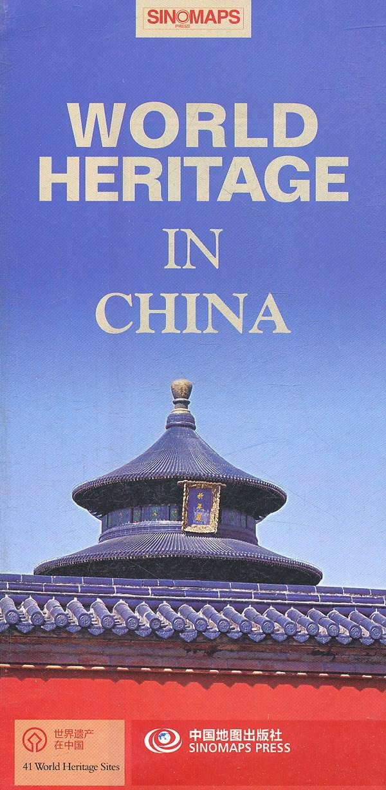

豆瓣条目《世界遗产在中国》（2008）的海报。

文章《强烈推荐36部儿童必看顶级纪录片》把它列在「历史文化」。全文只有名单和主题，没有这一部的剧情、年龄或播放链接。

**观看**：未找到可打开的正版播放页。

**来源文章**：
- [强烈推荐36部儿童必看顶级纪录片](https://mp.weixin.qq.com/s/N7tY4wyBz8yLYPtZCo3ENg)

### 南宋

- **分类**：{e['category']}
- **类型**：{e.get('kind') or '—'}
- **文章里的年龄**：{e.get('age_group') or '文章没有写'}

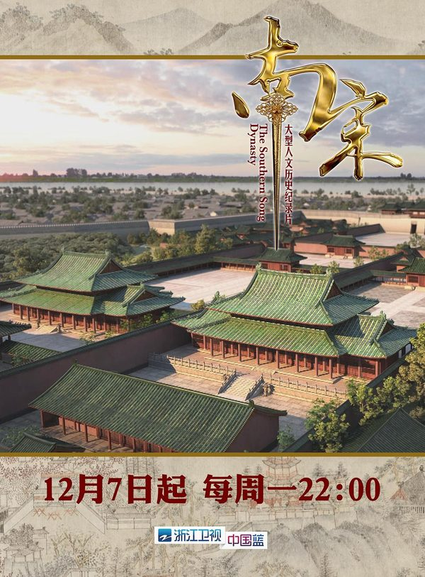

豆瓣条目《南宋》（2015）的海报。

文章《强烈推荐36部儿童必看顶级纪录片》把它列在「历史文化」。全文只有名单和主题，没有这一部的剧情、年龄或播放链接。

**观看**：未找到可打开的正版播放页。

**来源文章**：
- [强烈推荐36部儿童必看顶级纪录片](https://mp.weixin.qq.com/s/N7tY4wyBz8yLYPtZCo3ENg)

### 从秦始皇到汉武帝

- **分类**：{e['category']}
- **类型**：{e.get('kind') or '—'}
- **文章里的年龄**：{e.get('age_group') or '文章没有写'}

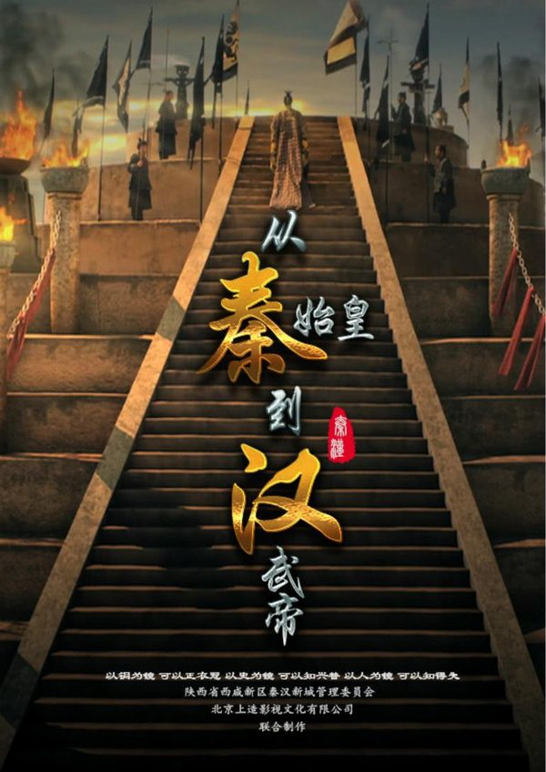

豆瓣条目《从秦始皇到汉武帝》（2016）的海报。

文章《强烈推荐36部儿童必看顶级纪录片》把它列在「历史文化」。全文只有名单和主题，没有这一部的剧情、年龄或播放链接。

**观看**：[https://www.iqiyi.com/v_21cda6wrha4.html](https://www.iqiyi.com/v_21cda6wrha4.html)

爱奇艺搜索结果里标题正好是《从秦始皇到汉武帝》的页面（频道：纪录片,3）。

**来源文章**：
- [强烈推荐36部儿童必看顶级纪录片](https://mp.weixin.qq.com/s/N7tY4wyBz8yLYPtZCo3ENg)

### 大明宫

- **分类**：{e['category']}
- **类型**：{e.get('kind') or '—'}
- **文章里的年龄**：{e.get('age_group') or '文章没有写'}

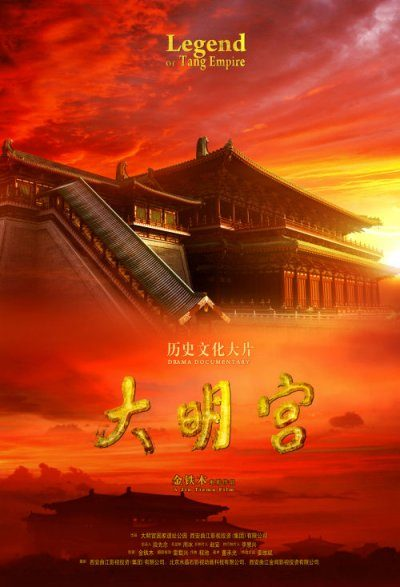

豆瓣条目《大明宫》（2009）的海报。

文章《强烈推荐36部儿童必看顶级纪录片》把它列在「历史文化」。全文只有名单和主题，没有这一部的剧情、年龄或播放链接。

**观看**：[https://www.iqiyi.com/v_1rs6w1r6nb0.html](https://www.iqiyi.com/v_1rs6w1r6nb0.html)

爱奇艺搜索结果里标题正好是《大明宫》的页面（频道：纪录片,3）。

**来源文章**：
- [强烈推荐36部儿童必看顶级纪录片](https://mp.weixin.qq.com/s/N7tY4wyBz8yLYPtZCo3ENg)

### 故宫

- **分类**：{e['category']}
- **类型**：{e.get('kind') or '—'}
- **文章里的年龄**：{e.get('age_group') or '文章没有写'}

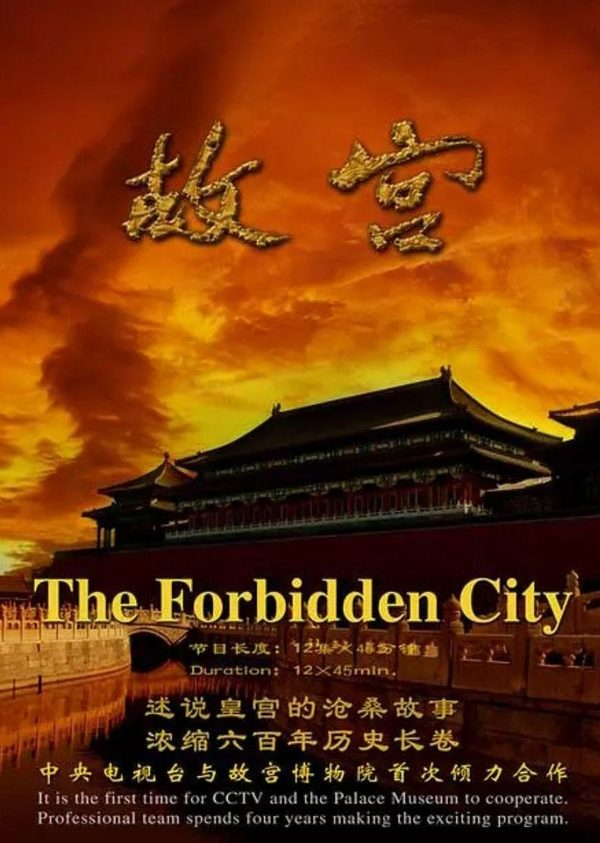

豆瓣条目《故宫》（2005）的海报。

文章《强烈推荐36部儿童必看顶级纪录片》把它列在「历史文化」。全文只有名单和主题，没有这一部的剧情、年龄或播放链接。

**观看**：未找到可打开的正版播放页。

**来源文章**：
- [强烈推荐36部儿童必看顶级纪录片](https://mp.weixin.qq.com/s/N7tY4wyBz8yLYPtZCo3ENg)

### 三国的世界

- **分类**：{e['category']}
- **类型**：{e.get('kind') or '—'}
- **文章里的年龄**：{e.get('age_group') or '文章没有写'}

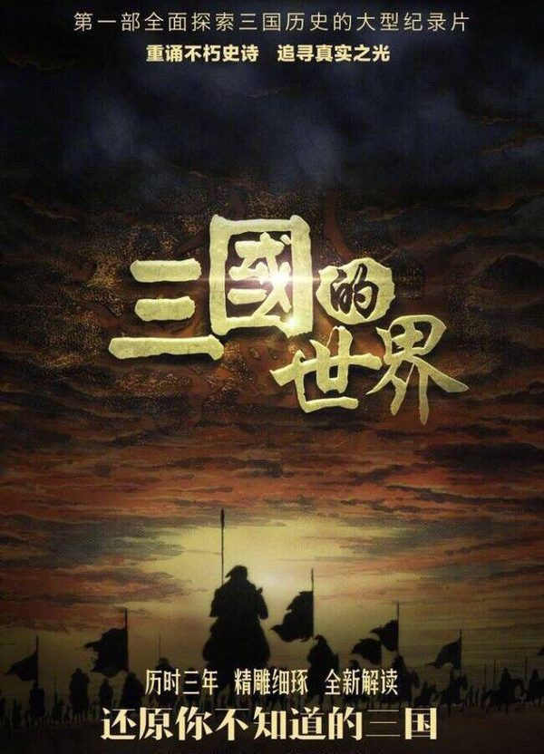

豆瓣条目《三国的世界》（2018）的海报。

文章《强烈推荐36部儿童必看顶级纪录片》把它列在「历史文化」。全文只有名单和主题，没有这一部的剧情、年龄或播放链接。

**观看**：[https://www.iqiyi.com/v_nsry7bet4w.html](https://www.iqiyi.com/v_nsry7bet4w.html)

爱奇艺搜索结果里标题正好是《三国的世界》的页面（频道：纪录片,3）。

**来源文章**：
- [强烈推荐36部儿童必看顶级纪录片](https://mp.weixin.qq.com/s/N7tY4wyBz8yLYPtZCo3ENg)

### 航拍中国

- **分类**：{e['category']}
- **类型**：{e.get('kind') or '—'}
- **文章里的年龄**：{e.get('age_group') or '文章没有写'}

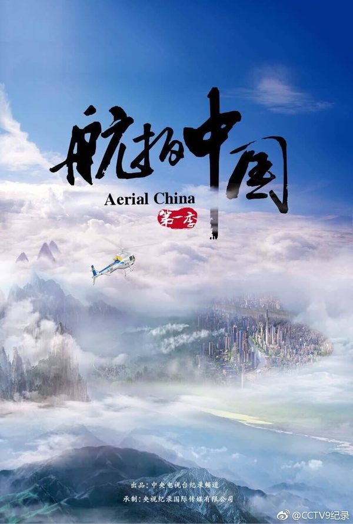

豆瓣条目《航拍中国 第一季》（2017）的海报。

文章《强烈推荐36部儿童必看顶级纪录片》把它列在「中国东方神韵」。全文只有名单和主题，没有这一部的剧情、年龄或播放链接。

**观看**：[https://www.iqiyi.com/v_1xe2qpncpz0.html?playertype=immersiveShort](https://www.iqiyi.com/v_1xe2qpncpz0.html?playertype=immersiveShort)

爱奇艺搜索结果里标题正好是《航拍中国》的页面（频道：纪录片,3）。

**来源文章**：
- [强烈推荐36部儿童必看顶级纪录片](https://mp.weixin.qq.com/s/N7tY4wyBz8yLYPtZCo3ENg)

### 第三极

- **分类**：{e['category']}
- **类型**：{e.get('kind') or '—'}
- **文章里的年龄**：{e.get('age_group') or '文章没有写'}

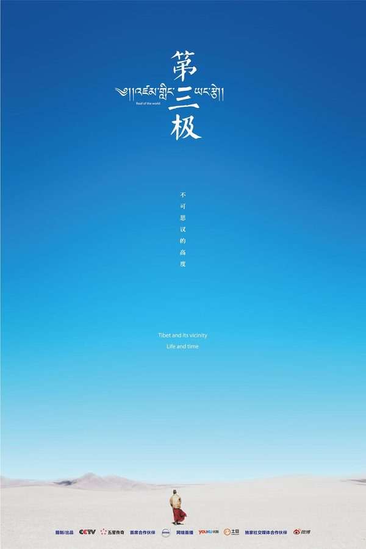

豆瓣条目《第三极》（2015）的海报。

文章《强烈推荐36部儿童必看顶级纪录片》把它列在「中国东方神韵」。全文只有名单和主题，没有这一部的剧情、年龄或播放链接。

**观看**：[https://www.iqiyi.com/v_29cn79rnyw4.html](https://www.iqiyi.com/v_29cn79rnyw4.html)

爱奇艺搜索结果里标题正好是《第三极》的页面（频道：纪录片,3）。

**来源文章**：
- [强烈推荐36部儿童必看顶级纪录片](https://mp.weixin.qq.com/s/N7tY4wyBz8yLYPtZCo3ENg)

### 了不起的村落

- **分类**：{e['category']}
- **类型**：{e.get('kind') or '—'}
- **文章里的年龄**：{e.get('age_group') or '文章没有写'}

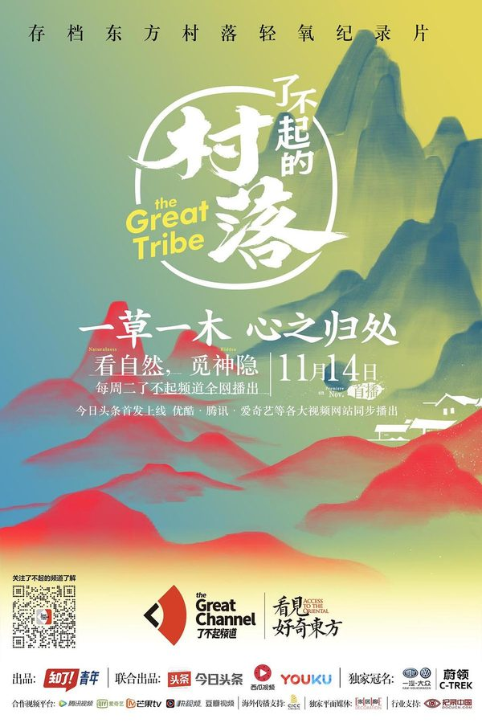

豆瓣条目《了不起的村落 第一季》（2017）的海报。

文章《强烈推荐36部儿童必看顶级纪录片》把它列在「中国东方神韵」。全文只有名单和主题，没有这一部的剧情、年龄或播放链接。

**观看**：[https://v.qq.com/x/cover/ys125s721vqcgo5/n0534bc3wcf.html](https://v.qq.com/x/cover/ys125s721vqcgo5/n0534bc3wcf.html)

腾讯视频页面。爱奇艺搜索里标题正好是《了不起的村落》，并跳到这个地址。

**来源文章**：
- [强烈推荐36部儿童必看顶级纪录片](https://mp.weixin.qq.com/s/N7tY4wyBz8yLYPtZCo3ENg)

### 河西走廊

- **分类**：{e['category']}
- **类型**：{e.get('kind') or '—'}
- **文章里的年龄**：{e.get('age_group') or '文章没有写'}

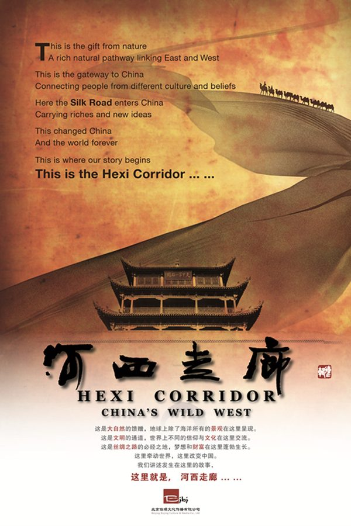

豆瓣条目《河西走廊》（2015）的海报。

文章《强烈推荐36部儿童必看顶级纪录片》把它列在「中国东方神韵」。全文只有名单和主题，没有这一部的剧情、年龄或播放链接。

**观看**：[https://www.iqiyi.com/v_svhjbuubps.html](https://www.iqiyi.com/v_svhjbuubps.html)

爱奇艺搜索结果里标题正好是《河西走廊》的页面（频道：纪录片,3）。

**来源文章**：
- [强烈推荐36部儿童必看顶级纪录片](https://mp.weixin.qq.com/s/N7tY4wyBz8yLYPtZCo3ENg)

### 美丽中国

- **分类**：{e['category']}
- **类型**：{e.get('kind') or '—'}
- **文章里的年龄**：{e.get('age_group') or '文章没有写'}

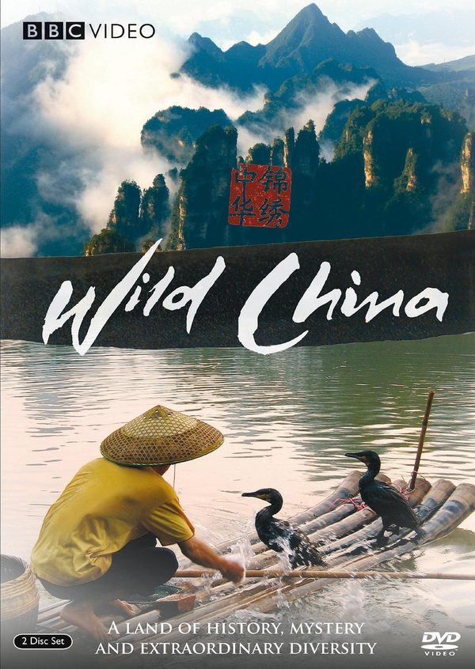

豆瓣条目《美丽中国》（2008）的海报。

文章《强烈推荐36部儿童必看顶级纪录片》把它列在「中国东方神韵」。全文只有名单和主题，没有这一部的剧情、年龄或播放链接。

**观看**：[https://www.iqiyi.com/v_19rrjt2elk.html](https://www.iqiyi.com/v_19rrjt2elk.html)

爱奇艺搜索结果里标题正好是《美丽中国》的页面（频道：纪录片,3）。

**来源文章**：
- [强烈推荐36部儿童必看顶级纪录片](https://mp.weixin.qq.com/s/N7tY4wyBz8yLYPtZCo3ENg)

### 天山脚下

- **分类**：{e['category']}
- **类型**：{e.get('kind') or '—'}
- **文章里的年龄**：{e.get('age_group') or '文章没有写'}

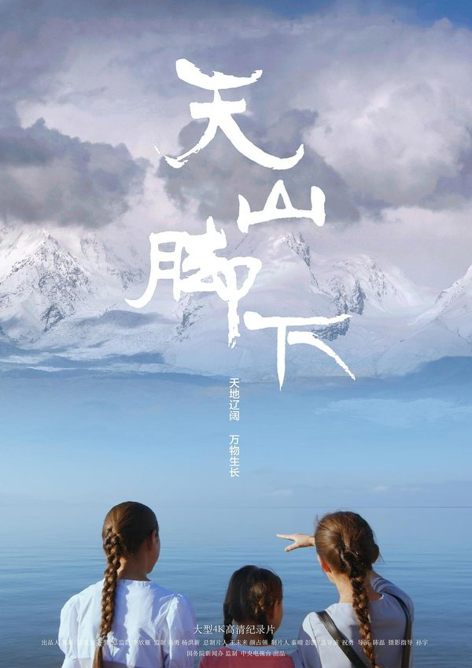

豆瓣条目《天山脚下》（2018）的海报。

文章《强烈推荐36部儿童必看顶级纪录片》把它列在「中国东方神韵」。全文只有名单和主题，没有这一部的剧情、年龄或播放链接。

**观看**：[https://www.iqiyi.com/v_19rr1xgrn8.html?playertype=immersiveShort](https://www.iqiyi.com/v_19rr1xgrn8.html?playertype=immersiveShort)

爱奇艺搜索结果里标题正好是《天山脚下》的页面（频道：纪录片,3）。

**来源文章**：
- [强烈推荐36部儿童必看顶级纪录片](https://mp.weixin.qq.com/s/N7tY4wyBz8yLYPtZCo3ENg)

### 此画怎讲

- **分类**：{e['category']}
- **类型**：{e.get('kind') or '—'}
- **文章里的年龄**：{e.get('age_group') or '文章没有写'}

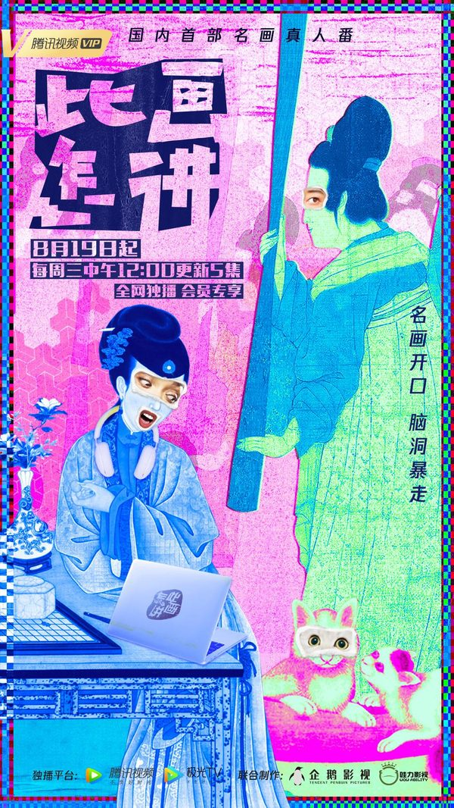

豆瓣条目《此画怎讲》（2020）的海报。

文章《强烈推荐36部儿童必看顶级纪录片》把它列在「艺术美学」。全文只有名单和主题，没有这一部的剧情、年龄或播放链接。

**观看**：[https://v.qq.com/x/cover/mzc00200r8ravfe/b0034jr2q96.html](https://v.qq.com/x/cover/mzc00200r8ravfe/b0034jr2q96.html)

腾讯视频页面。爱奇艺搜索里标题正好是《此画怎讲》，并跳到这个地址。

**来源文章**：
- [强烈推荐36部儿童必看顶级纪录片](https://mp.weixin.qq.com/s/N7tY4wyBz8yLYPtZCo3ENg)

### 啊！设计

- **分类**：{e['category']}
- **类型**：{e.get('kind') or '—'}
- **文章里的年龄**：{e.get('age_group') or '文章没有写'}

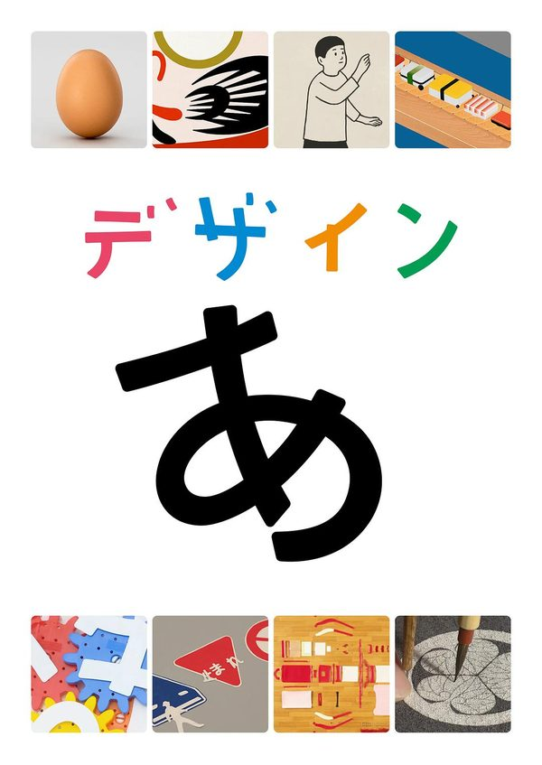

豆瓣条目《啊！设计》（2011）的海报。

文章《强烈推荐36部儿童必看顶级纪录片》把它列在「艺术美学」。全文只有名单和主题，没有这一部的剧情、年龄或播放链接。

**观看**：未找到可打开的正版播放页。

**来源文章**：
- [强烈推荐36部儿童必看顶级纪录片](https://mp.weixin.qq.com/s/N7tY4wyBz8yLYPtZCo3ENg)

### 艺术创世记

- **分类**：{e['category']}
- **类型**：{e.get('kind') or '—'}
- **文章里的年龄**：{e.get('age_group') or '文章没有写'}

**图片**：未找到可下载的海报或标题图。

文章《强烈推荐36部儿童必看顶级纪录片》把它列在「艺术美学」。全文只有名单和主题，没有这一部的剧情、年龄或播放链接。

**观看**：未找到可打开的正版播放页。

**来源文章**：
- [强烈推荐36部儿童必看顶级纪录片](https://mp.weixin.qq.com/s/N7tY4wyBz8yLYPtZCo3ENg)

### 文明

- **分类**：{e['category']}
- **类型**：{e.get('kind') or '—'}
- **文章里的年龄**：{e.get('age_group') or '文章没有写'}

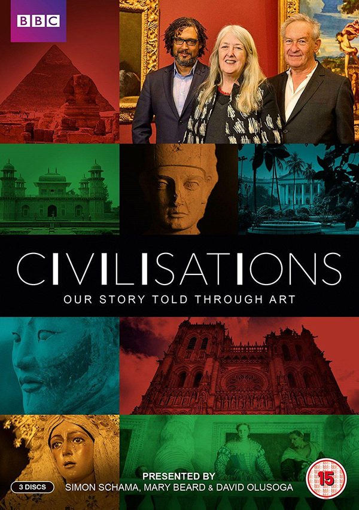

豆瓣条目《文明》（2018）的海报。

文章《强烈推荐36部儿童必看顶级纪录片》把它列在「艺术美学」。全文只有名单和主题，没有这一部的剧情、年龄或播放链接。

**观看**：[https://www.bbc.co.uk/programmes/p05xxp5j](https://www.bbc.co.uk/programmes/p05xxp5j)

维基数据登记的官方网站

**来源文章**：
- [强烈推荐36部儿童必看顶级纪录片](https://mp.weixin.qq.com/s/N7tY4wyBz8yLYPtZCo3ENg)

### 现代艺术大师

- **分类**：{e['category']}
- **类型**：{e.get('kind') or '—'}
- **文章里的年龄**：{e.get('age_group') or '文章没有写'}

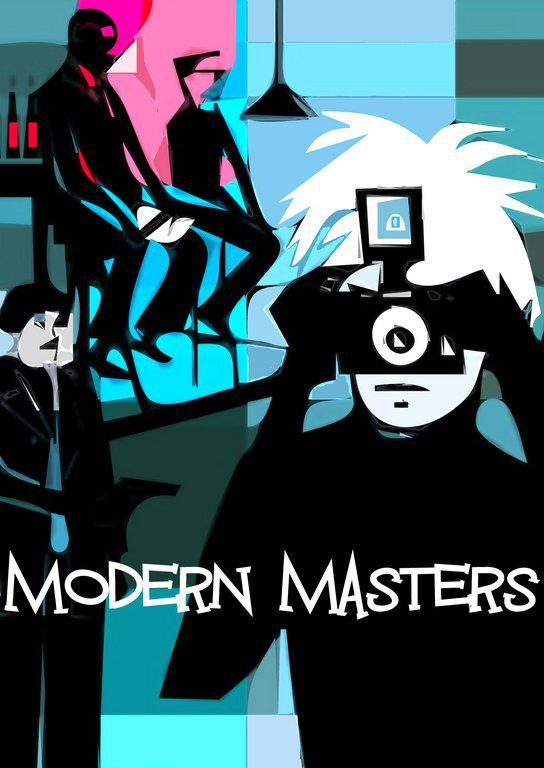

豆瓣条目《现代艺术大师》（2010）的海报。

文章《强烈推荐36部儿童必看顶级纪录片》把它列在「艺术美学」。全文只有名单和主题，没有这一部的剧情、年龄或播放链接。

**观看**：未找到可打开的正版播放页。

**来源文章**：
- [强烈推荐36部儿童必看顶级纪录片](https://mp.weixin.qq.com/s/N7tY4wyBz8yLYPtZCo3ENg)

### 卢浮宫的珍宝

- **分类**：{e['category']}
- **类型**：{e.get('kind') or '—'}
- **文章里的年龄**：{e.get('age_group') or '文章没有写'}

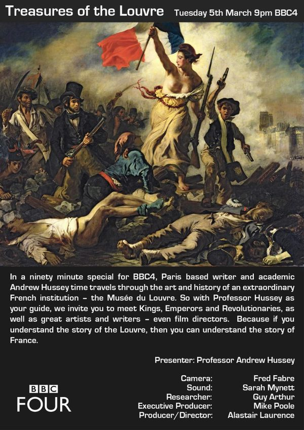

豆瓣条目《卢浮宫的珍宝》（2013）的海报。

文章《强烈推荐36部儿童必看顶级纪录片》把它列在「艺术美学」。全文只有名单和主题，没有这一部的剧情、年龄或播放链接。

**观看**：未找到可打开的正版播放页。

**来源文章**：
- [强烈推荐36部儿童必看顶级纪录片](https://mp.weixin.qq.com/s/N7tY4wyBz8yLYPtZCo3ENg)

### 意大利花园

- **分类**：{e['category']}
- **类型**：{e.get('kind') or '—'}
- **文章里的年龄**：{e.get('age_group') or '文章没有写'}

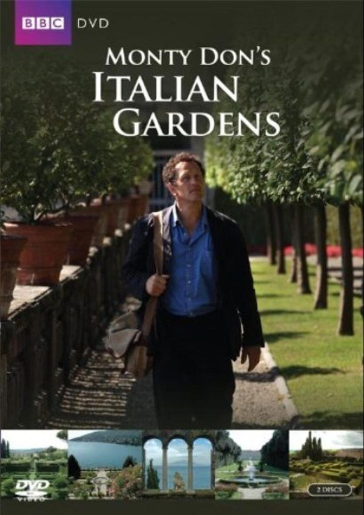

豆瓣条目《意大利花园》（2011）的海报。

文章《强烈推荐36部儿童必看顶级纪录片》把它列在「植物动物世界」。全文只有名单和主题，没有这一部的剧情、年龄或播放链接。

**观看**：未找到可打开的正版播放页。

**来源文章**：
- [强烈推荐36部儿童必看顶级纪录片](https://mp.weixin.qq.com/s/N7tY4wyBz8yLYPtZCo3ENg)

返回 [分类目录](catalog.md)。
