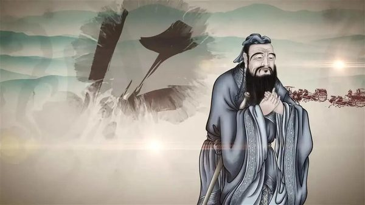
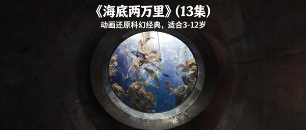

# 人文类

<!-- Generated by scripts/render_wechat_tables.py; edit data/catalog.json instead. -->

[返回首页](../../README.md) · [审核方法](review-method.md) · [不推荐](not-recommended.md) · [文章28待核验](pending-article-28.md)

本页 23 条，按强烈推荐→推荐→有保留排序。**有保留不等于推荐；年龄不等于听力难度；图片不证明适龄。**

每行一部，名称下的文章编号链接原文。适龄为审核建议；折叠的“原文说法”不代表采信。缩略图可点开放大，图下注明海报、旧图或文字封面；长简介可展开。

未注明已核实的豆瓣/IMDb评分和人数一律视为未核实；公众号评分不作独立证据。独立评测不等于教育效果证明，相关App/合集也不是单片认证。视频列仅保留官方入口等已记录地址，**不代表免费、完整或当地可播正片**；候选地址不展示。完整字段见[主目录数据](../../data/catalog.json)。

| 图片 | 名称 | 判断 | 适龄 | 简介 | 研判 | 证据状态 | 视频链接 |
| --- | --- | --- | --- | --- | --- | --- | --- |
|  [公众号通用图（非本片海报）](<https://mmbiz.qpic.cn/mmbiz_jpg/Fb3Efks8pLTx10Zwdeayr61SAMmSxibMt9CWVZr9D0S3N16G3CQYJolJs3rRvFcCJHlz2T14WCN65DRuxjIicKJRoHibNRicvUYrAicPY4dAMUD8/0?wx_fmt=jpeg>) | 三十六个字 [文章12](<https://mp.weixin.qq.com/s/Iy-SwhNQC6IFAAsECwqseQ>) | 有保留 | 5+（编辑暂议） 

原文说法
5岁以上
 | 文章写豆瓣8.7、适合5岁以上，上海美术电影制片厂短片。父亲用36个象形字串成故事，日、月、山、水、木、林从字变成画面。文章写它得过萨格勒布国际动画电影节教育片奖。 | 文字形象化可配合识字和书写，但把汉字变化讲成故事不等于严谨字源学；缺少独立学习效果与适龄证据，家长需核对具体字形和解释。 | 证据不足，编辑保守初筛 置信度：低 未取得作品级独立依据 | 未核实正版正片 |
|  [旧图（未逐张鉴定）](<https://mmbiz.qpic.cn/sz_mmbiz_jpg/Dbr7hULyqPJpFsXC9su9vn9IHhf5sNWEvF2V2oBHCASQ1ajmIzg10Fl0KFMjbbCmSgBic5qYxLXtZIBXtEzicyrnMAhZRO0GJRV3XXN9S/0?wx_fmt=jpeg>) | 三国的世界 [文章17](<https://mp.weixin.qq.com/s/N7tY4wyBz8yLYPtZCo3ENg>) | 有保留 | 12+（编辑暂议） 

原文说法
只列片名
 | 文章《强烈推荐36部儿童必看顶级纪录片》把它列在「历史文化」。全文只有名单和主题，没有这一部的剧情、年龄或播放链接。 | 先核实是否为纪录片而非同名课程或二创；三国史、演义和影视演绎必须区分。战争和政治谋略也不能自动等于儿童品格教材。 | 证据不足，编辑保守初筛 置信度：低 未取得作品级独立依据 | 未核实正版正片 |
|  [旧图（未逐张鉴定）](<https://mmbiz.qpic.cn/sz_mmbiz_jpg/Dbr7hULyqPJpFsXC9su9vn9IHhf5sNWEvF2V2oBHCASQ1ajmIzg10Fl0KFMjbbCmSgBic5qYxLXtZIBXtEzicyrnMAhZRO0GJRV3XXN9S/0?wx_fmt=jpeg>) | 世界遗产在中国 [文章17](<https://mp.weixin.qq.com/s/N7tY4wyBz8yLYPtZCo3ENg>) | 有保留 | 10+（编辑暂议） 

原文说法
只列片名
 | 文章《强烈推荐36部儿童必看顶级纪录片》把它列在「历史文化」。全文只有名单和主题，没有这一部的剧情、年龄或播放链接。 | 遗产影像可拓展文化视野，但需要区分保护现状、历史考证与宣传语言；现有清单没有作品级独立评测或逐集证据。 | 证据不足，编辑保守初筛 置信度：低 未取得作品级独立依据 | 未核实正版正片 |
|  [公众号通用图（非本片海报）](<https://mmbiz.qpic.cn/mmbiz_jpg/Fb3Efks8pLTx10Zwdeayr61SAMmSxibMt9CWVZr9D0S3N16G3CQYJolJs3rRvFcCJHlz2T14WCN65DRuxjIicKJRoHibNRicvUYrAicPY4dAMUD8/0?wx_fmt=jpeg>) | 中国唱诗班 [文章12](<https://mp.weixin.qq.com/s/Iy-SwhNQC6IFAAsECwqseQ>) | 有保留 | 逐集判断 

原文说法
4岁以上
 | 文章写豆瓣9.1、适合4岁以上，全系列6集，单集5至15分钟，用动画讲古诗背后的事：《元日》《相思》《游子吟》。文章没有给播放链接。 | “唱诗班”包含不同题材短片，不能以一篇总介绍给整套统一分龄。诗词意境值得讨论，但历史背景、成人情感和每集强度要分别预看。 | 证据不足，编辑保守初筛 置信度：低 未取得作品级独立依据 | 未核实正版正片 |
|  [旧图（未逐张鉴定）](<https://mmbiz.qpic.cn/sz_mmbiz_jpg/Dbr7hULyqPLwltTCtR46fYbT0A0VQbaMMwsMyABtnNSsHCUIegecqvbWMJYnpwmIw4OZ8Wn8KgibYD2AgrKsnAC54jzVs6eNYbD8Vicul/0?wx_fmt=jpeg>) | 了不起的村落 [文章17](<https://mp.weixin.qq.com/s/N7tY4wyBz8yLYPtZCo3ENg>) | 有保留 | 10+（编辑暂议） 

原文说法
只列片名
 | 文章《强烈推荐36部儿童必看顶级纪录片》把它列在「中国东方神韵」。全文只有名单和主题，没有这一部的剧情、年龄或播放链接。 | 乡村文化可讨论，但短片式叙事容易选择性呈现；不应将个别村落当全部农村。尚无逐集独立来源支持儿童普适推荐。 | 证据不足，编辑保守初筛 置信度：低 未取得作品级独立依据 | 未核实正版正片 |
|  [旧图（未逐张鉴定）](<https://mmbiz.qpic.cn/sz_mmbiz_jpg/Dbr7hULyqPJpFsXC9su9vn9IHhf5sNWEvF2V2oBHCASQ1ajmIzg10Fl0KFMjbbCmSgBic5qYxLXtZIBXtEzicyrnMAhZRO0GJRV3XXN9S/0?wx_fmt=jpeg>) | 从秦始皇到汉武帝 [文章17](<https://mp.weixin.qq.com/s/N7tY4wyBz8yLYPtZCo3ENg>) | 有保留 | 12+（编辑暂议） 

原文说法
只列片名
 | 文章《强烈推荐36部儿童必看顶级纪录片》把它列在「历史文化」。全文只有名单和主题，没有这一部的剧情、年龄或播放链接。 | 帝国史的权力斗争和战争不宜只当英雄故事；需要交叉核对史料与重演。没有独立儿童分龄，不能从高分或国家出品直接推导优质儿童教育。 | 证据不足，编辑保守初筛 置信度：低 未取得作品级独立依据 | 未核实正版正片 |
|  [旧图（未逐张鉴定）](<https://mmbiz.qpic.cn/mmbiz_jpg/SeWBVyE5nnBBxUGN0xBS27ib1pcvp0iaFJO28f2MhibH1LibrZ0gibmAFzQsJ1QBSGx53UAHJFE8sw7NiaXqP7Z548Iw/640?wx_fmt=jpeg>) | 你好中国 Hello China [文章2](<https://mp.weixin.qq.com/s/dslJ5aUjENI_CwzopVM2Sg>) | 有保留 | 8+（编辑暂议） 

原文说法
未标明年龄
 | 

文章说这套片由国家广电总局牵头，100集，每集几分钟，用一个代表中国的词讲历史、文化、地理和经济，例子包括筷子、长城、饺子、七夕、功夫、算盘、孔子、火锅和糖葫芦…（展开）
文章说这套片由国家广电总局牵头，100集，每集几分钟，用一个代表中国的词讲历史、文化、地理和经济，例子包括筷子、长城、饺子、七夕、功夫、算盘、孔子、火锅和糖葫芦。全英文配音，带中英双语字幕，画风被写成水墨。文章没有写年龄。
 | 英语介绍中国文化可作语言材料，但“国家级出品”不等于客观或适龄；文化宣传的叙述视角、史实和词汇难度需教师逐集核对，作品级独立评测未核实。 | 证据不足，编辑保守初筛 置信度：低 未取得作品级独立依据 | 未核实正版正片 |
|  [旧图（未逐张鉴定）](<https://mmbiz.qpic.cn/sz_mmbiz_jpg/Dbr7hULyqPJpFsXC9su9vn9IHhf5sNWEvF2V2oBHCASQ1ajmIzg10Fl0KFMjbbCmSgBic5qYxLXtZIBXtEzicyrnMAhZRO0GJRV3XXN9S/0?wx_fmt=jpeg>) | 南宋 [文章17](<https://mp.weixin.qq.com/s/N7tY4wyBz8yLYPtZCo3ENg>) | 有保留 | 12+（编辑暂议） 

原文说法
只列片名
 | 文章《强烈推荐36部儿童必看顶级纪录片》把它列在「历史文化」。全文只有名单和主题，没有这一部的剧情、年龄或播放链接。 | 历史重演与史料不是同一证据等级；南宋政治文化需要背景知识。仅列片名无法验证准确性、叙事立场或战争画面对儿童的强度。 | 证据不足，编辑保守初筛 置信度：低 未取得作品级独立依据 | 未核实正版正片 |
|  [旧图（未逐张鉴定）](<https://mmbiz.qpic.cn/mmbiz_jpg/Dbr7hULyqPIic1ib6BBoprEVfW7iaxI6PtIDrEfLzzkA3KAwJeq0UvLDkpZkAbc12Zd70YSP2iblGNNN3XKNYzpmQSE0mib1iajBmhiaxpth/0?wx_fmt=jpeg>) | 卢浮宫的珍宝 [文章17](<https://mp.weixin.qq.com/s/N7tY4wyBz8yLYPtZCo3ENg>) | 有保留 | 10+（编辑暂议） 

原文说法
只列片名
 | 文章《强烈推荐36部儿童必看顶级纪录片》把它列在「艺术美学」。全文只有名单和主题，没有这一部的剧情、年龄或播放链接。 | 博物馆导览有价值，但需补充文物来源、殖民收藏史与多种解释，不只欣赏“珍宝”。独立儿童评测和准确集目未核实。 | 证据不足，编辑保守初筛 置信度：低 未取得作品级独立依据 | 未核实正版正片 |
|  [旧图（未逐张鉴定）](<https://mmbiz.qpic.cn/mmbiz_jpg/Dbr7hULyqPIic1ib6BBoprEVfW7iaxI6PtIDrEfLzzkA3KAwJeq0UvLDkpZkAbc12Zd70YSP2iblGNNN3XKNYzpmQSE0mib1iajBmhiaxpth/0?wx_fmt=jpeg>) | 啊！设计 [文章17](<https://mp.weixin.qq.com/s/N7tY4wyBz8yLYPtZCo3ENg>) | 有保留 | 6+（编辑暂议） 

原文说法
只列片名
 | 文章《强烈推荐36部儿童必看顶级纪录片》把它列在「艺术美学」。全文只有名单和主题，没有这一部的剧情、年龄或播放链接。 | 日常设计可联系观察与动手活动，但节目目标年龄、语言和具体版本尚未核实；看懂画面不等于掌握设计方法，需配真实制作与讨论。 | 证据不足，编辑保守初筛 置信度：低 未取得作品级独立依据 | 未核实正版正片 |
|  [旧图（未逐张鉴定）](<https://mmbiz.qpic.cn/sz_mmbiz_jpg/Dbr7hULyqPJpFsXC9su9vn9IHhf5sNWEvF2V2oBHCASQ1ajmIzg10Fl0KFMjbbCmSgBic5qYxLXtZIBXtEzicyrnMAhZRO0GJRV3XXN9S/0?wx_fmt=jpeg>) | 大明宫 [文章17](<https://mp.weixin.qq.com/s/N7tY4wyBz8yLYPtZCo3ENg>) | 有保留 | 10+（编辑暂议） 

原文说法
只列片名
 | 文章《强烈推荐36部儿童必看顶级纪录片》把它列在「历史文化」。全文只有名单和主题，没有这一部的剧情、年龄或播放链接。 | 建筑复原和历史戏剧化有吸引力，但应区分考古证据与推测。文章未给出逐集独立依据，成人需筛选政治暴力与死亡叙事。 | 证据不足，编辑保守初筛 置信度：低 未取得作品级独立依据 | 未核实正版正片 |
|  [旧图（未逐张鉴定）](<https://mmbiz.qpic.cn/sz_mmbiz_jpg/Dbr7hULyqPLwltTCtR46fYbT0A0VQbaMMwsMyABtnNSsHCUIegecqvbWMJYnpwmIw4OZ8Wn8KgibYD2AgrKsnAC54jzVs6eNYbD8Vicul/0?wx_fmt=jpeg>) | 天山脚下 [文章17](<https://mp.weixin.qq.com/s/N7tY4wyBz8yLYPtZCo3ENg>) | 有保留 | 10+（编辑暂议） 

原文说法
只列片名
 | 文章《强烈推荐36部儿童必看顶级纪录片》把它列在「中国东方神韵」。全文只有名单和主题，没有这一部的剧情、年龄或播放链接。 | 地方生活影像可引出文化讨论，但需解释拍摄选择和叙述视角，避免将单一叙事当完整地方社会。独立儿童适龄与集目未核实。 | 证据不足，编辑保守初筛 置信度：低 未取得作品级独立依据 | 未核实正版正片 |
|  [旧图（未逐张鉴定）](<https://mmbiz.qpic.cn/mmbiz_jpg/Dbr7hULyqPIuDpBLPMWBTVUoGhnew2PxC4cIf3po4t3h4yPDjwSicDLT39DFx8FjIfbO34iaqsSUjd0QPicF4HewA2GDLhYlkb7iczOZAhzW/0?wx_fmt=jpeg>) | 意大利花园 [文章17](<https://mp.weixin.qq.com/s/N7tY4wyBz8yLYPtZCo3ENg>) | 有保留 | 10+（编辑暂议） 

原文说法
只列片名
 | 文章《强烈推荐36部儿童必看顶级纪录片》把它列在「植物动物世界」。全文只有名单和主题，没有这一部的剧情、年龄或播放链接。 | 园林审美与历史可延伸学习，但成人主持纪录不等于儿童课程；文化、阶级和劳动背景值得讨论。尚缺作品级独立儿童评测。 | 证据不足，编辑保守初筛 置信度：低 未取得作品级独立依据 | 未核实正版正片 |
|  [旧图（未逐张鉴定）](<https://mmbiz.qpic.cn/sz_mmbiz_jpg/Dbr7hULyqPJpFsXC9su9vn9IHhf5sNWEvF2V2oBHCASQ1ajmIzg10Fl0KFMjbbCmSgBic5qYxLXtZIBXtEzicyrnMAhZRO0GJRV3XXN9S/0?wx_fmt=jpeg>) | 故宫 [文章17](<https://mp.weixin.qq.com/s/N7tY4wyBz8yLYPtZCo3ENg>) | 有保留 | 10+（编辑暂议） 

原文说法
只列片名
 | 文章《强烈推荐36部儿童必看顶级纪录片》把它列在「历史文化」。全文只有名单和主题，没有这一部的剧情、年龄或播放链接。 | 故宫有多个系列，须先确定版本。建筑、文物和制度史适合延伸学习，但宫廷叙述可能过度简化，且缺少相应独立儿童评测。 | 证据不足，编辑保守初筛 置信度：低 未取得作品级独立依据 | 未核实正版正片 |
|  [旧图（未逐张鉴定）](<https://mmbiz.qpic.cn/mmbiz_jpg/Dbr7hULyqPIic1ib6BBoprEVfW7iaxI6PtIDrEfLzzkA3KAwJeq0UvLDkpZkAbc12Zd70YSP2iblGNNN3XKNYzpmQSE0mib1iajBmhiaxpth/0?wx_fmt=jpeg>) | 文明 [文章17](<https://mp.weixin.qq.com/s/N7tY4wyBz8yLYPtZCo3ENg>) | 有保留 | 12+（编辑暂议） 

原文说法
只列片名
 | 文章《强烈推荐36部儿童必看顶级纪录片》把它列在「艺术美学」。全文只有名单和主题，没有这一部的剧情、年龄或播放链接。 | “文明”有多个不同年代系列，艺术和历史视角也有争议。需要明确年份和主创，讨论地区与性别代表性，不能把单一文明叙事当全部人类历史。 | 证据不足，编辑保守初筛 置信度：低 未取得作品级独立依据 | [官方入口（非已验证正片）](<https://www.bbc.co.uk/programmes/p05xxp5j>) |
|  [旧图（未逐张鉴定）](<https://mmbiz.qpic.cn/mmbiz_jpg/Dbr7hULyqPIic1ib6BBoprEVfW7iaxI6PtIDrEfLzzkA3KAwJeq0UvLDkpZkAbc12Zd70YSP2iblGNNN3XKNYzpmQSE0mib1iajBmhiaxpth/0?wx_fmt=jpeg>) | 此画怎讲 [文章17](<https://mp.weixin.qq.com/s/N7tY4wyBz8yLYPtZCo3ENg>) | 有保留 | 10+（编辑暂议） 

原文说法
只列片名
 | 文章《强烈推荐36部儿童必看顶级纪录片》把它列在「艺术美学」。全文只有名单和主题，没有这一部的剧情、年龄或播放链接。 | 以幽默解读古画能引起兴趣，但现代段子与作品本义、史实要区分；可能并非为儿童制作。没有独立儿童指南，不以好笑替代知识核验。 | 证据不足，编辑保守初筛 置信度：低 未取得作品级独立依据 | 未核实正版正片 |
|  [旧图（未逐张鉴定）](<https://mmbiz.qpic.cn/sz_mmbiz_jpg/Dbr7hULyqPLwltTCtR46fYbT0A0VQbaMMwsMyABtnNSsHCUIegecqvbWMJYnpwmIw4OZ8Wn8KgibYD2AgrKsnAC54jzVs6eNYbD8Vicul/0?wx_fmt=jpeg>) | 河西走廊 [文章17](<https://mp.weixin.qq.com/s/N7tY4wyBz8yLYPtZCo3ENg>) | 有保留 | 12+（编辑暂议） 

原文说法
只列片名
 | 文章《强烈推荐36部儿童必看顶级纪录片》把它列在「中国东方神韵」。全文只有名单和主题，没有这一部的剧情、年龄或播放链接。 | 丝路历史有跨文化学习潜力，也有政治军事与宏大叙事；历史重演、史料和解说推论要分开。独立儿童适龄证据未核实。 | 证据不足，编辑保守初筛 置信度：低 未取得作品级独立依据 | 未核实正版正片 |
|  [旧图（未逐张鉴定）](<https://mmbiz.qpic.cn/mmbiz_jpg/zPQhETG3LfSyrzOfIbv1iaibMJv9Med2pYic61YMgrF74PTNnibFHAsBFXBUQgBulib7y1yyTSEcXPz9vlMoqrRdJ3LMVb7Qp2ZDLT7lDaZDSibT4/0?wx_fmt=jpeg>) | 海底两万里 [文章5](<https://mp.weixin.qq.com/s/xIBZbBPtG6ybBpwzQP_3ow>) | 有保留 | 未核实 

原文说法
3-12岁
 | 

文章推荐的是动画版，写明10集、每集10–15分钟，适合3–12岁。故事按原著：1866年海怪传闻引出追捕，阿龙纳斯、康塞尔和尼德兰落水后登上尼摩船长的潜艇，开…（展开）
文章推荐的是动画版，写明10集、每集10–15分钟，适合3–12岁。故事按原著：1866年海怪传闻引出追捕，阿龙纳斯、康塞尔和尼德兰落水后登上尼摩船长的潜艇，开始深海旅行。文章没有给出这一版动画的制作公司，也没有播放链接。
 | 《海底两万里》有多个动画与真人版本；文章的“10集+”尚不足以锁定制作年份和版本，3—12岁范围过宽。先确认身份、危险场面和语言难度。 | 证据不足，编辑保守初筛 置信度：低 未取得作品级独立依据 | 未核实正版正片 |
|  [旧图（未逐张鉴定）](<https://mmbiz.qpic.cn/mmbiz_jpg/Dbr7hULyqPIic1ib6BBoprEVfW7iaxI6PtIDrEfLzzkA3KAwJeq0UvLDkpZkAbc12Zd70YSP2iblGNNN3XKNYzpmQSE0mib1iajBmhiaxpth/0?wx_fmt=jpeg>) | 现代艺术大师 [文章17](<https://mp.weixin.qq.com/s/N7tY4wyBz8yLYPtZCo3ENg>) | 有保留 | 12+（编辑暂议） 

原文说法
只列片名
 | 文章《强烈推荐36部儿童必看顶级纪录片》把它列在「艺术美学」。全文只有名单和主题，没有这一部的剧情、年龄或播放链接。 | 现代艺术需要文化语境，不能用“看世界名画”替代理解；裸露与成人题材需逐集核查。具体版本和独立儿童年龄未核实。 | 证据不足，编辑保守初筛 置信度：低 未取得作品级独立依据 | 未核实正版正片 |
|  [旧图（未逐张鉴定）](<https://mmbiz.qpic.cn/sz_mmbiz_jpg/Dbr7hULyqPLwltTCtR46fYbT0A0VQbaMMwsMyABtnNSsHCUIegecqvbWMJYnpwmIw4OZ8Wn8KgibYD2AgrKsnAC54jzVs6eNYbD8Vicul/0?wx_fmt=jpeg>) | 第三极 [文章17](<https://mp.weixin.qq.com/s/N7tY4wyBz8yLYPtZCo3ENg>) | 有保留 | 10+（编辑暂议） 

原文说法
只列片名
 | 文章《强烈推荐36部儿童必看顶级纪录片》把它列在「中国东方神韵」。全文只有名单和主题，没有这一部的剧情、年龄或播放链接。 | 高原人文影像可增进了解，但需要避免把当地生活浪漫化；生计、动物处理和生命风险应先预看。作品级独立分龄未核实。 | 证据不足，编辑保守初筛 置信度：低 未取得作品级独立依据 | 未核实正版正片 |
|  [旧图（未逐张鉴定）](<https://mmbiz.qpic.cn/sz_mmbiz_jpg/Dbr7hULyqPLwltTCtR46fYbT0A0VQbaMMwsMyABtnNSsHCUIegecqvbWMJYnpwmIw4OZ8Wn8KgibYD2AgrKsnAC54jzVs6eNYbD8Vicul/0?wx_fmt=jpeg>) | 美丽中国 [文章17](<https://mp.weixin.qq.com/s/N7tY4wyBz8yLYPtZCo3ENg>) | 有保留 | 未核实 

原文说法
只列片名
 | 文章《强烈推荐36部儿童必看顶级纪录片》把它列在「中国东方神韵」。全文只有名单和主题，没有这一部的剧情、年龄或播放链接。 | 《美丽中国》存在多个版本，且条目被列为人文但可能实际以野生动物为主；先确认身份再分类。不能把同名高分当作品证据。 | 证据不足，编辑保守初筛 置信度：低 未取得作品级独立依据 | 未核实正版正片 |
|  [旧图（未逐张鉴定）](<https://mmbiz.qpic.cn/sz_mmbiz_jpg/Dbr7hULyqPLwltTCtR46fYbT0A0VQbaMMwsMyABtnNSsHCUIegecqvbWMJYnpwmIw4OZ8Wn8KgibYD2AgrKsnAC54jzVs6eNYbD8Vicul/0?wx_fmt=jpeg>) | 航拍中国 [文章17](<https://mp.weixin.qq.com/s/N7tY4wyBz8yLYPtZCo3ENg>) | 有保留 | 8+（编辑暂议） 

原文说法
只列片名
 | 文章《强烈推荐36部儿童必看顶级纪录片》把它列在「中国东方神韵」。全文只有名单和主题，没有这一部的剧情、年龄或播放链接。 | 航拍能建立地域尺度感，但旅游宣传与地理教学并不相同；应配地图和当地生活资料。暂缺此系列独立儿童分龄及认知效果证据。 | 证据不足，编辑保守初筛 置信度：低 未取得作品级独立依据 | 未核实正版正片 |
|  文字封面（非官方海报） | 艺术创世记 [文章17](<https://mp.weixin.qq.com/s/N7tY4wyBz8yLYPtZCo3ENg>) | 有保留 | 12+（编辑暂议） 

原文说法
只列片名
 | 文章《强烈推荐36部儿童必看顶级纪录片》把它列在「艺术美学」。全文只有名单和主题，没有这一部的剧情、年龄或播放链接。 | 艺术史长片可能涉及宗教、裸露或成人社会主题；此处只是风险筛查，不断言具体场面。须锁定版本并预看，独立儿童指南未核实。 | 证据不足，编辑保守初筛 置信度：低 未取得作品级独立依据 | 未核实正版正片 |
