# 动画娱乐类

<!-- Generated by scripts/render_wechat_tables.py; edit data/catalog.json instead. -->

[返回首页](../../README.md) · [审核方法](review-method.md) · [不推荐](not-recommended.md) · [文章28待核验](pending-article-28.md)

本页 56 条，按强烈推荐→推荐→有保留排序。**有保留不等于推荐；年龄不等于听力难度；图片不证明适龄。**

每行一部，名称下的文章编号链接原文。适龄为审核建议；折叠的“原文说法”不代表采信。缩略图可点开放大，图下注明海报、旧图或文字封面；长简介可展开。

未注明已核实的豆瓣/IMDb评分和人数一律视为未核实；公众号评分不作独立证据。独立评测不等于教育效果证明，相关App/合集也不是单片认证。视频列仅保留官方入口等已记录地址，**不代表免费、完整或当地可播正片**；候选地址不展示。完整字段见[主目录数据](../../data/catalog.json)。

| 图片 | 名称 | 判断 | 适龄 | 简介 | 研判 | 证据状态 | 视频链接 |
| --- | --- | --- | --- | --- | --- | --- | --- |
| <a href="../../images/review/wx28-c0746ef341a2.jpg">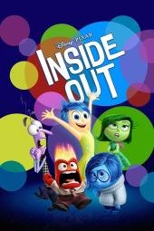</a> [评测页海报](<https://www.commonsensemedia.org/movie-reviews/inside-out>) | 头脑特工队1 Inside Out 原文年份：2015（未核实） [文章28](<https://mp.weixin.qq.com/s/kx7YqDwvnUhSYTM3Gh1f-Q>) | 强烈推荐 | 6+ 

原文说法
文章28没有逐片标注适龄
 | 女孩搬家后，拟人化情绪共同面对成长与失落。 | CSM建议6+；能帮助命名和接纳情绪，但包含危险、悲伤与角色消失。是心理隐喻而非大脑运行的精确科学模型。 | 作品级证据初审 置信度：中 [Common Sense Media](<https://www.commonsensemedia.org/movie-reviews/inside-out>) | 未核实正版正片 |
| <a href="../../images/review/wx28-dd4b70f5084e.jpg">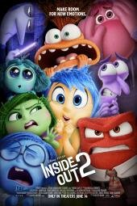</a> [评测页海报](<https://www.commonsensemedia.org/movie-reviews/inside-out-2>) | 头脑特工队2 Inside Out 2 原文年份：2024（未核实） [文章28](<https://mp.weixin.qq.com/s/kx7YqDwvnUhSYTM3Gh1f-Q>) | 强烈推荐 | 6+ 

原文说法
文章28没有逐片标注适龄
 | 莱莉进入青春期，新情绪焦焦等加入心灵团队。 | CSM建议6+；接纳不完美与认识焦虑值得讨论，仍有危险和青春期抽象概念。情绪角色是隐喻，不能用它替代真实心理支持。 | 作品级证据初审 置信度：中 [Common Sense Media](<https://www.commonsensemedia.org/movie-reviews/inside-out-2>) | 未核实正版正片 |
| <a href="../../images/review/wx28-351506d951f9.jpg">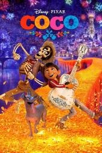</a> [评测页海报](<https://www.commonsensemedia.org/movie-reviews/coco>) | 寻梦环游记 Coco 原文年份：2017（未核实） [文章28](<https://mp.weixin.qq.com/s/kx7YqDwvnUhSYTM3Gh1f-Q>) | 强烈推荐 | 7+ 

原文说法
文章28没有逐片标注适龄
 | 爱音乐的男孩进入亡灵世界，重新理解家族记忆。 | CSM建议7+；文化、感恩和家庭联系有力，也有骨架、生死危险及悲伤。不能当所有家庭统一的死亡解释。 | 作品级证据初审 置信度：中 [Common Sense Media](<https://www.commonsensemedia.org/movie-reviews/coco>) | 未核实正版正片 |
| <a href="../../images/review/wx28-d99af05970ab.jpg">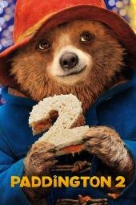</a> [评测页海报](<https://www.commonsensemedia.org/movie-reviews/paddington-2>) | 帕丁顿熊2 Paddington 2 原文年份：2017（未核实） [文章28](<https://mp.weixin.qq.com/s/kx7YqDwvnUhSYTM3Gh1f-Q>) | 强烈推荐 | 6+ 

原文说法
文章28没有逐片标注适龄
 | 小熊为礼物努力工作，却卷入失窃事件与监狱生活。 | CSM建议6+；善意、同理心与社区支持有力，仍有监禁的孤独及近乎溺水场面。适合共看，不是用无尽刷片替代社交。 | 作品级证据初审 置信度：中 [Common Sense Media](<https://www.commonsensemedia.org/movie-reviews/paddington-2>) | 未核实正版正片 |
| <a href="../../images/review/wx28-87c6637160a8.jpg">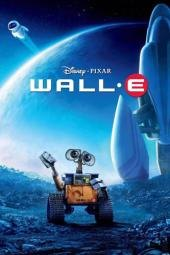</a> [评测页海报](<https://www.commonsensemedia.org/movie-reviews/wall-e>) | 机器人总动员 WALL-E 原文年份：2008（未核实） [文章28](<https://mp.weixin.qq.com/s/kx7YqDwvnUhSYTM3Gh1f-Q>) | 强烈推荐 | 5+ 

原文说法
文章28没有逐片标注适龄
 | 清洁机器人与探测机器人寻找地球和人类未来的可能。 | CSM建议5+；环保与照料值得讨论，也有激光、追逐和对胖者及残障的刻板描绘。前半几乎无对白，不是文章所称稳定对白精听样本。 | 作品级证据初审 置信度：中 [Common Sense Media](<https://www.commonsensemedia.org/movie-reviews/wall-e>) | 未核实正版正片 |
| <a href="../../images/review/wx28-d1c2bda06d41.jpg">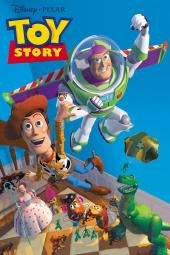</a> [评测页海报](<https://www.commonsensemedia.org/movie-reviews/toy-story>) | 玩具总动员 Toy Story 原文年份：1995（未核实） [文章28](<https://mp.weixin.qq.com/s/kx7YqDwvnUhSYTM3Gh1f-Q>) | 强烈推荐 | 5+ 

原文说法
文章28没有逐片标注适龄
 | 牛仔玩具与新来的太空玩具从竞争走向合作。 | CSM建议5+；友谊、团队和谦逊明确，但虐待玩具、火箭和恶犬仍可能吓人。注意大量商品联动，不把买周边当观看延伸。 | 作品级证据初审 置信度：中 [Common Sense Media](<https://www.commonsensemedia.org/movie-reviews/toy-story>) | 未核实正版正片 |
| <a href="../../images/review/wx28-a80eb8a74c21.jpg">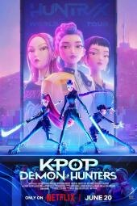</a> [评测页海报](<https://www.commonsensemedia.org/movie-reviews/kpop-demon-hunters>) | K-POP：猎魔女团 KPop Demon Hunters 原文年份：2025（未核实） [文章28](<https://mp.weixin.qq.com/s/kx7YqDwvnUhSYTM3Gh1f-Q>) | 推荐 | 10+ 

原文说法
文章28没有逐片标注适龄
 | 韩国流行女团同时肩负对抗恶魔的任务。 | CSM建议10+、PG；有灵魂被吸走、牺牲、打斗和恋慕。不能照抄原文将它与成人R级动画一概归类；年长孩子可在预看后选择。 | 作品级证据初审 置信度：中 [Common Sense Media](<https://www.commonsensemedia.org/movie-reviews/kpop-demon-hunters>) | 未核实正版正片 |
| <a href="../../images/review/wx28-7bef0069035d.jpg">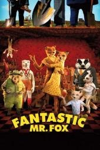</a> [评测页海报](<https://www.commonsensemedia.org/movie-reviews/fantastic-mr-fox>) | 了不起的狐狸爸爸 Fantastic Mr. Fox 原文年份：2009（未核实） [文章28](<https://mp.weixin.qq.com/s/kx7YqDwvnUhSYTM3Gh1f-Q>) | 推荐 | 7+ 

原文说法
文章28没有逐片标注适龄
 | 狐狸为偷食与农场主周旋，也面对家庭责任。 | CSM建议7+；枪支、爆炸、角色死亡和成人烟酒值得预告。干燥讽刺和伦理模糊不代表低龄孩子能靠慢语速理解。 | 作品级证据初审 置信度：中 [Common Sense Media](<https://www.commonsensemedia.org/movie-reviews/fantastic-mr-fox>) | 未核实正版正片 |
| <a href="../../images/review/wx28-7e5fdb15166c.jpg">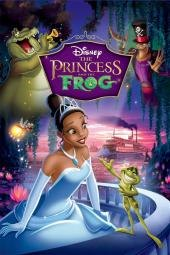</a> [评测页海报](<https://www.commonsensemedia.org/movie-reviews/the-princess-and-the-frog>) | 公主与青蛙 The Princess and the Frog 原文年份：2009（未核实） [文章28](<https://mp.weixin.qq.com/s/kx7YqDwvnUhSYTM3Gh1f-Q>) | 推荐 | 6+ 

原文说法
文章28没有逐片标注适龄
 | 新奥尔良女孩与变成青蛙的王子一起冒险。 | CSM建议6+；女主主动努力和文化表现有价值，阴影巫术、死亡与刻板配角仍需讨论，敏感孩子不宜直接放整片。 | 作品级证据初审 置信度：中 [Common Sense Media](<https://www.commonsensemedia.org/movie-reviews/the-princess-and-the-frog>) | 未核实正版正片 |
| <a href="../../images/review/wx28-141f1d43cfb1.jpg">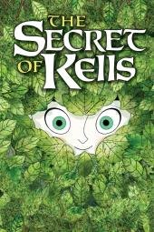</a> [评测页海报](<https://www.commonsensemedia.org/movie-reviews/the-secret-of-kells>) | 凯尔经的秘密 The Secret of Kells 原文年份：2009（未核实） [文章28](<https://mp.weixin.qq.com/s/kx7YqDwvnUhSYTM3Gh1f-Q>) | 推荐 | 9+ 

原文说法
文章28没有逐片标注适龄
 | 修道院少年在朋友帮助下探索手抄书与森林传说。 | CSM建议9+；有入侵、持剑杀戮与可怖狼蛇。美术、爱尔兰传说和宗教历史有学习潜力，不是低龄安抚片。 | 作品级证据初审 置信度：中 [Common Sense Media](<https://www.commonsensemedia.org/movie-reviews/the-secret-of-kells>) | 未核实正版正片 |
| <a href="../../images/review/wx28-f22721df3fc1.jpg">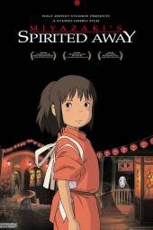</a> [评测页海报](<https://www.commonsensemedia.org/movie-reviews/spirited-away>) | 千与千寻 Spirited Away 原文年份：2001（未核实） [文章28](<https://mp.weixin.qq.com/s/kx7YqDwvnUhSYTM3Gh1f-Q>) | 推荐 | 9+ 

原文说法
文章28没有逐片标注适龄
 | 女孩误入神灵世界，为救父母学习工作与勇气。 | CSM建议9+；变形、怪物和流血龙较惊吓。英语是配音版，不是原生英语；不能把动画身份等同语言难度低。 | 作品级证据初审 置信度：中 [Common Sense Media](<https://www.commonsensemedia.org/movie-reviews/spirited-away>) | 未核实正版正片 |
| <a href="../../images/review/wx28-4c1805c0422e.jpg">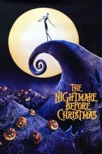</a> [评测页海报](<https://www.commonsensemedia.org/movie-reviews/the-nightmare-before-christmas>) | 圣诞夜惊魂 The Nightmare Before Christmas 原文年份：1993（未核实） [文章28](<https://mp.weixin.qq.com/s/kx7YqDwvnUhSYTM3Gh1f-Q>) | 推荐 | 7+ 

原文说法
文章28没有逐片标注适龄
 | 万圣镇的杰克尝试接管圣诞节。 | CSM建议7+；断开头肢的玩笑、亡灵与反派较恐怖，适合能区分幻想和现实的孩子；定格工艺不意味着温和。 | 作品级证据初审 置信度：中 [Common Sense Media](<https://www.commonsensemedia.org/movie-reviews/the-nightmare-before-christmas>) | 未核实正版正片 |
| <a href="../../images/review/wx28-0801b22f1fe1.jpg">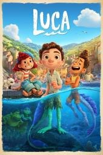</a> [评测页海报](<https://www.commonsensemedia.org/movie-reviews/luca>) | 夏日友晴天 Luca 原文年份：2021（未核实） [文章28](<https://mp.weixin.qq.com/s/kx7YqDwvnUhSYTM3Gh1f-Q>) | 推荐 | 6+ 

原文说法
文章28没有逐片标注适龄
 | 两个海中少年上岸，在意大利小镇建立友情。 | CSM建议6+；接纳差异与友谊积极，也有欺凌、逃家、危险跳跃和鱼叉威胁。可以讨论边界，不鼓励模仿冒险动作。 | 作品级证据初审 置信度：中 [Common Sense Media](<https://www.commonsensemedia.org/movie-reviews/luca>) | 未核实正版正片 |
| <a href="../../images/review/wx28-25eaea27e9c5.jpg">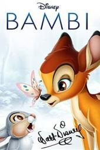</a> [评测页海报](<https://www.commonsensemedia.org/movie-reviews/bambi>) | 小鹿斑比1 Bambi 原文年份：1942（未核实） [文章28](<https://mp.weixin.qq.com/s/kx7YqDwvnUhSYTM3Gh1f-Q>) | 推荐 | 5+ 

原文说法
文章28没有逐片标注适龄
 | 小鹿在森林中成长并面对失去与生存。 | CSM建议5+；母亲被猎杀和森林火灾带来明显情绪冲击，不是平静无惊吓的动物启蒙，敏感孩子可延后。 | 作品级证据初审 置信度：中 [Common Sense Media](<https://www.commonsensemedia.org/movie-reviews/bambi>) | 未核实正版正片 |
| <a href="../../images/review/wx29-hilda.jpg">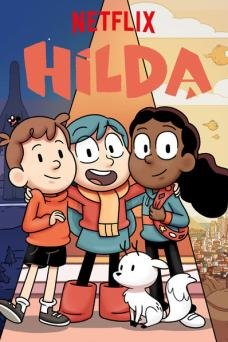</a> [评测页海报](<https://www.commonsensemedia.org/tv-reviews/hilda>) | 希尔达 Hilda [文章29](<https://mp.weixin.qq.com/s/X9krmKAuulTvIIAGGieWEg>) | 推荐 | 6+（CSM） 

原文说法
8-10岁
 | 文章说是北欧神话背景、蓝头发女孩主角，对话礼貌完整、几乎没有俚语，最适合当第一部看；推荐1–3季，文章把它排在8–10岁。 | CSM评6+，认可冒险与友谊主题，有坠崖、巨怪等险境，并明确以娱乐为主而非教育。画风温和、节奏不躁，可作英语原声入门；“听多自然会用”属文章推测，未核实豆瓣/IMDb分数。 | 作品级证据初审 置信度：中 [Common Sense Media](<https://www.commonsensemedia.org/tv-reviews/hilda>) | 未核实正版正片 |
| <a href="../../images/review/wx28-0bcadd332662.jpg">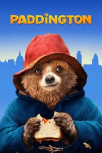</a> [评测页海报](<https://www.commonsensemedia.org/movie-reviews/paddington>) | 帕丁顿熊1 Paddington 原文年份：2014（未核实） [文章28](<https://mp.weixin.qq.com/s/kx7YqDwvnUhSYTM3Gh1f-Q>) | 推荐 | 6+ 

原文说法
文章28没有逐片标注适龄
 | 来自秘鲁的小熊被伦敦一家人接纳。 | CSM建议6+；善意与归属主题清楚，但地震丧亲、标本师绑架和险境不适合所有幼儿。是真人CG混合片，非纯动画。 | 作品级证据初审 置信度：中 [Common Sense Media](<https://www.commonsensemedia.org/movie-reviews/paddington>) | 未核实正版正片 |
| <a href="../../images/review/wx28-470d416a514d.jpg">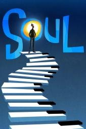</a> [评测页海报](<https://www.commonsensemedia.org/movie-reviews/soul>) | 心灵奇旅 Soul 原文年份：2020（未核实） [文章28](<https://mp.weixin.qq.com/s/kx7YqDwvnUhSYTM3Gh1f-Q>) | 推荐 | 8+ 

原文说法
文章28没有逐片标注适龄
 | 音乐教师在生死之间重新思考生活和目标。 | CSM建议8+，独立指南也指出更容易打动成人；死亡状态、身体交换及抽象存在主题可能使孩子困惑。不以“看不懂”评价孩子能力。 | 作品级证据初审 置信度：中 [Common Sense Media](<https://www.commonsensemedia.org/movie-reviews/soul>) | 未核实正版正片 |
| <a href="../../images/review/wx28-c33a3067d7a0.jpg">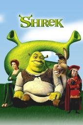</a> [评测页海报](<https://www.commonsensemedia.org/movie-reviews/shrek>) | 怪物史瑞克1 Shrek 原文年份：2001（未核实） [文章28](<https://mp.weixin.qq.com/s/kx7YqDwvnUhSYTM3Gh1f-Q>) | 推荐 | 6+ 

原文说法
文章28没有逐片标注适龄
 | 食人魔、驴与公主颠覆传统童话期待。 | CSM建议6+；包容外貌的主题有价值，也有成人双关、排泄笑话和卡通暴力。看得懂英语单词不等于理解讽刺语境。 | 作品级证据初审 置信度：中 [Common Sense Media](<https://www.commonsensemedia.org/movie-reviews/shrek>) | 未核实正版正片 |
| <a href="../../images/review/wx28-5c02f192cd92.jpg">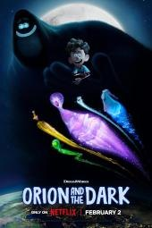</a> [评测页海报](<https://www.commonsensemedia.org/movie-reviews/orion-and-the-dark>) | 我的好朋友黑漆漆 Orion and the Dark 原文年份：2024（未核实） [文章28](<https://mp.weixin.qq.com/s/kx7YqDwvnUhSYTM3Gh1f-Q>) | 推荐 | 8+ 

原文说法
文章28没有逐片标注适龄
 | 焦虑男孩跟随黑暗化身探索自己害怕的事。 | CSM建议8+；能谈恐惧，但想象中的杀人小丑、坠落、欺凌与危险可能反而刺激敏感孩子，不是焦虑治疗工具。 | 作品级证据初审 置信度：中 [Common Sense Media](<https://www.commonsensemedia.org/movie-reviews/orion-and-the-dark>) | 未核实正版正片 |
| <a href="../../images/review/wx29-lilo-stitch-series.jpg">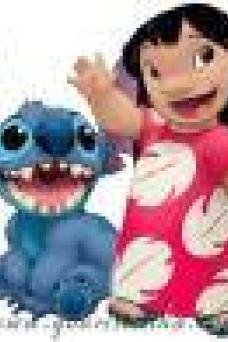</a> [评测页海报](<https://www.commonsensemedia.org/tv-reviews/lilo-stitch-the-series>) | 星际宝贝（剧集） Lilo &amp; Stitch: The Series [文章29](<https://mp.weixin.qq.com/s/X9krmKAuulTvIIAGGieWEg>) | 推荐 | 6+（CSM） 

原文说法
8-10岁
 | 文章说夏威夷背景，日常场景多、家庭对话比重高，语速在六部里偏慢；推荐1–2季，归在8–10岁。这是2003年剧集，不是已收录的2002年电影。 | CSM评6+，围绕友谊与家庭（“ohana”），有卡通式打闹和外星人追逐但较轻。整体温和适合小学低年级；语速偏慢为文章说法未独立核实，未核实豆瓣/IMDb分数。 | 作品级证据初审 置信度：中 [Common Sense Media](<https://www.commonsensemedia.org/tv-reviews/lilo-stitch-the-series>) | 未核实正版正片 |
| <a href="../../images/review/wx28-ed724213eee5.jpg">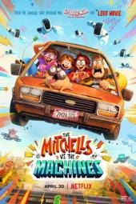</a> [评测页海报](<https://www.commonsensemedia.org/movie-reviews/the-mitchells-vs-the-machines>) | 智能大反攻 The Mitchells vs. the Machines 原文年份：2021（未核实） [文章28](<https://mp.weixin.qq.com/s/kx7YqDwvnUhSYTM3Gh1f-Q>) | 推荐 | 8+ 

原文说法
文章28没有逐片标注适龄
 | 一家人在公路旅行中面对机器危机，学习沟通。 | CSM建议8+；科技与家庭沟通值得讨论，但追逐、爆炸、强烈笑料及品牌呈现较密集。没有实测剪辑数据，不作“伤脑”式因果断言。 | 作品级证据初审 置信度：中 [Common Sense Media](<https://www.commonsensemedia.org/movie-reviews/the-mitchells-vs-the-machines>) | 未核实正版正片 |
| <a href="../../images/review/wx28-3ec80e6e97ad.jpg">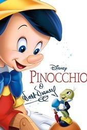</a> [评测页海报](<https://www.commonsensemedia.org/movie-reviews/pinocchio>) | 木偶奇遇记 Pinocchio 原文年份：1940（未核实） [文章28](<https://mp.weixin.qq.com/s/kx7YqDwvnUhSYTM3Gh1f-Q>) | 推荐 | 6+ 

原文说法
文章28没有逐片标注适龄
 | 木偶在冒险和诱惑中学习辨别良知。 | CSM建议6+；有绑架、囚禁、近乎溺水、吸烟和变驴的恐惧。可讨论责任，但不以恐吓服从作为教育方式。 | 作品级证据初审 置信度：中 [Common Sense Media](<https://www.commonsensemedia.org/movie-reviews/pinocchio>) | 未核实正版正片 |
| <a href="../../images/review/wx28-1ca6661ded98.jpg">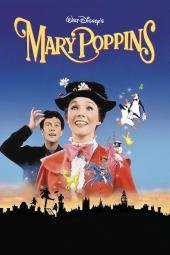</a> [评测页海报](<https://www.commonsensemedia.org/movie-reviews/mary-poppins>) | 欢乐满人间 Mary Poppins 原文年份：1964（未核实） [文章28](<https://mp.weixin.qq.com/s/kx7YqDwvnUhSYTM3Gh1f-Q>) | 推荐 | 5+ 

原文说法
文章28没有逐片标注适龄
 | 神奇保姆来到伦敦家庭，用音乐和想象改变日常。 | CSM建议5+；是真人加动画而非纯动画，也有过时种族用语、死亡提及和成人吸烟。歌曲可听，不证明整部对白适合所有英语初学者。 | 作品级证据初审 置信度：中 [Common Sense Media](<https://www.commonsensemedia.org/movie-reviews/mary-poppins>) | 未核实正版正片 |
| <a href="../../images/review/wx28-c6df29ef8c89.jpg">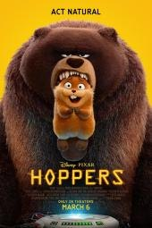</a> [评测页海报](<https://www.commonsensemedia.org/movie-reviews/hoppers>) | 河狸变身计划 Hoppers 原文年份：2026（未核实） [文章28](<https://mp.weixin.qq.com/s/kx7YqDwvnUhSYTM3Gh1f-Q>) | 推荐 | 8+ 

原文说法
文章28没有逐片标注适龄
 | 女大学生把意识放入机器河狸，尝试保护动物栖地。 | CSM建议8+；环保行动可讨论，但火灾、动物遇险与怪异机器人有惊吓。虚构科技和拟人化生态不应当真实科学解释。 | 作品级证据初审 置信度：中 [Common Sense Media](<https://www.commonsensemedia.org/movie-reviews/hoppers>) | 未核实正版正片 |
| <a href="../../images/review/wx28-a2d3d00f2150.jpg">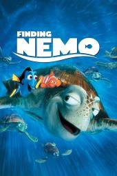</a> [评测页海报](<https://www.commonsensemedia.org/movie-reviews/finding-nemo>) | 海底总动员1 Finding Nemo 原文年份：2003（未核实） [文章28](<https://mp.weixin.qq.com/s/kx7YqDwvnUhSYTM3Gh1f-Q>) | 推荐 | 5+ 

原文说法
文章28没有逐片标注适龄
 | 父亲穿越海洋寻找被带走的小丑鱼尼莫。 | CSM建议5+；开场母亲和鱼卵遇害，鲨鱼与失散较紧张。可以谈关怀和自主，但不是海洋生物事实教材。 | 作品级证据初审 置信度：中 [Common Sense Media](<https://www.commonsensemedia.org/movie-reviews/finding-nemo>) | 未核实正版正片 |
| <a href="../../images/review/wx28-9e37754bc186.jpg">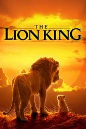</a> [评测页海报](<https://www.commonsensemedia.org/movie-reviews/the-lion-king>) | 狮子王 The Lion King 原文年份：2019（未核实） [文章28](<https://mp.weixin.qq.com/s/kx7YqDwvnUhSYTM3Gh1f-Q>) | 推荐 | 8+ 

原文说法
文章28没有逐片标注适龄
 | 幼狮失去父亲，成长后面对责任与家族冲突。 | 此证据只对应2019写实CG重拍版，CSM建议8+；踩踏丧父和搏斗更逼真。1994版另待核验，不能共用年龄与海报。 | 作品级证据初审 置信度：中 [Common Sense Media](<https://www.commonsensemedia.org/movie-reviews/the-lion-king>) | 未核实正版正片 |
| <a href="../../images/review/wx28-d649a41291a8.jpg">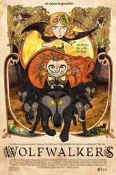</a> [评测页海报](<https://www.commonsensemedia.org/movie-reviews/wolfwalkers>) | 狼行者 Wolfwalkers 原文年份：2020（未核实） [文章28](<https://mp.weixin.qq.com/s/kx7YqDwvnUhSYTM3Gh1f-Q>) | 推荐 | 8+ 

原文说法
文章28没有逐片标注适龄
 | 女孩与能化身为狼的伙伴共同面对围捕和偏见。 | CSM建议8+；友情、生态与殖民历史有讨论价值，同时有武器、动物与人受伤死亡及母女分离，不是无惊吓森林童话。 | 作品级证据初审 置信度：中 [Common Sense Media](<https://www.commonsensemedia.org/movie-reviews/wolfwalkers>) | 未核实正版正片 |
| <a href="../../images/review/wx28-094f8bf8860a.jpg">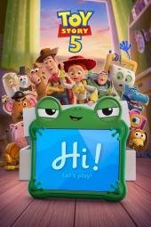</a> [评测页海报](<https://www.commonsensemedia.org/movie-reviews/toy-story-5>) | 玩具总动员5 Toy Story 5 原文年份：2026（未核实） [文章28](<https://mp.weixin.qq.com/s/kx7YqDwvnUhSYTM3Gh1f-Q>) | 推荐 | 5+ 

原文说法
文章28没有逐片标注适龄
 | 玩具们面对邦妮迷上互动平板后的新挑战。 | CSM建议5+；可讨论屏幕和想象游戏的平衡，但有被遗弃、排斥与救援险境。系列与商品宣传不等于每一部同样适合所有年龄。 | 作品级证据初审 置信度：中 [Common Sense Media](<https://www.commonsensemedia.org/movie-reviews/toy-story-5>) | 未核实正版正片 |
| <a href="../../images/review/wx28-127de5c1e0fc.jpg">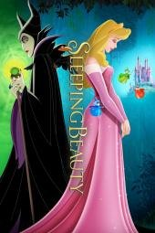</a> [评测页海报](<https://www.commonsensemedia.org/movie-reviews/sleeping-beauty>) | 睡美人 Sleeping Beauty 原文年份：1959（未核实） [文章28](<https://mp.weixin.qq.com/s/kx7YqDwvnUhSYTM3Gh1f-Q>) | 推荐 | 5+ 

原文说法
文章28没有逐片标注适龄
 | 公主受诅咒沉睡，王子和仙子对抗恶龙。 | CSM建议5+；巫婆、恶龙战斗、绑架和醉酒并非无风险。可欣赏音乐美术，同时讨论被动公主与救援叙事。 | 作品级证据初审 置信度：中 [Common Sense Media](<https://www.commonsensemedia.org/movie-reviews/sleeping-beauty>) | 未核实正版正片 |
| <a href="../../images/review/wx28-3228d1934c54.jpg">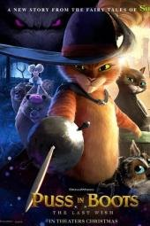</a> [评测页海报](<https://www.commonsensemedia.org/movie-reviews/puss-in-boots-the-last-wish>) | 穿靴子的猫2 Puss in Boots: The Last Wish 原文年份：2022（未核实） [文章28](<https://mp.weixin.qq.com/s/kx7YqDwvnUhSYTM3Gh1f-Q>) | 推荐 | 8+ 

原文说法
文章28没有逐片标注适龄
 | 只剩最后一条命的猫剑客寻找愿望与真正重要的关系。 | CSM建议8+；死亡化身持续追逐、刀剑、醉酒和粗口有强度。可谈珍惜生命，但怕死或易焦虑儿童需成人先看。 | 作品级证据初审 置信度：中 [Common Sense Media](<https://www.commonsensemedia.org/movie-reviews/puss-in-boots-the-last-wish>) | 未核实正版正片 |
| <a href="../../images/review/wx28-4e48f6afae12.jpg">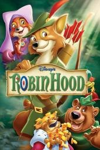</a> [评测页海报](<https://www.commonsensemedia.org/movie-reviews/robin-hood>) | 罗宾汉 Robin Hood 原文年份：1973（未核实） [文章28](<https://mp.weixin.qq.com/s/kx7YqDwvnUhSYTM3Gh1f-Q>) | 推荐 | 5+ 

原文说法
文章28没有逐片标注适龄
 | 狐狸罗宾汉帮助被重税压迫的居民。 | CSM建议5+；有武器、绞刑暗示和醉酒。可以讨论公平及权力，但“好人偷窃”需要年龄合适的情境解释。 | 作品级证据初审 置信度：中 [Common Sense Media](<https://www.commonsensemedia.org/movie-reviews/robin-hood>) | 未核实正版正片 |
| <a href="../../images/review/wx28-36a0b3ab2d78.jpg">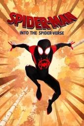</a> [评测页海报](<https://www.commonsensemedia.org/movie-reviews/spider-man-into-the-spider-verse>) | 蜘蛛侠：平行宇宙 Spider-Man: Into the Spider-Verse 原文年份：2018（未核实） [文章28](<https://mp.weixin.qq.com/s/kx7YqDwvnUhSYTM3Gh1f-Q>) | 推荐 | 9+ 

原文说法
文章28没有逐片标注适龄
 | 迈尔斯与不同宇宙的蜘蛛侠共同面对危机。 | CSM建议9+；多元角色与导师关系有价值，但高强度战斗、枪支、死亡和强烈视觉风格不适合所有儿童；不要用英雄品牌替代分龄。 | 作品级证据初审 置信度：中 [Common Sense Media](<https://www.commonsensemedia.org/movie-reviews/spider-man-into-the-spider-verse>) | 未核实正版正片 |
| <a href="../../images/review/wx28-89e036b99f37.jpg">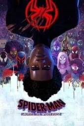</a> [评测页海报](<https://www.commonsensemedia.org/movie-reviews/spider-man-across-the-spider-verse>) | 蜘蛛侠：纵横宇宙 Spider-Man: Across the Spider-Verse 原文年份：2023（未核实） [文章28](<https://mp.weixin.qq.com/s/kx7YqDwvnUhSYTM3Gh1f-Q>) | 推荐 | 9+ 

原文说法
文章28没有逐片标注适龄
 | 迈尔斯与格温在多重宇宙中面对身份和选择。 | CSM建议9+；同理心与责任有讨论价值，也有持续战斗、爆炸、武器及复杂世界观。不是只凭画面鲜艳就适合学前儿童。 | 作品级证据初审 置信度：中 [Common Sense Media](<https://www.commonsensemedia.org/movie-reviews/spider-man-across-the-spider-verse>) | 未核实正版正片 |
| <a href="../../images/review/wx28-99da6e11ecdf.jpg">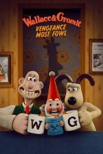</a> [评测页海报](<https://www.commonsensemedia.org/movie-reviews/wallace-gromit-vengeance-most-fowl>) | 超级无敌掌门狗：企鹅的复仇 Wallace &amp; Gromit: Vengeance Most Fowl 原文年份：2024（未核实） [文章28](<https://mp.weixin.qq.com/s/kx7YqDwvnUhSYTM3Gh1f-Q>) | 推荐 | 7+ 

原文说法
文章28没有逐片标注适龄
 | 华莱士发明智能园艺侏儒，老对手再次制造危机。 | CSM建议7+；创造力与忠诚有趣，但邪恶侏儒、追逐与险境仍会吓到小孩。英式幽默的文化和语言难度需另外判断。 | 作品级证据初审 置信度：中 [Common Sense Media](<https://www.commonsensemedia.org/movie-reviews/wallace-gromit-vengeance-most-fowl>) | 未核实正版正片 |
| <a href="../../images/review/wx28-3be0021050d2.jpg">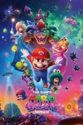</a> [评测页海报](<https://www.commonsensemedia.org/movie-reviews/the-super-mario-galaxy-movie>) | 超级马力欧银河大电影 The Super Mario Galaxy Movie 原文年份：2026（未核实） [文章28](<https://mp.weixin.qq.com/s/kx7YqDwvnUhSYTM3Gh1f-Q>) | 推荐 | 7+ 

原文说法
文章28没有逐片标注适龄
 | 马力欧与伙伴面对银河危机，公主们展开自己的行动。 | CSM建议7+；勇气和协作明确，频繁奇幻打斗、利刃、怪兽和骷髅意象仍有强度。游戏IP熟悉度不等于低龄适合度。 | 作品级证据初审 置信度：中 [Common Sense Media](<https://www.commonsensemedia.org/movie-reviews/the-super-mario-galaxy-movie>) | 未核实正版正片 |
| <a href="../../images/review/wx28-ef1fba7c5337.jpg">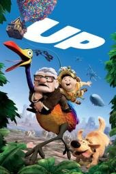</a> [评测页海报](<https://www.commonsensemedia.org/movie-reviews/up>) | 飞屋环游记 Up 原文年份：2009（未核实） [文章28](<https://mp.weixin.qq.com/s/kx7YqDwvnUhSYTM3Gh1f-Q>) | 推荐 | 6+ 

原文说法
文章28没有逐片标注适龄
 | 丧偶老人带着会飞的房子，与男孩和伙伴们旅行。 | CSM建议6+；婚姻、衰老与失去的开场及坠落、枪和恶犬需预告。温暖结局不保证丧亲儿童不会难过。 | 作品级证据初审 置信度：中 [Common Sense Media](<https://www.commonsensemedia.org/movie-reviews/up>) | 未核实正版正片 |
| <a href="../../images/review/wx28-2f869b5d5982.jpg">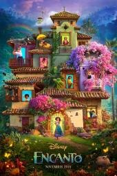</a> [评测页海报](<https://www.commonsensemedia.org/movie-reviews/encanto>) | 魔法满屋 Encanto 原文年份：2021（未核实） [文章28](<https://mp.weixin.qq.com/s/kx7YqDwvnUhSYTM3Gh1f-Q>) | 推荐 | 6+ 

原文说法
文章28没有逐片标注适龄
 | 没有魔法的女孩发现家庭期待与裂痕背后的原因。 | CSM建议6+；同理心与不以天赋定义价值很可取，仍有武装者杀人背景、灾难与代际压力。歌曲不是自动消化复杂家庭问题的保证。 | 作品级证据初审 置信度：中 [Common Sense Media](<https://www.commonsensemedia.org/movie-reviews/encanto>) | 未核实正版正片 |
| <a href="../../images/review/wx28-2411fa16f253.jpg">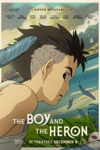</a> [评测页海报](<https://www.commonsensemedia.org/movie-reviews/the-boy-and-the-heron>) | 你想活出怎样的人生 The Boy and the Heron 原文年份：2023（未核实） [文章28](<https://mp.weixin.qq.com/s/kx7YqDwvnUhSYTM3Gh1f-Q>) | 有保留 | 10+ 

原文说法
文章28没有逐片标注适龄
 | 丧母少年进入奇异世界，面对伤痛与人生选择。 | CSM建议10+；开场火灾丧母、自伤头部、血、怪诞生物和抽象叙事较沉重。获赞的艺术作品不等于任何孩子都适合。 | 作品级证据初审 置信度：中 [Common Sense Media](<https://www.commonsensemedia.org/movie-reviews/the-boy-and-the-heron>) | 未核实正版正片 |
| <a href="../../images/review/wx28-f71e9a5dcf1e.jpg">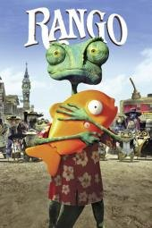</a> [评测页海报](<https://www.commonsensemedia.org/movie-reviews/rango>) | 兰戈 Rango 原文年份：2011（未核实） [文章28](<https://mp.weixin.qq.com/s/kx7YqDwvnUhSYTM3Gh1f-Q>) | 有保留 | 10+ 

原文说法
文章28没有逐片标注适龄
 | 变色龙误入西部小镇，寻找身份并对抗权力。 | CSM建议10+；枪战、绞架、烟酒、族群刻板与未经同意的触碰需要讨论，成人西部讽刺并非儿童启蒙首选。 | 作品级证据初审 置信度：中 [Common Sense Media](<https://www.commonsensemedia.org/movie-reviews/rango>) | 未核实正版正片 |
| <a href="../../images/review/wx29-captain-underpants.jpg">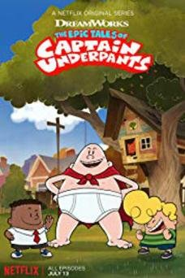</a> [评测页海报](<https://www.commonsensemedia.org/tv-reviews/the-epic-tales-of-captain-underpants>) | 内裤队长传奇 The Epic Tales of Captain Underpants [文章29](<https://mp.weixin.qq.com/s/X9krmKAuulTvIIAGGieWEg>) | 有保留 | 6+（CSM；原文6–8岁） 

原文说法
6-8岁
 | 文章说改编自同名童书，两个小学生把校长催眠成超级英雄；笑点全在谐音、双关和故意说错，孩子会顺便记住词；推荐1–4季。 | CSM评6+，但指出大量屎尿屁笑话、恶作剧及“loser”等互相嘲讽，并称以娱乐为主。故意说错的文字游戏对英语初学者未必有益；“顺便记住词”无证据，需家长对恶作剧与嘲讽做讨论。 | 作品级证据初审 置信度：中 [Common Sense Media](<https://www.commonsensemedia.org/tv-reviews/the-epic-tales-of-captain-underpants>) | 未核实正版正片 |
| <a href="../../images/review/wx28-a7135cb5eafd.jpg">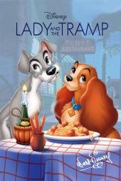</a> [评测页海报](<https://www.commonsensemedia.org/movie-reviews/lady-and-the-tramp>) | 小姐与流浪汉1 Lady and the Tramp 原文年份：1955（未核实） [文章28](<https://mp.weixin.qq.com/s/kx7YqDwvnUhSYTM3Gh1f-Q>) | 有保留 | 5+ 

原文说法
文章28没有逐片标注适龄
 | 家犬与流浪狗相识，经历误会和危险。 | CSM建议5+；总体温和，但暹罗猫形象涉及种族刻板，婴儿受威胁和看似死亡的场面需预看。 | 作品级证据初审 置信度：中 [Common Sense Media](<https://www.commonsensemedia.org/movie-reviews/lady-and-the-tramp>) | 未核实正版正片 |
| <a href="../../images/review/wx29-lucas-the-spider.jpg">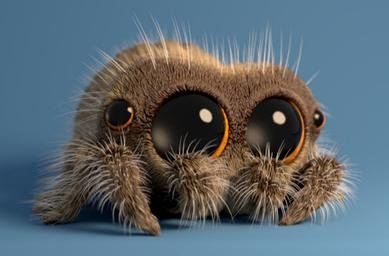</a> [百科页作品图（版权归原权利人）](<https://en.wikipedia.org/wiki/Lucas_the_Spider>) | 小蜘蛛卢卡斯 Lucas the Spider [文章29](<https://mp.weixin.qq.com/s/X9krmKAuulTvIIAGGieWEg>) | 有保留 | 未核实（原文6–8岁） 

原文说法
6-8岁
 | 文章说每集只有几分钟、几乎没有对白压力，最适合专注力短的小孩，建议零基础孩子从这部开始、一次一集。 | 画风可爱、单集极短，低负荷属实可能，但未取得儿童适龄评测；对白少恰恰意味着英语输入有限，与文章“学英语”定位矛盾。怕蜘蛛的孩子需先试看；剧集版本与YouTube短片需区分。 | 证据不足，编辑保守初筛 置信度：低 [Wikipedia](<https://en.wikipedia.org/wiki/Lucas_the_Spider>)（作品背景资料，不是适龄评测） | 未核实正版正片 |
| <a href="../../images/review/wx28-2bf698e87339.jpg">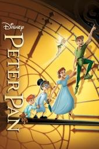</a> [评测页海报](<https://www.commonsensemedia.org/movie-reviews/peter-pan>) | 小飞侠1 Peter Pan 原文年份：1953（未核实） [文章28](<https://mp.weixin.qq.com/s/kx7YqDwvnUhSYTM3Gh1f-Q>) | 有保留 | 7+ 

原文说法
文章28没有逐片标注适龄
 | 孩子们跟随彼得潘来到永无岛。 | CSM建议7+；独立指南记录对原住民的种族刻板、性别竞争、绑架和武器暴力，不宜不加说明地当世界文化材料。 | 作品级证据初审 置信度：中 [Common Sense Media](<https://www.commonsensemedia.org/movie-reviews/peter-pan>) | 未核实正版正片 |
| <a href="../../images/review/wx28-c28101eca1cb.jpg">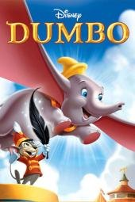</a> [评测页海报](<https://www.commonsensemedia.org/movie-reviews/dumbo>) | 小飞象 Dumbo 原文年份：1941（未核实） [文章28](<https://mp.weixin.qq.com/s/kx7YqDwvnUhSYTM3Gh1f-Q>) | 有保留 | 5+ 

原文说法
文章28没有逐片标注适龄
 | 被嘲笑大耳朵的小象逐渐发现自己的能力。 | CSM建议5+；母子分离、醉酒幻觉和种族刻板乌鸦需解释。接纳差异的主题不抵消旧时代偏见。 | 作品级证据初审 置信度：中 [Common Sense Media](<https://www.commonsensemedia.org/movie-reviews/dumbo>) | 未核实正版正片 |
| <a href="../../images/review/wx28-5b14dbeb6319.jpg">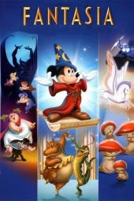</a> [评测页海报](<https://www.commonsensemedia.org/movie-reviews/fantasia>) | 幻想曲 Fantasia 原文年份：1940（未核实） [文章28](<https://mp.weixin.qq.com/s/kx7YqDwvnUhSYTM3Gh1f-Q>) | 有保留 | 6+ 

原文说法
文章28没有逐片标注适龄
 | 多段古典音乐配合抽象和叙事动画。 | CSM建议6+；恐龙死亡、恶魔、洪水等影像强烈，且对白很少。文章把它统称清晰英语对白精听材料并不成立。 | 作品级证据初审 置信度：中 [Common Sense Media](<https://www.commonsensemedia.org/movie-reviews/fantasia>) | 未核实正版正片 |
| <a href="../../images/review/wx28-c0dd7899647d.jpg">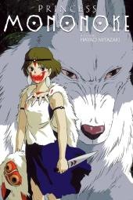</a> [评测页海报](<https://www.commonsensemedia.org/movie-reviews/princess-mononoke>) | 幽灵公主 Princess Mononoke 原文年份：1997（未核实） [文章28](<https://mp.weixin.qq.com/s/kx7YqDwvnUhSYTM3Gh1f-Q>) | 有保留 | 12+ 

原文说法
文章28没有逐片标注适龄
 | 少年在森林神灵与采铁城镇的冲突中寻找共存之路。 | CSM建议12+；明确有斩首、断肢、枪战和死亡。生态主题与复杂人物值得年长观众讨论，不适合当幼儿英语磨耳朵材料。 | 作品级证据初审 置信度：中 [Common Sense Media](<https://www.commonsensemedia.org/movie-reviews/princess-mononoke>) | 未核实正版正片 |
| <a href="../../images/review/wx28-d0d7dc0b1197.jpg">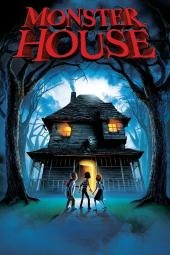</a> [评测页海报](<https://www.commonsensemedia.org/movie-reviews/monster-house>) | 怪兽屋 Monster House 原文年份：2006（未核实） [文章28](<https://mp.weixin.qq.com/s/kx7YqDwvnUhSYTM3Gh1f-Q>) | 有保留 | 11+ 

原文说法
文章28没有逐片标注适龄
 | 孩子们发现邻居的房屋会吞噬靠近的人。 | CSM建议11+；整片持续危险、恐怖意象和不良行为，可能引发噩梦。动画外观不适合低龄练听力，需成人先看。 | 作品级证据初审 置信度：中 [Common Sense Media](<https://www.commonsensemedia.org/movie-reviews/monster-house>) | 未核实正版正片 |
| <a href="../../images/review/wx29-gravity-falls.jpg">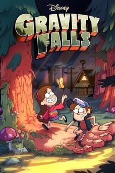</a> [评测页海报](<https://www.commonsensemedia.org/tv-reviews/gravity-falls>) | 怪诞小镇 Gravity Falls [文章29](<https://mp.weixin.qq.com/s/X9krmKAuulTvIIAGGieWEg>) | 有保留 | 8+（CSM；敏感儿童10+更稳） 

原文说法
10岁以上
 | 文章说双胞胎暑假探秘，语速稍快、笑点密，适合已能听懂一半的孩子，归在10岁以上。 | CSM评8+，写作聪明，但有怪物遭遇和紧张悬疑场面，可能吓到敏感孩子，且以娱乐为主。语速快、笑点双关多，作英语入门负荷偏高；适合较大孩子，不宜低龄连刷。 | 作品级证据初审 置信度：中 [Common Sense Media](<https://www.commonsensemedia.org/tv-reviews/gravity-falls>) | 未核实正版正片 |
| <a href="../../images/review/wx28-a656382005ce.jpg">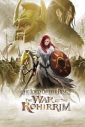</a> [评测页海报](<https://www.commonsensemedia.org/movie-reviews/the-lord-of-the-rings-the-war-of-the-rohirrim>) | 指环王：洛汗之战 The Lord of the Rings: The War of the Rohirrim 原文年份：2024（未核实） [文章28](<https://mp.weixin.qq.com/s/kx7YqDwvnUhSYTM3Gh1f-Q>) | 有保留 | 11+ 

原文说法
文章28没有逐片标注适龄
 | 洛汗家族在围城与复仇中争取生存。 | CSM建议11+；独立指南有断肢、尸体、围困、杀戮与针对女性的威胁。世界观厚重，不是一般低龄奇幻冒险。 | 作品级证据初审 置信度：中 [Common Sense Media](<https://www.commonsensemedia.org/movie-reviews/the-lord-of-the-rings-the-war-of-the-rohirrim>) | 未核实正版正片 |
| <a href="../../images/review/wx28-e48b6f3866df.jpg">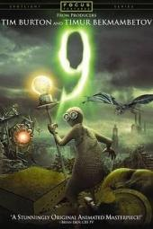</a> [评测页海报](<https://www.commonsensemedia.org/movie-reviews/9>) | 机器人9号 9 原文年份：2009（未核实） [文章28](<https://mp.weixin.qq.com/s/kx7YqDwvnUhSYTM3Gh1f-Q>) | 有保留 | 12+ 

原文说法
文章28没有逐片标注适龄
 | 末世中的布偶生命对抗猎杀机器。 | CSM建议12+；持续追杀、主角死亡和尸体影像使它明显不适合幼儿。不能因少粗口、是动画就忽略恐怖强度。 | 作品级证据初审 置信度：中 [Common Sense Media](<https://www.commonsensemedia.org/movie-reviews/9>) | 未核实正版正片 |
|  [评测页海报](<https://www.commonsensemedia.org/movie-reviews/the-aristocats>) | 猫儿历险记 The Aristocats 原文年份：1970（未核实） [文章28](<https://mp.weixin.qq.com/s/kx7YqDwvnUhSYTM3Gh1f-Q>) | 有保留 | 4+ 

原文说法
文章28没有逐片标注适龄
 | 猫妈妈与小猫遭遗弃后，在朋友帮助下回家。 | CSM建议4+；下药、分离和追逐可能使幼儿不安，“中国猫”还使用种族刻板。不能只因旧片语速慢就优先推荐。 | 作品级证据初审 置信度：中 [Common Sense Media](<https://www.commonsensemedia.org/movie-reviews/the-aristocats>) | 未核实正版正片 |
|  [评测页海报](<https://www.commonsensemedia.org/tv-reviews/the-owl-house>) | 猫头鹰魔法社 The Owl House [文章29](<https://mp.weixin.qq.com/s/X9krmKAuulTvIIAGGieWEg>) | 有保留 | 8+（CSM；部分剧情较黑暗，建议10+） 

原文说法
10岁以上
 | 文章说魔法学校题材，主角是不会魔法的女孩，对话里情绪词多，适合练表达感受；归在10岁以上；推荐1–3季。 | CSM评8+，肯定做自己、多元与LGBTQ+主角等社会情感主题，也提到奇幻打斗、恐怖形象与辱骂用语。后期剧情较黑暗紧张，更适合较大孩子；“练表达感受”为文章推测。 | 作品级证据初审 置信度：中 [Common Sense Media](<https://www.commonsensemedia.org/tv-reviews/the-owl-house>) | 未核实正版正片 |
|  [评测页海报](<https://www.commonsensemedia.org/movie-reviews/snow-white-and-the-seven-dwarfs>) | 白雪公主和七个小矮人 Snow White and the Seven Dwarfs 原文年份：1937（未核实） [文章28](<https://mp.weixin.qq.com/s/kx7YqDwvnUhSYTM3Gh1f-Q>) | 有保留 | 6+ 

原文说法
文章28没有逐片标注适龄
 | 公主逃避王后的迫害，与七位矿工生活。 | CSM建议6+；追杀、毒苹果和变身较吓人，且女性被动等待救援、美貌与肤色价值观需批判讨论。经典地位不等于今天低龄首选。 | 作品级证据初审 置信度：中 [Common Sense Media](<https://www.commonsensemedia.org/movie-reviews/snow-white-and-the-seven-dwarfs>) | 未核实正版正片 |
|  [评测页海报](<https://www.commonsensemedia.org/movie-reviews/frankenweenie>) | 科学怪狗 Frankenweenie 原文年份：2012（未核实） [文章28](<https://mp.weixin.qq.com/s/kx7YqDwvnUhSYTM3Gh1f-Q>) | 有保留 | 9+ 

原文说法
文章28没有逐片标注适龄
 | 男孩试图用实验让死去的爱犬复活。 | CSM建议9+；宠物死亡、复活后怪物与恐怖影像可能触发悲伤或惊吓。科学外衣不是可模仿实验，敏感孩子需延后。 | 作品级证据初审 置信度：中 [Common Sense Media](<https://www.commonsensemedia.org/movie-reviews/frankenweenie>) | 未核实正版正片 |
|  [评测页海报](<https://www.commonsensemedia.org/movie-reviews/pocahontas>) | 风中奇缘1 Pocahontas 原文年份：1995（未核实） [文章28](<https://mp.weixin.qq.com/s/kx7YqDwvnUhSYTM3Gh1f-Q>) | 有保留 | 6+ 

原文说法
文章28没有逐片标注适龄
 | 迪士尼以殖民时期相遇改编成爱情故事。 | CSM建议6+，但独立指南指出历史失真、反原住民用语及把真实儿童浪漫化为成人。不要当真实历史或原住民文化教材。 | 作品级证据初审 置信度：中 [Common Sense Media](<https://www.commonsensemedia.org/movie-reviews/pocahontas>) | 未核实正版正片 |
|  [评测页海报](<https://www.commonsensemedia.org/movie-reviews/coraline>) | 鬼妈妈 Coraline 原文年份：2009（未核实） [文章28](<https://mp.weixin.qq.com/s/kx7YqDwvnUhSYTM3Gh1f-Q>) | 有保留 | 9+ 

原文说法
文章28没有逐片标注适龄
 | 女孩进入看似完美的另一家庭，发现危险代价。 | CSM建议9+；死亡威胁、鬼孩子与强烈怪诞意象明显。可谈边界和不完美家庭，但不宜作为低龄睡前或无筛选英语素材。 | 作品级证据初审 置信度：中 [Common Sense Media](<https://www.commonsensemedia.org/movie-reviews/coraline>) | 未核实正版正片 |
