# 学习类

<!-- Generated by scripts/render_wechat_tables.py; edit data/catalog.json instead. -->

[返回首页](../../README.md) · [审核方法](review-method.md) · [不推荐](not-recommended.md) · [文章28待核验](pending-article-28.md)

本页 70 条，按强烈推荐→推荐→有保留排序。**有保留不等于推荐；年龄不等于听力难度；图片不证明适龄。**

每行一部，名称下的文章编号或“全网检索”链接到来源。适龄为审核建议；折叠的“原文说法”不代表采信。缩略图可点开放大，图下注明海报、旧图或文字封面；长简介可展开。

未注明已核实的豆瓣/IMDb评分和人数一律视为未核实；公众号评分不作独立证据。独立评测不等于教育效果证明，相关App/合集也不是单片认证。视频列仅保留官方入口等已记录地址，**不代表免费、完整或当地可播正片**；候选地址不展示。完整字段见[主目录数据](../../data/catalog.json)。

| 图片 | 名称 | 判断 | 适龄 | 简介 | 研判 | 证据状态 | 视频链接 |
| --- | --- | --- | --- | --- | --- | --- | --- |
|  [评测页海报](<https://www.commonsensemedia.org/tv-reviews/yakka-dee>) | 亚克迪 Yakka Dee [文章23](<https://mp.weixin.qq.com/s/B2loD1DLgD3WS77WM1XkqQ>) | 强烈推荐 | 2+（CSM；需共看） 

原文说法
文章准备给2岁孩子试
 | 文章把它放在“想补的片单”。BBC 出品，每集只教一个词，重复率高，用来让孩子开口。 | 独立评测确认每集围绕一个词、鼓励开口并展示多样儿童，认知目标清楚。重复不等于无效，但也不是“开口神器”或语言障碍治疗，应一起说并连到实物。 | 作品级证据初审 置信度：中 [Common Sense Media](<https://www.commonsensemedia.org/tv-reviews/yakka-dee>) | 未核实正版正片 |
| <a href="../../images/review/web-peg-cat.jpg">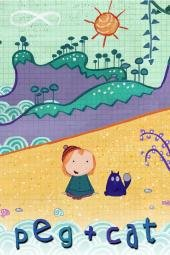</a> [评测页海报](<https://www.commonsensemedia.org/tv-reviews/peg-cat>) | 佩格和猫 Peg + Cat [全网检索](<https://pbskids.org/peg>) | 强烈推荐 | 3+（CSM） 

原文说法
非公众号来源；适龄以本轮独立评测或官方栏目定位为准
 | PBS KIDS学前数学动画：佩格和猫用计数、排序、分组等基础数学解决日常问题。可从PBS KIDS官方节目页进入。CSM评3+、编辑5/5。此次为2026年11月全网检索收录。 | CSM编辑5/5、评3+，评测页标注Common Sense Selection，肯定它把基础数学放进解决问题的故事里。短集适合共看后用实物数一数、排一排，不能指望只看电视就掌握数学。 | 作品级证据初审 置信度：中 [Common Sense Media](<https://www.commonsensemedia.org/tv-reviews/peg-cat>) | [官方入口（非已验证正片）](<https://pbskids.org/peg>) |
|  [评测页海报](<https://www.commonsensemedia.org/tv-reviews/alphablocks>) | 字母积木 Alphablocks [文章23](<https://mp.weixin.qq.com/s/B2loD1DLgD3WS77WM1XkqQ>) · [全网检索](<https://github.com/iamorangedad/kids-video-picks/blob/main/docs/web-search-sources.md>) | 强烈推荐 | 2+（CSM；按语言准备度） 

原文说法
文章准备留给大女儿幼小衔接
 | 文章说它和《数字积木》同系列，每个字母是会说话的小人，拉手就能拼出单词，用来做自然拼读启蒙。 | 独立评测明确肯定字母与自然拼读的可视化及短单集形式；英语拼读规则仍需真人示范和阅读实践。不是只看动画就能阅读，也不等同中文识字训练。 | 作品级证据初审 置信度：中 [Common Sense Media](<https://www.commonsensemedia.org/tv-reviews/alphablocks>) | [官方入口（非已验证正片）](<https://www.bbc.co.uk/cbeebies/shows/alphablocks>) |
|  [评测页海报](<https://www.commonsensemedia.org/tv-reviews/numberblocks>) | 数字积木 Numberblocks [文章12](<https://mp.weixin.qq.com/s/Iy-SwhNQC6IFAAsECwqseQ>) · [文章23](<https://mp.weixin.qq.com/s/B2loD1DLgD3WS77WM1XkqQ>) · [全网检索](<https://github.com/iamorangedad/kids-video-picks/blob/main/docs/web-search-sources.md>) · [文章50](<https://mp.weixin.qq.com/s/6XzwxNUnjkAKvwAyKDGsJA>) | 强烈推荐 | 2+（CSM；需共看） 

原文说法
2-6岁
 | 

文章写豆瓣9.6、适合2–6岁、BBC 制作、每集约5分钟。数字是积木小人，1和2叠在一起变成3。此前单独整理的研究片单里已有这部，这里按微信文章再记一条，不并…（展开）
文章写豆瓣9.6、适合2–6岁、BBC 制作、每集约5分钟。数字是积木小人，1和2叠在一起变成3。此前单独整理的研究片单里已有这部，这里按微信文章再记一条，不并进那份研究正文。 第23篇也把它放在6岁主攻片单里，说6岁看不幼稚，2岁看画面也喜欢。 第50篇也列入（原文3岁+、列于1—3年级）。
 | 独立评测明确肯定单位方块对数量、计数和加减的可视化，短单集便于联系实物。年龄标签不是让两岁孩子刷长合集；看后用积木动手，效果不能只凭家长口碑推定。 | 作品级证据初审 置信度：中 [Common Sense Media](<https://www.commonsensemedia.org/tv-reviews/numberblocks>) | [官方入口（非已验证正片）](<https://www.bbc.co.uk/cbeebies/shows/numberblocks>) |
| <a href="../../images/review/wx33-cyberchase.jpg">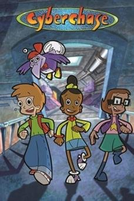</a> [评测页海报](<https://www.commonsensemedia.org/tv-reviews/cyberchase>) | 数学荒岛历险记 Cyberchase [文章33](<https://mp.weixin.qq.com/s/OQYM-V4pi28WVwmz01oHUg>) · [文章34](<https://mp.weixin.qq.com/s/Ky-may7qF1IUAu_wEnloCQ>) | 强烈推荐 | 5+（CSM） 

原文说法
文章（往期推荐）未写年龄
 | 出现在文末“往期推荐”：称豆瓣9.7、三季120集、“别的动画费眼，这部费脑”。 | CSM编辑5/5、评5+，PBS出品，以数学推理解决问题为主线，教育目标明确。“三季120集”与实际多季规模不符；豆瓣9.7未核实。适合小学低中年级，看后用实际问题练习更有效。 | 作品级证据初审 置信度：中 [Common Sense Media](<https://www.commonsensemedia.org/tv-reviews/cyberchase>) | [官方入口（非已验证正片）](<https://pbskids.org/cyberchase>) |
| <a href="../../images/review/web-sesame-street.jpg">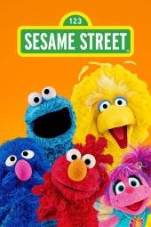</a> [评测页海报](<https://www.commonsensemedia.org/tv-reviews/sesame-street>) | 芝麻街 Sesame Street [全网检索](<https://pbskids.org/sesame>) | 强烈推荐 | 2+（CSM；需共看） 

原文说法
非公众号来源；适龄以本轮独立评测或官方栏目定位为准
 | 

美国公共电视长期学前教育节目，覆盖早期识字、数学、科学，并用音乐、语言和故事介绍多元文化。可从PBS KIDS官方站与Sesame Street官网进入。CSM…（展开）
美国公共电视长期学前教育节目，覆盖早期识字、数学、科学，并用音乐、语言和故事介绍多元文化。可从PBS KIDS官方站与Sesame Street官网进入。CSM评2+、编辑5/5。节目也会处理情绪和社会议题，适合由成人共看，而不是让幼儿独自连刷。此次为2026年11月全网检索收录。
 | CSM编辑5/5、评2+，评测页标注Common Sense Selection，肯定其早期学习内容仍然成立。年龄标签不是把节目当作两岁以下幼儿的常规娱乐屏幕；按AAP既有政策，18个月以下一般避免娱乐屏幕，18—24个月若看需成人共看优质内容。不能把节目效果宣传成保证提高成绩或语言能力。 | 作品级证据初审 置信度：中 [Common Sense Media](<https://www.commonsensemedia.org/tv-reviews/sesame-street>) | [官方入口（非已验证正片）](<https://pbskids.org/sesame>) |
| <a href="../../images/review/web-blues-clues-you.jpg">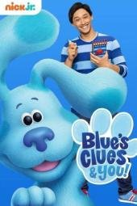</a> [评测页海报](<https://www.commonsensemedia.org/tv-reviews/blues-clues-you>) | 蓝色线索与你 Blue&#x27;s Clues &amp; You! [全网检索](<https://www.youtube.com/@bluesclues>) | 强烈推荐 | 3+（CSM） 

原文说法
非公众号来源；适龄以本轮独立评测或官方栏目定位为准
 | 《蓝色线索》的重制版，主持人邀请孩子一起找线索、解谜，侧重学前准备阅读技能。已核实官方YouTube频道可打开。CSM评3+、编辑5/5。此次为2026年11月全网检索收录。 | CSM编辑5/5、评3+，评测页标注Common Sense Selection，肯定重制版延续互动解谜和早期读写方向。YouTube频道有广告、自动播放和评论风险，应用官方应用或成人先排队播放，而不是放开自动连播。互动效果取决于孩子是否被邀请开口回答，而不是“看了就会识字”。 | 作品级证据初审 置信度：中 [Common Sense Media](<https://www.commonsensemedia.org/tv-reviews/blues-clues-you>) | [官方入口（非已验证正片）](<https://www.youtube.com/@bluesclues>) |
| <a href="../../images/review/web-work-it-out-wombats.jpg">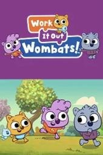</a> [评测页海报](<https://www.commonsensemedia.org/tv-reviews/work-it-out-wombats>) | 袋熊开动脑筋 Work It Out Wombats! [全网检索](<https://pbskids.org/wombats>) | 强烈推荐 | 4+（CSM） 

原文说法
非公众号来源；适龄以本轮独立评测或官方栏目定位为准
 | PBS KIDS学前动画，三只袋熊兄妹用计算思维（分解问题、尝试办法）解决生活挑战。可从PBS KIDS官方节目页进入。CSM评4+、编辑5/5。此次为2026年11月全网检索收录。 | CSM编辑5/5、评4+，评测页标注Common Sense Selection，肯定其解决问题和计算思维，而不是教孩子写代码。适合学前到小学低年级共看，看后一起拆任务、试办法，比把节目当背景声更符合其长处。 | 作品级证据初审 置信度：中 [Common Sense Media](<https://www.commonsensemedia.org/tv-reviews/work-it-out-wombats>) | [官方入口（非已验证正片）](<https://pbskids.org/wombats>) |
|  文字封面（非官方海报） | SSS 英文儿歌 [文章23](<https://mp.weixin.qq.com/s/B2loD1DLgD3WS77WM1XkqQ>) | 推荐 | 3+（CSM评的是相关App，非所有视频） 

原文说法
2岁左右
 | 文章写明这不是动画片，而是低龄启蒙的儿歌：数字、颜色、身体部位、动物，每首歌配动作。作者把它和两部动画并列为2岁只看的三样。 | 独立评测认可基础语言、数字和日常歌谣的补充价值，也指出被动观看和付费内容。相关App评价不能当整个频道逐片认证；优先成人选单歌、动作互动和纯音频。 | 相关合集/App参考，不是单片独立适龄认证 置信度：低至中 [Common Sense Media](<https://www.commonsensemedia.org/app-reviews/super-simple>)（相关App，不能当整频道认证） | 未核实正版正片 |
| <a href="../../images/review/web-ted-ed.jpg">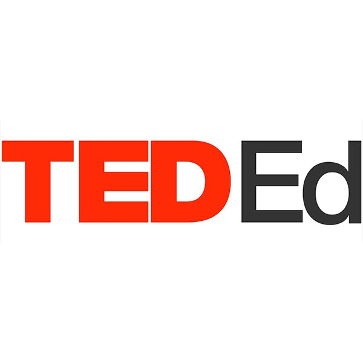</a> [官方页面标识（版权归原权利人）](<https://ed.ted.com/>) | TED-Ed [全网检索](<https://www.youtube.com/@TEDEd>) | 推荐 | 9+（CSM；须挑集） 

原文说法
非公众号来源；适龄以本轮独立评测或官方栏目定位为准
 | 

非营利教育机构TED-Ed的动画短视频频道，题材跨科学、历史、艺术、健康和谜题。已核实YouTube官方频道与ed.ted.com可打开。CSM评9+、编辑5/…（展开）
非营利教育机构TED-Ed的动画短视频频道，题材跨科学、历史、艺术、健康和谜题。已核实YouTube官方频道与ed.ted.com可打开。CSM评9+、编辑5/5。此次为2026年11月全网检索收录。库中已有的TED-Ed相关合集《揭秘身体奥秘》《了不起的自然》不在此重复建条。
 | CSM对频道整体评9+、编辑5/5，肯定制作质量与选题广度，同时也写明部分集目涉及性教育、心理健康和历史阴暗面，需要成人挑选或共看。合集不能用一个年龄给所有视频背书，低龄儿童不宜当日常频道浏览。YouTube有广告和自动播放，建议关闭自动播放并按主题选看。 | 作品级证据初审 置信度：中 [Common Sense Media](<https://www.commonsensemedia.org/youtube-reviews/ted-ed>)（频道整体，不是每一集的单独认证） | [官方入口（非已验证正片）](<https://www.youtube.com/@TEDEd>) |
|  [评测页海报](<https://www.commonsensemedia.org/tv-reviews/operation-ouch>) | 人体奥奇实验室 Operation Ouch! [文章8](<https://mp.weixin.qq.com/s/DcF-aYLjzo5rt263kz0nXQ>) | 推荐 | 9+（CSM；非原文6+） 

原文说法
6-15岁
 | 

文章推荐 BBC 的《Operation Ouch!》，中文译名《人体奥奇实验室》，并写一共14季、6到15岁都适合。主持人是双胞胎医生克里斯和克斯。文中举例：…（展开）
文章推荐 BBC 的《Operation Ouch!》，中文译名《人体奥奇实验室》，并写一共14季、6到15岁都适合。主持人是双胞胎医生克里斯和克斯。文中举例：克里斯吞下带摄像头的药丸，镜头从嘴进入食道、胃和小肠，孩子因此说胃像搅拌机。这是真人医学节目，不是动画片。
 | 真人医生讲身体和医疗，知识价值有独立评测支持；有针头、血液、缝合及身体近景。原文6岁起偏宽，怕血儿童应先由成人预看，节目不能代替医疗建议。 | 作品级证据初审 置信度：中 [Common Sense Media](<https://www.commonsensemedia.org/tv-reviews/operation-ouch>) | [官方入口（非已验证正片）](<https://www.bbc.co.uk/cbbc/shows/operation-ouch>) |
| <a href="../../images/review/wx36-weird-but-true.jpg">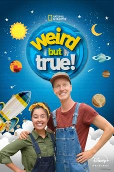</a> [评测页海报](<https://www.commonsensemedia.org/tv-reviews/weird-but-true>) | 奇怪但真实 Weird But True! [文章36](<https://mp.weixin.qq.com/s/yVGlKVHZwhUz5PmmlvEP-g>) | 推荐 | 8+（CSM） 

原文说法
文章未写年龄
 | 

文章称国家地理出品、获艾美奖最佳教育节目，兄妹主持，每集一个主题（火山、太空岩石、动物、感官、天气、食物等），实地探访、动手实验。举例：恐龙国家纪念碑挖化石、恐…（展开）
文章称国家地理出品、获艾美奖最佳教育节目，兄妹主持，每集一个主题（火山、太空岩石、动物、感官、天气、食物等），实地探访、动手实验。举例：恐龙国家纪念碑挖化石、恐龙有羽毛；太空营失重训练、塑料瓶小苏打水火箭；毒蛇毒蜘蛛与野外安全。
 | CSM评8+、编辑4/5，确认为获艾美奖的系列、主持人Charlie与Kirby Engelman姐弟，喜剧加科学适合小学中高年级。文章“所有知识点全部真实可考证、不用担心错误科普”属过度保证，冷知识节目仍可能简化；“看完主动找原版书”为推广说法。做小苏打水火箭等实验需成人在场。 | 作品级证据初审 置信度：中 [Common Sense Media](<https://www.commonsensemedia.org/tv-reviews/weird-but-true>) | 未核实正版正片 |
| <a href="../../images/review/web-odd-squad.jpg">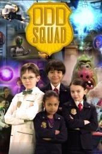</a> [评测页海报](<https://www.commonsensemedia.org/tv-reviews/odd-squad>) | 奇探小队 Odd Squad [全网检索](<https://pbskids.org/oddsquad>) | 推荐 | 5+（CSM） 

原文说法
非公众号来源；适龄以本轮独立评测或官方栏目定位为准
 | PBS KIDS小学低年级数学探案节目，孩子探员用加法、减法、规律和数的关系解决怪事。可从PBS KIDS官方节目页进入。CSM评5+、编辑4/5。此次为2026年11月全网检索收录。 | CSM编辑4/5、评5+，肯定把年级数学概念放进活泼的多媒体探案里，适合小学低中年级，而不是学前班起步。看后用实际问题练一练比连刷更有价值。官方页不保证当前地区可看全部正片。 | 作品级证据初审 置信度：中 [Common Sense Media](<https://www.commonsensemedia.org/tv-reviews/odd-squad>) | [官方入口（非已验证正片）](<https://pbskids.org/oddsquad>) |
|  [评测页海报](<https://www.commonsensemedia.org/tv-reviews/maisy>) | 小鼠波波 Maisy [文章23](<https://mp.weixin.qq.com/s/B2loD1DLgD3WS77WM1XkqQ>) | 推荐 | 3+（CSM；非原文2岁普推） 

原文说法
文章说适合两岁段补充
 | 文章把它和《蓝色小考拉》放在一起：画风柔和、语速极慢，主题是睡觉、洗澡、上学这类生活场景。 | 独立指南描述节奏慢、温和、重复日常与合作，适合低刺激选择。故事和重复旁白不等于系统英语课程，成人仍要回应孩子而非让屏幕代陪伴。 | 作品级证据初审 置信度：中 [Common Sense Media](<https://www.commonsensemedia.org/tv-reviews/maisy>) | 未核实正版正片 |
| <a href="../../images/review/web-bill-nye.jpg">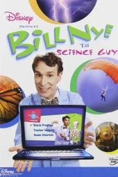</a> [评测页海报](<https://www.commonsensemedia.org/tv-reviews/bill-nye-the-science-guy>) | 比尔教科学 Bill Nye the Science Guy [全网检索](<https://www.billnye.com/>) | 推荐 | 7+（CSM） 

原文说法
非公众号来源；适龄以本轮独立评测或官方栏目定位为准
 | 

1990年代经典科学节目，比尔·奈用幽默和演示讲生物多样性、磁学、太空等，单集约25分钟。已核实其个人官网可打开，内有The Science Guy相关入口。C…（展开）
1990年代经典科学节目，比尔·奈用幽默和演示讲生物多样性、磁学、太空等，单集约25分钟。已核实其个人官网可打开，内有The Science Guy相关入口。CSM评7+、编辑5/5。此次为2026年11月全网检索收录。
 | CSM编辑5/5、评7+，评测页标注Common Sense Selection，肯定其把科学讲得有趣。节目年代较早，部分知识点或演示需对照更新资料，不能当作最新教材。官网是人物与作品入口，不代表能在当前地区免费看完全部正片。 | 作品级证据初审 置信度：中 [Common Sense Media](<https://www.commonsensemedia.org/tv-reviews/bill-nye-the-science-guy>) | [官方入口（非已验证正片）](<https://www.billnye.com/>) |
| <a href="../../images/review/web-ms-rachel.jpg">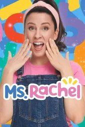</a> [评测页海报](<https://www.commonsensemedia.org/tv-reviews/ms-rachel>) | 瑞秋老师 Ms. Rachel [全网检索](<https://www.youtube.com/@msrachel>) | 推荐 | 2+（CSM；须共看，非婴儿常规屏幕） 

原文说法
非公众号来源；适龄以本轮独立评测或官方栏目定位为准
 | 

先在YouTube流行、后有流媒体汇编的婴幼儿语言与音乐短片，鼓励跟唱、跟做。已核实官方YouTube频道可打开。CSM所评的是按发育水平汇编的版本，评2+、编…（展开）
先在YouTube流行、后有流媒体汇编的婴幼儿语言与音乐短片，鼓励跟唱、跟做。已核实官方YouTube频道可打开。CSM所评的是按发育水平汇编的版本，评2+、编辑5/5。此次为2026年11月全网检索收录。
 | CSM编辑5/5、评2+，评测页标注Common Sense Selection，肯定其用歌曲和互动促进语言学习。CSM也提到有一集出现推广向的学前主持嘉宾。2+不是建议把节目当作两岁以下的日常背景电视；18个月以下一般避免娱乐屏幕，即便共看也要限量。YouTube广告和自动播放需要成人管控。 | 作品级证据初审 置信度：中 [Common Sense Media](<https://www.commonsensemedia.org/tv-reviews/ms-rachel>) | [官方入口（非已验证正片）](<https://www.youtube.com/@msrachel>) |
| <a href="../../images/review/web-magic-school-bus.jpg">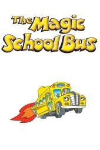</a> [评测页海报](<https://www.commonsensemedia.org/tv-reviews/the-magic-school-bus>) | 神奇校车 The Magic School Bus [全网检索](<https://www.commonsensemedia.org/tv-reviews/the-magic-school-bus>) | 推荐 | 5+（CSM；原版） 

原文说法
非公众号来源；适龄以本轮独立评测或官方栏目定位为准
 | 

1990年代经典科学动画：弗里兹老师带学生进行奇幻实地考察。本条对应原版系列，CSM评5+、编辑3/5。2017年重制《The Magic School Bus…（展开）
1990年代经典科学动画：弗里兹老师带学生进行奇幻实地考察。本条对应原版系列，CSM评5+、编辑3/5。2017年重制《The Magic School Bus Rides Again》由CSM另页评5+、编辑4/5，不把两版评分混用。本轮未核实可打开的特定正片播放页。此次为2026年11月全网检索收录。
 | CSM对原版评5+、编辑3/5，认为好玩、节奏快且有教育性，但也指出有时课程不太好跟上。奇幻冒险里会有看似危险的场景。1990年代科学内容需对照更新资料。重制版是另一部作品，已另查CSM，不在本条下替换评分。 | 作品级证据初审 置信度：中 [Common Sense Media](<https://www.commonsensemedia.org/tv-reviews/the-magic-school-bus>) | 未核实正版正片 |
| <a href="../../images/review/web-ada-twist-scientist.jpg">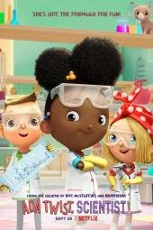</a> [评测页海报](<https://www.commonsensemedia.org/tv-reviews/ada-twist-scientist>) | 科学家艾达 Ada Twist, Scientist [全网检索](<https://www.commonsensemedia.org/tv-reviews/ada-twist-scientist>) | 推荐 | 3+（CSM） 

原文说法
非公众号来源；适龄以本轮独立评测或官方栏目定位为准
 | 根据同名绘本改编的学前科学动画，主角是喜欢提问的黑人女孩科学家。CSM评3+、编辑4/5。本轮未核实可打开的特定正片播放页，故链接栏留空。此次为2026年11月全网检索收录。 | CSM编辑4/5、评3+，评测页标注Common Sense Selection，肯定它能激发学前儿童对科学的兴趣，并提供积极的角色表征。它是故事化的科学启蒙，不是系统科学课程；每集有两个要用科学解决的问题，仍需成人帮助把好奇落到观察和动手上。 | 作品级证据初审 置信度：中 [Common Sense Media](<https://www.commonsensemedia.org/tv-reviews/ada-twist-scientist>) | 未核实正版正片 |
|  [评测页海报](<https://www.commonsensemedia.org/tv-reviews/the-fixies>) | 螺丝钉 [文章12](<https://mp.weixin.qq.com/s/Iy-SwhNQC6IFAAsECwqseQ>) | 推荐 | 6+（CSM；非原文3+） 

原文说法
3-6岁
 | 文章写豆瓣9.4、适合3–6岁，称它是俄罗斯动画：家电里住着修理小精灵，用故事讲冰箱为什么制冷、遥控器如何发信号、洗衣机怎样洗净衣服。文章没有英文名。 | 机械与日常技术的解释获独立评测肯定，但人物会示范不安全或欠妥行为。原文3—6岁过宽，应提醒不拆电器、不模仿维修，把动画模型和真实工程区分开。 | 作品级证据初审 置信度：中 [Common Sense Media](<https://www.commonsensemedia.org/tv-reviews/the-fixies>) | 未核实正版正片 |
| <a href="../../images/review/web-super-why.jpg">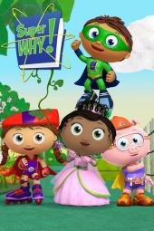</a> [评测页海报](<https://www.commonsensemedia.org/tv-reviews/super-why>) | 超级为什么 Super WHY! [全网检索](<https://pbskids.org/videos/super-why>) | 推荐 | 3+（CSM） 

原文说法
非公众号来源；适龄以本轮独立评测或官方栏目定位为准
 | 

PBS学前识字动画，小英雄进入故事里辨认字母和单词。CSM评3+、编辑4/5。注意：pbskids.org/superwhy 在本轮会跳转到衍生节目《Super…（展开）
PBS学前识字动画，小英雄进入故事里辨认字母和单词。CSM评3+、编辑4/5。注意：pbskids.org/superwhy 在本轮会跳转到衍生节目《Super Why&#x27;s Comic Book Adventures》，不是原版页面；本条采用已打开的原版视频页 pbskids.org/videos/super-why。此次为2026年11月全网检索收录。
 | CSM编辑4/5、评3+，肯定其早期读写和友谊、合作主题，并写明没有需要回避的不良内容。识字动画不能代替真人共读。官方站点路径可能指向衍生节目，选看时要核对该集是否为原版《Super WHY!》。 | 作品级证据初审 置信度：中 [Common Sense Media](<https://www.commonsensemedia.org/tv-reviews/super-why>) | [官方入口（非已验证正片）](<https://pbskids.org/videos/super-why>) |
| <a href="../../images/review/wx33-wordgirl.jpg">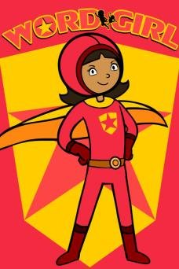</a> [评测页海报](<https://www.commonsensemedia.org/tv-reviews/wordgirl>) | 超级单词女孩 WordGirl [文章33](<https://mp.weixin.qq.com/s/OQYM-V4pi28WVwmz01oHUg>) · [文章34](<https://mp.weixin.qq.com/s/Ky-may7qF1IUAu_wEnloCQ>) | 推荐 | 5+（CSM） 

原文说法
文章（往期推荐）未写年龄；第34篇写6–10岁、已学过自然拼读
 | 

出现在文末“往期推荐”：称PBS出品，跟着超级英雄让孩子“轻松从零到听懂会说”。 第34篇专文介绍：主角Becky是五年级女孩，变身单词女孩，猴子搭档Huggy…（展开）
出现在文末“往期推荐”：称PBS出品，跟着超级英雄让孩子“轻松从零到听懂会说”。 第34篇专文介绍：主角Becky是五年级女孩，变身单词女孩，猴子搭档Huggy Face；反派用错词闹笑话，例词enormous、mystery、cooperate；每集约11分钟。
 | CSM评5+、编辑4/5，借超级英雄故事教词汇，有卡通打斗。它面向英语母语儿童扩充词汇，不是零基础英语课；第34篇标题“从零到听懂会说”与其正文“适合已学过自然拼读的6–10岁”自相矛盾，效果依据为家庭轶事。 | 作品级证据初审 置信度：中 [Common Sense Media](<https://www.commonsensemedia.org/tv-reviews/wordgirl>) | [官方入口（非已验证正片）](<https://pbskids.org/videos/wordgirl>) |
| <a href="../../images/review/web-ask-the-storybots.jpg">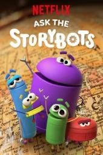</a> [评测页海报](<https://www.commonsensemedia.org/tv-reviews/ask-the-storybots>) | 问故事机器人 Ask the StoryBots [全网检索](<https://www.commonsensemedia.org/tv-reviews/ask-the-storybots>) | 推荐 | 3+（CSM） 

原文说法
非公众号来源；适龄以本轮独立评测或官方栏目定位为准
 | 

儿童提出大问题，故事机器人去寻找答案，节目中有音乐、采访和幽默段落。CSM评3+、编辑4/5，评测页列出的平台包括Netflix。本轮未核实可打开的特定正片播放…（展开）
儿童提出大问题，故事机器人去寻找答案，节目中有音乐、采访和幽默段落。CSM评3+、编辑4/5，评测页列出的平台包括Netflix。本轮未核实可打开的特定正片播放页（不猜测平台片号），故链接栏留空。此次为2026年11月全网检索收录。
 | CSM编辑4/5、评3+，肯定它能把孩子的大问题讲得有趣，家长也愿意共看。杂志式结构里有歌曲和穿插段落，节奏因集而异。没有已核实的官方免费正片入口，不把商业流媒体目录当成已验证可播。 | 作品级证据初审 置信度：中 [Common Sense Media](<https://www.commonsensemedia.org/tv-reviews/ask-the-storybots>) | 未核实正版正片 |
|  文字封面（非官方海报） | Little Fox 分级动画 Little Fox [文章23](<https://mp.weixin.qq.com/s/B2loD1DLgD3WS77WM1XkqQ>) · [文章39](<https://mp.weixin.qq.com/s/n4NYE3lnXXynjPaTD8KG5A>) | 有保留 | 按语言水平，逐篇判断 

原文说法
6岁，文章写从1阶或2阶起步
 | 文章说它按难度分1到9阶，有四千多篇，每篇配电子书、音频和词汇表。作者主要在 B 站搜 “Little Fox” 看。第1阶举例是《汽车城学校》《恐龙兄弟》，大约到小学一二年级是第2–3阶。 | 付费分级库不是一部作品，也不能用同一年龄或一个总分认证四千多篇。“按级别刷水平自动上升”没有在本轮获得独立证据；需核实官方级别、授权与具体篇目。 | 证据不足，编辑保守初筛 置信度：低 未取得作品级独立依据 | 未核实正版正片 |
| <a href="../../images/title-cards/wx39-lf-mrs-kellys-class.svg">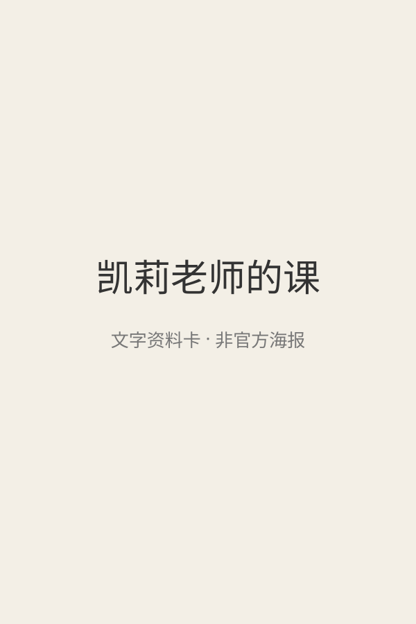</a> 文字封面（非官方海报） | Little Fox：凯莉老师的课 Mrs. Kelly&#x27;s Class [文章39](<https://mp.weixin.qq.com/s/n4NYE3lnXXynjPaTD8KG5A>) | 有保留 | 3+（编辑暂议；按英语水平） 

原文说法
文章称L1—L3约2—6岁
 | 文章把它列为Little Fox第1级“必看”：一集约50秒，单词配动作（jump、touch）。官方目录显示36个故事（2026-11-07读取）。文章称L1—L3主要适合2—6岁。 | Little Fox官方目录已核实该系列（第1级、36个故事）。分级读物动画语言控制清楚，适合作英语听读材料；但无CSM等独立适龄或效果评测，属付费订阅商业产品。文章“英语启蒙天花板”“2岁看到初中”“别开中文字幕”为营销或个人主张，2岁幼儿屏幕时间应很少，看后仍需真人互动与共读。 | 官方来源核实，无独立适龄评测 置信度：低至中 [Little Fox官方目录](<https://www.littlefox.com/en/full_list>)（制作方官方页面，不是独立评测） | [官方入口（非已验证正片）](<https://www.littlefox.com/en/full_list>) |
| <a href="../../images/title-cards/wx39-lf-big-green-forest.svg">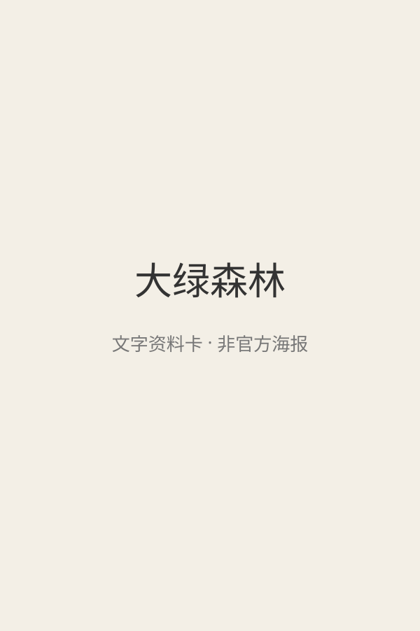</a> 文字封面（非官方海报） | Little Fox：大绿森林 Big Green Forest [文章39](<https://mp.weixin.qq.com/s/n4NYE3lnXXynjPaTD8KG5A>) | 有保留 | 3+（编辑暂议；按英语水平） 

原文说法
文章称L1—L3约2—6岁
 | 文章把它列为Little Fox第1级“必看”：一集聚焦一个动词，当“会动的单词卡”。官方目录显示24个故事（2026-11-07读取）。文章称L1—L3主要适合2—6岁。 | Little Fox官方目录已核实该系列（第1级、24个故事）。分级读物动画语言控制清楚，适合作英语听读材料；但无CSM等独立适龄或效果评测，属付费订阅商业产品。文章“英语启蒙天花板”“2岁看到初中”“别开中文字幕”为营销或个人主张，2岁幼儿屏幕时间应很少，看后仍需真人互动与共读。 | 官方来源核实，无独立适龄评测 置信度：低至中 [Little Fox官方目录](<https://www.littlefox.com/en/full_list>)（制作方官方页面，不是独立评测） | [官方入口（非已验证正片）](<https://www.littlefox.com/en/full_list>) |
| <a href="../../images/title-cards/wx39-lf-bird-and-kip.svg">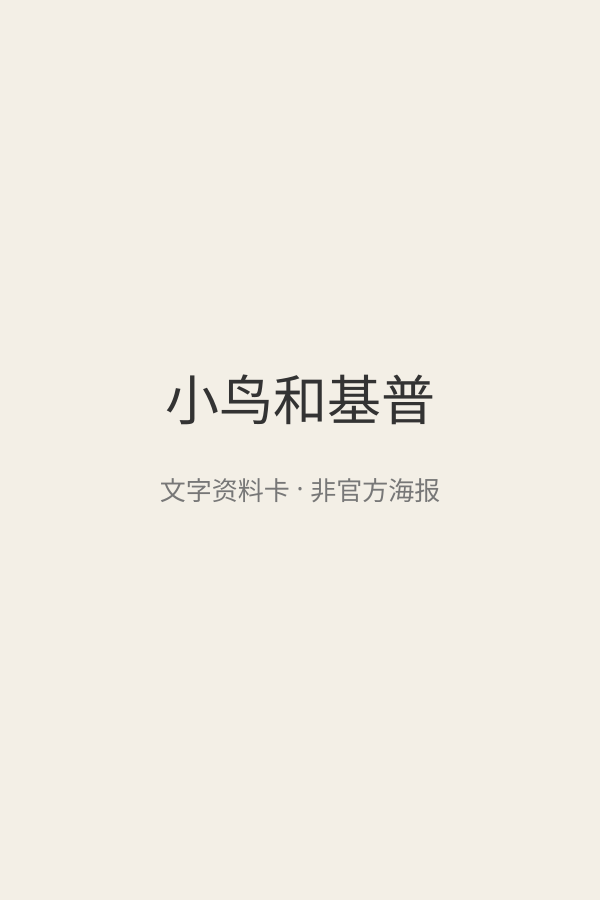</a> 文字封面（非官方海报） | Little Fox：小鸟和基普 Bird and Kip [文章39](<https://mp.weixin.qq.com/s/n4NYE3lnXXynjPaTD8KG5A>) | 有保留 | 4+（编辑暂议；按英语水平） 

原文说法
文章称L1—L3约2—6岁
 | 文章把它列为Little Fox第2级“必看”：安静的小鸟与捣蛋花栗鼠Kip做邻居，从单词过渡到句子。官方目录显示120个故事（2026-11-07读取）。文章称L1—L3主要适合2—6岁。 | Little Fox官方目录已核实该系列（第2级、120个故事）。分级读物动画语言控制清楚，适合作英语听读材料；但无CSM等独立适龄或效果评测，属付费订阅商业产品。文章“英语启蒙天花板”“2岁看到初中”“别开中文字幕”为营销或个人主张，2岁幼儿屏幕时间应很少，看后仍需真人互动与共读。 | 官方来源核实，无独立适龄评测 置信度：低至中 [Little Fox官方目录](<https://www.littlefox.com/en/full_list>)（制作方官方页面，不是独立评测） | [官方入口（非已验证正片）](<https://www.littlefox.com/en/full_list>) |
| <a href="../../images/title-cards/wx39-lf-wizard-and-cat.svg">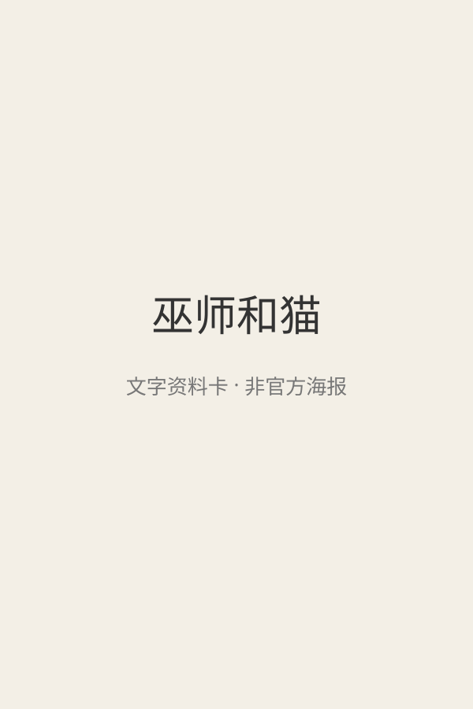</a> 文字封面（非官方海报） | Little Fox：巫师和猫 Wizard and Cat [文章39](<https://mp.weixin.qq.com/s/n4NYE3lnXXynjPaTD8KG5A>) | 有保留 | 4+（编辑暂议；按英语水平） 

原文说法
文章称L1—L3约2—6岁
 | 文章把它列为Little Fox第3级“必看”：爱闯祸的小巫师Tom和聪明猫，一集一个小反转。官方目录显示72个故事（2026-11-07读取）。文章称L1—L3主要适合2—6岁。 | Little Fox官方目录已核实该系列（第3级、72个故事）。分级读物动画语言控制清楚，适合作英语听读材料；但无CSM等独立适龄或效果评测，属付费订阅商业产品。文章“英语启蒙天花板”“2岁看到初中”“别开中文字幕”为营销或个人主张，2岁幼儿屏幕时间应很少，看后仍需真人互动与共读。 | 官方来源核实，无独立适龄评测 置信度：低至中 [Little Fox官方目录](<https://www.littlefox.com/en/full_list>)（制作方官方页面，不是独立评测） | [官方入口（非已验证正片）](<https://www.littlefox.com/en/full_list>) |
| <a href="../../images/title-cards/wx39-lf-peter-rabbit.svg">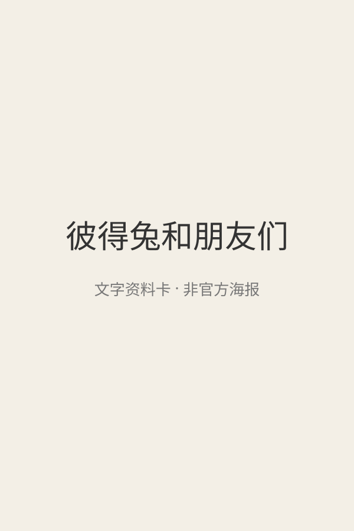</a> 文字封面（非官方海报） | Little Fox：彼得兔和朋友们 Peter Rabbit and Friends [文章39](<https://mp.weixin.qq.com/s/n4NYE3lnXXynjPaTD8KG5A>) | 有保留 | 4+（编辑暂议；按英语水平） 

原文说法
文章称L1—L3约2—6岁
 | 文章把它列为Little Fox第2级“必看”：经典IP改编，开始有故事感。官方目录显示72个故事（2026-11-07读取）。文章称L1—L3主要适合2—6岁。 | Little Fox官方目录已核实该系列（第2级、72个故事）。分级读物动画语言控制清楚，适合作英语听读材料；但无CSM等独立适龄或效果评测，属付费订阅商业产品。文章“英语启蒙天花板”“2岁看到初中”“别开中文字幕”为营销或个人主张，2岁幼儿屏幕时间应很少，看后仍需真人互动与共读。 | 官方来源核实，无独立适龄评测 置信度：低至中 [Little Fox官方目录](<https://www.littlefox.com/en/full_list>)（制作方官方页面，不是独立评测） | [官方入口（非已验证正片）](<https://www.littlefox.com/en/full_list>) |
| <a href="../../images/title-cards/wx39-lf-dino-buddies.svg">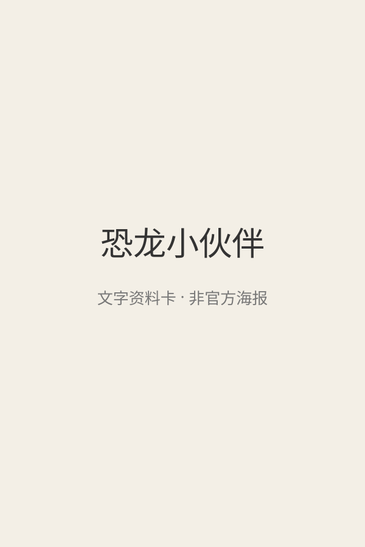</a> 文字封面（非官方海报） | Little Fox：恐龙小伙伴 Dino Buddies [文章39](<https://mp.weixin.qq.com/s/n4NYE3lnXXynjPaTD8KG5A>) | 有保留 | 3+（编辑暂议；按英语水平） 

原文说法
文章称L1—L3约2—6岁
 | 文章把它列为Little Fox第1级“必看”：四只小恐龙的冒险，句子简短重复。官方目录显示72个故事（2026-11-07读取）。文章称L1—L3主要适合2—6岁。 | Little Fox官方目录已核实该系列（第1级、72个故事）。分级读物动画语言控制清楚，适合作英语听读材料；但无CSM等独立适龄或效果评测，属付费订阅商业产品。文章“英语启蒙天花板”“2岁看到初中”“别开中文字幕”为营销或个人主张，2岁幼儿屏幕时间应很少，看后仍需真人互动与共读。 | 官方来源核实，无独立适龄评测 置信度：低至中 [Little Fox官方目录](<https://www.littlefox.com/en/full_list>)（制作方官方页面，不是独立评测） | [官方入口（非已验证正片）](<https://www.littlefox.com/en/full_list>) |
| <a href="../../images/title-cards/wx39-lf-wind-in-the-willows.svg">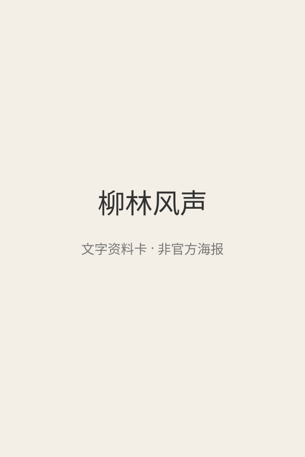</a> 文字封面（非官方海报） | Little Fox：柳林风声 Wind in the Willows [文章39](<https://mp.weixin.qq.com/s/n4NYE3lnXXynjPaTD8KG5A>) | 有保留 | 4+（编辑暂议；按英语水平） 

原文说法
文章称L1—L3约2—6岁
 | 文章把它列为Little Fox第3级“必看”：名著改编，句子明显加长。官方目录显示100个故事（2026-11-07读取）。文章称L1—L3主要适合2—6岁。 | Little Fox官方目录已核实该系列（第3级、100个故事）。分级读物动画语言控制清楚，适合作英语听读材料；但无CSM等独立适龄或效果评测，属付费订阅商业产品。文章“英语启蒙天花板”“2岁看到初中”“别开中文字幕”为营销或个人主张，2岁幼儿屏幕时间应很少，看后仍需真人互动与共读。 | 官方来源核实，无独立适龄评测 置信度：低至中 [Little Fox官方目录](<https://www.littlefox.com/en/full_list>)（制作方官方页面，不是独立评测） | [官方入口（非已验证正片）](<https://www.littlefox.com/en/full_list>) |
| <a href="../../images/title-cards/wx39-lf-tire-town-school.svg">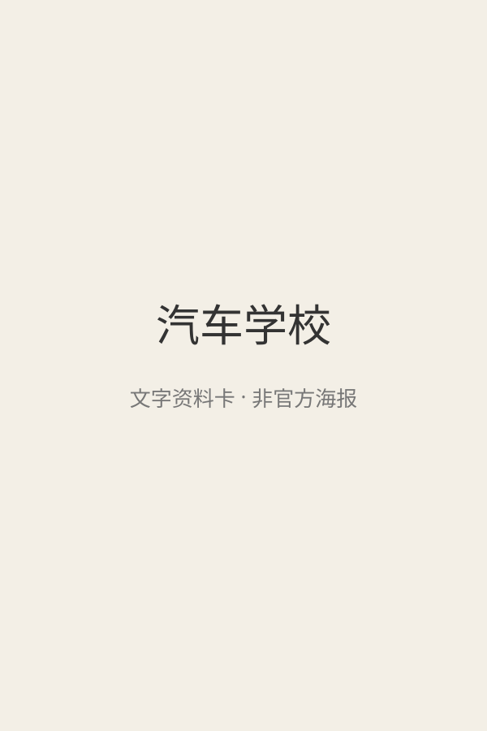</a> 文字封面（非官方海报） | Little Fox：汽车学校 Tire Town School [文章39](<https://mp.weixin.qq.com/s/n4NYE3lnXXynjPaTD8KG5A>) | 有保留 | 3+（编辑暂议；按英语水平） 

原文说法
文章称L1—L3约2—6岁
 | 文章把它列为Little Fox第1级“必看”：蓝色小卡车Eddy和小伙伴的校园故事，单词极简、重复率高。官方目录显示72个故事（2026-11-07读取）。文章称L1—L3主要适合2—6岁。 | Little Fox官方目录已核实该系列（第1级、72个故事）。分级读物动画语言控制清楚，适合作英语听读材料；但无CSM等独立适龄或效果评测，属付费订阅商业产品。文章“英语启蒙天花板”“2岁看到初中”“别开中文字幕”为营销或个人主张，2岁幼儿屏幕时间应很少，看后仍需真人互动与共读。 | 官方来源核实，无独立适龄评测 置信度：低至中 [Little Fox官方目录](<https://www.littlefox.com/en/full_list>)（制作方官方页面，不是独立评测） | [官方入口（非已验证正片）](<https://www.littlefox.com/en/full_list>) |
| <a href="../../images/title-cards/wx39-lf-cinderella.svg">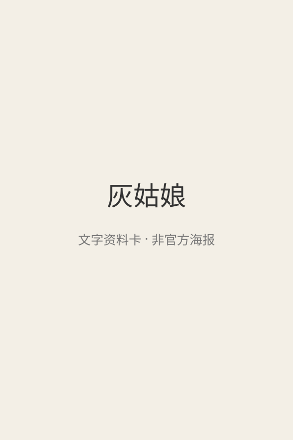</a> 文字封面（非官方海报） | Little Fox：灰姑娘 Cinderella [文章39](<https://mp.weixin.qq.com/s/n4NYE3lnXXynjPaTD8KG5A>) | 有保留 | 4+（编辑暂议；按英语水平） 

原文说法
文章称L1—L3约2—6岁
 | 文章把它列为Little Fox第3级“必看”：熟悉的童话，用已知剧情猜英文。官方目录显示12个故事（2026-11-07读取）。文章称L1—L3主要适合2—6岁。 | Little Fox官方目录已核实该系列（第3级、12个故事）。分级读物动画语言控制清楚，适合作英语听读材料；但无CSM等独立适龄或效果评测，属付费订阅商业产品。文章“英语启蒙天花板”“2岁看到初中”“别开中文字幕”为营销或个人主张，2岁幼儿屏幕时间应很少，看后仍需真人互动与共读。 | 官方来源核实，无独立适龄评测 置信度：低至中 [Little Fox官方目录](<https://www.littlefox.com/en/full_list>)（制作方官方页面，不是独立评测） | [官方入口（非已验证正片）](<https://www.littlefox.com/en/full_list>) |
| <a href="../../images/title-cards/wx39-lf-bat-and-friends.svg">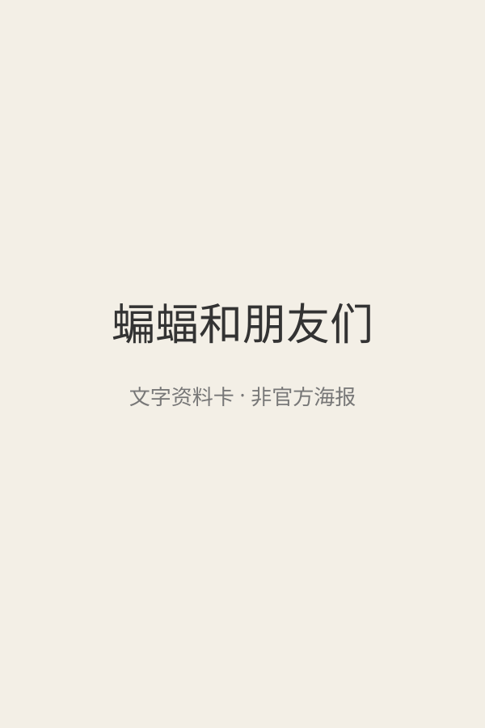</a> 文字封面（非官方海报） | Little Fox：蝙蝠和朋友们 Bat and Friends [文章39](<https://mp.weixin.qq.com/s/n4NYE3lnXXynjPaTD8KG5A>) | 有保留 | 3+（编辑暂议；按英语水平） 

原文说法
文章称L1—L3约2—6岁
 | 文章把它列为Little Fox第1级“必看”：小蝙蝠和农场动物，动物词与日常句重复。官方目录显示72个故事（2026-11-07读取）。文章称L1—L3主要适合2—6岁。 | Little Fox官方目录已核实该系列（第1级、72个故事）。分级读物动画语言控制清楚，适合作英语听读材料；但无CSM等独立适龄或效果评测，属付费订阅商业产品。文章“英语启蒙天花板”“2岁看到初中”“别开中文字幕”为营销或个人主张，2岁幼儿屏幕时间应很少，看后仍需真人互动与共读。 | 官方来源核实，无独立适龄评测 置信度：低至中 [Little Fox官方目录](<https://www.littlefox.com/en/full_list>)（制作方官方页面，不是独立评测） | [官方入口（非已验证正片）](<https://www.littlefox.com/en/full_list>) |
| <a href="../../images/title-cards/wx39-lf-meet-the-animals.svg">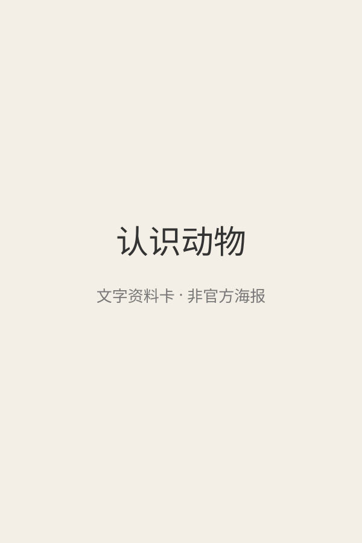</a> 文字封面（非官方海报） | Little Fox：认识动物 Meet the Animals [文章39](<https://mp.weixin.qq.com/s/n4NYE3lnXXynjPaTD8KG5A>) | 有保留 | 4+（编辑暂议；按英语水平） 

原文说法
文章称L1—L3约2—6岁
 | 文章把它列为Little Fox第2级“必看”：实拍动物加动画讲解。官方目录显示76个故事（2026-11-07读取）。文章称L1—L3主要适合2—6岁。 | Little Fox官方目录已核实该系列（第2级、76个故事）。分级读物动画语言控制清楚，适合作英语听读材料；但无CSM等独立适龄或效果评测，属付费订阅商业产品。文章“英语启蒙天花板”“2岁看到初中”“别开中文字幕”为营销或个人主张，2岁幼儿屏幕时间应很少，看后仍需真人互动与共读。 | 官方来源核实，无独立适龄评测 置信度：低至中 [Little Fox官方目录](<https://www.littlefox.com/en/full_list>)（制作方官方页面，不是独立评测） | [官方入口（非已验证正片）](<https://www.littlefox.com/en/full_list>) |
| <a href="../../images/w-what-if.jpg">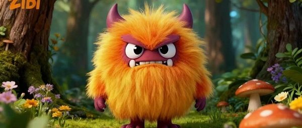</a> [公众号通用图（非本片海报）](<https://mmbiz.qpic.cn/sz_mmbiz_jpg/Cu3arSAIaMw3Y9UpdaRITDFOib7ODPtfYDUUf6XGhBdz5vrYPLazc3xpfEgAGoc6fUgcicsluSrUActH2dRicaXcePLD6bia2Wnlu1VrBiaSzRv8/0?wx_fmt=jpeg>) | What If [文章6](<https://mp.weixin.qq.com/s/chL3s5Cy86w0a_Ykz0VNLg>) · [文章32](<https://mp.weixin.qq.com/s/_1jigH8MZdLofsaUiUXMLg>) · [文章35](<https://mp.weixin.qq.com/s/OVU50VeXzN38joyavb47dA>) | 有保留 | 逐集判断 

原文说法
未标明年龄
 | 出现在《小怪兽阿蒙》文末的往期推荐。原文是：BBC 专为孩子拍的科普片《What If》（52 集，中英文），每个奇思妙想里都有一个科学答案。没有写年龄，也没有播放链接。 | What If可能是多个不同品牌或合集；假设推演并非现实预测。需逐集查科学来源、概率条件和灾难画面的刺激性，不能整体盖“科学优质”章。 | 证据不足，编辑保守初筛 置信度：低 未取得作品级独立依据 | 未核实正版正片 |
|  文字封面（非官方海报） | Wow English [文章23](<https://mp.weixin.qq.com/s/B2loD1DLgD3WS77WM1XkqQ>) | 有保留 | 按语言水平，独立年龄未核实 

原文说法
6岁，文章写幼儿园段
 | 文章说这是真人加手偶的英语教学片，老师 Steve 表演夸张。语法和词汇逐层递进，看完一集能在生活里用上几句。 | 真人夸张表演可能吸引孩子，但这是商业英语品牌，不是独立效果研究。未找到对应独立儿童指南，不保证看一集就能迁移到生活；需家长互动和试听选择。 | 证据不足，编辑保守初筛 置信度：低 未取得作品级独立依据 | 未核实正版正片 |
|  [公众号通用图（非本片海报）](<https://mmbiz.qpic.cn/sz_mmbiz_jpg/Cu3arSAIaMyO6ajJX6PuIZ2cryTibsdeAQewQsk79Nk7LVIkM2RiaHiboibht0c7BDYTz6f0Jpd4EEpsNQyXjH6bCdjUbmjn1ptibzYlSCNxUZpE/0?wx_fmt=jpeg>) | 万物运转的秘密 The Way Things Work [文章1](<https://mp.weixin.qq.com/s/avLRvdVMXnPOaVbRW418CA>) · [文章7](<https://mp.weixin.qq.com/s/JLfW5GcNqZjFjPqpOzKXHw>) · [文章6](<https://mp.weixin.qq.com/s/chL3s5Cy86w0a_Ykz0VNLg>) · [文章20](<https://mp.weixin.qq.com/s/-5VGJkhfqgD0lcveZ1_sbg>) · [文章31](<https://mp.weixin.qq.com/s/wzJmew_gUZLoBC9gcNv1Zw>) | 有保留 | 6+（编辑暂议） 

原文说法
6岁以上
 | 

文章说这部片根据大卫·麦考利的同名书改编，26集，每集约13分钟。故事发生在猛犸象小岛：挤奶时讲滑轮，打捞沉船铁轨时讲电磁铁。文章写它适合6岁以上，没有中文配音…（展开）
文章说这部片根据大卫·麦考利的同名书改编，26集，每集约13分钟。故事发生在猛犸象小岛：挤奶时讲滑轮，打捞沉船铁轨时讲电磁铁。文章写它适合6岁以上，没有中文配音，是英文原声加中英文字幕。另一篇同样推荐了这部，并补充科学家旁白、每集13分钟。
 | 动画把机械原理视觉化有潜力，但独立片目没有核实文章的“豆瓣9.5”；不能把同名图书的评分转给动画。缺少学习迁移证据，旧技术内容应与现代资料核对。 | 作品级证据初审 置信度：中 [豆瓣搜索索引（非实时评分）](<https://movie.douban.com/subject/5174185/>) | 未核实正版正片 |
|  [旧图（未逐张鉴定）](<https://mmbiz.qpic.cn/mmbiz_png/9TOlbmicibtkMLwUv1gyKNlRc0SfAnpiceqJCfrWtaryrAKVibTOhkAKLcPkwSL5MFkABtgozJ24WnGiakYbcJngq1w/640?wx_fmt=png>) | 了不起的自然 [文章18](<https://mp.weixin.qq.com/s/OVAalp0Bxej8u2Q7FDJFgg>) | 有保留 | 逐集判断 

原文说法
未标明年龄
 | 

文章把一套128集、每集约五分钟的科普动画称为《了不起的自然》，并写制作方是 TED-Ed。选题来自中小学科学老师，由动物学家、海洋科学家、地质学家供稿，再做成…（展开）
文章把一套128集、每集约五分钟的科普动画称为《了不起的自然》，并写制作方是 TED-Ed。选题来自中小学科学老师，由动物学家、海洋科学家、地质学家供稿，再做成手绘动画。例子包括树懒为什么慢、燕子如何找回家、静电、捕蝇草和壁虎断尾。文章没有给出对应的单一英文剧名，所以这里不把它安到某一套现成英文系列上。
 | “了不起的自然128集”更像文章自编合集名，不能当作TED-Ed统一系列或统一年龄认证；须逐集核实作者、科学来源、时长与知识更新。 | 证据不足，编辑保守初筛 置信度：低 未取得作品级独立依据 | 未核实正版正片 |
| <a href="../../images/title-cards/wx35-nhk-the-body.svg">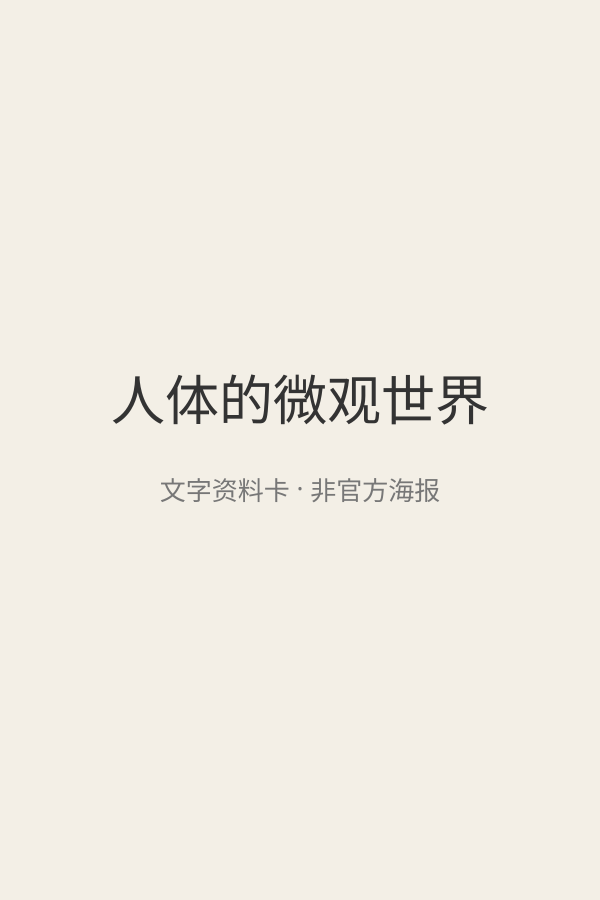</a> 文字封面（非官方海报） | 人体的微观世界 The Body (NHK, 2018) [文章35](<https://mp.weixin.qq.com/s/OVU50VeXzN38joyavb47dA>) | 有保留 | 12+（编辑暂议；原文“越早越好”不成立） 

原文说法
文章（往期推荐）未写年龄；称“孩子越早了解越好”
 | 出现在文末“往期推荐”（重复列出两次）：称豆瓣9.6、8集，“孩子越早了解身体真相，越懂得珍惜健康”。 | NHK 2018年8集纪录片，每集约50分钟，讲信号分子、肾、脂肪肌肉、骨骼、肠道、大脑、产前母婴交流、外泌体等前沿医学，观众短评也说“观看有一定门槛”。文章“越早了解越好”与内容难度不符，适合初中以上；产前一集含孕育内容。豆瓣9.6未核实，未找到正版官方播放页。 | 作品级证据初审 置信度：低 [豆瓣条目（短评页）](<https://movie.douban.com/subject/36036108/>)（观众条目，非适龄评测） | 未核实正版正片 |
| <a href="../../images/title-cards/wx50-brilliant-madness.svg">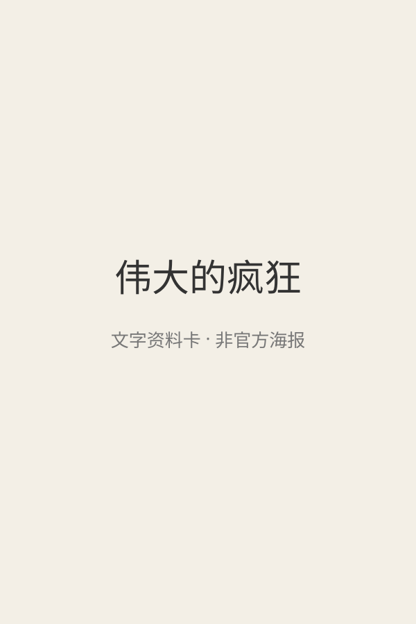</a> 文字封面（非官方海报） | 伟大的疯狂 A Brilliant Madness (American Experience, 2002) [文章50](<https://mp.weixin.qq.com/s/6XzwxNUnjkAKvwAyKDGsJA>) | 有保留 | 15+（原文；无独立评测） 

原文说法
15岁+（原文）
 | 原文列于10—12年级：记录数学家约翰·纳什的一生与精神疾病。 | PBS官方页与维基百科核实：PBS《美国经验》2002年播出的纳什传记纪录片。原文称纳什“发明了博弈论”不准确——维基百科记载博弈论由冯·诺依曼与摩根斯特恩奠基，纳什的贡献是纳什均衡等基础成果，并因此获1994年诺贝尔经济学奖。题材涉及精神分裂症，适合高中生与家长一起看。无独立适龄评测，豆瓣8.8未核实。 | 官方来源与百科背景核实，无独立适龄评测 置信度：低 [PBS American Experience](<https://www.pbs.org/wgbh/americanexperience/films/nash/>)（制作方官方页面，不是独立评测） [Wikipedia](<https://en.wikipedia.org/wiki/A_Brilliant_Madness>)（作品背景资料，不是适龄评测） | [官方入口（非已验证正片）](<https://www.pbs.org/wgbh/americanexperience/films/nash/>) |
|  旧图（未逐张鉴定） | 依娜和恰恰 [文章23](<https://mp.weixin.qq.com/s/B2loD1DLgD3WS77WM1XkqQ>) | 有保留 | 未核实 

原文说法
2岁左右
 | 文章说中文、英文版本都有，画风柔和，情节简单，两岁孩子跟着哼就能有语感。这个阶段看动画是为了对英语不陌生，不是为了看懂剧情。 | 原文称适合两岁，但具体制作版本、独立儿童评测与学习效果未核实。先看单集的剪辑、音量和重复方式，不凭柔和画风或家长个案推定有教育效果。 | 证据不足，编辑保守初筛 置信度：低 未取得作品级独立依据 | 未核实正版正片 |
|  [旧图（未逐张鉴定）](<https://mmbiz.qpic.cn/sz_mmbiz_jpg/zPQhETG3LfTKeMLpib7KS1A6IAqAJfj7Bk4MuObdkc52ic6Y4ibU5d3acSia2pHwWmwIrib8z520sbMOyYzAFOR0xbib43yW0T0GYr43Wq6lmXdUc/0?wx_fmt=jpeg>) | 唐老鸭漫游数学奇境 Donald in Mathmagic Land [文章3](<https://mp.weixin.qq.com/s/MOZwqN65Jkq0XRtZ5E0qyQ>) | 有保留 | 6+（编辑暂议） 

原文说法
5-10岁
 | 文章写这是1集、约27分钟的迪士尼动画，中文和英文都有，适合5–10岁。它不把计算题搬进动画，而是讲数学有什么用、数学的美在哪里。迪士尼电影页写首映日期为1959年6月26日。 | 用音乐与图形引入数学可能有趣，但“看完就爱数学”不是已验证效果。1959年的文化表现与数学史叙述需要补充背景；未取得独立儿童分龄依据。 | 证据不足，编辑保守初筛 置信度：低 未取得作品级独立依据 | [官方入口（非已验证正片）](<https://movies.disney.com/donald-in-mathmagic-land>) |
| <a href="../../images/title-cards/wx50-hunting-hidden-dimension.svg">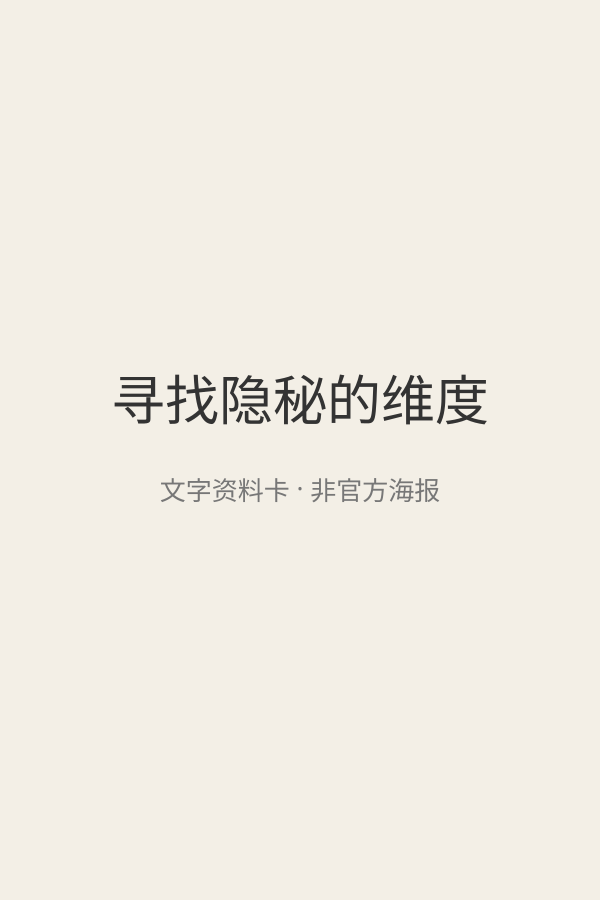</a> 文字封面（非官方海报） | 寻找隐秘的维度 NOVA: Hunting the Hidden Dimension (2008) [文章50](<https://mp.weixin.qq.com/s/6XzwxNUnjkAKvwAyKDGsJA>) | 有保留 | 14+（原文；无独立评测） 

原文说法
14岁+（原文）
 | 原文列于10—12年级：讲分形几何在电影特效、海岸线测量、心脏病检测等方面的应用。 | PBS NOVA官方页核实：关于分形几何与曼德博的一小时节目。内容与原文描述相符；年龄沿用原文，无独立适龄评测，豆瓣8.8未核实。 | 官方来源核实，无独立适龄评测 置信度：低 [PBS NOVA](<https://www.pbs.org/wgbh/nova/fractals/>)（制作方官方页面，不是独立评测） | [官方入口（非已验证正片）](<https://www.pbs.org/wgbh/nova/fractals/>) |
|  文字封面（非官方海报） | 小小智慧树 [全网检索](<https://tv.cctv.cn/lm/xxzhs/>) | 有保留 | 官方写1—3岁；18个月以下不建议作为娱乐屏幕（AAP既有政策），须成人共看 

原文说法
非公众号来源；适龄以本轮独立评测或官方栏目定位为准
 | 

中央电视台少儿频道原创杂志型益智栏目。官方栏目页写明自2008年起、在多元智能框架下为1—3岁幼儿制作，工作日早间播出，页面可打开并有完整视频入口。无Commo…（展开）
中央电视台少儿频道原创杂志型益智栏目。官方栏目页写明自2008年起、在多元智能框架下为1—3岁幼儿制作，工作日早间播出，页面可打开并有完整视频入口。无Common Sense Media等独立适龄评测。此次为2026年11月全网检索收录。
 | 有官方栏目定位和可打开的节目页，但只有制作方说明，不能当作独立儿童内容评测。官方起始年龄为1岁，低于常见儿科媒体使用建议中的娱乐屏幕起点，婴儿阶段更不宜把节目当看护工具。具体环节质量需家长按集预看，不把“总台出品”等同于已验证适龄或学习效果。 | 只有制作方官方页面（不算独立参考） 置信度：低 未取得作品级独立依据 | [官方入口（非已验证正片）](<https://tv.cctv.cn/lm/xxzhs/>) |
|  [公众号通用图（非本片海报）](<https://mmbiz.qpic.cn/mmbiz_jpg/Cu3arSAIaMwRJobiciaQXymdALKZA6NUwGDbtL3ChrPGjLII3ayicR9n0DN5jibiacQm7A6Ey44WlcKbN2ETrRic8bzhjicyIzibS9Y6JhptKVhhtUk/0?wx_fmt=jpeg>) | 平博士密码 [文章8](<https://mp.weixin.qq.com/s/DcF-aYLjzo5rt263kz0nXQ>) | 有保留 | 6+（编辑暂议） 

原文说法
未标明年龄
 | 出现在《人体奥奇实验室》文末的往期推荐。原文是：全球首部诺贝尔科普题材动画《平博士密码》（52 集，中英文），把看不见的科学讲明白。没有写年龄，也没有播放链接。 | 科学冒险有潜在启蒙价值，但尚无对应独立儿童评测；需把虚构情节、类比与真实科学区分，并排查不安全实验示范。 | 证据不足，编辑保守初筛 置信度：低 未取得作品级独立依据 | 未核实正版正片 |
| <a href="../../images/review/wx37-just-joking.jpg">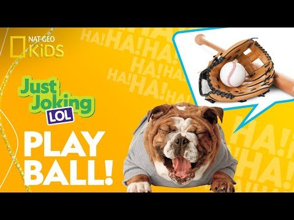</a> [官方页面视频缩略图（版权归原权利人）](<https://www.youtube.com/playlist?list=PLQlnTldJs0ZSwXZodadqpS_vv0NXXB-GC>) | 开怀大笑：国家地理冷笑话 Just Joking—LOL (Nat Geo Kids) [文章37](<https://mp.weixin.qq.com/s/wpVf_2x_Lnk65ik8EnTnGA>) | 有保留 | 8+（编辑暂议；需一定英语基础） 

原文说法
文章未写年龄
 | 

文章称国家地理儿童频道“Just Joking—LOL”系列，30多集、每集不到2分钟，把动物和自然拍成短片，配大量冷笑话、脑筋急转弯和英语双关语、谐音梗，举例…（展开）
文章称国家地理儿童频道“Just Joking—LOL”系列，30多集、每集不到2分钟，把动物和自然拍成短片，配大量冷笑话、脑筋急转弯和英语双关语、谐音梗，举例葡萄bunch、24 carrots/karats、Olive you、Neptunes、月球餐厅no atmosphere。
 | Nat Geo Kids官方YouTube播放列表已核实，免费、每集很短，动物画面配英语冷笑话。但这是笑话短片而非科普：双关、谐音（carrots/karats、Olive you）需要较好的英语和文化背景，初学者看不懂笑点，“磨耳朵”价值有限；文章“跨越语言字面意思”属拔高。无独立适龄评测，节奏快、可作为偶尔的家庭英语游戏。 | 官方来源核实，无独立适龄评测 置信度：低至中 [Nat Geo Kids官方YouTube播放列表](<https://www.youtube.com/playlist?list=PLQlnTldJs0ZSwXZodadqpS_vv0NXXB-GC>)（制作方官方页面，不是独立评测） | [官方入口（非已验证正片）](<https://www.youtube.com/playlist?list=PLQlnTldJs0ZSwXZodadqpS_vv0NXXB-GC>) |
|  文字封面（非官方海报） | 快乐体验 [全网检索](<https://tv.cctv.cn/lm/klty/index.shtml>) | 有保留 | 11+（编辑暂议，依据官方“中学生”表述；无独立评测） 

原文说法
非公众号来源；适龄以本轮独立评测或官方栏目定位为准
 | CCTV-14栏目。官方页面说明用纪实手法，让中学生以自己的身份和视角进入设定情境，做角色互换、行业体验和自然探索。节目页可打开。不宜当作低幼节目。此次为2026年11月全网检索收录。 | 官方明确写的是中学生视角，不是幼儿或小学低年级栏目。没有独立适龄评测，具体集目（野外训练、职业体验等）强度需成人预看。不能因为它出现在少儿频道就把适龄下调到学龄前。 | 只有制作方官方页面（不算独立参考） 置信度：低 未取得作品级独立依据 | [官方入口（非已验证正片）](<https://tv.cctv.cn/lm/klty/index.shtml>) |
|  文字封面（非官方海报） | 恐龙兄弟 [文章23](<https://mp.weixin.qq.com/s/B2loD1DLgD3WS77WM1XkqQ>) | 有保留 | 独立年龄未核实 

原文说法
文章把它当作 Little Fox 第1阶例子
 | 文章没有单独讲剧情，只把它写为 Little Fox 第1阶的例子之一。 | 恐龙题材不等于科学准确或有语言迁移效果；目前只有平台例举，缺乏对应独立内容与适龄评测。应确认具体系列、主题和词汇后选择。 | 证据不足，编辑保守初筛 置信度：低 未取得作品级独立依据 | 未核实正版正片 |
| <a href="../../images/review/wx31-getting-under-our-skin.jpg">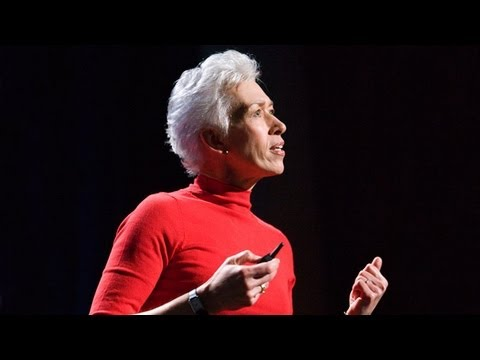</a> [官方页面视频缩略图（版权归原权利人）](<https://ed.ted.com/series/getting-under-our-skin>) | 揭秘身体奥秘 Getting Under Our Skin [文章31](<https://mp.weixin.qq.com/s/wzJmew_gUZLoBC9gcNv1Zw>) · [文章32](<https://mp.weixin.qq.com/s/_1jigH8MZdLofsaUiUXMLg>) | 有保留 | 10+（编辑暂议；逐集挑选） 

原文说法
文章以5岁半女儿及更大的儿子为例，未明确年龄
 | 

TED-Ed出品，文章称150集、每集3–5分钟、中英文。把人体画成城市：心脏是水泵、血管是水管，癌细胞像蒲公英种子顺血管和淋巴管扩散，坐姿与腰椎压力，深度睡眠…（展开）
TED-Ed出品，文章称150集、每集3–5分钟、中英文。把人体画成城市：心脏是水泵、血管是水管，癌细胞像蒲公英种子顺血管和淋巴管扩散，坐姿与腰椎压力，深度睡眠时大脑清理代谢废物。文末“后台回复【揭秘】”领取资源。
 | TED-Ed官方系列，免费、单集短，用城市等比喻讲人体，制作方可信；但无CSM等独立适龄评测，集目含癌症转移、自闭症诊断、禽流感等，面向较大学生。“看完主动坐直早睡”“比唠叨管用100倍”是个人轶事，无证据；5岁半看懂癌症扩散需谨慎，建议10岁左右挑集共看。 | 官方来源核实，无独立适龄评测 置信度：低至中 [TED-Ed官方系列页](<https://ed.ted.com/series/getting-under-our-skin>)（制作方官方页面，不是独立评测） | [官方入口（非已验证正片）](<https://ed.ted.com/series/getting-under-our-skin>) |
| <a href="../../images/title-cards/wx50-great-math-mystery.svg">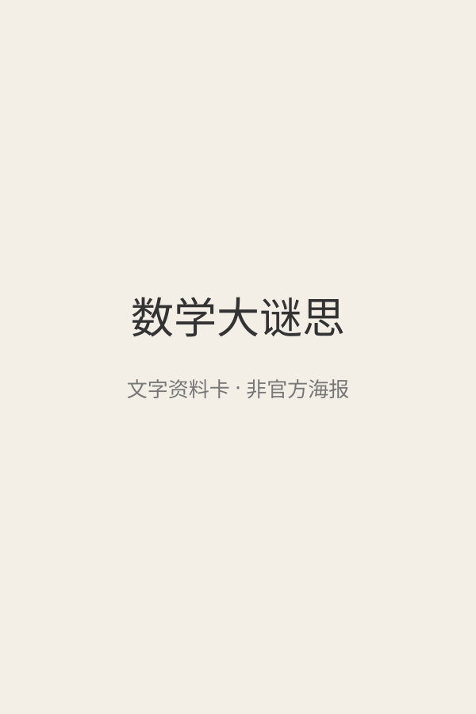</a> 文字封面（非官方海报） | 数学大谜思 NOVA: The Great Math Mystery (2015) [文章50](<https://mp.weixin.qq.com/s/6XzwxNUnjkAKvwAyKDGsJA>) | 有保留 | 12+（编辑暂议；PBS标TV-PG） 

原文说法
14岁+（原文）
 | 原文列于10—12年级：追问数学是发明还是发现。 | PBS NOVA官方页核实：2015年首播、53分钟，天体物理学家Mario Livio等人从毕达哥拉斯讲到爱因斯坦，追问数学是人类发明还是宇宙语言；PBS标注TV-PG。PBS页面注明已不再提供在线播放。无独立适龄评测，豆瓣8.3未核实。 | 官方来源核实，无独立适龄评测 置信度：低 [PBS NOVA](<https://www.pbs.org/wgbh/nova/video/the-great-math-mystery/>)（制作方官方页面，不是独立评测） | [官方入口（非已验证正片）](<https://www.pbs.org/wgbh/nova/video/the-great-math-mystery/>) |
| <a href="../../images/title-cards/wx50-voyages-maths.svg">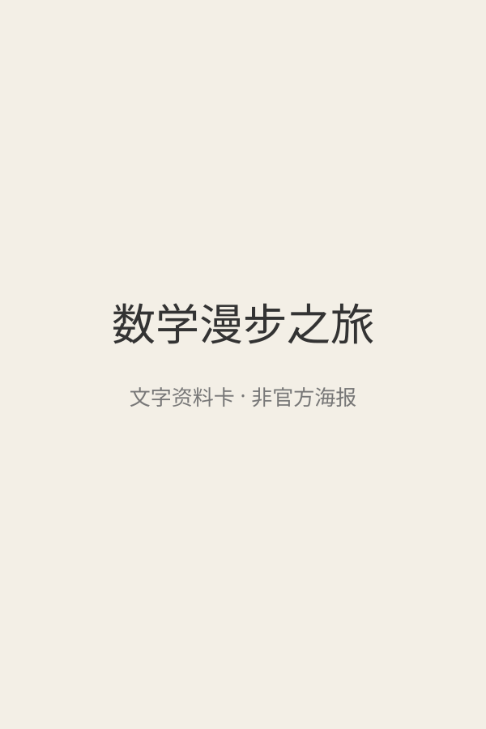</a> 文字封面（非官方海报） | 数学漫步之旅 Voyages au pays des maths (Short Trips in the Land of Math) [文章50](<https://mp.weixin.qq.com/s/6XzwxNUnjkAKvwAyKDGsJA>) | 有保留 | 12+（编辑暂议） 

原文说法
6岁+（原文）
 | 原文列于1—3年级，称每集9分半钟，用极简动画讲本福特定律、对数、庞加莱猜想、囚徒困境，建议三年级以上一天一集。 | 身份已核实：法国Arte出品、Denis Van Waerebeke创作的动画科普系列（2021年起，2季20集，每集约10分钟），豆瓣条目“数学漫步之旅 Short Trips In The Land of Math”。法语维基说明该片以初高中数学知识为起点、一路讲到当代研究前沿（哥德尔定理、黎曼猜想、复平面等），片头也自称“不真的做数学，只是看风景”。把它放在1—3年级、原文标6岁+明显偏低；适合对数学有兴趣的初中以上学生挑集看。无独立适龄评测，豆瓣9.5未核实。 | 官方来源与百科背景核实，无独立适龄评测 置信度：低 [Wikipédia (fr)](<https://fr.wikipedia.org/wiki/Voyages_au_pays_des_maths>)（作品背景资料，不是适龄评测） [ARTE](<https://www.arte.tv/fr/videos/097454-002-A/voyages-au-pays-des-maths/>)（制作方官方页面，不是独立评测） | [官方入口（非已验证正片）](<https://www.arte.tv/fr/videos/097454-002-A/voyages-au-pays-des-maths/>) |
|  [公众号通用图（非本片海报）](<https://mmbiz.qpic.cn/mmbiz_jpg/Cu3arSAIaMwRJobiciaQXymdALKZA6NUwGDbtL3ChrPGjLII3ayicR9n0DN5jibiacQm7A6Ey44WlcKbN2ETrRic8bzhjicyIzibS9Y6JhptKVhhtUk/0?wx_fmt=jpeg>) | 数学的故事 [文章6](<https://mp.weixin.qq.com/s/chL3s5Cy86w0a_Ykz0VNLg>) · [文章8](<https://mp.weixin.qq.com/s/DcF-aYLjzo5rt263kz0nXQ>) · [文章32](<https://mp.weixin.qq.com/s/_1jigH8MZdLofsaUiUXMLg>) · [文章33](<https://mp.weixin.qq.com/s/OQYM-V4pi28WVwmz01oHUg>) · [文章50](<https://mp.weixin.qq.com/s/6XzwxNUnjkAKvwAyKDGsJA>) | 有保留 | 12+（编辑暂议） 

原文说法
未标明年龄
 | 往期推荐里出现两次。原文是：BBC 科普《数学的故事》（4 集，中英文），跳出公式，换个角度看数字背后的逻辑。没有写年龄，也没有播放链接。 第50篇也列入（原文10+）。 | 数学史能引入思想与文化，但成人长篇纪录可能超出儿童知识背景；历史归属和史料需要交叉核对。文章的激发兴趣承诺不等于已验证效果。 | 证据不足，编辑保守初筛 置信度：低 未取得作品级独立依据 | 未核实正版正片 |
|  文字封面（非官方海报） | 智慧树 [全网检索](<https://tv.cctv.cn/lm/zhs/>) | 有保留 | 3+（官方栏目定位；无独立评测） 

原文说法
非公众号来源；适龄以本轮独立评测或官方栏目定位为准
 | 中央电视台少儿频道益智栏目。官方栏目页写明创办于2003年，以游戏承载教育理念，面向3—6岁学龄前儿童，工作日下午在少儿频道播出，页面可打开。无独立适龄评测。此次为2026年11月全网检索收录。 | 官方页对年龄和栏目定位有说明，且可打开，但没有作品级独立评测，不能据此给强烈推荐或保证教育效果。适合作为国内学前节目的官方入口之一，由成人按集选择，而不是把整档栏目当作已核验的优质课。 | 只有制作方官方页面（不算独立参考） 置信度：低 未取得作品级独立依据 | [官方入口（非已验证正片）](<https://tv.cctv.cn/lm/zhs/>) |
| <a href="../../images/title-cards/wx50-million-2-one.svg">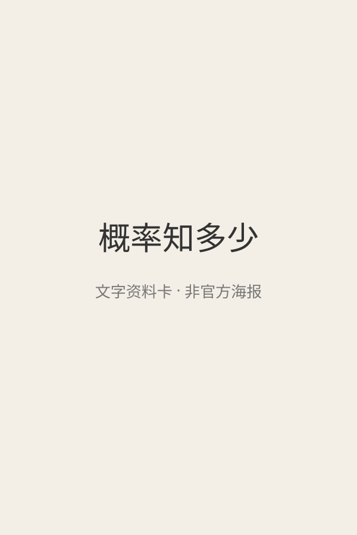</a> 文字封面（非官方海报） | 概率知多少 Million 2 One (2005) [文章50](<https://mp.weixin.qq.com/s/6XzwxNUnjkAKvwAyKDGsJA>) | 有保留 | 未核实（原文10+） 

原文说法
10岁+（原文）
 | 原文列于4—6年级：10集，用“奇葩但真实”的实验讲概率，举纸张最多对折7次的例子，称可作初中概率预习。 | 身份核实：TMDB、IMDb记为2005年英国纪录系列，10集，主持人Grub Smith；德国Discovery介绍称其为“不完全严肃”的幽默数字节目。原文举的“纸最多对折7次”是常见误区，2002年Britney Gallivan已把纸对折12次。娱乐性实验节目不等于系统的概率课，“初中预习”未见依据。无独立适龄评测，豆瓣8.7未核实。 | 作品资料库核实身份，无独立适龄评测 置信度：低 [TMDB](<https://www.themoviedb.org/tv/122628>)（作品资料库条目，不是适龄评测） [IMDb](<https://www.imdb.com/title/tt0977629/>)（作品资料库条目，不是适龄评测） | 未核实正版正片 |
|  文字封面（非官方海报） | 汽车城学校 [文章23](<https://mp.weixin.qq.com/s/B2loD1DLgD3WS77WM1XkqQ>) | 有保留 | 独立年龄未核实 

原文说法
文章把它当作 Little Fox 第1阶例子
 | 文章没有单独讲剧情，只把它写为 Little Fox 第1阶（学龄前）的例子之一，和《恐龙兄弟》并列。 | 只确认是文章举出的Little Fox低阶例子，不能把平台级宣传转成此片的学习效果。待核对官方名称、完整篇目和具体语言难度，再由家长试看。 | 证据不足，编辑保守初筛 置信度：低 未取得作品级独立依据 | 未核实正版正片 |
| <a href="../../images/title-cards/wx33-baoxiao-chemistry.svg">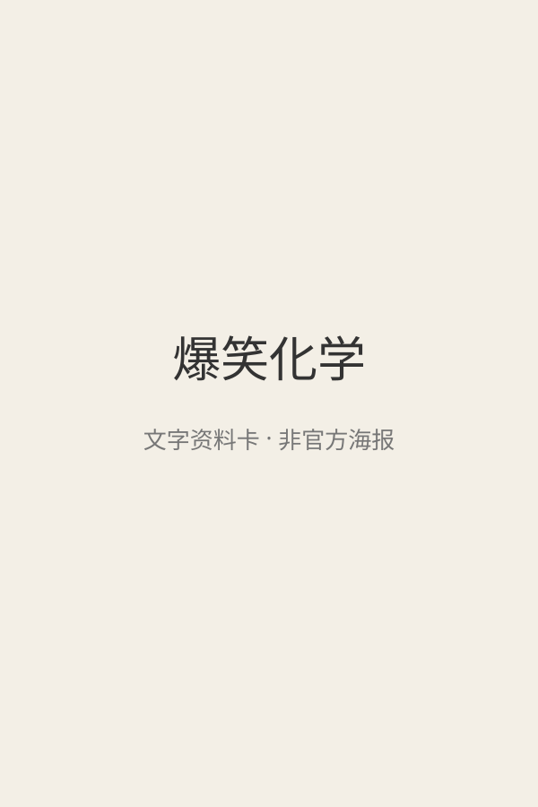</a> 文字封面（非官方海报） | 爆笑化学 [文章33](<https://mp.weixin.qq.com/s/OQYM-V4pi28WVwmz01oHUg>) · [文章34](<https://mp.weixin.qq.com/s/Ky-may7qF1IUAu_wEnloCQ>) | 有保留 | 未核实 

原文说法
文章（往期推荐）未写年龄
 | 出现在文末“往期推荐”：称“清华附”出品、172集、趣味学化学、家长辅导不焦虑。 | 制作方与“清华附”的关系、集数、内容准确性均未核实，无独立评测；“家长辅导不焦虑”为营销语。需先确认出品方和知识准确性，且应提醒不在家模仿实验。 | 证据不足，编辑保守初筛 置信度：低 未取得作品级独立依据 | 未核实正版正片 |
|  [公众号通用图（非本片海报）](<https://mmbiz.qpic.cn/sz_mmbiz_jpg/Cu3arSAIaMyO6ajJX6PuIZ2cryTibsdeAQewQsk79Nk7LVIkM2RiaHiboibht0c7BDYTz6f0Jpd4EEpsNQyXjH6bCdjUbmjn1ptibzYlSCNxUZpE/0?wx_fmt=jpeg>) | 爆笑物理 [文章1](<https://mp.weixin.qq.com/s/avLRvdVMXnPOaVbRW418CA>) · [文章20](<https://mp.weixin.qq.com/s/-5VGJkhfqgD0lcveZ1_sbg>) · [文章31](<https://mp.weixin.qq.com/s/wzJmew_gUZLoBC9gcNv1Zw>) | 有保留 | 未核实 

原文说法
未标明年龄
 | 只在《万物运转的秘密》文末作为往期推荐出现，原文是：清华附《爆笑物理》（144集），孩子趣味学物理。没有进一步介绍，也没有链接。 | “爆笑物理”像合集或非标准译名，未确认出品方和具体集目。没有独立材料支持“看了开窍”，更不能保证实验动作安全。 | 证据不足，编辑保守初筛 置信度：低 未取得作品级独立依据 | 未核实正版正片 |
| <a href="../../images/review/wx35-newton-avenue.jpg">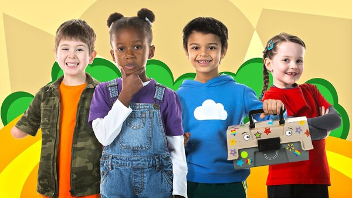</a> [官方节目页配图（版权归原权利人）](<https://www.bbc.co.uk/iplayer/episodes/m000z2n6/number-1-newton-avenue>) | 牛顿大道1号 Number 1 Newton Avenue [文章35](<https://mp.weixin.qq.com/s/OVU50VeXzN38joyavb47dA>) | 有保留 | 3–6岁（编辑暂议；BBC学前节目） 

原文说法
文章未写年龄，以年幼女儿和儿子为例
 | 

文章说BBC短剧共26集、单集约7分钟，四个孩子住在牛顿大道1号，用找袜子（配对）、晾球衣（红蓝规律）、车库停车（加一）、捉迷藏（三明治三角形）等日常小事讲数学…（展开）
文章说BBC短剧共26集、单集约7分钟，四个孩子住在牛顿大道1号，用找袜子（配对）、晾球衣（红蓝规律）、车库停车（加一）、捉迷藏（三明治三角形）等日常小事讲数学；台词是简单英式口语、语速不快。文末“后台回复【牛顿】”领取资源。
 | BBC iPlayer与CBeebies官方页已核实：26集、每集7分钟，真人儿童演出加动画歌曲，覆盖数数、规律、测量、图形、方向，学前数学目标清楚。无CSM等独立评测，属BBC官方学前节目；“打通数学思路”是营销说法，看后在家做同款活动更关键。部分地区无法用iPlayer播放。 | 官方来源核实，无独立适龄评测 置信度：低至中 [BBC iPlayer](<https://www.bbc.co.uk/iplayer/episodes/m000z2n6/number-1-newton-avenue>)（制作方官方页面，不是独立评测） [CBeebies节目页](<https://www.bbc.co.uk/cbeebies/shows/number-one-newton-avenue>)（制作方官方页面，不是独立评测） | [官方入口（非已验证正片）](<https://www.bbc.co.uk/iplayer/episodes/m000z2n6/number-1-newton-avenue>) |
|  旧图（未逐张鉴定） | 玛泽的故事 Big Muzzy [文章23](<https://mp.weixin.qq.com/s/B2loD1DLgD3WS77WM1XkqQ>) | 有保留 | 5—6岁仅为原文经验 

原文说法
6岁，文章写幼儿园段、约5–6岁
 | 文章说这是 BBC 给非英语母语孩子做的教学动画，一共15集，语速比《小猪佩奇》慢，铺数字、颜色和基础句型。作者当精看来用，一周一两集，会重复看。 | 教学品牌和BBC渊源不等于当代儿童学习效果已经验证；版本、语速比较和“15集”需核实。应结合孩子现有语言水平，不把看完当达成语言目标。 | 证据不足，编辑保守初筛 置信度：低 未取得作品级独立依据 | 未核实正版正片 |
|  [官方节目页配图（版权归原权利人）](<https://www.bbc.co.uk/programmes/b00pv1c3>) | 神秘的混沌理论 The Secret Life of Chaos [文章33](<https://mp.weixin.qq.com/s/OQYM-V4pi28WVwmz01oHUg>) | 有保留 | 12+（编辑暂议；原文9+偏低） 

原文说法
9岁以上
 | 文章写豆瓣9.1，讲蝴蝶效应、雪花形状、心跳和天气预报的不确定性，主持人生活化；建议9岁以上，看完去公园找自然中的例子。 | BBC Four官方节目页已核实（Jim Al-Khalili主持）。涉及图灵、反馈与演化等抽象内容，约一小时，9岁偏早；文中“心跳会乱”等例子不宜当医学结论。无独立适龄评测，豆瓣9.1未核实。 | 官方来源核实，无独立适龄评测 置信度：低 [BBC Programmes](<https://www.bbc.co.uk/programmes/b00pv1c3>)（制作方官方页面，不是独立评测） | [官方入口（非已验证正片）](<https://www.bbc.co.uk/programmes/b00pv1c3>) |
| <a href="../../images/title-cards/wx50-the-code.svg">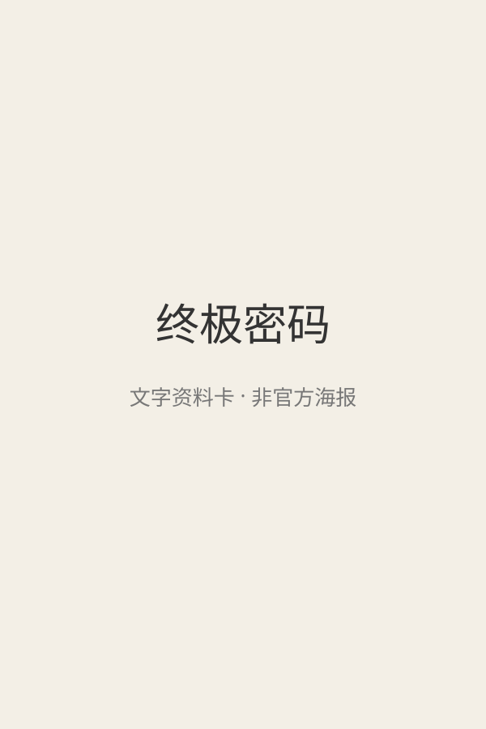</a> 文字封面（非官方海报） | 终极密码 The Code (BBC Two, 2011) [文章50](<https://mp.weixin.qq.com/s/6XzwxNUnjkAKvwAyKDGsJA>) | 有保留 | 12+（编辑暂议） 

原文说法
8岁+（原文）
 | 原文列于4—6年级：BBC出品3集，从数字、形状、预测三个方向找数学，举北美周期蝉质数年出土的例子。 | BBC节目页与维基百科核实：马库斯·杜·索托伊主持，2011年BBC Two播出，3集各约1小时（Numbers、Shapes、Prediction）。每集1小时、成人向科普，对8岁偏长；BBC对第3集的介绍包括“如何抓连环杀手”等内容，需家长预看。原文把周期蝉“质数周期躲天敌”当定论陈述，实际是假说之一。无独立适龄评测，豆瓣8.6未核实。 | 官方来源与百科背景核实，无独立适龄评测 置信度：低 [BBC Programmes](<https://www.bbc.co.uk/programmes/b00zs6sl>)（制作方官方页面，不是独立评测） [Wikipedia](<https://en.wikipedia.org/wiki/The_Code_(2011_TV_series)>)（作品背景资料，不是适龄评测） | [官方入口（非已验证正片）](<https://www.bbc.co.uk/programmes/b00zs6sl>) |
| <a href="../../images/review/wx33-joy-of-stats.jpg">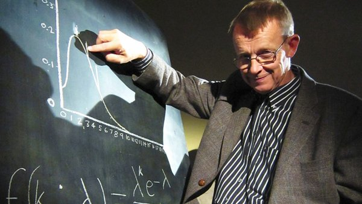</a> [官方节目页配图（版权归原权利人）](<https://www.bbc.co.uk/programmes/b00wgq0l>) | 统计的乐趣 The Joy of Stats [文章33](<https://mp.weixin.qq.com/s/OQYM-V4pi28WVwmz01oHUg>) · [文章50](<https://mp.weixin.qq.com/s/6XzwxNUnjkAKvwAyKDGsJA>) | 有保留 | 10+（编辑暂议；原文7+偏低） 

原文说法
7岁以上
 | 文章写豆瓣8.5，汉斯·罗斯林用动画、数据可视化讲平均数、标准差、相关性；称经典片段用246个国家数据在4分钟展示全球健康变迁；建议7岁以上。 第50篇也列入（原文12+）。 | BBC Four官方节目页已核实。罗斯林的数据可视化确有启发；但该名场面通常称“200个国家、200年、4分钟”，文中“246个国家”有误。内容涉及贫困、死亡率等，7岁偏早；无独立适龄评测，豆瓣8.5未核实。 | 官方来源核实，无独立适龄评测 置信度：低 [BBC Programmes](<https://www.bbc.co.uk/programmes/b00wgq0l>)（制作方官方页面，不是独立评测） | [官方入口（非已验证正片）](<https://www.bbc.co.uk/programmes/b00wgq0l>) |
| <a href="../../images/title-cards/wx33-dimensions.svg">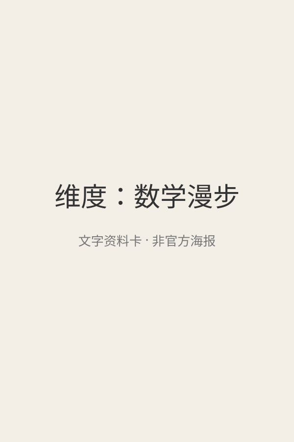</a> 文字封面（非官方海报） | 维度：数学漫步 Dimensions: A Walk Through Mathematics! [文章33](<https://mp.weixin.qq.com/s/OQYM-V4pi28WVwmz01oHUg>) · [文章50](<https://mp.weixin.qq.com/s/6XzwxNUnjkAKvwAyKDGsJA>) | 有保留 | 10+（编辑暂议；挑章节） 

原文说法
7岁以上
 | 文章写豆瓣9.3，法国人拍，用3D动画呈现四维空间、分形几何、拓扑学；超立方体旋转投影的镜头让孩子着迷；建议7岁以上挑画面看、家长陪看。 第50篇也列入（原文12+）。 | 官方网站可免费观看，数学可视化质量高；但内容为高维几何、复数、纤维化等大学级概念，章节较长、讲解密集。7岁可以看画面“惊叹”，不等于理解；无独立适龄评测，豆瓣9.3未核实。 | 官方来源核实，无独立适龄评测 置信度：低 [Dimensions官方网站](<https://www.dimensions-math.org/>)（制作方官方页面，不是独立评测） | [官方入口（非已验证正片）](<https://www.dimensions-math.org/>) |
| <a href="../../images/title-cards/wx50-math-in-nature.svg">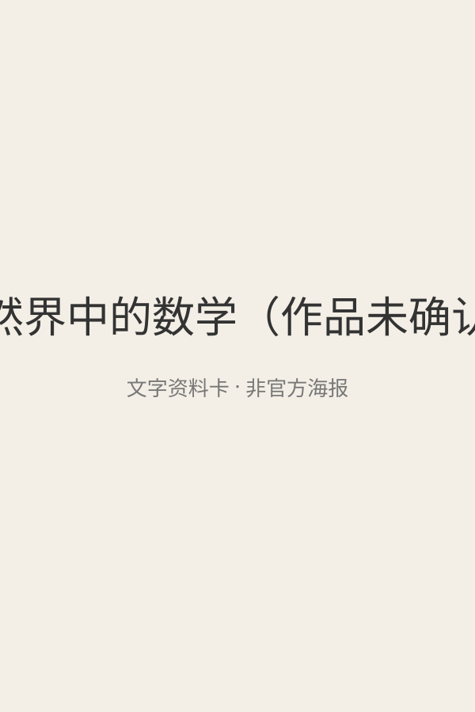</a> 文字封面（非官方海报） | 自然界中的数学（作品未确认） (unidentified) [文章50](<https://mp.weixin.qq.com/s/6XzwxNUnjkAKvwAyKDGsJA>) | 有保留 | 未核实 

原文说法
6岁+（原文）
 | 原文列于1—3年级：只有两集、每集12分钟，讲向日葵种子的斐波那契排列、鹦鹉螺等角螺旋、彩虹几何。 | 仅作片名留档：原文未给出英文名、制作方或年份，豆瓣检索未能确认具体作品，无法核实内容与适龄；“鹦鹉螺是黄金螺旋”一类说法常被夸大，原文只说“极度相似”。不作正向推荐。 | 仅原文片名留档，未核实 置信度：低 未取得作品级独立依据 | 未核实正版正片 |
|  旧图（未逐张鉴定） | 蓝色小考拉 Penelope [文章23](<https://mp.weixin.qq.com/s/B2loD1DLgD3WS77WM1XkqQ>) | 有保留 | 未核实 

原文说法
文章说适合两岁段补充
 | 文章只写了画风柔和、语速极慢、生活场景，没有单独讲一集的情节。和《小鼠波波》并列，作为两岁段可以补的片子。 | 蓝色小考拉与2024年同名真人剧Penelope不是一部作品；已排除错误13+结果。尚未取得此动画的独立年龄和教育价值证据，不强套其他同名节目。 | 证据不足，编辑保守初筛 置信度：低 未取得作品级独立依据 | 未核实正版正片 |
|  旧图（未逐张鉴定） | 西游记 [文章23](<https://mp.weixin.qq.com/s/B2loD1DLgD3WS77WM1XkqQ>) | 有保留 | 未核实 

原文说法
文章说等英语进阶再安排
 | 文章只写了一句：英文动画片，等英语进阶了再安排。没有写是哪一个版本。 | 英语《西游记》改编很多，原文没有制作年份和发行方；不能把Little Fox、央视或其他版本混在一起。先明确版本，再审查打斗、神怪惊吓与改写。 | 证据不足，编辑保守初筛 置信度：低 未取得作品级独立依据 | 未核实正版正片 |
| <a href="../../images/review/wx33-fermat-horizon.jpg">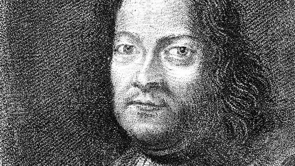</a> [官方节目页配图（版权归原权利人）](<https://www.bbc.co.uk/programmes/b0074rxx>) | 费马大定理 Horizon: Fermat&#x27;s Last Theorem [文章33](<https://mp.weixin.qq.com/s/OQYM-V4pi28WVwmz01oHUg>) · [文章50](<https://mp.weixin.qq.com/s/6XzwxNUnjkAKvwAyKDGsJA>) | 有保留 | 10+（编辑暂议；需讲解） 

原文说法
10岁以上
 | 文章写豆瓣9.2，讲费马1637年留下猜想、安德鲁·怀尔斯秘密研究七年于1994年完成证明，镜头里他落泪；建议10岁以上当故事看。 第50篇也列入（原文15+）。 | BBC Horizon官方节目页已核实（1995—1996季）。坚持与求索的故事有激励价值，但数学细节（椭圆曲线、模形式）远超小学；文中“1994年站在讲台上解开”简化了1993年发表、发现漏洞再于1994年修正的过程。无独立适龄评测，豆瓣9.2未核实。 | 官方来源核实，无独立适龄评测 置信度：低 [BBC Programmes](<https://www.bbc.co.uk/programmes/b0074rxx>)（制作方官方页面，不是独立评测） | [官方入口（非已验证正片）](<https://www.bbc.co.uk/programmes/b0074rxx>) |
|  文字封面（非官方海报） | 超级宝贝 JoJo [文章23](<https://mp.weixin.qq.com/s/B2loD1DLgD3WS77WM1XkqQ>) | 有保留 | 2+仅作编辑暂议 

原文说法
2岁左右
 | 文章把它放在2岁英文磨耳朵的三样之一。有中文版和英文版。贴近吃饭、洗澡、收玩具、坐厕这些生活场景，节奏慢，英文句子短。 | 生活儿歌不等于已经证明能提升英语；缺少此品牌独立适龄与学习研究，不把观看量或鲜艳画面当品质。只选短歌、一起唱，避免自动连播和长合集。 | 证据不足，编辑保守初筛 置信度：低 未取得作品级独立依据 | 未核实正版正片 |
|  [公众号通用图（非本片海报）](<https://mmbiz.qpic.cn/sz_mmbiz_jpg/Cu3arSAIaMyO6ajJX6PuIZ2cryTibsdeAQewQsk79Nk7LVIkM2RiaHiboibht0c7BDYTz6f0Jpd4EEpsNQyXjH6bCdjUbmjn1ptibzYlSCNxUZpE/0?wx_fmt=jpeg>) | 趣味科学 [文章1](<https://mp.weixin.qq.com/s/avLRvdVMXnPOaVbRW418CA>) | 有保留 | 未核实 

原文说法
未标明年龄
 | 只在同一篇文末作为往期推荐出现，原文是：央视推荐《趣味科学》（1–8季，中英文）。没有进一步介绍，也没有链接。 | 名称过于宽泛，无法确定是哪套科学节目。应逐条确认知识出处、实验风险和更新日期，不能把“趣味”当科学可靠性的证明。 | 证据不足，编辑保守初筛 置信度：低 未取得作品级独立依据 | 未核实正版正片 |
| <a href="../../images/title-cards/wx50-joy-of-logic.svg">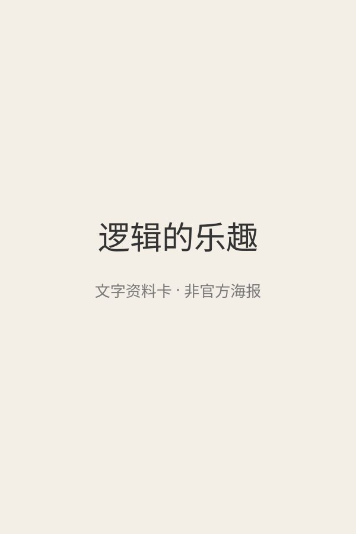</a> 文字封面（非官方海报） | 逻辑的乐趣 The Joy of Logic (BBC Four, 2013) [文章50](<https://mp.weixin.qq.com/s/6XzwxNUnjkAKvwAyKDGsJA>) | 有保留 | 12+（编辑暂议） 

原文说法
12岁+（原文）
 | 原文列于7—9年级：用“三门问题”“真话假话”等例子讲逻辑推理。 | BBC Four节目页核实：计算机科学家Dave Cliff主持，2013年首播，单集约1小时，从亚里士多德、布尔、罗素、哥德尔讲到图灵与计算机，片中有25名7岁孩子组成“人体计算机”的段落。原文所说“三门问题”“真话假话”在官方简介中未见，无法核实。年龄建议与原文一致，但无独立适龄评测，豆瓣8.4未核实。 | 官方来源核实，无独立适龄评测 置信度：低 [BBC Programmes](<https://www.bbc.co.uk/programmes/b03k6ypz>)（制作方官方页面，不是独立评测） | [官方入口（非已验证正片）](<https://www.bbc.co.uk/programmes/b03k6ypz>) |
