# 学习类

<!-- Generated by scripts/render_wechat_tables.py; edit data/catalog.json instead. -->

[返回首页](../../README.md) · [审核方法](review-method.md) · [不推荐](not-recommended.md) · [文章28待核验](pending-article-28.md)

本页 24 条，按强烈推荐→推荐→有保留排序。**有保留不等于推荐；年龄不等于听力难度；图片不证明适龄。**

每行一部，名称下的文章编号链接原文。适龄为审核建议；折叠的“原文说法”不代表采信。缩略图可点开放大，图下注明海报、旧图或文字封面；长简介可展开。

未注明已核实的豆瓣/IMDb评分和人数一律视为未核实；公众号评分不作独立证据。独立评测不等于教育效果证明，相关App/合集也不是单片认证。视频列仅保留官方入口等已记录地址，**不代表免费、完整或当地可播正片**；候选地址不展示。完整字段见[主目录数据](../../data/catalog.json)。

| 图片 | 名称 | 判断 | 适龄 | 简介 | 研判 | 证据状态 | 视频链接 |
| --- | --- | --- | --- | --- | --- | --- | --- |
| <a href="../../images/review/yakka-dee.jpg">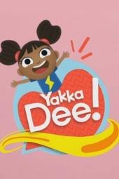</a> [评测页海报](<https://www.commonsensemedia.org/tv-reviews/yakka-dee>) | 亚克迪 Yakka Dee [文章23](<https://mp.weixin.qq.com/s/B2loD1DLgD3WS77WM1XkqQ>) | 强烈推荐 | 2+（CSM；需共看） 

原文说法
文章准备给2岁孩子试
 | 文章把它放在“想补的片单”。BBC 出品，每集只教一个词，重复率高，用来让孩子开口。 | 独立评测确认每集围绕一个词、鼓励开口并展示多样儿童，认知目标清楚。重复不等于无效，但也不是“开口神器”或语言障碍治疗，应一起说并连到实物。 | 作品级证据初审 置信度：中 [Common Sense Media](<https://www.commonsensemedia.org/tv-reviews/yakka-dee>) | 未核实正版正片 |
| <a href="../../images/review/alphablocks-wx.jpg">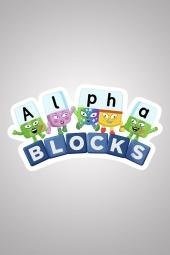</a> [评测页海报](<https://www.commonsensemedia.org/tv-reviews/alphablocks>) | 字母积木 Alphablocks [文章23](<https://mp.weixin.qq.com/s/B2loD1DLgD3WS77WM1XkqQ>) | 强烈推荐 | 2+（CSM；按语言准备度） 

原文说法
文章准备留给大女儿幼小衔接
 | 文章说它和《数字积木》同系列，每个字母是会说话的小人，拉手就能拼出单词，用来做自然拼读启蒙。 | 独立评测明确肯定字母与自然拼读的可视化及短单集形式；英语拼读规则仍需真人示范和阅读实践。不是只看动画就能阅读，也不等同中文识字训练。 | 作品级证据初审 置信度：中 [Common Sense Media](<https://www.commonsensemedia.org/tv-reviews/alphablocks>) | [官方入口（非已验证正片）](<https://www.bbc.co.uk/cbeebies/shows/alphablocks>) |
| <a href="../../images/review/numberblocks-wx.jpg">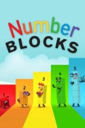</a> [评测页海报](<https://www.commonsensemedia.org/tv-reviews/numberblocks>) | 数字积木 Numberblocks [文章12](<https://mp.weixin.qq.com/s/Iy-SwhNQC6IFAAsECwqseQ>) · [文章23](<https://mp.weixin.qq.com/s/B2loD1DLgD3WS77WM1XkqQ>) | 强烈推荐 | 2+（CSM；需共看） 

原文说法
2-6岁
 | 

文章写豆瓣9.6、适合2–6岁、BBC 制作、每集约5分钟。数字是积木小人，1和2叠在一起变成3。此前单独整理的研究片单里已有这部，这里按微信文章再记一条，不并…（展开）
文章写豆瓣9.6、适合2–6岁、BBC 制作、每集约5分钟。数字是积木小人，1和2叠在一起变成3。此前单独整理的研究片单里已有这部，这里按微信文章再记一条，不并进那份研究正文。 第23篇也把它放在6岁主攻片单里，说6岁看不幼稚，2岁看画面也喜欢。
 | 独立评测明确肯定单位方块对数量、计数和加减的可视化，短单集便于联系实物。年龄标签不是让两岁孩子刷长合集；看后用积木动手，效果不能只凭家长口碑推定。 | 作品级证据初审 置信度：中 [Common Sense Media](<https://www.commonsensemedia.org/tv-reviews/numberblocks>) | [官方入口（非已验证正片）](<https://www.bbc.co.uk/cbeebies/shows/numberblocks>) |
|  文字封面（非官方海报） | SSS 英文儿歌 [文章23](<https://mp.weixin.qq.com/s/B2loD1DLgD3WS77WM1XkqQ>) | 推荐 | 3+（CSM评的是相关App，非所有视频） 

原文说法
2岁左右
 | 文章写明这不是动画片，而是低龄启蒙的儿歌：数字、颜色、身体部位、动物，每首歌配动作。作者把它和两部动画并列为2岁只看的三样。 | 独立评测认可基础语言、数字和日常歌谣的补充价值，也指出被动观看和付费内容。相关App评价不能当整个频道逐片认证；优先成人选单歌、动作互动和纯音频。 | 相关合集/App参考，不是单片独立适龄认证 置信度：低至中 [Common Sense Media](<https://www.commonsensemedia.org/app-reviews/super-simple>)（相关App，不能当整频道认证） | 未核实正版正片 |
| <a href="../../images/review/operation-ouch.jpg">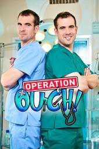</a> [评测页海报](<https://www.commonsensemedia.org/tv-reviews/operation-ouch>) | 人体奥奇实验室 Operation Ouch! [文章8](<https://mp.weixin.qq.com/s/DcF-aYLjzo5rt263kz0nXQ>) | 推荐 | 9+（CSM；非原文6+） 

原文说法
6-15岁
 | 

文章推荐 BBC 的《Operation Ouch!》，中文译名《人体奥奇实验室》，并写一共14季、6到15岁都适合。主持人是双胞胎医生克里斯和克斯。文中举例：…（展开）
文章推荐 BBC 的《Operation Ouch!》，中文译名《人体奥奇实验室》，并写一共14季、6到15岁都适合。主持人是双胞胎医生克里斯和克斯。文中举例：克里斯吞下带摄像头的药丸，镜头从嘴进入食道、胃和小肠，孩子因此说胃像搅拌机。这是真人医学节目，不是动画片。
 | 真人医生讲身体和医疗，知识价值有独立评测支持；有针头、血液、缝合及身体近景。原文6岁起偏宽，怕血儿童应先由成人预看，节目不能代替医疗建议。 | 作品级证据初审 置信度：中 [Common Sense Media](<https://www.commonsensemedia.org/tv-reviews/operation-ouch>) | [官方入口（非已验证正片）](<https://www.bbc.co.uk/cbbc/shows/operation-ouch>) |
| <a href="../../images/review/maisy-wx.jpg">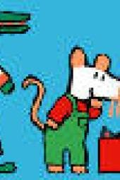</a> [评测页海报](<https://www.commonsensemedia.org/tv-reviews/maisy>) | 小鼠波波 Maisy [文章23](<https://mp.weixin.qq.com/s/B2loD1DLgD3WS77WM1XkqQ>) | 推荐 | 3+（CSM；非原文2岁普推） 

原文说法
文章说适合两岁段补充
 | 文章把它和《蓝色小考拉》放在一起：画风柔和、语速极慢，主题是睡觉、洗澡、上学这类生活场景。 | 独立指南描述节奏慢、温和、重复日常与合作，适合低刺激选择。故事和重复旁白不等于系统英语课程，成人仍要回应孩子而非让屏幕代陪伴。 | 作品级证据初审 置信度：中 [Common Sense Media](<https://www.commonsensemedia.org/tv-reviews/maisy>) | 未核实正版正片 |
| <a href="../../images/review/fixies.jpg">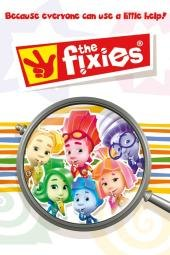</a> [评测页海报](<https://www.commonsensemedia.org/tv-reviews/the-fixies>) | 螺丝钉 [文章12](<https://mp.weixin.qq.com/s/Iy-SwhNQC6IFAAsECwqseQ>) | 推荐 | 6+（CSM；非原文3+） 

原文说法
3-6岁
 | 文章写豆瓣9.4、适合3–6岁，称它是俄罗斯动画：家电里住着修理小精灵，用故事讲冰箱为什么制冷、遥控器如何发信号、洗衣机怎样洗净衣服。文章没有英文名。 | 机械与日常技术的解释获独立评测肯定，但人物会示范不安全或欠妥行为。原文3—6岁过宽，应提醒不拆电器、不模仿维修，把动画模型和真实工程区分开。 | 作品级证据初审 置信度：中 [Common Sense Media](<https://www.commonsensemedia.org/tv-reviews/the-fixies>) | 未核实正版正片 |
|  文字封面（非官方海报） | Little Fox 分级动画 Little Fox [文章23](<https://mp.weixin.qq.com/s/B2loD1DLgD3WS77WM1XkqQ>) | 有保留 | 按语言水平，逐篇判断 

原文说法
6岁，文章写从1阶或2阶起步
 | 文章说它按难度分1到9阶，有四千多篇，每篇配电子书、音频和词汇表。作者主要在 B 站搜 “Little Fox” 看。第1阶举例是《汽车城学校》《恐龙兄弟》，大约到小学一二年级是第2–3阶。 | 付费分级库不是一部作品，也不能用同一年龄或一个总分认证四千多篇。“按级别刷水平自动上升”没有在本轮获得独立证据；需核实官方级别、授权与具体篇目。 | 证据不足，编辑保守初筛 置信度：低 未取得作品级独立依据 | 未核实正版正片 |
|  [公众号通用图（非本片海报）](<https://mmbiz.qpic.cn/sz_mmbiz_jpg/Cu3arSAIaMw3Y9UpdaRITDFOib7ODPtfYDUUf6XGhBdz5vrYPLazc3xpfEgAGoc6fUgcicsluSrUActH2dRicaXcePLD6bia2Wnlu1VrBiaSzRv8/0?wx_fmt=jpeg>) | What If [文章6](<https://mp.weixin.qq.com/s/chL3s5Cy86w0a_Ykz0VNLg>) | 有保留 | 逐集判断 

原文说法
未标明年龄
 | 出现在《小怪兽阿蒙》文末的往期推荐。原文是：BBC 专为孩子拍的科普片《What If》（52 集，中英文），每个奇思妙想里都有一个科学答案。没有写年龄，也没有播放链接。 | What If可能是多个不同品牌或合集；假设推演并非现实预测。需逐集查科学来源、概率条件和灾难画面的刺激性，不能整体盖“科学优质”章。 | 证据不足，编辑保守初筛 置信度：低 未取得作品级独立依据 | 未核实正版正片 |
| <a href="../../images/title-cards/wow-english.svg">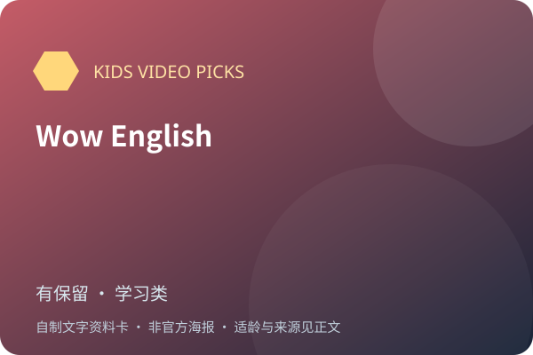</a> 文字封面（非官方海报） | Wow English [文章23](<https://mp.weixin.qq.com/s/B2loD1DLgD3WS77WM1XkqQ>) | 有保留 | 按语言水平，独立年龄未核实 

原文说法
6岁，文章写幼儿园段
 | 文章说这是真人加手偶的英语教学片，老师 Steve 表演夸张。语法和词汇逐层递进，看完一集能在生活里用上几句。 | 真人夸张表演可能吸引孩子，但这是商业英语品牌，不是独立效果研究。未找到对应独立儿童指南，不保证看一集就能迁移到生活；需家长互动和试听选择。 | 证据不足，编辑保守初筛 置信度：低 未取得作品级独立依据 | 未核实正版正片 |
|  [公众号通用图（非本片海报）](<https://mmbiz.qpic.cn/sz_mmbiz_jpg/Cu3arSAIaMyO6ajJX6PuIZ2cryTibsdeAQewQsk79Nk7LVIkM2RiaHiboibht0c7BDYTz6f0Jpd4EEpsNQyXjH6bCdjUbmjn1ptibzYlSCNxUZpE/0?wx_fmt=jpeg>) | 万物运转的秘密 The Way Things Work [文章1](<https://mp.weixin.qq.com/s/avLRvdVMXnPOaVbRW418CA>) · [文章7](<https://mp.weixin.qq.com/s/JLfW5GcNqZjFjPqpOzKXHw>) · [文章6](<https://mp.weixin.qq.com/s/chL3s5Cy86w0a_Ykz0VNLg>) · [文章20](<https://mp.weixin.qq.com/s/-5VGJkhfqgD0lcveZ1_sbg>) | 有保留 | 6+（编辑暂议） 

原文说法
6岁以上
 | 

文章说这部片根据大卫·麦考利的同名书改编，26集，每集约13分钟。故事发生在猛犸象小岛：挤奶时讲滑轮，打捞沉船铁轨时讲电磁铁。文章写它适合6岁以上，没有中文配音…（展开）
文章说这部片根据大卫·麦考利的同名书改编，26集，每集约13分钟。故事发生在猛犸象小岛：挤奶时讲滑轮，打捞沉船铁轨时讲电磁铁。文章写它适合6岁以上，没有中文配音，是英文原声加中英文字幕。另一篇同样推荐了这部，并补充科学家旁白、每集13分钟。
 | 动画把机械原理视觉化有潜力，但独立片目没有核实文章的“豆瓣9.5”；不能把同名图书的评分转给动画。缺少学习迁移证据，旧技术内容应与现代资料核对。 | 作品级证据初审 置信度：中 [豆瓣搜索索引（非实时评分）](<https://movie.douban.com/subject/5174185/>) | 未核实正版正片 |
| <a href="../../images/w-ted-ed-nature.jpg">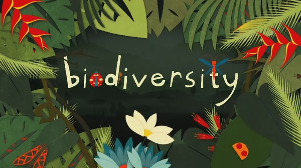</a> [旧图（未逐张鉴定）](<https://mmbiz.qpic.cn/mmbiz_png/9TOlbmicibtkMLwUv1gyKNlRc0SfAnpiceqJCfrWtaryrAKVibTOhkAKLcPkwSL5MFkABtgozJ24WnGiakYbcJngq1w/640?wx_fmt=png>) | 了不起的自然 [文章18](<https://mp.weixin.qq.com/s/OVAalp0Bxej8u2Q7FDJFgg>) | 有保留 | 逐集判断 

原文说法
未标明年龄
 | 

文章把一套128集、每集约五分钟的科普动画称为《了不起的自然》，并写制作方是 TED-Ed。选题来自中小学科学老师，由动物学家、海洋科学家、地质学家供稿，再做成…（展开）
文章把一套128集、每集约五分钟的科普动画称为《了不起的自然》，并写制作方是 TED-Ed。选题来自中小学科学老师，由动物学家、海洋科学家、地质学家供稿，再做成手绘动画。例子包括树懒为什么慢、燕子如何找回家、静电、捕蝇草和壁虎断尾。文章没有给出对应的单一英文剧名，所以这里不把它安到某一套现成英文系列上。
 | “了不起的自然128集”更像文章自编合集名，不能当作TED-Ed统一系列或统一年龄认证；须逐集核实作者、科学来源、时长与知识更新。 | 证据不足，编辑保守初筛 置信度：低 未取得作品级独立依据 | 未核实正版正片 |
| <a href="../../images/wx-yina-qiaqia.jpg">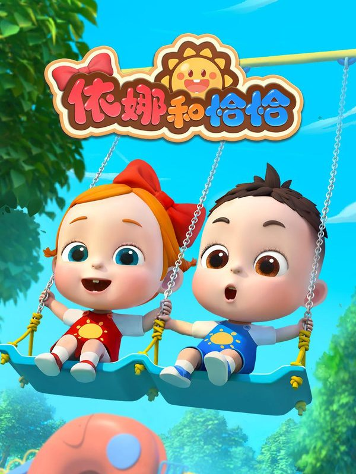</a> 旧图（未逐张鉴定） | 依娜和恰恰 [文章23](<https://mp.weixin.qq.com/s/B2loD1DLgD3WS77WM1XkqQ>) | 有保留 | 未核实 

原文说法
2岁左右
 | 文章说中文、英文版本都有，画风柔和，情节简单，两岁孩子跟着哼就能有语感。这个阶段看动画是为了对英语不陌生，不是为了看懂剧情。 | 原文称适合两岁，但具体制作版本、独立儿童评测与学习效果未核实。先看单集的剪辑、音量和重复方式，不凭柔和画风或家长个案推定有教育效果。 | 证据不足，编辑保守初筛 置信度：低 未取得作品级独立依据 | 未核实正版正片 |
| <a href="../../images/w-donald-mathmagic.jpg">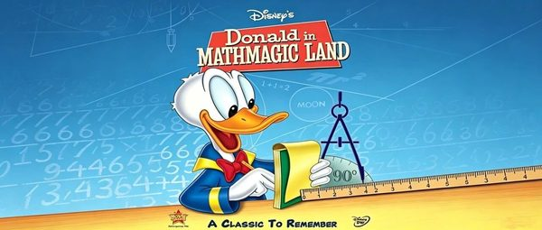</a> [旧图（未逐张鉴定）](<https://mmbiz.qpic.cn/sz_mmbiz_jpg/zPQhETG3LfTKeMLpib7KS1A6IAqAJfj7Bk4MuObdkc52ic6Y4ibU5d3acSia2pHwWmwIrib8z520sbMOyYzAFOR0xbib43yW0T0GYr43Wq6lmXdUc/0?wx_fmt=jpeg>) | 唐老鸭漫游数学奇境 Donald in Mathmagic Land [文章3](<https://mp.weixin.qq.com/s/MOZwqN65Jkq0XRtZ5E0qyQ>) | 有保留 | 6+（编辑暂议） 

原文说法
5-10岁
 | 文章写这是1集、约27分钟的迪士尼动画，中文和英文都有，适合5–10岁。它不把计算题搬进动画，而是讲数学有什么用、数学的美在哪里。迪士尼电影页写首映日期为1959年6月26日。 | 用音乐与图形引入数学可能有趣，但“看完就爱数学”不是已验证效果。1959年的文化表现与数学史叙述需要补充背景；未取得独立儿童分龄依据。 | 证据不足，编辑保守初筛 置信度：低 未取得作品级独立依据 | [官方入口（非已验证正片）](<https://movies.disney.com/donald-in-mathmagic-land>) |
|  [公众号通用图（非本片海报）](<https://mmbiz.qpic.cn/mmbiz_jpg/Cu3arSAIaMwRJobiciaQXymdALKZA6NUwGDbtL3ChrPGjLII3ayicR9n0DN5jibiacQm7A6Ey44WlcKbN2ETrRic8bzhjicyIzibS9Y6JhptKVhhtUk/0?wx_fmt=jpeg>) | 平博士密码 [文章8](<https://mp.weixin.qq.com/s/DcF-aYLjzo5rt263kz0nXQ>) | 有保留 | 6+（编辑暂议） 

原文说法
未标明年龄
 | 出现在《人体奥奇实验室》文末的往期推荐。原文是：全球首部诺贝尔科普题材动画《平博士密码》（52 集，中英文），把看不见的科学讲明白。没有写年龄，也没有播放链接。 | 科学冒险有潜在启蒙价值，但尚无对应独立儿童评测；需把虚构情节、类比与真实科学区分，并排查不安全实验示范。 | 证据不足，编辑保守初筛 置信度：低 未取得作品级独立依据 | 未核实正版正片 |
|  文字封面（非官方海报） | 恐龙兄弟 [文章23](<https://mp.weixin.qq.com/s/B2loD1DLgD3WS77WM1XkqQ>) | 有保留 | 独立年龄未核实 

原文说法
文章把它当作 Little Fox 第1阶例子
 | 文章没有单独讲剧情，只把它写为 Little Fox 第1阶的例子之一。 | 恐龙题材不等于科学准确或有语言迁移效果；目前只有平台例举，缺乏对应独立内容与适龄评测。应确认具体系列、主题和词汇后选择。 | 证据不足，编辑保守初筛 置信度：低 未取得作品级独立依据 | 未核实正版正片 |
|  [公众号通用图（非本片海报）](<https://mmbiz.qpic.cn/mmbiz_jpg/Cu3arSAIaMwRJobiciaQXymdALKZA6NUwGDbtL3ChrPGjLII3ayicR9n0DN5jibiacQm7A6Ey44WlcKbN2ETrRic8bzhjicyIzibS9Y6JhptKVhhtUk/0?wx_fmt=jpeg>) | 数学的故事 [文章6](<https://mp.weixin.qq.com/s/chL3s5Cy86w0a_Ykz0VNLg>) · [文章8](<https://mp.weixin.qq.com/s/DcF-aYLjzo5rt263kz0nXQ>) | 有保留 | 12+（编辑暂议） 

原文说法
未标明年龄
 | 往期推荐里出现两次。原文是：BBC 科普《数学的故事》（4 集，中英文），跳出公式，换个角度看数字背后的逻辑。没有写年龄，也没有播放链接。 | 数学史能引入思想与文化，但成人长篇纪录可能超出儿童知识背景；历史归属和史料需要交叉核对。文章的激发兴趣承诺不等于已验证效果。 | 证据不足，编辑保守初筛 置信度：低 未取得作品级独立依据 | 未核实正版正片 |
|  文字封面（非官方海报） | 汽车城学校 [文章23](<https://mp.weixin.qq.com/s/B2loD1DLgD3WS77WM1XkqQ>) | 有保留 | 独立年龄未核实 

原文说法
文章把它当作 Little Fox 第1阶例子
 | 文章没有单独讲剧情，只把它写为 Little Fox 第1阶（学龄前）的例子之一，和《恐龙兄弟》并列。 | 只确认是文章举出的Little Fox低阶例子，不能把平台级宣传转成此片的学习效果。待核对官方名称、完整篇目和具体语言难度，再由家长试看。 | 证据不足，编辑保守初筛 置信度：低 未取得作品级独立依据 | 未核实正版正片 |
|  [公众号通用图（非本片海报）](<https://mmbiz.qpic.cn/sz_mmbiz_jpg/Cu3arSAIaMyO6ajJX6PuIZ2cryTibsdeAQewQsk79Nk7LVIkM2RiaHiboibht0c7BDYTz6f0Jpd4EEpsNQyXjH6bCdjUbmjn1ptibzYlSCNxUZpE/0?wx_fmt=jpeg>) | 爆笑物理 [文章1](<https://mp.weixin.qq.com/s/avLRvdVMXnPOaVbRW418CA>) · [文章20](<https://mp.weixin.qq.com/s/-5VGJkhfqgD0lcveZ1_sbg>) | 有保留 | 未核实 

原文说法
未标明年龄
 | 只在《万物运转的秘密》文末作为往期推荐出现，原文是：清华附《爆笑物理》（144集），孩子趣味学物理。没有进一步介绍，也没有链接。 | “爆笑物理”像合集或非标准译名，未确认出品方和具体集目。没有独立材料支持“看了开窍”，更不能保证实验动作安全。 | 证据不足，编辑保守初筛 置信度：低 未取得作品级独立依据 | 未核实正版正片 |
| <a href="../../images/wx-big-muzzy.jpg">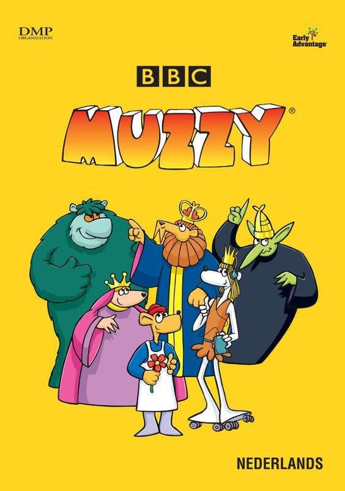</a> 旧图（未逐张鉴定） | 玛泽的故事 Big Muzzy [文章23](<https://mp.weixin.qq.com/s/B2loD1DLgD3WS77WM1XkqQ>) | 有保留 | 5—6岁仅为原文经验 

原文说法
6岁，文章写幼儿园段、约5–6岁
 | 文章说这是 BBC 给非英语母语孩子做的教学动画，一共15集，语速比《小猪佩奇》慢，铺数字、颜色和基础句型。作者当精看来用，一周一两集，会重复看。 | 教学品牌和BBC渊源不等于当代儿童学习效果已经验证；版本、语速比较和“15集”需核实。应结合孩子现有语言水平，不把看完当达成语言目标。 | 证据不足，编辑保守初筛 置信度：低 未取得作品级独立依据 | 未核实正版正片 |
| <a href="../../images/wx-penelope.jpg">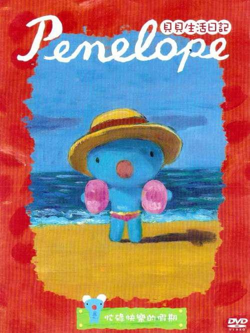</a> 旧图（未逐张鉴定） | 蓝色小考拉 Penelope [文章23](<https://mp.weixin.qq.com/s/B2loD1DLgD3WS77WM1XkqQ>) | 有保留 | 未核实 

原文说法
文章说适合两岁段补充
 | 文章只写了画风柔和、语速极慢、生活场景，没有单独讲一集的情节。和《小鼠波波》并列，作为两岁段可以补的片子。 | 蓝色小考拉与2024年同名真人剧Penelope不是一部作品；已排除错误13+结果。尚未取得此动画的独立年龄和教育价值证据，不强套其他同名节目。 | 证据不足，编辑保守初筛 置信度：低 未取得作品级独立依据 | 未核实正版正片 |
| <a href="../../images/wx-journey-west-en.jpg">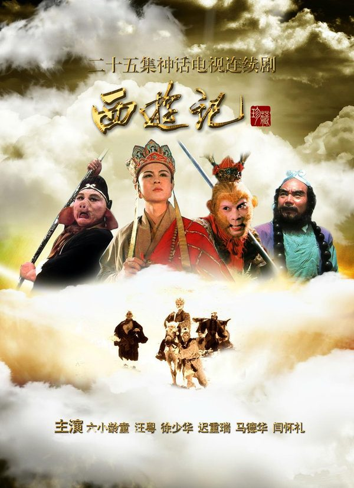</a> 旧图（未逐张鉴定） | 西游记 [文章23](<https://mp.weixin.qq.com/s/B2loD1DLgD3WS77WM1XkqQ>) | 有保留 | 未核实 

原文说法
文章说等英语进阶再安排
 | 文章只写了一句：英文动画片，等英语进阶了再安排。没有写是哪一个版本。 | 英语《西游记》改编很多，原文没有制作年份和发行方；不能把Little Fox、央视或其他版本混在一起。先明确版本，再审查打斗、神怪惊吓与改写。 | 证据不足，编辑保守初筛 置信度：低 未取得作品级独立依据 | 未核实正版正片 |
|  文字封面（非官方海报） | 超级宝贝 JoJo [文章23](<https://mp.weixin.qq.com/s/B2loD1DLgD3WS77WM1XkqQ>) | 有保留 | 2+仅作编辑暂议 

原文说法
2岁左右
 | 文章把它放在2岁英文磨耳朵的三样之一。有中文版和英文版。贴近吃饭、洗澡、收玩具、坐厕这些生活场景，节奏慢，英文句子短。 | 生活儿歌不等于已经证明能提升英语；缺少此品牌独立适龄与学习研究，不把观看量或鲜艳画面当品质。只选短歌、一起唱，避免自动连播和长合集。 | 证据不足，编辑保守初筛 置信度：低 未取得作品级独立依据 | 未核实正版正片 |
|  [公众号通用图（非本片海报）](<https://mmbiz.qpic.cn/sz_mmbiz_jpg/Cu3arSAIaMyO6ajJX6PuIZ2cryTibsdeAQewQsk79Nk7LVIkM2RiaHiboibht0c7BDYTz6f0Jpd4EEpsNQyXjH6bCdjUbmjn1ptibzYlSCNxUZpE/0?wx_fmt=jpeg>) | 趣味科学 [文章1](<https://mp.weixin.qq.com/s/avLRvdVMXnPOaVbRW418CA>) | 有保留 | 未核实 

原文说法
未标明年龄
 | 只在同一篇文末作为往期推荐出现，原文是：央视推荐《趣味科学》（1–8季，中英文）。没有进一步介绍，也没有链接。 | 名称过于宽泛，无法确定是哪套科学节目。应逐条确认知识出处、实验风险和更新日期，不能把“趣味”当科学可靠性的证明。 | 证据不足，编辑保守初筛 置信度：低 未取得作品级独立依据 | 未核实正版正片 |
