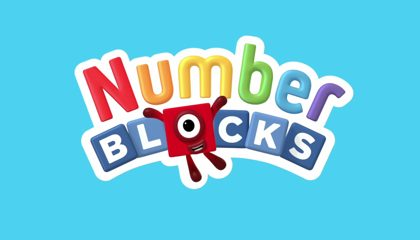
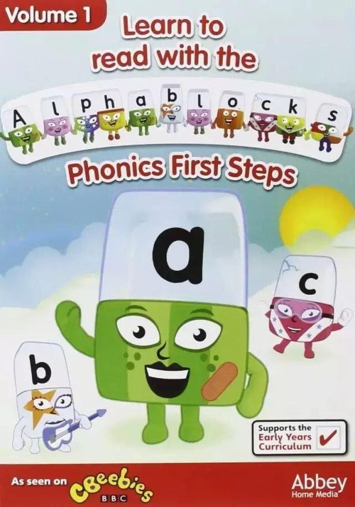
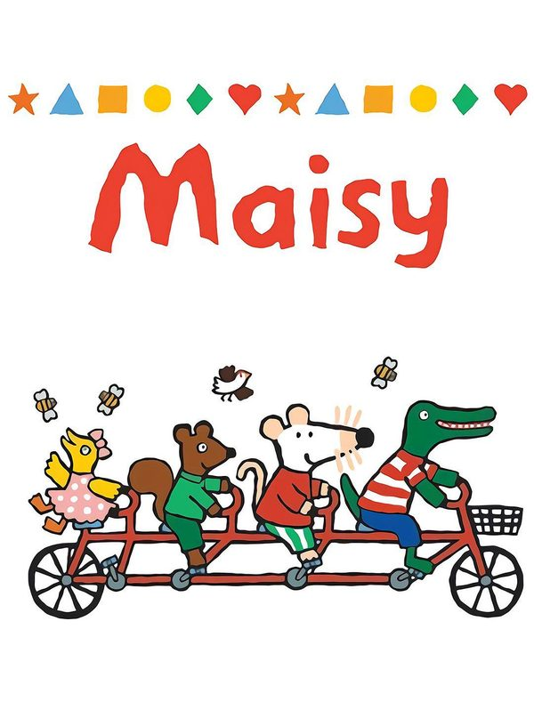

# 学习类

语言、数学和科学基础知识。包括英语磨耳朵、数学启蒙、机械原理、身体常识和短科普动画。

24 条。年龄写在每条上。

### 万物运转的秘密（The Way Things Work）

- **分类**：{e['category']}
- **类型**：{e.get('kind') or '—'}
- **文章里的年龄**：{e.get('age_group') or '文章没有写'}

文章封面。正文没有单独剧照。

文章说这部片根据大卫·麦考利的同名书改编，26集，每集约13分钟。故事发生在猛犸象小岛：挤奶时讲滑轮，打捞沉船铁轨时讲电磁铁。文章写它适合6岁以上，没有中文配音，是英文原声加中英文字幕。另一篇同样推荐了这部，并补充科学家旁白、每集13分钟。

**观看**：未找到可打开的正版播放页。

**来源文章**：
- [豆瓣9.5分《万物运转的秘密》（26集中英文）把机械原理变故事，孩子看一眼就停不下来](https://mp.weixin.qq.com/s/avLRvdVMXnPOaVbRW418CA)
- [9.5高评分！《万物运转的秘密》家长圈疯传的物理科普动画神作！](https://mp.weixin.qq.com/s/JLfW5GcNqZjFjPqpOzKXHw)
- [BBC科普动画！《Love Monster》（75集中英文） 让胆小爱闹脾气的孩子，悄悄学会爱和情绪表达](https://mp.weixin.qq.com/s/chL3s5Cy86w0a_Ykz0VNLg)
- [豆瓣 9.7 科普《宇宙时空之旅》（25集）孩子的宇宙启蒙课，看这一部就够了](https://mp.weixin.qq.com/s/-5VGJkhfqgD0lcveZ1_sbg)

### 唐老鸭漫游数学奇境（Donald in Mathmagic Land）

- **分类**：{e['category']}
- **类型**：{e.get('kind') or '—'}
- **文章里的年龄**：{e.get('age_group') or '文章没有写'}

文章封面。正文没有单独剧照。

文章写这是1集、约27分钟的迪士尼动画，中文和英文都有，适合5–10岁。它不把计算题搬进动画，而是讲数学有什么用、数学的美在哪里。迪士尼电影页写首映日期为1959年6月26日。

**观看**：[https://movies.disney.com/donald-in-mathmagic-land](https://movies.disney.com/donald-in-mathmagic-land)

迪士尼电影官方介绍页，页面标注有 DVD，不代表在线可播。

**来源文章**：
- [迪士尼9.0分神作《漫游数学奇境》|数学无聊？孩子看完就不这么想了](https://mp.weixin.qq.com/s/MOZwqN65Jkq0XRtZ5E0qyQ)

### 人体奥奇实验室（Operation Ouch!）

- **分类**：{e['category']}
- **类型**：{e.get('kind') or '—'}
- **文章里的年龄**：{e.get('age_group') or '文章没有写'}

文章封面。正文没有单独剧照。

文章推荐 BBC 的《Operation Ouch!》，中文译名《人体奥奇实验室》，并写一共14季、6到15岁都适合。主持人是双胞胎医生克里斯和克斯。文中举例：克里斯吞下带摄像头的药丸，镜头从嘴进入食道、胃和小肠，孩子因此说胃像搅拌机。这是真人医学节目，不是动画片。

**观看**：[https://www.bbc.co.uk/cbbc/shows/operation-ouch](https://www.bbc.co.uk/cbbc/shows/operation-ouch)

BBC CBBC 官方节目页，页内有短视频。完整季是否可看取决于地区。

**来源文章**：
- [BBC儿童医学科普《Operation Ouch  》（14季中英文）让孩子看懂身体、学会急救，强烈推荐！](https://mp.weixin.qq.com/s/DcF-aYLjzo5rt263kz0nXQ)

### 了不起的自然

- **分类**：{e['category']}
- **类型**：{e.get('kind') or '—'}
- **文章里的年龄**：{e.get('age_group') or '文章没有写'}

图来自该微信文章。

文章把一套128集、每集约五分钟的科普动画称为《了不起的自然》，并写制作方是 TED-Ed。选题来自中小学科学老师，由动物学家、海洋科学家、地质学家供稿，再做成手绘动画。例子包括树懒为什么慢、燕子如何找回家、静电、捕蝇草和壁虎断尾。文章没有给出对应的单一英文剧名，所以这里不把它安到某一套现成英文系列上。

**观看**：未找到可打开的正版播放页。

**来源文章**：
- [TED-Ed《了不起的自然》128集宝藏科普动画，让孩子爱上自然的最好方式！](https://mp.weixin.qq.com/s/OVAalp0Bxej8u2Q7FDJFgg)

### 数字积木（Numberblocks）

- **分类**：{e['category']}
- **类型**：{e.get('kind') or '—'}
- **文章里的年龄**：{e.get('age_group') or '文章没有写'}

8部共用这篇的封面。

文章写豆瓣9.6、适合2–6岁、BBC 制作、每集约5分钟。数字是积木小人，1和2叠在一起变成3。此前单独整理的研究片单里已有这部，这里按微信文章再记一条，不并进那份研究正文。 第23篇也把它放在6岁主攻片单里，说6岁看不幼稚，2岁看画面也喜欢。

**观看**：[https://www.bbc.co.uk/cbeebies/shows/numberblocks](https://www.bbc.co.uk/cbeebies/shows/numberblocks)

BBC CBeebies 节目页。

**来源文章**：
- [推荐几部越看孩子越开窍的动画片（家长必看）](https://mp.weixin.qq.com/s/Iy-SwhNQC6IFAAsECwqseQ)
- [两个女儿6岁和2岁，我们只看这8部动画片](https://mp.weixin.qq.com/s/B2loD1DLgD3WS77WM1XkqQ)

### 螺丝钉

- **分类**：{e['category']}
- **类型**：{e.get('kind') or '—'}
- **文章里的年龄**：{e.get('age_group') or '文章没有写'}

8部共用这篇的封面。

文章写豆瓣9.4、适合3–6岁，称它是俄罗斯动画：家电里住着修理小精灵，用故事讲冰箱为什么制冷、遥控器如何发信号、洗衣机怎样洗净衣服。文章没有英文名。

**观看**：[https://www.iqiyi.com/v_19rro5db60.html](https://www.iqiyi.com/v_19rro5db60.html)

爱奇艺搜索结果里标题正好是《螺丝钉》的页面（频道：少儿综艺,15）。

**来源文章**：
- [推荐几部越看孩子越开窍的动画片（家长必看）](https://mp.weixin.qq.com/s/Iy-SwhNQC6IFAAsECwqseQ)

### 爆笑物理

- **分类**：{e['category']}
- **类型**：{e.get('kind') or '—'}
- **文章里的年龄**：{e.get('age_group') or '文章没有写'}

没有单独配图，用的是那篇文章的封面。

只在《万物运转的秘密》文末作为往期推荐出现，原文是：清华附《爆笑物理》（144集），孩子趣味学物理。没有进一步介绍，也没有链接。

**观看**：未找到可打开的正版播放页。

**来源文章**：
- [豆瓣9.5分《万物运转的秘密》（26集中英文）把机械原理变故事，孩子看一眼就停不下来](https://mp.weixin.qq.com/s/avLRvdVMXnPOaVbRW418CA)
- [豆瓣 9.7 科普《宇宙时空之旅》（25集）孩子的宇宙启蒙课，看这一部就够了](https://mp.weixin.qq.com/s/-5VGJkhfqgD0lcveZ1_sbg)

### 趣味科学

- **分类**：{e['category']}
- **类型**：{e.get('kind') or '—'}
- **文章里的年龄**：{e.get('age_group') or '文章没有写'}

没有单独配图，用的是那篇文章的封面。

只在同一篇文末作为往期推荐出现，原文是：央视推荐《趣味科学》（1–8季，中英文）。没有进一步介绍，也没有链接。

**观看**：未找到可打开的正版播放页。

**来源文章**：
- [豆瓣9.5分《万物运转的秘密》（26集中英文）把机械原理变故事，孩子看一眼就停不下来](https://mp.weixin.qq.com/s/avLRvdVMXnPOaVbRW418CA)

### What If（What If）

- **分类**：{e['category']}
- **类型**：{e.get('kind') or '—'}
- **文章里的年龄**：{e.get('age_group') or '文章没有写'}

这篇没有给它单独配图，用的是点名它的那篇文章封面。

出现在《小怪兽阿蒙》文末的往期推荐。原文是：BBC 专为孩子拍的科普片《What If》（52 集，中英文），每个奇思妙想里都有一个科学答案。没有写年龄，也没有播放链接。

**观看**：未找到可打开的正版播放页。

**来源文章**：
- [BBC科普动画！《Love Monster》（75集中英文） 让胆小爱闹脾气的孩子，悄悄学会爱和情绪表达](https://mp.weixin.qq.com/s/chL3s5Cy86w0a_Ykz0VNLg)

### 数学的故事

- **分类**：{e['category']}
- **类型**：{e.get('kind') or '—'}
- **文章里的年龄**：{e.get('age_group') or '文章没有写'}

两篇都没有给它单独配图。图用的是其中一篇（《人体奥奇实验室》）的封面。

往期推荐里出现两次。原文是：BBC 科普《数学的故事》（4 集，中英文），跳出公式，换个角度看数字背后的逻辑。没有写年龄，也没有播放链接。

**观看**：未找到可打开的正版播放页。

**来源文章**：
- [BBC科普动画！《Love Monster》（75集中英文） 让胆小爱闹脾气的孩子，悄悄学会爱和情绪表达](https://mp.weixin.qq.com/s/chL3s5Cy86w0a_Ykz0VNLg)
- [BBC儿童医学科普《Operation Ouch  》（14季中英文）让孩子看懂身体、学会急救，强烈推荐！](https://mp.weixin.qq.com/s/DcF-aYLjzo5rt263kz0nXQ)

### 平博士密码

- **分类**：{e['category']}
- **类型**：{e.get('kind') or '—'}
- **文章里的年龄**：{e.get('age_group') or '文章没有写'}

这篇没有给它单独配图，用的是点名它的那篇文章封面。

出现在《人体奥奇实验室》文末的往期推荐。原文是：全球首部诺贝尔科普题材动画《平博士密码》（52 集，中英文），把看不见的科学讲明白。没有写年龄，也没有播放链接。

**观看**：未找到可打开的正版播放页。

**来源文章**：
- [BBC儿童医学科普《Operation Ouch  》（14季中英文）让孩子看懂身体、学会急救，强烈推荐！](https://mp.weixin.qq.com/s/DcF-aYLjzo5rt263kz0nXQ)

### 超级宝贝 JoJo

- **分类**：{e['category']}
- **类型**：{e.get('kind') or '—'}
- **文章里的年龄**：{e.get('age_group') or '文章没有写'}

**图片**：未找到可下载的海报或标题图。

文章把它放在2岁英文磨耳朵的三样之一。有中文版和英文版。贴近吃饭、洗澡、收玩具、坐厕这些生活场景，节奏慢，英文句子短。

**观看**：未找到可打开的正版播放页。

**来源文章**：
- [两个女儿6岁和2岁，我们只看这8部动画片](https://mp.weixin.qq.com/s/B2loD1DLgD3WS77WM1XkqQ)

### 依娜和恰恰

- **分类**：{e['category']}
- **类型**：{e.get('kind') or '—'}
- **文章里的年龄**：{e.get('age_group') or '文章没有写'}

豆瓣条目《依娜和恰恰》（2024）的海报。

文章说中文、英文版本都有，画风柔和，情节简单，两岁孩子跟着哼就能有语感。这个阶段看动画是为了对英语不陌生，不是为了看懂剧情。

**观看**：[https://www.iqiyi.com/v_b8m056zdyw.html](https://www.iqiyi.com/v_b8m056zdyw.html)

爱奇艺搜索结果里标题正好是《依娜和恰恰》的页面（频道：少儿综艺,15）。

**来源文章**：
- [两个女儿6岁和2岁，我们只看这8部动画片](https://mp.weixin.qq.com/s/B2loD1DLgD3WS77WM1XkqQ)

### SSS 英文儿歌

- **分类**：{e['category']}
- **类型**：{e.get('kind') or '—'}
- **文章里的年龄**：{e.get('age_group') or '文章没有写'}

**图片**：未找到可下载的海报或标题图。

文章写明这不是动画片，而是低龄启蒙的儿歌：数字、颜色、身体部位、动物，每首歌配动作。作者把它和两部动画并列为2岁只看的三样。

**观看**：未找到可打开的正版播放页。

**来源文章**：
- [两个女儿6岁和2岁，我们只看这8部动画片](https://mp.weixin.qq.com/s/B2loD1DLgD3WS77WM1XkqQ)

### 玛泽的故事（Big Muzzy）

- **分类**：{e['category']}
- **类型**：{e.get('kind') or '—'}
- **文章里的年龄**：{e.get('age_group') or '文章没有写'}

豆瓣条目《玛泽的故事》（1987）的海报。

文章说这是 BBC 给非英语母语孩子做的教学动画，一共15集，语速比《小猪佩奇》慢，铺数字、颜色和基础句型。作者当精看来用，一周一两集，会重复看。

**观看**：未找到可打开的正版播放页。

**来源文章**：
- [两个女儿6岁和2岁，我们只看这8部动画片](https://mp.weixin.qq.com/s/B2loD1DLgD3WS77WM1XkqQ)

### Wow English（Wow English）

- **分类**：{e['category']}
- **类型**：{e.get('kind') or '—'}
- **文章里的年龄**：{e.get('age_group') or '文章没有写'}

**图片**：未找到可下载的海报或标题图。

文章说这是真人加手偶的英语教学片，老师 Steve 表演夸张。语法和词汇逐层递进，看完一集能在生活里用上几句。

**观看**：未找到可打开的正版播放页。

**来源文章**：
- [两个女儿6岁和2岁，我们只看这8部动画片](https://mp.weixin.qq.com/s/B2loD1DLgD3WS77WM1XkqQ)

### Little Fox 分级动画（Little Fox）

- **分类**：{e['category']}
- **类型**：{e.get('kind') or '—'}
- **文章里的年龄**：{e.get('age_group') or '文章没有写'}

**图片**：未找到可下载的海报或标题图。

文章说它按难度分1到9阶，有四千多篇，每篇配电子书、音频和词汇表。作者主要在 B 站搜 “Little Fox” 看。第1阶举例是《汽车城学校》《恐龙兄弟》，大约到小学一二年级是第2–3阶。

**观看**：未找到可打开的正版播放页。

**来源文章**：
- [两个女儿6岁和2岁，我们只看这8部动画片](https://mp.weixin.qq.com/s/B2loD1DLgD3WS77WM1XkqQ)

### 汽车城学校

- **分类**：{e['category']}
- **类型**：{e.get('kind') or '—'}
- **文章里的年龄**：{e.get('age_group') or '文章没有写'}

**图片**：未找到可下载的海报或标题图。

文章没有单独讲剧情，只把它写为 Little Fox 第1阶（学龄前）的例子之一，和《恐龙兄弟》并列。

**观看**：未找到可打开的正版播放页。

**来源文章**：
- [两个女儿6岁和2岁，我们只看这8部动画片](https://mp.weixin.qq.com/s/B2loD1DLgD3WS77WM1XkqQ)

### 恐龙兄弟

- **分类**：{e['category']}
- **类型**：{e.get('kind') or '—'}
- **文章里的年龄**：{e.get('age_group') or '文章没有写'}

**图片**：未找到可下载的海报或标题图。

文章没有单独讲剧情，只把它写为 Little Fox 第1阶的例子之一。

**观看**：未找到可打开的正版播放页。

**来源文章**：
- [两个女儿6岁和2岁，我们只看这8部动画片](https://mp.weixin.qq.com/s/B2loD1DLgD3WS77WM1XkqQ)

### 亚克迪（Yakka Dee）

- **分类**：{e['category']}
- **类型**：{e.get('kind') or '—'}
- **文章里的年龄**：{e.get('age_group') or '文章没有写'}

**图片**：未找到可下载的海报或标题图。

文章把它放在“想补的片单”。BBC 出品，每集只教一个词，重复率高，用来让孩子开口。

**观看**：[https://www.iqiyi.com/v_1es6loytne0.html?playertype=immersiveShort](https://www.iqiyi.com/v_1es6loytne0.html?playertype=immersiveShort)

爱奇艺搜索结果里标题正好是《亚克迪》的页面（频道：少儿综艺,15）。

**来源文章**：
- [两个女儿6岁和2岁，我们只看这8部动画片](https://mp.weixin.qq.com/s/B2loD1DLgD3WS77WM1XkqQ)

### 字母积木（Alphablocks）

- **分类**：{e['category']}
- **类型**：{e.get('kind') or '—'}
- **文章里的年龄**：{e.get('age_group') or '文章没有写'}

豆瓣条目《字母积木 第一季》（2010）的海报。

文章说它和《数字积木》同系列，每个字母是会说话的小人，拉手就能拼出单词，用来做自然拼读启蒙。

**观看**：[https://www.bbc.co.uk/cbeebies/shows/alphablocks](https://www.bbc.co.uk/cbeebies/shows/alphablocks)

BBC CBeebies 节目页。

**来源文章**：
- [两个女儿6岁和2岁，我们只看这8部动画片](https://mp.weixin.qq.com/s/B2loD1DLgD3WS77WM1XkqQ)

### 小鼠波波（Maisy）

- **分类**：{e['category']}
- **类型**：{e.get('kind') or '—'}
- **文章里的年龄**：{e.get('age_group') or '文章没有写'}

豆瓣条目《小鼠波波和他的朋友们》（1999）的海报。

文章把它和《蓝色小考拉》放在一起：画风柔和、语速极慢，主题是睡觉、洗澡、上学这类生活场景。

**观看**：未找到可打开的正版播放页。

**来源文章**：
- [两个女儿6岁和2岁，我们只看这8部动画片](https://mp.weixin.qq.com/s/B2loD1DLgD3WS77WM1XkqQ)

### 蓝色小考拉（Penelope）

- **分类**：{e['category']}
- **类型**：{e.get('kind') or '—'}
- **文章里的年龄**：{e.get('age_group') or '文章没有写'}

豆瓣条目《蓝色小考拉》（2008）的海报。

文章只写了画风柔和、语速极慢、生活场景，没有单独讲一集的情节。和《小鼠波波》并列，作为两岁段可以补的片子。

**观看**：未找到可打开的正版播放页。

**来源文章**：
- [两个女儿6岁和2岁，我们只看这8部动画片](https://mp.weixin.qq.com/s/B2loD1DLgD3WS77WM1XkqQ)

### 西游记

- **分类**：{e['category']}
- **类型**：{e.get('kind') or '—'}
- **文章里的年龄**：{e.get('age_group') or '文章没有写'}

豆瓣条目《西游记》（1986）的海报。

文章只写了一句：英文动画片，等英语进阶了再安排。没有写是哪一个版本。

**观看**：未找到可打开的正版播放页。

**来源文章**：
- [两个女儿6岁和2岁，我们只看这8部动画片](https://mp.weixin.qq.com/s/B2loD1DLgD3WS77WM1XkqQ)

返回 [分类目录](catalog.md)。
