# 情感品格类

情绪、友谊、家庭、死亡、同理心和价值观。成长电影也放在这里。

43 条。年龄写在每条上。

### 姆明山谷（Moominvalley）

- **分类**：{e['category']}
- **类型**：{e.get('kind') or '—'}
- **文章里的年龄**：{e.get('age_group') or '文章没有写'}

图来自该微信文章。

文章推荐的是芬兰动画《姆明山谷》，并写豆瓣9.3。它说新版一共三季、每季13集、每集22分钟，讲害羞的白色小精灵姆明和家人、朋友在山谷里过日子，没有打打杀杀。姆明官网写这部剧由托芙·扬松的故事改编，第一季2019年播出。文章说成片是英文字幕，没有写明确年龄。

**观看**：[https://www.moomin.com/en/moominvalley/](https://www.moomin.com/en/moominvalley/)

姆明官方剧集介绍页，不是播放器。

**来源文章**：
- [豆瓣评分9.3！芬兰国宝级治愈动画《Moominvalley》，收获爱的教育 ！](https://mp.weixin.qq.com/s/nVy3SrmgSITwT-6pOLgruA)

### 小怪兽阿蒙（Love Monster）

- **分类**：{e['category']}
- **类型**：{e.get('kind') or '—'}
- **文章里的年龄**：{e.get('age_group') or '文章没有写'}

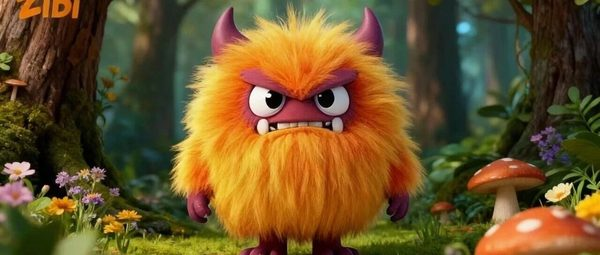

文章封面。正文没有单独剧照。

文章说这是 BBC 少儿频道的《Love Monster》，中文名《小怪兽阿蒙》，并在标题里写75集、中英文。毛茸茸的小怪兽住在可爱村，一直希望有人喜欢他、陪着他、接受他本来的样子。文章用分食物等很小的事讲爱，没有写数字年龄。

**观看**：[https://www.bbc.co.uk/cbeebies/shows/love-monster](https://www.bbc.co.uk/cbeebies/shows/love-monster)

BBC CBeebies 官方节目页。能否点播取决于地区。

**来源文章**：
- [BBC科普动画！《Love Monster》（75集中英文） 让胆小爱闹脾气的孩子，悄悄学会爱和情绪表达](https://mp.weixin.qq.com/s/chL3s5Cy86w0a_Ykz0VNLg)
- [BBC儿童医学科普《Operation Ouch  》（14季中英文）让孩子看懂身体、学会急救，强烈推荐！](https://mp.weixin.qq.com/s/DcF-aYLjzo5rt263kz0nXQ)
- [豆瓣 9.7 科普《宇宙时空之旅》（25集）孩子的宇宙启蒙课，看这一部就够了](https://mp.weixin.qq.com/s/-5VGJkhfqgD0lcveZ1_sbg)

### 尽管我们的手中空无一物

- **分类**：{e['category']}
- **类型**：{e.get('kind') or '—'}
- **文章里的年龄**：{e.get('age_group') or '文章没有写'}

图来自该微信文章。

文章介绍的短片：小羊去世后在去天堂的路上排队，过天河时身上的东西都会消失。它剃掉羊毛搓成绳子逃回家，又被狼守卫抓回去。羊妈妈一直在屋外织毛衣。结尾是狼守卫顺着绳子把毛衣送到小羊身边，绳子化作满天繁星。文章说它表面上讲死亡，落点是爱。没有写年龄，也没有英文名。

**观看**：[https://www.iqiyi.com/v_19rqq2132k.html](https://www.iqiyi.com/v_19rqq2132k.html)

爱奇艺搜索结果里标题正好是《尽管我们的手中空无一物》的页面（频道：unknown,-1）。

**来源文章**：
- [豆瓣9.4动画《尽管我们的手中空无一物》：原来跟孩子聊死亡还可以这样暖心，看完只想抱抱宝贝！](https://mp.weixin.qq.com/s/llZzyHjpLUUGo9Nb-N6Kkw)
- [豆瓣高分动画《午后时光》：父母不是一个角色，而是一场波澜壮阔的人生](https://mp.weixin.qq.com/s/ggJPptYppMBlsS4ui7jsqw)

### 远在天边

- **分类**：{e['category']}
- **类型**：{e.get('kind') or '—'}
- **文章里的年龄**：{e.get('age_group') or '文章没有写'}

图来自该微信文章。

文章说这是一个小男孩送企鹅回家的短片。男孩独自住在港口小镇，企鹅敲门而入。他起初厌烦，想把企鹅送到失物招领处或丢在宠物店，最后还是划船送它回南极。暴风雨里两人互相救援；章鱼没有攻击他们，只把行李放回船上，并把船推向企鹅的家。文章没有写年龄和英文名。另一篇在文末也点了这个名字。

**观看**：[https://www.iqiyi.com/v_21kzjy4huj4.html?playertype=immersiveShort](https://www.iqiyi.com/v_21kzjy4huj4.html?playertype=immersiveShort)

爱奇艺搜索结果里标题正好是《远在天边》的页面（频道：动漫,4）。

**来源文章**：
- [豆瓣高分动画《远在天边》：关于孤独、归属和幸福，给孩子讲不明白的道理，就看它](https://mp.weixin.qq.com/s/mLsTKPOHMdEYURdaalx2HQ)
- [豆瓣9.4动画《尽管我们的手中空无一物》：原来跟孩子聊死亡还可以这样暖心，看完只想抱抱宝贝！](https://mp.weixin.qq.com/s/llZzyHjpLUUGo9Nb-N6Kkw)
- [豆瓣高分动画《午后时光》：父母不是一个角色，而是一场波澜壮阔的人生](https://mp.weixin.qq.com/s/ggJPptYppMBlsS4ui7jsqw)

### 午后时光

- **分类**：{e['category']}
- **类型**：{e.get('kind') or '—'}
- **文章里的年龄**：{e.get('age_group') or '文章没有写'}

图来自该微信文章。

文章说这是一部约9分钟、几乎没有对白的动画。穿红衣服的老奶奶在客厅喝下午茶，她患有阿尔茨海默症，不断掉进回忆：海边的父亲、少女时代的朋友、热恋、有了女儿。结尾她想起照顾自己的人就是女儿，两人相拥。文章特别写到回忆中的老奶奶没有脖子，用来表现记忆和身体的连接断了。没有写年龄和英文名。

**观看**：未找到可打开的正版播放页。

**来源文章**：
- [豆瓣高分动画《午后时光》：父母不是一个角色，而是一场波澜壮阔的人生](https://mp.weixin.qq.com/s/ggJPptYppMBlsS4ui7jsqw)

### 月神

- **分类**：{e['category']}
- **类型**：{e.get('kind') or '—'}
- **文章里的年龄**：{e.get('age_group') or '文章没有写'}

8部共用这篇的封面。

文章写豆瓣9.0、适合4岁以上，是皮克斯约7分钟短片。男孩第一次跟爷爷和爸爸到月亮上清扫星辰。爷爷要用耙子，爸爸坚持用扫帚，男孩自己观察，敲开星辰。文章没有写英文名。

**观看**：未找到可打开的正版播放页。

**来源文章**：
- [推荐几部越看孩子越开窍的动画片（家长必看）](https://mp.weixin.qq.com/s/Iy-SwhNQC6IFAAsECwqseQ)

### 洞穴

- **分类**：{e['category']}
- **类型**：{e.get('kind') or '—'}
- **文章里的年龄**：{e.get('age_group') or '文章没有写'}

8部共用这篇的封面。

文章写豆瓣8.8、适合4岁以上，是皮克斯短片。怕社交的小兔子往地下挖洞，挖穿了鼹鼠、老鼠和蚂蚁的家，最后遇到麻烦才向邻居求助，大家一起把洞穴重建好。文章没有英文名。

**观看**：未找到可打开的正版播放页。

**来源文章**：
- [推荐几部越看孩子越开窍的动画片（家长必看）](https://mp.weixin.qq.com/s/Iy-SwhNQC6IFAAsECwqseQ)

### 失物招领

- **分类**：{e['category']}
- **类型**：{e.get('kind') or '—'}
- **文章里的年龄**：{e.get('age_group') or '文章没有写'}

8部共用这篇的封面。

文章写豆瓣8.4、适合5岁以上。失物招领箱里的小精灵发现爱欺负人的男孩 JJ 自己的东西也曾被抢走，于是帮他把抢走的东西还回去，并找回毛绒玩具。文章没有英文名。

**观看**：未找到可打开的正版播放页。

**来源文章**：
- [推荐几部越看孩子越开窍的动画片（家长必看）](https://mp.weixin.qq.com/s/Iy-SwhNQC6IFAAsECwqseQ)

### 小鞋子

- **分类**：{e['category']}
- **类型**：{e.get('kind') or '—'}
- **文章里的年龄**：{e.get('age_group') or '文章没有写'}

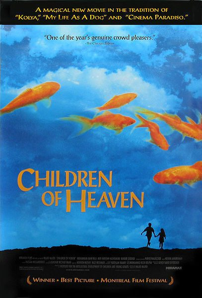

豆瓣条目《小鞋子》（1997）的海报。

文章用一句话推荐，没有写年龄和播放链接。文章写：清贫生活里兄妹互相体谅，想让孩子懂得知足和共情。

**观看**：未找到可打开的正版播放页。

**来源文章**：
- [9部孩子必看的成长电影，治愈孩子一生](https://mp.weixin.qq.com/s/oKG9Fhp_e-YAl2DMdq5_QQ)

### 地球上的星星

- **分类**：{e['category']}
- **类型**：{e.get('kind') or '—'}
- **文章里的年龄**：{e.get('age_group') or '文章没有写'}

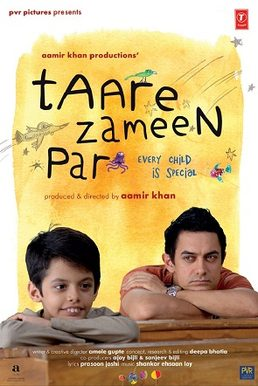

文章是图片帖。图集前9张按正文9个片名的顺序附上；页面没有在每张图下写片名，若顺序不一致，以原文图集为准。

文章用一句话推荐，没有写年龄和播放链接。文章写：每个孩子都是不一样的星星，不必跟风比较。

**观看**：未找到可打开的正版播放页。

**来源文章**：
- [9部孩子必看的成长电影，治愈孩子一生](https://mp.weixin.qq.com/s/oKG9Fhp_e-YAl2DMdq5_QQ)

### 放牛班的春天

- **分类**：{e['category']}
- **类型**：{e.get('kind') or '—'}
- **文章里的年龄**：{e.get('age_group') or '文章没有写'}

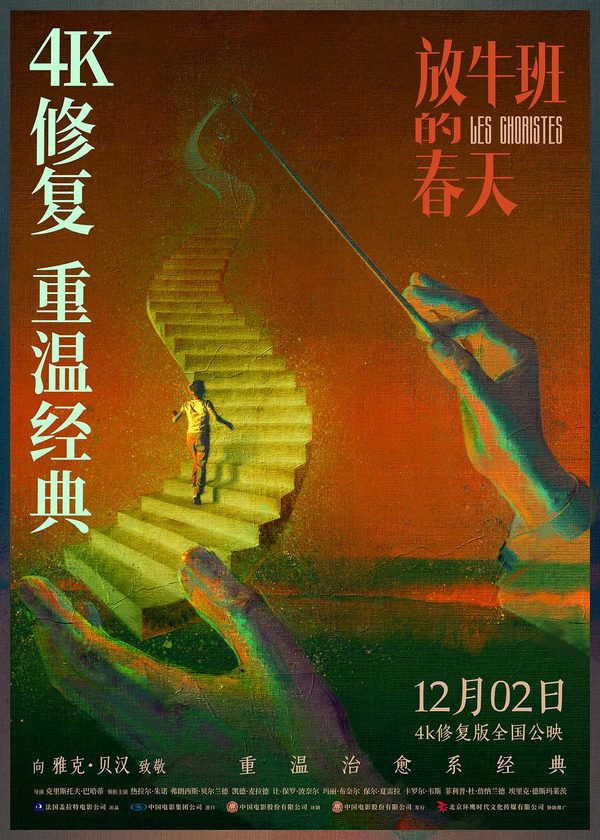

豆瓣条目《放牛班的春天》（2004）的海报。

文章用一句话推荐，没有写年龄和播放链接。文章写：没有真正的坏孩子，只有需要被看见的孩子。

**观看**：未找到可打开的正版播放页。

**来源文章**：
- [9部孩子必看的成长电影，治愈孩子一生](https://mp.weixin.qq.com/s/oKG9Fhp_e-YAl2DMdq5_QQ)

### 听见天堂

- **分类**：{e['category']}
- **类型**：{e.get('kind') or '—'}
- **文章里的年龄**：{e.get('age_group') or '文章没有写'}

豆瓣条目《听见天堂》（2006）的海报。

文章用一句话推荐，没有写年龄和播放链接。文章写：生活有缺憾，仍然可以用心感受世界。文章没有写这是哪一版电影的英文名。

**观看**：[https://www.iqiyi.com/v_13yup4e85j4.html?playertype=immersiveShort](https://www.iqiyi.com/v_13yup4e85j4.html?playertype=immersiveShort)

爱奇艺搜索结果里标题正好是《听见天堂》的页面（频道：片花,10）。

**来源文章**：
- [9部孩子必看的成长电影，治愈孩子一生](https://mp.weixin.qq.com/s/oKG9Fhp_e-YAl2DMdq5_QQ)

### 追风筝的人

- **分类**：{e['category']}
- **类型**：{e.get('kind') or '—'}
- **文章里的年龄**：{e.get('age_group') or '文章没有写'}

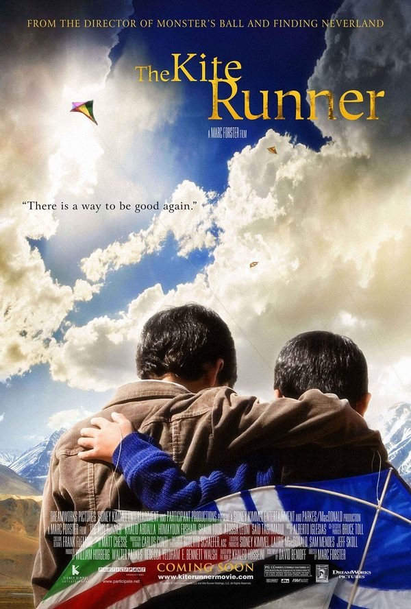

豆瓣条目《追风筝的人》（2007）的海报。

文章用一句话推荐，没有写年龄和播放链接。文章写：成长是直面过错、弥补遗憾。

**观看**：[https://www.iqiyi.com/v_12ew3xbom2s.html?playertype=immersiveShort](https://www.iqiyi.com/v_12ew3xbom2s.html?playertype=immersiveShort)

爱奇艺搜索结果里标题正好是《追风筝的人》的页面（频道：片花,10）。

**来源文章**：
- [9部孩子必看的成长电影，治愈孩子一生](https://mp.weixin.qq.com/s/oKG9Fhp_e-YAl2DMdq5_QQ)

### 何以为家

- **分类**：{e['category']}
- **类型**：{e.get('kind') or '—'}
- **文章里的年龄**：{e.get('age_group') or '文章没有写'}

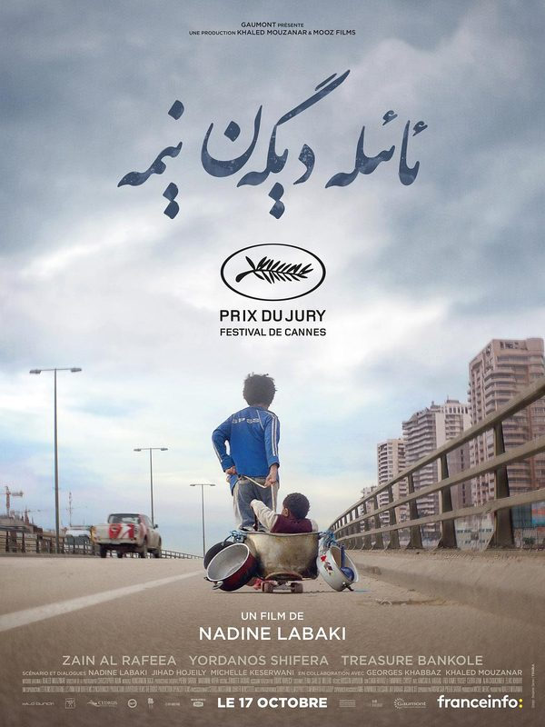

豆瓣条目《何以为家》（2018）的海报。

文章用一句话推荐，没有写年龄和播放链接。文章写：幸福不是理所当然，要珍惜被爱和被守护。

**观看**：[https://www.iqiyi.com/v_293e0qk7dbc.html?playertype=immersiveShort](https://www.iqiyi.com/v_293e0qk7dbc.html?playertype=immersiveShort)

爱奇艺搜索结果里标题正好是《何以为家》的页面（频道：片花,10）。

**来源文章**：
- [9部孩子必看的成长电影，治愈孩子一生](https://mp.weixin.qq.com/s/oKG9Fhp_e-YAl2DMdq5_QQ)

### 天堂电影院

- **分类**：{e['category']}
- **类型**：{e.get('kind') or '—'}
- **文章里的年龄**：{e.get('age_group') or '文章没有写'}

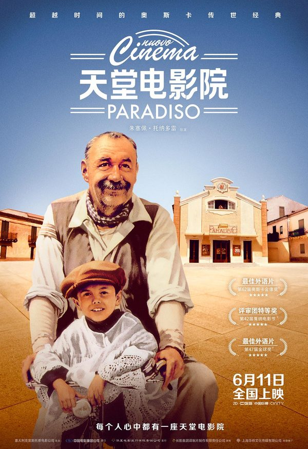

豆瓣条目《天堂电影院》（1988）的海报。

文章用一句话推荐，没有写年龄和播放链接。文章写：童年的光会照亮以后的路。

**观看**：未找到可打开的正版播放页。

**来源文章**：
- [9部孩子必看的成长电影，治愈孩子一生](https://mp.weixin.qq.com/s/oKG9Fhp_e-YAl2DMdq5_QQ)

### 大卫·科波菲尔

- **分类**：{e['category']}
- **类型**：{e.get('kind') or '—'}
- **文章里的年龄**：{e.get('age_group') or '文章没有写'}

豆瓣条目《大卫·科波菲尔》（年份未标）的海报。

文章用一句话推荐，没有写年龄和播放链接。文章写：生活有风雨，本心不能丢。文章没有写是哪一个改编版本。

**观看**：未找到可打开的正版播放页。

**来源文章**：
- [9部孩子必看的成长电影，治愈孩子一生](https://mp.weixin.qq.com/s/oKG9Fhp_e-YAl2DMdq5_QQ)

### 逃跑机器人

- **分类**：{e['category']}
- **类型**：{e.get('kind') or '—'}
- **文章里的年龄**：{e.get('age_group') or '文章没有写'}

没有单独配图，用的是该文主片的第一张图。

只在《尽管我们的手中空无一物》文末被点名。原文说它改编自国际大奖小说，并写到和平与两难时的抉择。没有年龄、集数和链接。

**观看**：未找到可打开的正版播放页。

**来源文章**：
- [豆瓣9.4动画《尽管我们的手中空无一物》：原来跟孩子聊死亡还可以这样暖心，看完只想抱抱宝贝！](https://mp.weixin.qq.com/s/llZzyHjpLUUGo9Nb-N6Kkw)

### 悠悠长假

- **分类**：{e['category']}
- **类型**：{e.get('kind') or '—'}
- **文章里的年龄**：{e.get('age_group') or '文章没有写'}

没有单独配图，用的是该文主片的第一张图。

只在《远在天边》文末被点名。原文写豆瓣9.5，画风明媚，并说它让孩子想到生活在和平环境里。没有年龄和链接。

**观看**：未找到可打开的正版播放页。

**来源文章**：
- [豆瓣高分动画《远在天边》：关于孤独、归属和幸福，给孩子讲不明白的道理，就看它](https://mp.weixin.qq.com/s/mLsTKPOHMdEYURdaalx2HQ)

### 超级肥皂

- **分类**：{e['category']}
- **类型**：{e.get('kind') or '—'}
- **文章里的年龄**：{e.get('age_group') or '文章没有写'}

没有单独配图，用的是该文主片的第一张图。

只在《午后时光》文末作为往期出现。原文写：40年前的国产动画，讲消费主义、营销套路和群体盲从。没有链接。

**观看**：[https://www.iqiyi.com/v_1upd8l2p10k.html?playertype=immersiveShort](https://www.iqiyi.com/v_1upd8l2p10k.html?playertype=immersiveShort)

爱奇艺搜索结果里标题正好是《超级肥皂》的页面（频道：少儿综艺,15）。

**来源文章**：
- [豆瓣高分动画《午后时光》：父母不是一个角色，而是一场波澜壮阔的人生](https://mp.weixin.qq.com/s/ggJPptYppMBlsS4ui7jsqw)

### 雨后

- **分类**：{e['category']}
- **类型**：{e.get('kind') or '—'}
- **文章里的年龄**：{e.get('age_group') or '文章没有写'}

没有单独配图，用的是该文主片的第一张图。

只在《午后时光》文末作为往期出现。原文写：法国获奖动画，关于自然循环、责任与传承。没有链接。

**观看**：未找到可打开的正版播放页。

**来源文章**：
- [豆瓣高分动画《午后时光》：父母不是一个角色，而是一场波澜壮阔的人生](https://mp.weixin.qq.com/s/ggJPptYppMBlsS4ui7jsqw)

### 驯龙高手（How to Train Your Dragon）

- **分类**：{e['category']}
- **类型**：{e.get('kind') or '—'}
- **文章里的年龄**：{e.get('age_group') or '文章没有写'}

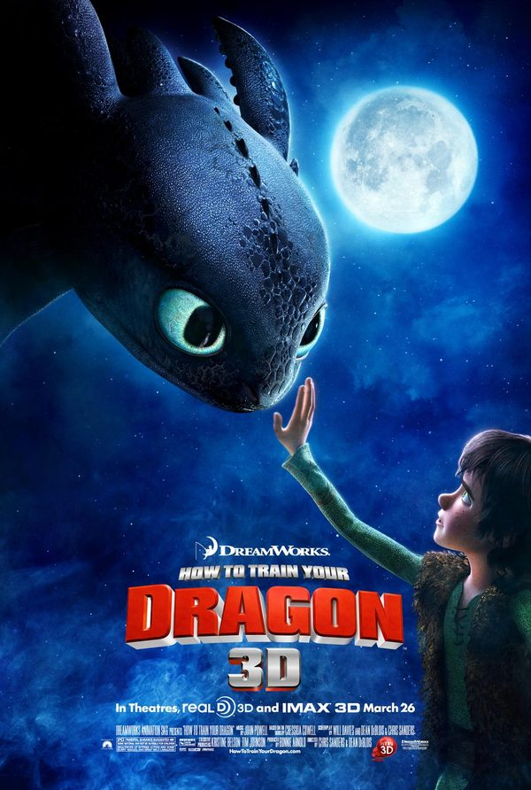

豆瓣条目《驯龙高手》（2010）的海报。

文章说孩子在趣配音里看了片段后想把整部电影看完，正文介绍的就是这一部。维京部落世世代代把龙当敌人。首领的儿子 Hiccup 瘦弱，不像其他维京人。他遇见罕见的夜煞 Night Fury，给它取名 Toothless。两人从互相试探到互相信任，Hiccup 拒绝再屠龙，最后和 Toothless 一起对付真正的威胁。文章写电影和原著不完全对应。同页还介绍了 Cressida Cowell 的同名书，那是书，不是视频。文章没有写具体岁数。

**观看**：[https://www.youtube.com/watch?v=zzT3Rhcwq2Y](https://www.youtube.com/watch?v=zzT3Rhcwq2Y)

维基数据为 2010 年电影登记的 YouTube 视频，本环境打开返回 200。梦工厂影片页 https://www.dreamworks.com/movies/how-to-train-your-dragon 也同样打开了。

**来源文章**：
- [入迷了，娃最近大呼好看的儿童电影](https://mp.weixin.qq.com/s/1zcUZOanOLPia36GlVYinA)

### 布鲁伊（Bluey）

- **分类**：{e['category']}
- **类型**：{e.get('kind') or '—'}
- **文章里的年龄**：{e.get('age_group') or '文章没有写'}

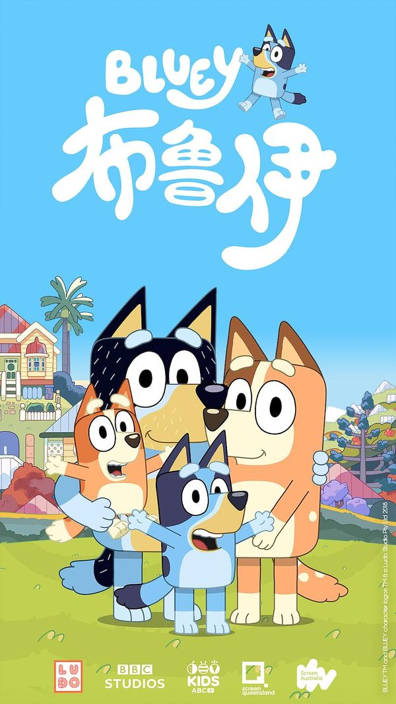

豆瓣条目《布鲁伊 第一季》（2018）的海报。

文章说豆瓣9.8，每集7分钟，讲澳洲一家四口怎么玩。作者认为它不是教英语的，而是教家长跟孩子玩什么，看完可以照着做亲子游戏。家里目前中文看得多，英文跟不上。

**观看**：[https://www.bluey.tv/](https://www.bluey.tv/)

官方网站 bluey.tv。若本环境能打开则保留。

**来源文章**：
- [两个女儿6岁和2岁，我们只看这8部动画片](https://mp.weixin.qq.com/s/B2loD1DLgD3WS77WM1XkqQ)

### 克劳斯：圣诞节的秘密（Klaus）

- **分类**：{e['category']}
- **类型**：{e.get('kind') or '—'}
- **文章里的年龄**：{e.get('age_group') or '文章没有写'}

豆瓣条目《克劳斯：圣诞节的秘密》（2019）的海报。

文章24：邮政学徒贾斯帕被派到常年对立的北极小岛，遇见做玩具的樵夫克劳斯，两人用送信和礼物慢慢化解小镇的对立。文章27补充英文名 Klaus，并引用 “A true selfless act always sparks another.”

**观看**：未找到可打开的正版播放页。

**来源文章**：
- [6部治愈亲子电影：不用讲道理，只陪孩子纯粹快乐大笑](https://mp.weixin.qq.com/s/emCL8FTZgeWRNQoj8Fki6Q)
- [陪女儿看的1000部电影——10部脑洞大开又温暖治愈的动画电影](https://mp.weixin.qq.com/s/5TG375Bph1OhKcTfKC1OMQ)

### 天赐灵机（Ron's Gone Wrong）

- **分类**：{e['category']}
- **类型**：{e.get('kind') or '—'}
- **文章里的年龄**：{e.get('age_group') or '文章没有写'}

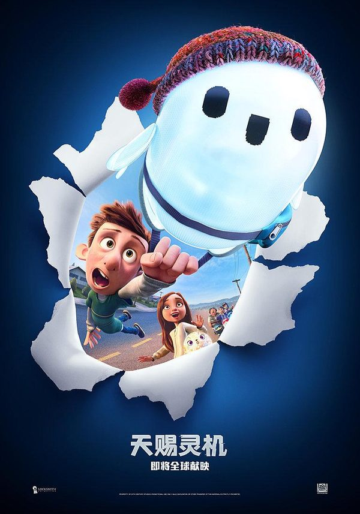

豆瓣条目《天赐灵机》（2021）的海报。

文章写豆瓣8.1。未来世界里每个孩子都有智能机器人，内向的巴尼分到一个会出错的“小笨蛋”。这个有缺陷的机器人陪他冒险，文章用它讲不必完美。文章没有给英文名。 英文名来自豆瓣该条目的外文名，不是文章原文。

**观看**：未找到可打开的正版播放页。

**来源文章**：
- [6部治愈亲子电影：不用讲道理，只陪孩子纯粹快乐大笑](https://mp.weixin.qq.com/s/emCL8FTZgeWRNQoj8Fki6Q)

### 青春变形记（Turning Red）

- **分类**：{e['category']}
- **类型**：{e.get('kind') or '—'}
- **文章里的年龄**：{e.get('age_group') or '文章没有写'}

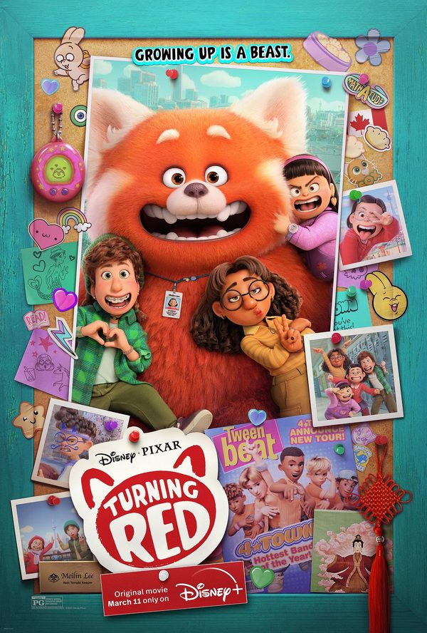

豆瓣条目《青春变形记》（2022）的海报。

13岁的华裔女孩情绪激动时会变成红色小熊猫。文章24把它写成青春期和母女和解。文章27补充这是家族女性代代相传的变化，妈妈后来道歉，女孩选择把熊猫留下来。

**观看**：[https://www.iqiyi.com/v_26ytlpx77tk.html?playertype=immersiveShort](https://www.iqiyi.com/v_26ytlpx77tk.html?playertype=immersiveShort)

爱奇艺搜索结果里标题正好是《青春变形记》的页面（频道：片花,10）。

**来源文章**：
- [6部治愈亲子电影：不用讲道理，只陪孩子纯粹快乐大笑](https://mp.weixin.qq.com/s/emCL8FTZgeWRNQoj8Fki6Q)
- [陪女儿看的1000部电影——10部脑洞大开又温暖治愈的动画电影](https://mp.weixin.qq.com/s/5TG375Bph1OhKcTfKC1OMQ)

### 朝花夕誓

- **分类**：{e['category']}
- **类型**：{e.get('kind') or '—'}
- **文章里的年龄**：{e.get('age_group') or '文章没有写'}

豆瓣条目《朝花夕誓》（2018）的海报。

文章写豆瓣7.3。寿命很长的少女玛奇亚在战乱中捡到婴儿，孩子会长大变老，她的样子却不变。文章用它讲陪伴、守护和放手，并引了“是你教会了我什么是爱”。没有给英文名。

**观看**：[https://www.iqiyi.com/v_1x7vmewomgw.html?playertype=immersiveShort](https://www.iqiyi.com/v_1x7vmewomgw.html?playertype=immersiveShort)

爱奇艺搜索结果里标题正好是《朝花夕誓》的页面（频道：动漫,4）。

**来源文章**：
- [6部治愈亲子电影：不用讲道理，只陪孩子纯粹快乐大笑](https://mp.weixin.qq.com/s/emCL8FTZgeWRNQoj8Fki6Q)

### 白日梦想家（The Secret Life of Walter Mitty）

- **分类**：{e['category']}
- **类型**：{e.get('kind') or '—'}
- **文章里的年龄**：{e.get('age_group') or '文章没有写'}

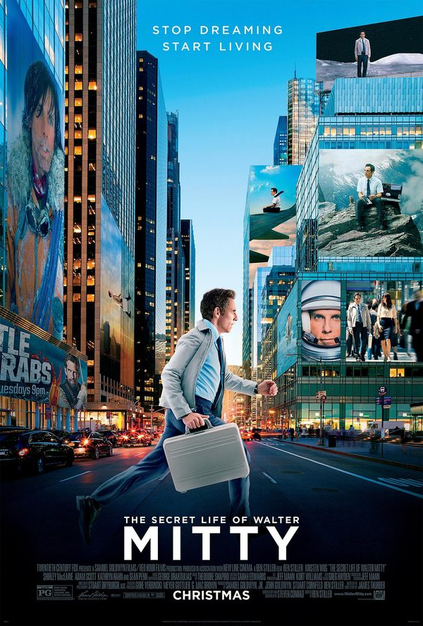

豆瓣条目《白日梦想家》（2013）的海报。

文章写豆瓣8.7，并称它是治愈的成人励志片。内向的上班族沃特沉在白日梦里，一张底片失踪后他走出家门。文章没有说它是动画，也没有给英文名。 英文名来自豆瓣该条目的外文名，不是文章原文。

**观看**：未找到可打开的正版播放页。

**来源文章**：
- [6部治愈亲子电影：不用讲道理，只陪孩子纯粹快乐大笑](https://mp.weixin.qq.com/s/emCL8FTZgeWRNQoj8Fki6Q)

### 大坏狐狸的故事（Le Grand Méchant Renard et autres contes...）

- **分类**：{e['category']}
- **类型**：{e.get('kind') or '—'}
- **文章里的年龄**：{e.get('age_group') or '文章没有写'}

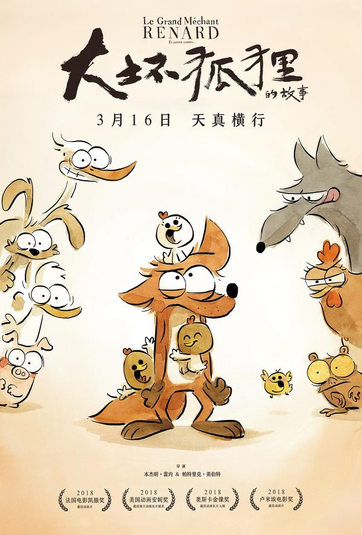

豆瓣条目《大坏狐狸的故事》（2017）的海报。

文章写豆瓣8.2，手绘水彩，法国凯撒奖，入围奥斯卡。狐狸偷了三颗蛋，小鸡却认它当妈妈。三个农场小故事。文章没有给英文名。 英文名来自豆瓣该条目的外文名，不是文章原文。

**观看**：[https://www.iqiyi.com/v_16c0ikjdt70.html?playertype=immersiveShort](https://www.iqiyi.com/v_16c0ikjdt70.html?playertype=immersiveShort)

爱奇艺搜索结果里标题正好是《大坏狐狸的故事》的页面（频道：少儿综艺,15）。

**来源文章**：
- [6部治愈亲子电影：不用讲道理，只陪孩子纯粹快乐大笑](https://mp.weixin.qq.com/s/emCL8FTZgeWRNQoj8Fki6Q)

### 埃及王子（The Prince of Egypt）

- **分类**：{e['category']}
- **类型**：{e.get('kind') or '—'}
- **文章里的年龄**：{e.get('age_group') or '文章没有写'}

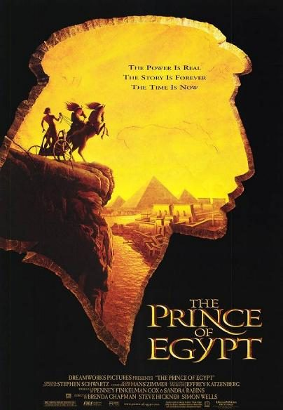

豆瓣条目《埃及王子》（1998）的海报。

文章写1998年梦工厂动画，豆瓣评分栏没有填数字。摩西本可以继续当埃及王子，却选择回到族人那边。十分钟红海镜头做了四年。配乐歌 When You Believe 获奥斯卡最佳原创歌曲。文章写可以从腾讯视频或爱奇艺搜索，但没有给出具体播放地址。

**观看**：未找到可打开的正版播放页。

**来源文章**：
- [【观影】《埃及王子》：耗资一亿、花四年做十分钟红海，这部28年前的动画至今无人超越](https://mp.weixin.qq.com/s/MgcsNGCON5gTlKMhDjqGTQ)

### 伦敦一家人（Ethel & Ernest）

- **分类**：{e['category']}
- **类型**：{e.get('kind') or '—'}
- **文章里的年龄**：{e.get('age_group') or '文章没有写'}

豆瓣条目《伦敦一家人》（2016）的海报。

文章写豆瓣8.8，手绘水彩。1928年一个女仆和一个送奶工一见钟情，后来躲空袭、等儿子回家。台词来自作者父母说过的话，片尾有他们的照片。 英文名来自豆瓣该条目的外文名，不是文章原文。

**观看**：未找到可打开的正版播放页。

**来源文章**：
- [6部零差评宝藏动画电影！完美封神却无人提及，太可惜了](https://mp.weixin.qq.com/s/FrkyAZYpTEqOreapJ-f3UA)

### 马茹娜的非凡旅程（L'extraordinaire voyage de Marona）

- **分类**：{e['category']}
- **类型**：{e.get('kind') or '—'}
- **文章里的年龄**：{e.get('age_group') or '文章没有写'}

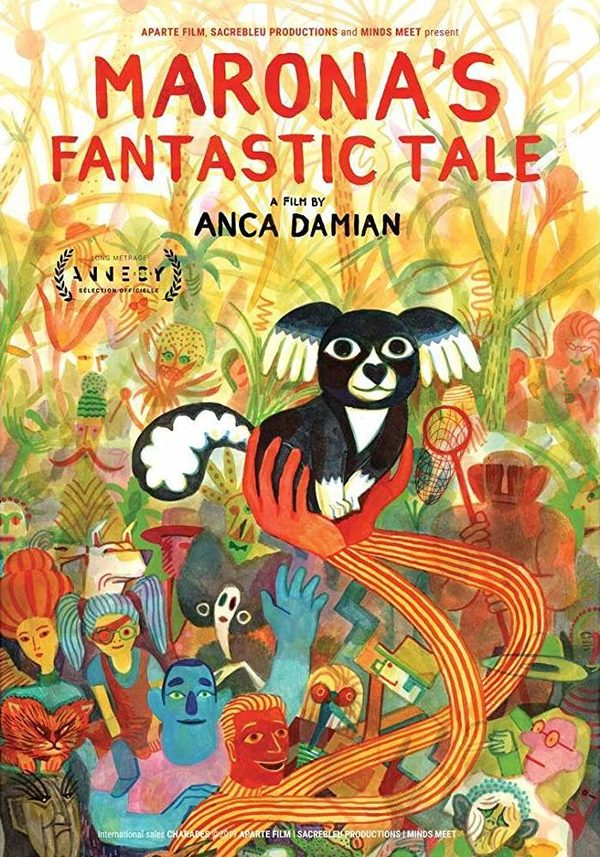

豆瓣条目《马茹娜的非凡旅程》（2019）的海报。

文章写豆瓣8.6。小狗被马戏团小丑、建筑工人和独居老人先后捡到又遗弃，仍然相信人。文章没有给英文名。 英文名来自豆瓣该条目的外文名，不是文章原文。

**观看**：未找到可打开的正版播放页。

**来源文章**：
- [6部零差评宝藏动画电影！完美封神却无人提及，太可惜了](https://mp.weixin.qq.com/s/FrkyAZYpTEqOreapJ-f3UA)

### 记忆中的玛妮

- **分类**：{e['category']}
- **类型**：{e.get('kind') or '—'}
- **文章里的年龄**：{e.get('age_group') or '文章没有写'}

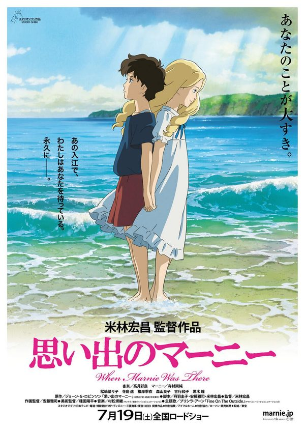

豆瓣条目《记忆中的玛妮》（2014）的海报。

文章写豆瓣8.0，吉卜力。社恐的杏奈在乡下遇见金发女孩玛妮，结尾揭开陪伴以另一种方式回来。适合心思敏感的孩子。文章没有给英文名。

**观看**：[https://www.iqiyi.com/v_24597srybyc.html](https://www.iqiyi.com/v_24597srybyc.html)

爱奇艺搜索结果里标题正好是《记忆中的玛妮》的页面（频道：动漫,4）。

**来源文章**：
- [6部零差评宝藏动画电影！完美封神却无人提及，太可惜了](https://mp.weixin.qq.com/s/FrkyAZYpTEqOreapJ-f3UA)

### 反叛的童谣（Revolting Rhymes）

- **分类**：{e['category']}
- **类型**：{e.get('kind') or '—'}
- **文章里的年龄**：{e.get('age_group') or '文章没有写'}

豆瓣条目《反叛的童谣》（2016）的海报。

文章写豆瓣8.7，英国动画，约57分钟，奥斯卡提名。把《小红帽》《白雪公主》《灰姑娘》揉碎重讲。这三则是片中的童话，不是另外三部片子。文章没有给英文名。 英文名来自豆瓣该条目的外文名，不是文章原文。

**观看**：未找到可打开的正版播放页。

**来源文章**：
- [6部零差评宝藏动画电影！完美封神却无人提及，太可惜了](https://mp.weixin.qq.com/s/FrkyAZYpTEqOreapJ-f3UA)

### 蜗牛回忆录（Memoir of a Snail）

- **分类**：{e['category']}
- **类型**：{e.get('kind') or '—'}
- **文章里的年龄**：{e.get('age_group') or '文章没有写'}

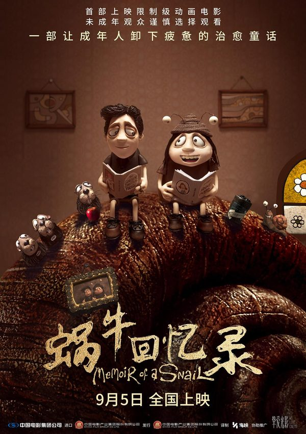

豆瓣条目《蜗牛回忆录》（2024）的海报。

文章写豆瓣8.6，2024年安锡最佳动画长片，奥斯卡最佳动画长片提名。黏土动画。女孩格蕾丝因外貌被欺凌，把自己关在壳里，老奶奶萍奇用口头禅 BAGA 让她面对破碎。文章没有给英文名。 英文名来自豆瓣该条目的外文名，不是文章原文。

**观看**：未找到可打开的正版播放页。

**来源文章**：
- [6部零差评宝藏动画电影！完美封神却无人提及，太可惜了](https://mp.weixin.qq.com/s/FrkyAZYpTEqOreapJ-f3UA)

### 我住在凡尔赛的日子（La vie de château - Mon enfance à Versailles）

- **分类**：{e['category']}
- **类型**：{e.get('kind') or '—'}
- **文章里的年龄**：{e.get('age_group') or '文章没有写'}

豆瓣条目《我住在凡尔赛的日子》（2025）的海报。

文章写豆瓣8.2。8岁的维奥丽特失去父母，投奔在凡尔赛宫做维修的孤僻舅舅。法式水彩。提名法国凯撒奖最佳动画片。文章没有给英文名。 英文名来自豆瓣该条目的外文名，不是文章原文。

**观看**：未找到可打开的正版播放页。

**来源文章**：
- [6部零差评宝藏动画电影！完美封神却无人提及，太可惜了](https://mp.weixin.qq.com/s/FrkyAZYpTEqOreapJ-f3UA)

### 星际宝贝（Lilo & Stitch）

- **分类**：{e['category']}
- **类型**：{e.get('kind') or '—'}
- **文章里的年龄**：{e.get('age_group') or '文章没有写'}

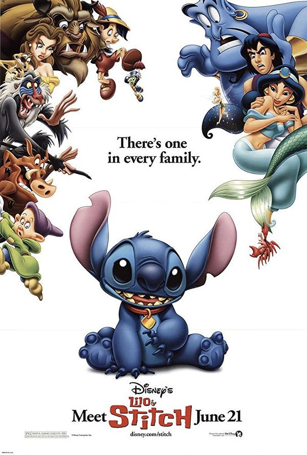

豆瓣条目《星际宝贝》（2002）的海报。

文章写夏威夷女孩莉萝和姐姐娜妮相依为命，把逃出来的外星实验体当成狗，取名史迪奇，教它的第一个词是家人。金句是 Ohana means family。

**观看**：未找到可打开的正版播放页。

**来源文章**：
- [陪女儿看的1000部电影——10部脑洞大开又温暖治愈的动画电影](https://mp.weixin.qq.com/s/5TG375Bph1OhKcTfKC1OMQ)

### 花木兰（Mulan）

- **分类**：{e['category']}
- **类型**：{e.get('kind') or '—'}
- **文章里的年龄**：{e.get('age_group') or '文章没有写'}

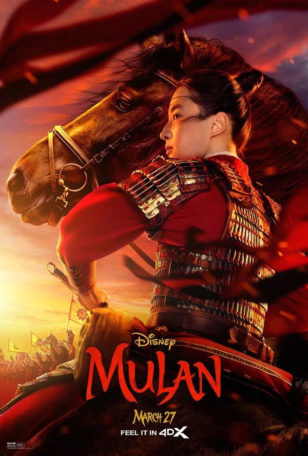

豆瓣条目《花木兰》（2020）的海报。

文章写明是1998年动画版。父亲腿有旧伤，木兰夜里剪发，穿上父亲的盔甲去从军。文章用它谈“我是谁”和“我为谁而做”。

**观看**：未找到可打开的正版播放页。

**来源文章**：
- [陪女儿看的1000部电影——10部脑洞大开又温暖治愈的动画电影](https://mp.weixin.qq.com/s/5TG375Bph1OhKcTfKC1OMQ)

### 海洋之歌（Song of the Sea）

- **分类**：{e['category']}
- **类型**：{e.get('kind') or '—'}
- **文章里的年龄**：{e.get('age_group') or '文章没有写'}

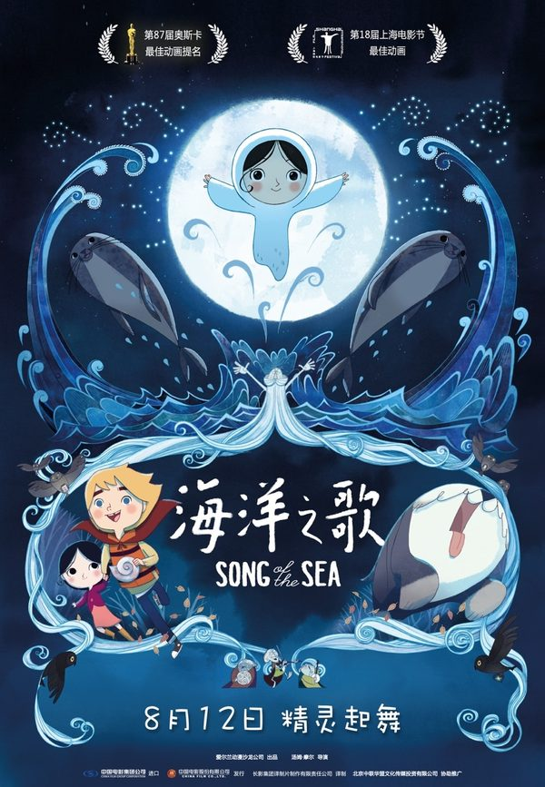

豆瓣条目《海洋之歌》（2014）的海报。

文章写爱尔兰灯塔边的兄妹。母亲在妹妹出生那夜回到海里。妹妹是海豹精灵，要找回被父亲扔进海里的海豹皮才能唱歌。文章说难过要留着，不是拿掉。

**观看**：未找到可打开的正版播放页。

**来源文章**：
- [陪女儿看的1000部电影——10部脑洞大开又温暖治愈的动画电影](https://mp.weixin.qq.com/s/5TG375Bph1OhKcTfKC1OMQ)

### 拜见罗宾逊一家（Meet the Robinsons）

- **分类**：{e['category']}
- **类型**：{e.get('kind') or '—'}
- **文章里的年龄**：{e.get('age_group') or '文章没有写'}

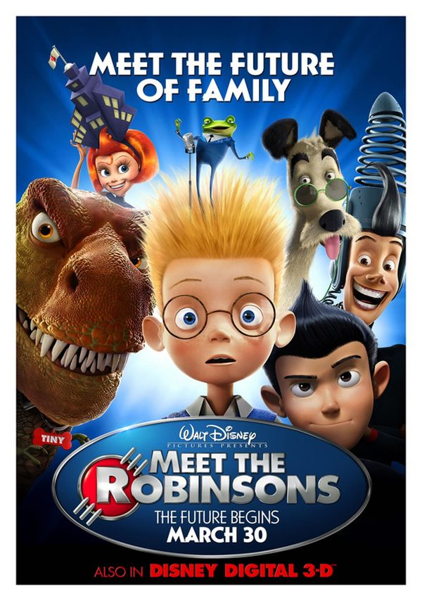

豆瓣条目《拜见罗宾逊一家》（2007）的海报。

文章写孤儿院里的小发明家路易斯为了找母亲造记忆扫描机，被来自未来的威尔伯拉上时光机。金句 Keep moving forward。

**观看**：未找到可打开的正版播放页。

**来源文章**：
- [陪女儿看的1000部电影——10部脑洞大开又温暖治愈的动画电影](https://mp.weixin.qq.com/s/5TG375Bph1OhKcTfKC1OMQ)

### 海兽猎人（The Sea Beast）

- **分类**：{e['category']}
- **类型**：{e.get('kind') or '—'}
- **文章里的年龄**：{e.get('age_group') or '文章没有写'}

豆瓣条目《海兽猎人》（2022）的海报。

文章写孤女梅茜溜上猎兽船，和传说中的大红海兽困在岛上，发现海兽和她听到的故事不一样。金句 Maybe you can be a hero and still be wrong.

**观看**：[https://www.iqiyi.com/v_1iuco1v6b9s.html?playertype=immersiveShort](https://www.iqiyi.com/v_1iuco1v6b9s.html?playertype=immersiveShort)

爱奇艺搜索结果里标题正好是《海兽猎人》的页面（频道：动漫,4）。

**来源文章**：
- [陪女儿看的1000部电影——10部脑洞大开又温暖治愈的动画电影](https://mp.weixin.qq.com/s/5TG375Bph1OhKcTfKC1OMQ)

### 荒野机器人（The Wild Robot）

- **分类**：{e['category']}
- **类型**：{e.get('kind') or '—'}
- **文章里的年龄**：{e.get('age_group') or '文章没有写'}

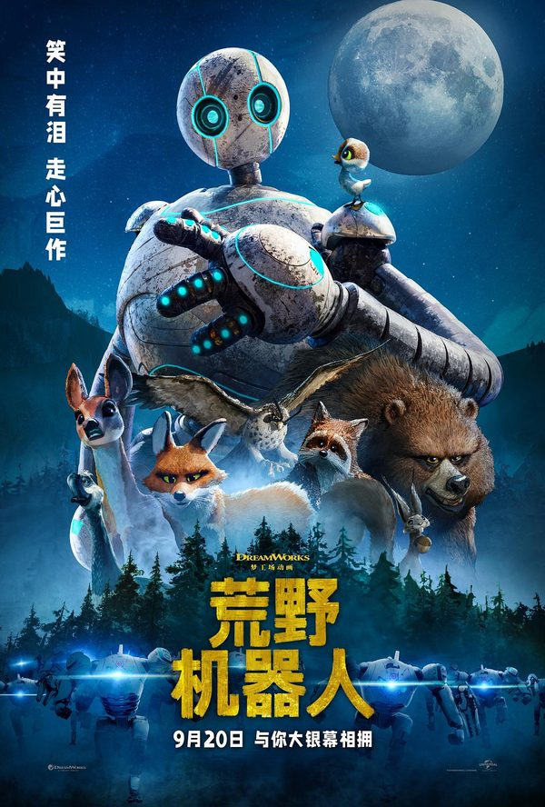

豆瓣条目《荒野机器人》（2024）的海报。

文章写机器人罗兹漂到荒岛，意外成了一只小雁的妈妈，要在秋天前教会它飞。她没有“当妈妈的程序”，是硬着头皮学会的。

**观看**：未找到可打开的正版播放页。

**来源文章**：
- [陪女儿看的1000部电影——10部脑洞大开又温暖治愈的动画电影](https://mp.weixin.qq.com/s/5TG375Bph1OhKcTfKC1OMQ)

### 魔弦传说（Kubo and the Two Strings）

- **分类**：{e['category']}
- **类型**：{e.get('kind') or '—'}
- **文章里的年龄**：{e.get('age_group') or '文章没有写'}

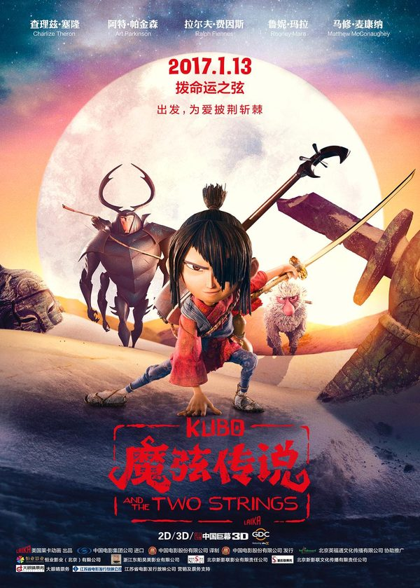

豆瓣条目《魔弦传说》（2016）的海报。

文章写独眼男孩库博用琴和会动的纸片在集市说书，天黑前必须回家。母亲被击倒后，他和会说话的猴子、甲虫去找父亲留下的盔甲。定格动画。

**观看**：未找到可打开的正版播放页。

**来源文章**：
- [陪女儿看的1000部电影——10部脑洞大开又温暖治愈的动画电影](https://mp.weixin.qq.com/s/5TG375Bph1OhKcTfKC1OMQ)

### 疯狂元素城（Elemental）

- **分类**：{e['category']}
- **类型**：{e.get('kind') or '—'}
- **文章里的年龄**：{e.get('age_group') or '文章没有写'}

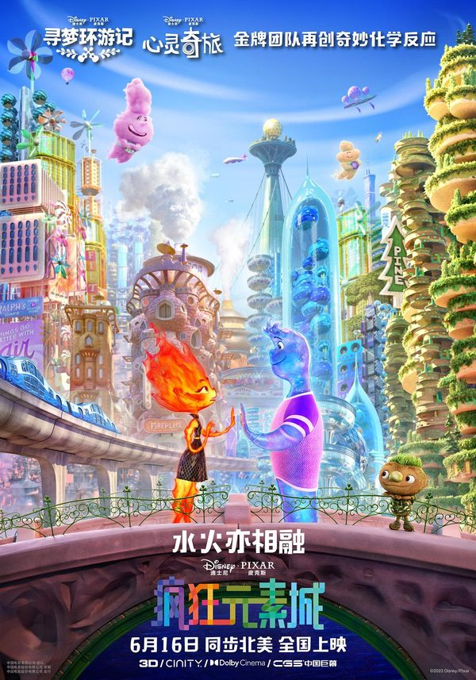

豆瓣条目《疯狂元素城》（2023）的海报。

文章写火族姑娘小焰被父亲当接班人，自己喜欢玻璃艺术却不敢说。水族男孩阿波闯进店里。父亲后来说：店从来不是梦想，你才是。

**观看**：未找到可打开的正版播放页。

**来源文章**：
- [陪女儿看的1000部电影——10部脑洞大开又温暖治愈的动画电影](https://mp.weixin.qq.com/s/5TG375Bph1OhKcTfKC1OMQ)

返回 [分类目录](catalog.md)。
