# 情感品格类

[返回首页](../../README.md) · [方法](review-method.md) · [不推荐](not-recommended.md) · [文章28待核验](pending-article-28.md)

本页 40 条，按判断排序。**有保留不等于推荐；年龄不等于听力难度；图片不证明适龄。**

## 布鲁伊 / Bluey
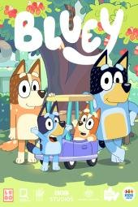
**判断：强烈推荐** · 建议：4+（CSM；不因妹妹爱看降到2岁）

**简介**：文章说豆瓣9.8，每集7分钟，讲澳洲一家四口怎么玩。作者认为它不是教英语的，而是教家长跟孩子玩什么，看完可以照着做亲子游戏。家里目前中文看得多，英文跟不上。

**研判**：独立评测肯定想象游戏、耐心和支持性亲子关系。它不是STEM或系统英语课程，英语难度与适龄是两回事；看后一起玩，比连刷更符合其长处。

**证据状态**：作品级证据初审；置信度：中。

**视频/官方入口**：[查看官方页](https://www.bluey.tv/)。已核实官方作品页或节目页，不代表能免费播放、包含完整影片或在当前地区可播。

**图片**：独立评测页所标本片海报（版权归原权利人）。 [图源](https://www.commonsensemedia.org/tv-reviews/bluey)

原文年龄（不是本项目认可结论）：6岁，文章写两岁妹妹看画面也乐。

**独立依据**：[Common Sense Media](https://www.commonsensemedia.org/tv-reviews/bluey)

豆瓣评分/人数：未核实；IMDb评分/人数：未核实。公众号里的评分仅为原文说法，不计作已验证数据。

**原文来源**：[文章23](https://mp.weixin.qq.com/s/B2loD1DLgD3WS77WM1XkqQ)

---

## 荒野机器人 / The Wild Robot
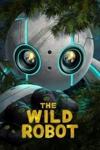
**判断：强烈推荐** · 建议：8+（CSM；非原文7+）

**简介**：文章写机器人罗兹漂到荒岛，意外成了一只小雁的妈妈，要在秋天前教会它飞。她没有“当妈妈的程序”，是硬着头皮学会的。

**研判**：独立评测肯定照料、合作与适应环境，也记录动物死亡、捕食和大规模动作险境。情感表达扎实，推荐共看，但不能把故事等同准确的野生动物行为教程。

**证据状态**：作品级证据初审；置信度：中。

**视频链接**：未核实正版正片；不以同名页、预告、资源站或HTTP 200冒充可播正片。

**图片**：独立评测页所标本片海报（版权归原权利人）。 [图源](https://www.commonsensemedia.org/movie-reviews/the-wild-robot)

原文年龄（不是本项目认可结论）：7岁+。

**独立依据**：[Common Sense Media](https://www.commonsensemedia.org/movie-reviews/the-wild-robot)

豆瓣评分/人数：未核实；IMDb评分/人数：未核实。公众号里的评分仅为原文说法，不计作已验证数据。

**原文来源**：[文章27](https://mp.weixin.qq.com/s/5TG375Bph1OhKcTfKC1OMQ)；[文章28](https://mp.weixin.qq.com/s/kx7YqDwvnUhSYTM3Gh1f-Q)

---

## 远在天边
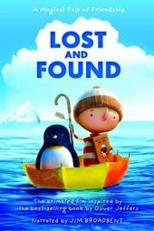
**判断：强烈推荐** · 建议：3+（CSM）

**简介**：文章说这是一个小男孩送企鹅回家的短片。男孩独自住在港口小镇，企鹅敲门而入。他起初厌烦，想把企鹅送到失物招领处或丢在宠物店，最后还是划船送它回南极。暴风雨里两人互相救援；章鱼没有攻击他们，只把行李放回船上，并把船推向企鹅的家。文章没有写年龄和英文名。另一篇在文末也点了这个名字。

**研判**：独立评测确认是Oliver Jeffers绘本改编的短片，友情主题清楚且无明显不当内容；短暂失散可能使敏感儿童难过。适合共看讨论陪伴，不夸大为认知训练。

**证据状态**：作品级证据初审；置信度：中。

**视频链接**：未核实正版正片；不以同名页、预告、资源站或HTTP 200冒充可播正片。

**图片**：独立评测页所标本片海报（版权归原权利人）。 [图源](https://www.commonsensemedia.org/movie-reviews/lost-and-found)

原文年龄（不是本项目认可结论）：未标明年龄。

**独立依据**：[Common Sense Media](https://www.commonsensemedia.org/movie-reviews/lost-and-found)

豆瓣评分/人数：未核实；IMDb评分/人数：未核实。公众号里的评分仅为原文说法，不计作已验证数据。

**原文来源**：[文章15](https://mp.weixin.qq.com/s/mLsTKPOHMdEYURdaalx2HQ)；[文章9](https://mp.weixin.qq.com/s/llZzyHjpLUUGo9Nb-N6Kkw)；[文章21](https://mp.weixin.qq.com/s/ggJPptYppMBlsS4ui7jsqw)

---

## 克劳斯：圣诞节的秘密 / Klaus
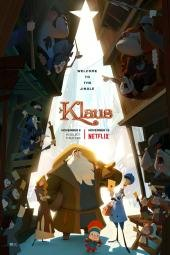
**判断：推荐** · 建议：6+（CSM）

**简介**：文章24：邮政学徒贾斯帕被派到常年对立的北极小岛，遇见做玩具的樵夫克劳斯，两人用送信和礼物慢慢化解小镇的对立。文章27补充英文名 Klaus，并引用 “A true selfless act always sparks another.”

**研判**：独立指南肯定善意改变关系的主题，同时提醒家族争斗、威胁及丧失。并非“纯粹快乐、没有沉重情节”，敏感儿童宜先预看。

**证据状态**：作品级证据初审；置信度：中。

**视频链接**：未核实正版正片；不以同名页、预告、资源站或HTTP 200冒充可播正片。

**图片**：独立评测页所标本片海报（版权归原权利人）。 [图源](https://www.commonsensemedia.org/movie-reviews/klaus)

原文年龄（不是本项目认可结论）：文章24写6岁以上；文章27写6岁+。

**独立依据**：[Common Sense Media](https://www.commonsensemedia.org/movie-reviews/klaus)

豆瓣评分/人数：未核实；IMDb评分/人数：未核实。公众号里的评分仅为原文说法，不计作已验证数据。

**原文来源**：[文章24](https://mp.weixin.qq.com/s/emCL8FTZgeWRNQoj8Fki6Q)；[文章27](https://mp.weixin.qq.com/s/5TG375Bph1OhKcTfKC1OMQ)；[文章28](https://mp.weixin.qq.com/s/kx7YqDwvnUhSYTM3Gh1f-Q)

---

## 埃及王子 / The Prince of Egypt
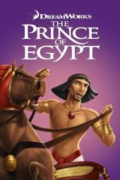
**判断：推荐** · 建议：8+（CSM；成人预看）

**简介**：文章写1998年梦工厂动画，豆瓣评分栏没有填数字。摩西本可以继续当埃及王子，却选择回到族人那边。十分钟红海镜头做了四年。配乐歌 When You Believe 获奥斯卡最佳原创歌曲。文章写可以从腾讯视频或爱奇艺搜索，但没有给出具体播放地址。

**研判**：歌曲和叙事优秀不应遮住奴役、杀婴、灾难与死亡的强度。是宗教经典的艺术改编而非可直接当考古史实；家庭可解释不同信仰与历史证据。

**证据状态**：作品级证据初审；置信度：中。

**视频链接**：未核实正版正片；不以同名页、预告、资源站或HTTP 200冒充可播正片。

**图片**：独立评测页所标本片海报（版权归原权利人）。 [图源](https://www.commonsensemedia.org/movie-reviews/the-prince-of-egypt)

原文年龄（不是本项目认可结论）：文章没有写岁数。

**独立依据**：[Common Sense Media](https://www.commonsensemedia.org/movie-reviews/the-prince-of-egypt)

豆瓣评分/人数：未核实；IMDb评分/人数：未核实。公众号里的评分仅为原文说法，不计作已验证数据。

**原文来源**：[文章25](https://mp.weixin.qq.com/s/MgcsNGCON5gTlKMhDjqGTQ)

---

## 大坏狐狸的故事 / Le Grand Méchant Renard et autres contes...
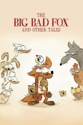
**判断：推荐** · 建议：5+（CSM）

**简介**：文章写豆瓣8.2，手绘水彩，法国凯撒奖，入围奥斯卡。狐狸偷了三颗蛋，小鸡却认它当妈妈。三个农场小故事。文章没有给英文名。 英文名来自豆瓣该条目的外文名，不是文章原文。

**研判**：独立指南肯定幽默与互助，但明确有摔打、摔落等卡通暴力。以娱乐和讨论关系为主，不把“看得开心”夸大为系统教育收益。

**证据状态**：作品级证据初审；置信度：中。

**视频链接**：未核实正版正片；不以同名页、预告、资源站或HTTP 200冒充可播正片。

**图片**：独立评测页所标本片海报（版权归原权利人）。 [图源](https://www.commonsensemedia.org/movie-reviews/the-big-bad-fox-and-other-tales)

原文年龄（不是本项目认可结论）：5岁以上。

**独立依据**：[Common Sense Media](https://www.commonsensemedia.org/movie-reviews/the-big-bad-fox-and-other-tales)

豆瓣评分/人数：未核实；IMDb评分/人数：未核实。公众号里的评分仅为原文说法，不计作已验证数据。

**原文来源**：[文章24](https://mp.weixin.qq.com/s/emCL8FTZgeWRNQoj8Fki6Q)

---

## 天赐灵机 / Ron's Gone Wrong
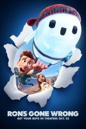
**判断：推荐** · 建议：8+（CSM；非原文6+）

**简介**：文章写豆瓣8.1。未来世界里每个孩子都有智能机器人，内向的巴尼分到一个会出错的“小笨蛋”。这个有缺陷的机器人陪他冒险，文章用它讲不必完美。文章没有给英文名。 英文名来自豆瓣该条目的外文名，不是文章原文。

**研判**：关于友谊、社交科技与不依赖算法的讨论有价值，但追逐冲突、欺凌和粗口增加强度。应讨论数字隐私与品牌营销，不把机器人当理想朋友模板。

**证据状态**：作品级证据初审；置信度：中。

**视频链接**：未核实正版正片；不以同名页、预告、资源站或HTTP 200冒充可播正片。

**图片**：独立评测页所标本片海报（版权归原权利人）。 [图源](https://www.commonsensemedia.org/movie-reviews/rons-gone-wrong)

原文年龄（不是本项目认可结论）：6岁以上。

**独立依据**：[Common Sense Media](https://www.commonsensemedia.org/movie-reviews/rons-gone-wrong)

豆瓣评分/人数：未核实；IMDb评分/人数：未核实。公众号里的评分仅为原文说法，不计作已验证数据。

**原文来源**：[文章24](https://mp.weixin.qq.com/s/emCL8FTZgeWRNQoj8Fki6Q)

---

## 小怪兽阿蒙 / Love Monster
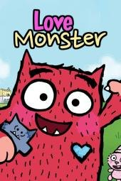
**判断：推荐** · 建议：3+（CSM）

**简介**：文章说这是 BBC 少儿频道的《Love Monster》，中文名《小怪兽阿蒙》，并在标题里写75集、中英文。毛茸茸的小怪兽住在可爱村，一直希望有人喜欢他、陪着他、接受他本来的样子。文章用分食物等很小的事讲爱，没有写数字年龄。

**研判**：独立评测确认以分享、识别情绪与合作为主，只有很轻的害怕表现。可共看后练习表达，但不能把故事当情绪治疗，也不属于文章标题所说的医学或自然科普。

**证据状态**：作品级证据初审；置信度：中。

**视频/官方入口**：[查看官方页](https://www.bbc.co.uk/cbeebies/shows/love-monster)。已核实官方作品页或节目页，不代表能免费播放、包含完整影片或在当前地区可播。

**图片**：独立评测页所标本片海报（版权归原权利人）。 [图源](https://www.commonsensemedia.org/tv-reviews/love-monster)

原文年龄（不是本项目认可结论）：未标明年龄。

**独立依据**：[Common Sense Media](https://www.commonsensemedia.org/tv-reviews/love-monster)

豆瓣评分/人数：未核实；IMDb评分/人数：未核实。公众号里的评分仅为原文说法，不计作已验证数据。

**原文来源**：[文章6](https://mp.weixin.qq.com/s/chL3s5Cy86w0a_Ykz0VNLg)；[文章8](https://mp.weixin.qq.com/s/DcF-aYLjzo5rt263kz0nXQ)；[文章20](https://mp.weixin.qq.com/s/-5VGJkhfqgD0lcveZ1_sbg)

---

## 小鞋子
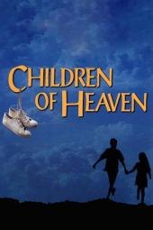
**判断：推荐** · 建议：10+（CSM）

**简介**：文章用一句话推荐，没有写年龄和播放链接。文章写：清贫生活里兄妹互相体谅，想让孩子懂得知足和共情。

**研判**：独立评测肯定亲情、责任与伊朗生活的呈现，风险主要是轻微事故和冲突。字幕、贫困背景与叙事节奏对小孩有门槛，不该用来羞辱孩子“不知足”。

**证据状态**：作品级证据初审；置信度：中。

**视频链接**：未核实正版正片；不以同名页、预告、资源站或HTTP 200冒充可播正片。

**图片**：独立评测页所标本片海报（版权归原权利人）。 [图源](https://www.commonsensemedia.org/movie-reviews/children-of-heaven)

原文年龄（不是本项目认可结论）：未标明年龄。

**独立依据**：[Common Sense Media](https://www.commonsensemedia.org/movie-reviews/children-of-heaven)

豆瓣评分/人数：未核实；IMDb评分/人数：未核实。公众号里的评分仅为原文说法，不计作已验证数据。

**原文来源**：[文章11](https://mp.weixin.qq.com/s/oKG9Fhp_e-YAl2DMdq5_QQ)

---

## 拜见罗宾逊一家 / Meet the Robinsons
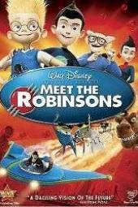
**判断：推荐** · 建议：7+（CSM）

**简介**：文章写孤儿院里的小发明家路易斯为了找母亲造记忆扫描机，被来自未来的威尔伯拉上时光机。金句 Keep moving forward。

**研判**：独立评测支持面对失败继续尝试，但孤儿被拒绝、控制人的机械反派与未来险境可能吓人。可谈收养与多样家庭，不把坚持等同必须成功。

**证据状态**：作品级证据初审；置信度：中。

**视频链接**：未核实正版正片；不以同名页、预告、资源站或HTTP 200冒充可播正片。

**图片**：独立评测页所标本片海报（版权归原权利人）。 [图源](https://www.commonsensemedia.org/movie-reviews/meet-the-robinsons)

原文年龄（不是本项目认可结论）：7岁+。

**独立依据**：[Common Sense Media](https://www.commonsensemedia.org/movie-reviews/meet-the-robinsons)

豆瓣评分/人数：未核实；IMDb评分/人数：未核实。公众号里的评分仅为原文说法，不计作已验证数据。

**原文来源**：[文章27](https://mp.weixin.qq.com/s/5TG375Bph1OhKcTfKC1OMQ)；[文章28](https://mp.weixin.qq.com/s/kx7YqDwvnUhSYTM3Gh1f-Q)

---

## 星际宝贝 / Lilo & Stitch
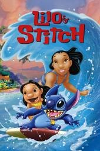
**判断：推荐** · 建议：6+（CSM，2002动画）

**简介**：文章写夏威夷女孩莉萝和姐姐娜妮相依为命，把逃出来的外星实验体当成狗，取名史迪奇，教它的第一个词是家人。金句是 Ohana means family。

**研判**：独立指南支持非血缘家庭与归属主题，也有破坏、追逐、离散和悲伤。明确是2002动画，未把2025真人重拍的评测套过来。

**证据状态**：作品级证据初审；置信度：中。

**视频链接**：未核实正版正片；不以同名页、预告、资源站或HTTP 200冒充可播正片。

**图片**：独立评测页所标本片海报（版权归原权利人）。 [图源](https://www.commonsensemedia.org/movie-reviews/lilo-stitch-0)

原文年龄（不是本项目认可结论）：6岁+。

**独立依据**：[Common Sense Media](https://www.commonsensemedia.org/movie-reviews/lilo-stitch-0)

豆瓣评分/人数：未核实；IMDb评分/人数：未核实。公众号里的评分仅为原文说法，不计作已验证数据。

**原文来源**：[文章27](https://mp.weixin.qq.com/s/5TG375Bph1OhKcTfKC1OMQ)；[文章28](https://mp.weixin.qq.com/s/kx7YqDwvnUhSYTM3Gh1f-Q)

---

## 月神

**判断：推荐** · 建议：4+（编辑暂议；合集CSM4+）

**简介**：文章写豆瓣9.0、适合4岁以上，是皮克斯约7分钟短片。男孩第一次跟爷爷和爸爸到月亮上清扫星辰。爷爷要用耙子，爸爸坚持用扫帚，男孩自己观察，敲开星辰。文章没有写英文名。

**研判**：《月神》可用于讨论代际合作与自己的想法；核实的是包含此片的皮克斯短片合集评测，不是单片年龄认证。已排除同名马来西亚成人喜剧的错误匹配。

**证据状态**：相关合集/App参考，不是单片独立适龄认证；置信度：低至中。

**视频链接**：未核实正版正片；不以同名页、预告、资源站或HTTP 200冒充可播正片。

**图片**：原公众号通用配图／重复封面，不能当本片海报。

原文年龄（不是本项目认可结论）：4岁以上。

**独立依据**：[Common Sense Media](https://www.commonsensemedia.org/movie-reviews/pixar-short-films-collection-volume-2)（含此片的短片合集，不能当单片年龄认证）

豆瓣评分/人数：未核实；IMDb评分/人数：未核实。公众号里的评分仅为原文说法，不计作已验证数据。

**原文来源**：[文章12](https://mp.weixin.qq.com/s/Iy-SwhNQC6IFAAsECwqseQ)

---

## 海兽猎人 / The Sea Beast
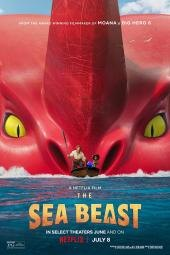
**判断：推荐** · 建议：8+（CSM；非原文7+）

**简介**：文章写孤女梅茜溜上猎兽船，和传说中的大红海兽困在岛上，发现海兽和她听到的故事不一样。金句 Maybe you can be a hero and still be wrong.

**研判**：独立指南肯定质疑偏见、诚信和团队合作，但猎杀巨兽、战斗毁坏和酒精场面较强。应讨论谁定义“怪物”，而不是只接受英雄叙事。

**证据状态**：作品级证据初审；置信度：中。

**视频链接**：未核实正版正片；不以同名页、预告、资源站或HTTP 200冒充可播正片。

**图片**：独立评测页所标本片海报（版权归原权利人）。 [图源](https://www.commonsensemedia.org/movie-reviews/the-sea-beast)

原文年龄（不是本项目认可结论）：7岁+。

**独立依据**：[Common Sense Media](https://www.commonsensemedia.org/movie-reviews/the-sea-beast)

豆瓣评分/人数：未核实；IMDb评分/人数：未核实。公众号里的评分仅为原文说法，不计作已验证数据。

**原文来源**：[文章27](https://mp.weixin.qq.com/s/5TG375Bph1OhKcTfKC1OMQ)

---

## 海洋之歌 / Song of the Sea
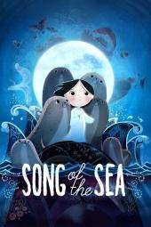
**判断：推荐** · 建议：7+（CSM；非原文6+）

**简介**：文章写爱尔兰灯塔边的兄妹。母亲在妹妹出生那夜回到海里。妹妹是海豹精灵，要找回被父亲扔进海里的海豹皮才能唱歌。文章说难过要留着，不是拿掉。

**研判**：独立指南肯定兄妹合作和接纳悲伤，同时提醒母亲离开、溺水感和惊吓追逐。适合讨论神话与情绪，不是无忧、纯快乐的低龄片。

**证据状态**：作品级证据初审；置信度：中。

**视频链接**：未核实正版正片；不以同名页、预告、资源站或HTTP 200冒充可播正片。

**图片**：独立评测页所标本片海报（版权归原权利人）。 [图源](https://www.commonsensemedia.org/movie-reviews/song-of-the-sea)

原文年龄（不是本项目认可结论）：6岁+。

**独立依据**：[Common Sense Media](https://www.commonsensemedia.org/movie-reviews/song-of-the-sea)

豆瓣评分/人数：未核实；IMDb评分/人数：未核实。公众号里的评分仅为原文说法，不计作已验证数据。

**原文来源**：[文章27](https://mp.weixin.qq.com/s/5TG375Bph1OhKcTfKC1OMQ)；[文章28](https://mp.weixin.qq.com/s/kx7YqDwvnUhSYTM3Gh1f-Q)

---

## 疯狂元素城 / Elemental
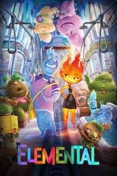
**判断：推荐** · 建议：8+（沿用保守编辑建议；CSM6+）

**简介**：文章写火族姑娘小焰被父亲当接班人，自己喜欢玻璃艺术却不敢说。水族男孩阿波闯进店里。父亲后来说：店从来不是梦想，你才是。

**研判**：独立指南肯定移民家庭、同理心和代际沟通；有险境与浪漫关系。适合讨论刻板印象，但元素拟人不是物理科普，不能拿火水设定解释科学。

**证据状态**：作品级证据初审；置信度：中。

**视频链接**：未核实正版正片；不以同名页、预告、资源站或HTTP 200冒充可播正片。

**图片**：独立评测页所标本片海报（版权归原权利人）。 [图源](https://www.commonsensemedia.org/movie-reviews/elemental)

原文年龄（不是本项目认可结论）：8岁+。

**独立依据**：[Common Sense Media](https://www.commonsensemedia.org/movie-reviews/elemental)

豆瓣评分/人数：未核实；IMDb评分/人数：未核实。公众号里的评分仅为原文说法，不计作已验证数据。

**原文来源**：[文章27](https://mp.weixin.qq.com/s/5TG375Bph1OhKcTfKC1OMQ)

---

## 白日梦想家 / The Secret Life of Walter Mitty
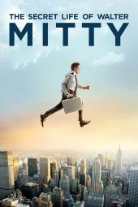
**判断：推荐** · 建议：12+（CSM；非原文10+）

**简介**：文章写豆瓣8.7，并称它是治愈的成人励志片。内向的上班族沃特沉在白日梦里，一张底片失踪后他走出家门。文章没有说它是动画，也没有给英文名。 英文名来自豆瓣该条目的外文名，不是文章原文。

**研判**：独立评测肯定行动与希望，同时有危险幻想、粗口、饮酒及醉酒驾驶直升机等表现。成人职场主线和真人动作不等于儿童英语启蒙片。

**证据状态**：作品级证据初审；置信度：中。

**视频链接**：未核实正版正片；不以同名页、预告、资源站或HTTP 200冒充可播正片。

**图片**：独立评测页所标本片海报（版权归原权利人）。 [图源](https://www.commonsensemedia.org/movie-reviews/the-secret-life-of-walter-mitty)

原文年龄（不是本项目认可结论）：10岁以上。

**独立依据**：[Common Sense Media](https://www.commonsensemedia.org/movie-reviews/the-secret-life-of-walter-mitty)

豆瓣评分/人数：未核实；IMDb评分/人数：未核实。公众号里的评分仅为原文说法，不计作已验证数据。

**原文来源**：[文章24](https://mp.weixin.qq.com/s/emCL8FTZgeWRNQoj8Fki6Q)

---

## 花木兰 / Mulan
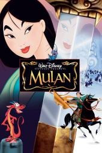
**判断：推荐** · 建议：6+（编辑从严；CSM5+）

**简介**：文章写明是1998年动画版。父亲腿有旧伤，木兰夜里剪发，穿上父亲的盔甲去从军。文章用它谈“我是谁”和“我为谁而做”。

**研判**：独立评测肯定勇气、勤奋与女性主动性，也提醒战争、武器和性别刻板玩笑。是1998迪士尼改编，不等于中国历史或完整传统文化教育。

**证据状态**：作品级证据初审；置信度：中。

**视频链接**：未核实正版正片；不以同名页、预告、资源站或HTTP 200冒充可播正片。

**图片**：独立评测页所标本片海报（版权归原权利人）。 [图源](https://www.commonsensemedia.org/movie-reviews/mulan)

原文年龄（不是本项目认可结论）：6岁+。

**独立依据**：[Common Sense Media](https://www.commonsensemedia.org/movie-reviews/mulan)

豆瓣评分/人数：未核实；IMDb评分/人数：未核实。公众号里的评分仅为原文说法，不计作已验证数据。

**原文来源**：[文章27](https://mp.weixin.qq.com/s/5TG375Bph1OhKcTfKC1OMQ)；[文章28](https://mp.weixin.qq.com/s/kx7YqDwvnUhSYTM3Gh1f-Q)

---

## 记忆中的玛妮
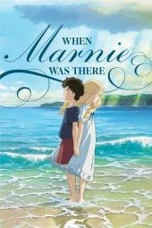
**判断：推荐** · 建议：9+（CSM；非原文8+）

**简介**：文章写豆瓣8.0，吉卜力。社恐的杏奈在乡下遇见金发女孩玛妮，结尾揭开陪伴以另一种方式回来。适合心思敏感的孩子。文章没有给英文名。

**研判**：独立指南支持自我价值与家庭归属的讨论，同时有孤独、自我贬低、惊吓和饮酒等内容。不能凭“画风温柔”忽略心理负荷。

**证据状态**：作品级证据初审；置信度：中。

**视频链接**：未核实正版正片；不以同名页、预告、资源站或HTTP 200冒充可播正片。

**图片**：独立评测页所标本片海报（版权归原权利人）。 [图源](https://www.commonsensemedia.org/movie-reviews/when-marnie-was-there)

原文年龄（不是本项目认可结论）：8岁+。

**独立依据**：[Common Sense Media](https://www.commonsensemedia.org/movie-reviews/when-marnie-was-there)

豆瓣评分/人数：未核实；IMDb评分/人数：未核实。公众号里的评分仅为原文说法，不计作已验证数据。

**原文来源**：[文章26](https://mp.weixin.qq.com/s/FrkyAZYpTEqOreapJ-f3UA)

---

## 青春变形记 / Turning Red
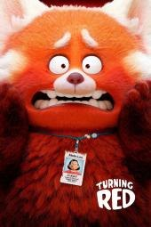
**判断：推荐** · 建议：10+（CSM；非原文7+/9+）

**简介**：13岁的华裔女孩情绪激动时会变成红色小熊猫。文章24把它写成青春期和母女和解。文章27补充这是家族女性代代相传的变化，妈妈后来道歉，女孩选择把熊猫留下来。

**研判**：青春期、月经暗示、同伴关系和亲子边界有讨论价值；不因文化争议一概否定。变身和冲突较强，不是低龄安抚片，原文适龄偏低。

**证据状态**：作品级证据初审；置信度：中。

**视频链接**：未核实正版正片；不以同名页、预告、资源站或HTTP 200冒充可播正片。

**图片**：独立评测页所标本片海报（版权归原权利人）。 [图源](https://www.commonsensemedia.org/movie-reviews/turning-red)

原文年龄（不是本项目认可结论）：文章24写7岁以上；文章27写9岁+。

**独立依据**：[Common Sense Media](https://www.commonsensemedia.org/movie-reviews/turning-red)

豆瓣评分/人数：未核实；IMDb评分/人数：未核实。公众号里的评分仅为原文说法，不计作已验证数据。

**原文来源**：[文章24](https://mp.weixin.qq.com/s/emCL8FTZgeWRNQoj8Fki6Q)；[文章27](https://mp.weixin.qq.com/s/5TG375Bph1OhKcTfKC1OMQ)；[文章28](https://mp.weixin.qq.com/s/kx7YqDwvnUhSYTM3Gh1f-Q)

---

## 马茹娜的非凡旅程 / L'extraordinaire voyage de Marona
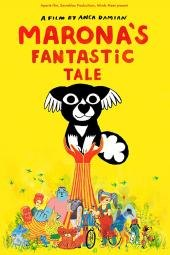
**判断：推荐** · 建议：10+（CSM；非原文7+）

**简介**：文章写豆瓣8.6。小狗被马戏团小丑、建筑工人和独居老人先后捡到又遗弃，仍然相信人。文章没有给英文名。 英文名来自豆瓣该条目的外文名，不是文章原文。

**研判**：独立指南肯定对动物关系的温柔哲学表达，也强调开场车祸、临终回忆和被遗弃带来的悲伤。爱宠或经历丧失的孩子应先由成人判断，不作为无负担治愈片。

**证据状态**：作品级证据初审；置信度：中。

**视频链接**：未核实正版正片；不以同名页、预告、资源站或HTTP 200冒充可播正片。

**图片**：独立评测页所标本片海报（版权归原权利人）。 [图源](https://www.commonsensemedia.org/movie-reviews/maronas-fantastic-tale)

原文年龄（不是本项目认可结论）：7岁+。

**独立依据**：[Common Sense Media](https://www.commonsensemedia.org/movie-reviews/maronas-fantastic-tale)

豆瓣评分/人数：未核实；IMDb评分/人数：未核实。公众号里的评分仅为原文说法，不计作已验证数据。

**原文来源**：[文章26](https://mp.weixin.qq.com/s/FrkyAZYpTEqOreapJ-f3UA)

---

## 驯龙高手 / How to Train Your Dragon
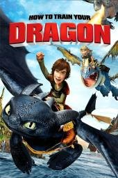
**判断：推荐** · 建议：6+（CSM；敏感儿童可后移）

**简介**：文章说孩子在趣配音里看了片段后想把整部电影看完，正文介绍的就是这一部。维京部落世世代代把龙当敌人。首领的儿子 Hiccup 瘦弱，不像其他维京人。他遇见罕见的夜煞 Night Fury，给它取名 Toothless。两人从互相试探到互相信任，Hiccup 拒绝再屠龙，最后和 Toothless 一起对付真正的威胁。文章写电影和原著不完全对应。同页还介绍了 Cressida Cowell 的同名书，那是书，不是视频。文章没有写具体岁数。

**研判**：独立评测肯定同理心、合作和反对盲目敌对的主题；龙战斗、火焰及伤残仍有强度。已确认2010动画，不混用2025真人重拍的页面或评分。

**证据状态**：作品级证据初审；置信度：中。

**视频链接**：未核实正版正片；不以同名页、预告、资源站或HTTP 200冒充可播正片。

**图片**：独立评测页所标本片海报（版权归原权利人）。 [图源](https://www.commonsensemedia.org/movie-reviews/how-to-train-your-dragon)

原文年龄（不是本项目认可结论）：未标明年龄。

**独立依据**：[Common Sense Media](https://www.commonsensemedia.org/movie-reviews/how-to-train-your-dragon)

豆瓣评分/人数：未核实；IMDb评分/人数：未核实。公众号里的评分仅为原文说法，不计作已验证数据。

**原文来源**：[文章22](https://mp.weixin.qq.com/s/1zcUZOanOLPia36GlVYinA)；[文章28](https://mp.weixin.qq.com/s/kx7YqDwvnUhSYTM3Gh1f-Q)

---

## 魔弦传说 / Kubo and the Two Strings
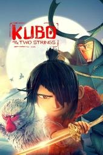
**判断：推荐** · 建议：9+（CSM；非原文8+）

**简介**：文章写独眼男孩库博用琴和会动的纸片在集市说书，天黑前必须回家。母亲被击倒后，他和会说话的猴子、甲虫去找父亲留下的盔甲。定格动画。

**研判**：独立评测认可亲情、记忆与讲故事的力量，同时明确人物死亡、村落焚毁和强烈惊吓。审美成就不抵消内容强度，低龄或敏感儿童宜延后。

**证据状态**：作品级证据初审；置信度：中。

**视频链接**：未核实正版正片；不以同名页、预告、资源站或HTTP 200冒充可播正片。

**图片**：独立评测页所标本片海报（版权归原权利人）。 [图源](https://www.commonsensemedia.org/movie-reviews/kubo-and-the-two-strings)

原文年龄（不是本项目认可结论）：8岁+。

**独立依据**：[Common Sense Media](https://www.commonsensemedia.org/movie-reviews/kubo-and-the-two-strings)

豆瓣评分/人数：未核实；IMDb评分/人数：未核实。公众号里的评分仅为原文说法，不计作已验证数据。

**原文来源**：[文章27](https://mp.weixin.qq.com/s/5TG375Bph1OhKcTfKC1OMQ)；[文章28](https://mp.weixin.qq.com/s/kx7YqDwvnUhSYTM3Gh1f-Q)

---

## 伦敦一家人 / Ethel & Ernest
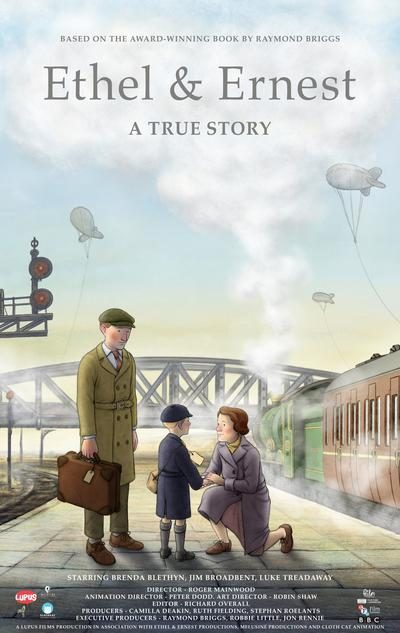
**判断：有保留** · 建议：10+（编辑暂议；原文7+需谨慎）

**简介**：文章写豆瓣8.8，手绘水彩。1928年一个女仆和一个送奶工一见钟情，后来躲空袭、等儿子回家。台词来自作者父母说过的话，片尾有他们的照片。 英文名来自豆瓣该条目的外文名，不是文章原文。

**研判**：BBFC确认有空袭威胁、性暗示、粗口、重病与丧亲，也涉及旧时偏见。平静画风不等于只讲琐碎日常；成人历史背景较重，适龄需个别判断。

**证据状态**：作品级证据初审；置信度：中。

**视频链接**：未核实正版正片；不以同名页、预告、资源站或HTTP 200冒充可播正片。

**图片**：原库图片（来源说明保留，非本轮逐张鉴定）。

原文年龄（不是本项目认可结论）：7岁+。

**独立依据**：[BBFC 内容指南](https://www.bbfc.co.uk/release/ethel-ernest-q29sbgvjdglvbjpwwc00mzqxota)

豆瓣评分/人数：未核实；IMDb评分/人数：未核实。公众号里的评分仅为原文说法，不计作已验证数据。

**原文来源**：[文章26](https://mp.weixin.qq.com/s/FrkyAZYpTEqOreapJ-f3UA)

---

## 午后时光
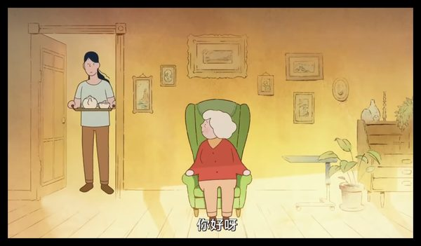
**判断：有保留** · 建议：成人先看／未核实

**简介**：文章说这是一部约9分钟、几乎没有对白的动画。穿红衣服的老奶奶在客厅喝下午茶，她患有阿尔茨海默症，不断掉进回忆：海边的父亲、少女时代的朋友、热恋、有了女儿。结尾她想起照顾自己的人就是女儿，两人相拥。文章特别写到回忆中的老奶奶没有脖子，用来表现记忆和身体的连接断了。没有写年龄和英文名。

**研判**：原文讨论父母、记忆与人生的价值不等于适合幼儿。缺乏独立儿童分龄，需核对是否为2017年Late Afternoon及其认知衰退、失落主题。

**证据状态**：证据不足，编辑保守初筛；置信度：低。

**视频链接**：未核实正版正片；不以同名页、预告、资源站或HTTP 200冒充可播正片。

**图片**：原公众号通用配图／重复封面，不能当本片海报。

原文年龄（不是本项目认可结论）：未标明年龄。

**独立依据**：未取得作品级独立证据；此条不是正向推荐。

豆瓣评分/人数：未核实；IMDb评分/人数：未核实。公众号里的评分仅为原文说法，不计作已验证数据。

**原文来源**：[文章21](https://mp.weixin.qq.com/s/ggJPptYppMBlsS4ui7jsqw)

---

## 反叛的童谣 / Revolting Rhymes
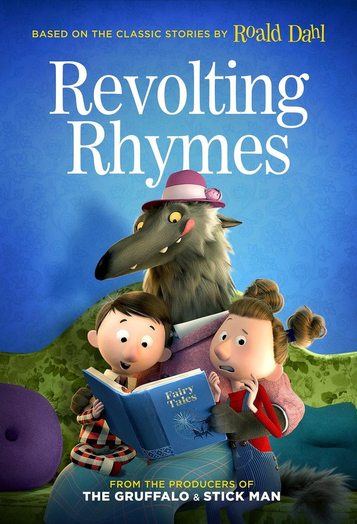
**判断：有保留** · 建议：8+仅为原文建议，独立年龄未核实

**简介**：文章写豆瓣8.7，英国动画，约57分钟，奥斯卡提名。把《小红帽》《白雪公主》《灰姑娘》揉碎重讲。这三则是片中的童话，不是另外三部片子。文章没有给英文名。 英文名来自豆瓣该条目的外文名，不是文章原文。

**研判**：原文自己提到枪和赌场，却又笼统称不黑暗；不能只因童话和奥斯卡提名便降龄。上下两部分和短片版本需区分，黑色幽默与暴力强度待独立核验。

**证据状态**：证据不足，编辑保守初筛；置信度：低。

**视频链接**：未核实正版正片；不以同名页、预告、资源站或HTTP 200冒充可播正片。

**图片**：原库图片（来源说明保留，非本轮逐张鉴定）。

原文年龄（不是本项目认可结论）：8岁+。

**独立依据**：未取得作品级独立证据；此条不是正向推荐。

豆瓣评分/人数：未核实；IMDb评分/人数：未核实。公众号里的评分仅为原文说法，不计作已验证数据。

**原文来源**：[文章26](https://mp.weixin.qq.com/s/FrkyAZYpTEqOreapJ-f3UA)；[文章28](https://mp.weixin.qq.com/s/kx7YqDwvnUhSYTM3Gh1f-Q)

---

## 听见天堂
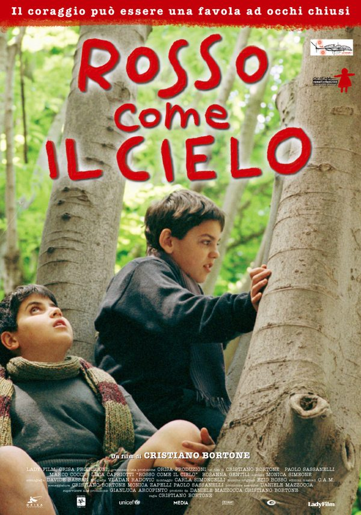
**判断：有保留** · 建议：未核实

**简介**：文章用一句话推荐，没有写年龄和播放链接。文章写：生活有缺憾，仍然可以用心感受世界。文章没有写这是哪一版电影的英文名。

**研判**：需先锁定意大利《Red Like the Sky》的版本并取得独立儿童评测。残障经验值得理解，但创伤场景和成人压迫不宜因励志标签忽略。

**证据状态**：证据不足，编辑保守初筛；置信度：低。

**视频链接**：未核实正版正片；不以同名页、预告、资源站或HTTP 200冒充可播正片。

**图片**：原库图片（来源说明保留，非本轮逐张鉴定）。

原文年龄（不是本项目认可结论）：未标明年龄。

**独立依据**：未取得作品级独立证据；此条不是正向推荐。

豆瓣评分/人数：未核实；IMDb评分/人数：未核实。公众号里的评分仅为原文说法，不计作已验证数据。

**原文来源**：[文章11](https://mp.weixin.qq.com/s/oKG9Fhp_e-YAl2DMdq5_QQ)

---

## 地球上的星星
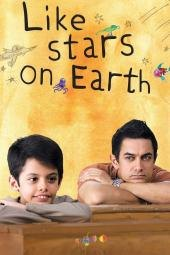
**判断：有保留** · 建议：13+（CSM）

**简介**：文章用一句话推荐，没有写年龄和播放链接。文章写：每个孩子都是不一样的星星，不必跟风比较。

**研判**：对读写困难的同理心值得家长学习，但独立指南提醒体罚、羞辱和儿童自杀念头。主角8岁不等于受众8岁；不宜作为低龄“励志教育”直接播放。

**证据状态**：作品级证据初审；置信度：中。

**视频链接**：未核实正版正片；不以同名页、预告、资源站或HTTP 200冒充可播正片。

**图片**：独立评测页所标本片海报（版权归原权利人）。 [图源](https://www.commonsensemedia.org/movie-reviews/taare-zameen-par)

原文年龄（不是本项目认可结论）：未标明年龄。

**独立依据**：[Common Sense Media](https://www.commonsensemedia.org/movie-reviews/taare-zameen-par)

豆瓣评分/人数：未核实；IMDb评分/人数：未核实。公众号里的评分仅为原文说法，不计作已验证数据。

**原文来源**：[文章11](https://mp.weixin.qq.com/s/oKG9Fhp_e-YAl2DMdq5_QQ)

---

## 大卫·科波菲尔

**判断：有保留** · 建议：未核实

**简介**：文章用一句话推荐，没有写年龄和播放链接。文章写：生活有风雨，本心不能丢。文章没有写是哪一个改编版本。

**研判**：多次影视改编年代、长度和强度不同，目前无法锁定文章说的版本。儿童劳动、虐待和困境不能仅因原著是名著便判为低龄优质。

**证据状态**：证据不足，编辑保守初筛；置信度：低。

**视频链接**：未核实正版正片；不以同名页、预告、资源站或HTTP 200冒充可播正片。

**图片**：原库图片（来源说明保留，非本轮逐张鉴定）。

原文年龄（不是本项目认可结论）：未标明年龄。

**独立依据**：未取得作品级独立证据；此条不是正向推荐。

豆瓣评分/人数：未核实；IMDb评分/人数：未核实。公众号里的评分仅为原文说法，不计作已验证数据。

**原文来源**：[文章11](https://mp.weixin.qq.com/s/oKG9Fhp_e-YAl2DMdq5_QQ)

---

## 天堂电影院
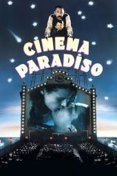
**判断：有保留** · 建议：14+（CSM；还须区分剪辑版）

**简介**：文章用一句话推荐，没有写年龄和播放链接。文章写：童年的光会照亮以后的路。

**研判**：电影史与忘年友情值得讨论，但独立指南有裸露、青少年性行为暗示、吸烟和烧伤。院线版与加长版有差别，不得以“成长电影”一概推给儿童。

**证据状态**：作品级证据初审；置信度：中。

**视频链接**：未核实正版正片；不以同名页、预告、资源站或HTTP 200冒充可播正片。

**图片**：独立评测页所标本片海报（版权归原权利人）。 [图源](https://www.commonsensemedia.org/movie-reviews/cinema-paradiso)

原文年龄（不是本项目认可结论）：未标明年龄。

**独立依据**：[Common Sense Media](https://www.commonsensemedia.org/movie-reviews/cinema-paradiso)

豆瓣评分/人数：未核实；IMDb评分/人数：未核实。公众号里的评分仅为原文说法，不计作已验证数据。

**原文来源**：[文章11](https://mp.weixin.qq.com/s/oKG9Fhp_e-YAl2DMdq5_QQ)

---

## 失物招领

**判断：有保留** · 建议：未核实

**简介**：文章写豆瓣8.4、适合5岁以上。失物招领箱里的小精灵发现爱欺负人的男孩 JJ 自己的东西也曾被抢走，于是帮他把抢走的东西还回去，并找回毛绒玩具。文章没有英文名。

**研判**：先确认是否为Shaun Tan《The Lost Thing》，而非同名寻物短片。疏离与归属主题有讨论潜力，不能只凭“失物招领”片名给5岁以上普推。

**证据状态**：证据不足，编辑保守初筛；置信度：低。

**视频链接**：未核实正版正片；不以同名页、预告、资源站或HTTP 200冒充可播正片。

**图片**：原公众号通用配图／重复封面，不能当本片海报。

原文年龄（不是本项目认可结论）：5岁以上。

**独立依据**：未取得作品级独立证据；此条不是正向推荐。

豆瓣评分/人数：未核实；IMDb评分/人数：未核实。公众号里的评分仅为原文说法，不计作已验证数据。

**原文来源**：[文章12](https://mp.weixin.qq.com/s/Iy-SwhNQC6IFAAsECwqseQ)

---

## 姆明山谷 / Moominvalley
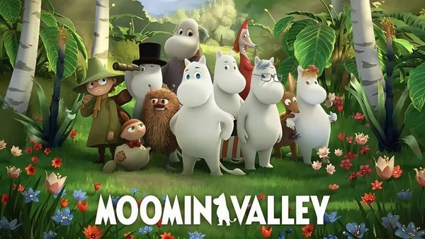
**判断：有保留** · 建议：未核实

**简介**：文章推荐的是芬兰动画《姆明山谷》，并写豆瓣9.3。它说新版一共三季、每季13集、每集22分钟，讲害羞的白色小精灵姆明和家人、朋友在山谷里过日子，没有打打杀杀。姆明官网写这部剧由托芙·扬松的故事改编，第一季2019年播出。文章说成片是英文字幕，没有写明确年龄。

**研判**：不能把姆明这一品牌、不同年代改编与某一季的高分混用。暂缺与此版对应的独立适龄和内容评测，不因“治愈”文案自动升级。

**证据状态**：证据不足，编辑保守初筛；置信度：低。

**视频/官方入口**：[查看官方页](https://www.moomin.com/en/moominvalley/)。已核实官方作品页或节目页，不代表能免费播放、包含完整影片或在当前地区可播。

**图片**：原库图片（来源说明保留，非本轮逐张鉴定）。

原文年龄（不是本项目认可结论）：未标明年龄。

**独立依据**：未取得作品级独立证据；此条不是正向推荐。

豆瓣评分/人数：未核实；IMDb评分/人数：未核实。公众号里的评分仅为原文说法，不计作已验证数据。

**原文来源**：[文章4](https://mp.weixin.qq.com/s/nVy3SrmgSITwT-6pOLgruA)

---

## 尽管我们的手中空无一物

**判断：有保留** · 建议：未核实

**简介**：文章介绍的短片：小羊去世后在去天堂的路上排队，过天河时身上的东西都会消失。它剃掉羊毛搓成绳子逃回家，又被狼守卫抓回去。羊妈妈一直在屋外织毛衣。结尾是狼守卫顺着绳子把毛衣送到小羊身边，绳子化作满天繁星。文章说它表面上讲死亡，落点是爱。没有写年龄，也没有英文名。

**研判**：涉及丧失与死亡，不能因温暖画风就视为普适死亡教育。尚未核实准确制作版本、独立分龄与儿童理解情况；亲历丧亲的孩子尤其需成人判断。

**证据状态**：证据不足，编辑保守初筛；置信度：低。

**视频链接**：未核实正版正片；不以同名页、预告、资源站或HTTP 200冒充可播正片。

**图片**：原公众号通用配图／重复封面，不能当本片海报。

原文年龄（不是本项目认可结论）：未标明年龄。

**独立依据**：未取得作品级独立证据；此条不是正向推荐。

豆瓣评分/人数：未核实；IMDb评分/人数：未核实。公众号里的评分仅为原文说法，不计作已验证数据。

**原文来源**：[文章9](https://mp.weixin.qq.com/s/llZzyHjpLUUGo9Nb-N6Kkw)；[文章21](https://mp.weixin.qq.com/s/ggJPptYppMBlsS4ui7jsqw)

---

## 悠悠长假
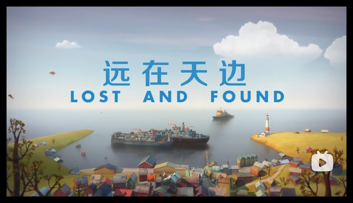
**判断：有保留** · 建议：未核实

**简介**：只在《远在天边》文末被点名。原文写豆瓣9.5，画风明媚，并说它让孩子想到生活在和平环境里。没有年龄和链接。

**研判**：文章的长假故事需要核实具体作品与战争背景。题材若涉及战乱，必须先看儿童受威胁和死亡强度；当前不足以普推。

**证据状态**：证据不足，编辑保守初筛；置信度：低。

**视频链接**：未核实正版正片；不以同名页、预告、资源站或HTTP 200冒充可播正片。

**图片**：原公众号通用配图／重复封面，不能当本片海报。

原文年龄（不是本项目认可结论）：未标明年龄。

**独立依据**：未取得作品级独立证据；此条不是正向推荐。

豆瓣评分/人数：未核实；IMDb评分/人数：未核实。公众号里的评分仅为原文说法，不计作已验证数据。

**原文来源**：[文章15](https://mp.weixin.qq.com/s/mLsTKPOHMdEYURdaalx2HQ)

---

## 我住在凡尔赛的日子 / La vie de château - Mon enfance à Versailles

**判断：有保留** · 建议：未核实；原文8+未采纳为权威年龄

**简介**：文章写豆瓣8.2。8岁的维奥丽特失去父母，投奔在凡尔赛宫做维修的孤僻舅舅。法式水彩。提名法国凯撒奖最佳动画片。文章没有给英文名。 英文名来自豆瓣该条目的外文名，不是文章原文。

**研判**：需区分2019短片和2025长片/系列；中文名和法文副标题不足以完成版本核验。丧亲及可能的恐袭背景需独立确认，不能只按凡尔赛冒险宣传。

**证据状态**：证据不足，编辑保守初筛；置信度：低。

**视频链接**：未核实正版正片；不以同名页、预告、资源站或HTTP 200冒充可播正片。

**图片**：原库图片（来源说明保留，非本轮逐张鉴定）。

原文年龄（不是本项目认可结论）：8岁+。

**独立依据**：未取得作品级独立证据；此条不是正向推荐。

豆瓣评分/人数：未核实；IMDb评分/人数：未核实。公众号里的评分仅为原文说法，不计作已验证数据。

**原文来源**：[文章26](https://mp.weixin.qq.com/s/FrkyAZYpTEqOreapJ-f3UA)

---

## 放牛班的春天
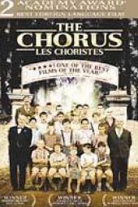
**判断：有保留** · 建议：14+（CSM）

**简介**：文章用一句话推荐，没有写年龄和播放链接。文章写：没有真正的坏孩子，只有需要被看见的孩子。

**研判**：音乐与关怀有价值，独立指南同时指出体罚、禁闭、性暗示歌曲、吸烟和偷窃。温暖结局不能抵消这些内容，适合年长青少年在背景讨论中观看。

**证据状态**：作品级证据初审；置信度：中。

**视频链接**：未核实正版正片；不以同名页、预告、资源站或HTTP 200冒充可播正片。

**图片**：独立评测页所标本片海报（版权归原权利人）。 [图源](https://www.commonsensemedia.org/movie-reviews/the-chorus)

原文年龄（不是本项目认可结论）：未标明年龄。

**独立依据**：[Common Sense Media](https://www.commonsensemedia.org/movie-reviews/the-chorus)

豆瓣评分/人数：未核实；IMDb评分/人数：未核实。公众号里的评分仅为原文说法，不计作已验证数据。

**原文来源**：[文章11](https://mp.weixin.qq.com/s/oKG9Fhp_e-YAl2DMdq5_QQ)

---

## 朝花夕誓
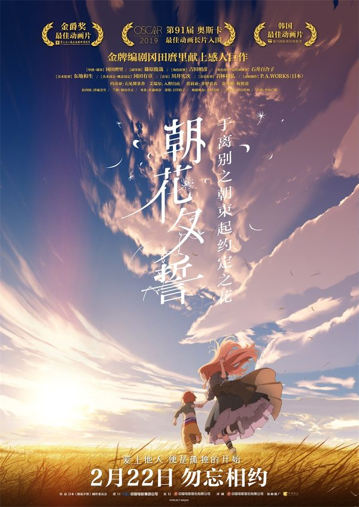
**判断：有保留** · 建议：13+（编辑暂议；非原文9+）

**简介**：文章写豆瓣7.3。寿命很长的少女玛奇亚在战乱中捡到婴儿，孩子会长大变老，她的样子却不变。文章用它讲陪伴、守护和放手，并引了“是你教会了我什么是爱”。没有给英文名。

**研判**：独立影评与家长指南指向战争、血腥危险、被迫婚育及长期离别；母爱主题不自动适合儿童。未核实权威统一年龄，13+只是保守编辑建议。

**证据状态**：作品级证据初审；置信度：中。

**视频链接**：未核实正版正片；不以同名页、预告、资源站或HTTP 200冒充可播正片。

**图片**：原库图片（来源说明保留，非本轮逐张鉴定）。

原文年龄（不是本项目认可结论）：9岁以上。

**独立依据**：[IMDb Parents Guide（搜索结果）](https://www.imdb.com/title/tt7339826/parentalguide/)；[Variety 独立影评](https://variety.com/2018/film/reviews/maquia-when-the-promised-flower-blooms-review-1202879491/)

豆瓣评分/人数：未核实；IMDb评分/人数：未核实。公众号里的评分仅为原文说法，不计作已验证数据。

**原文来源**：[文章24](https://mp.weixin.qq.com/s/emCL8FTZgeWRNQoj8Fki6Q)

---

## 洞穴

**判断：有保留** · 建议：未核实

**简介**：文章写豆瓣8.8、适合4岁以上，是皮克斯短片。怕社交的小兔子往地下挖洞，挖穿了鼹鼠、老鼠和蚂蚁的家，最后遇到麻烦才向邻居求助，大家一起把洞穴重建好。文章没有英文名。

**研判**：应核实是否为皮克斯Burrow；借助别人不等于必须放弃边界。当前缺少此单片的独立分龄证据，不沿用文章“4+”作权威结论。

**证据状态**：证据不足，编辑保守初筛；置信度：低。

**视频链接**：未核实正版正片；不以同名页、预告、资源站或HTTP 200冒充可播正片。

**图片**：原公众号通用配图／重复封面，不能当本片海报。

原文年龄（不是本项目认可结论）：4岁以上。

**独立依据**：未取得作品级独立证据；此条不是正向推荐。

豆瓣评分/人数：未核实；IMDb评分/人数：未核实。公众号里的评分仅为原文说法，不计作已验证数据。

**原文来源**：[文章12](https://mp.weixin.qq.com/s/Iy-SwhNQC6IFAAsECwqseQ)

---

## 超级肥皂

**判断：有保留** · 建议：未核实

**简介**：只在《午后时光》文末作为往期出现。原文写：40年前的国产动画，讲消费主义、营销套路和群体盲从。没有链接。

**研判**：需确认原作年份和作者，不能把超现实隐喻自动解释为儿童品格课。还应检查是否存在物化他人或消费主义等需要讨论的表达。

**证据状态**：证据不足，编辑保守初筛；置信度：低。

**视频链接**：未核实正版正片；不以同名页、预告、资源站或HTTP 200冒充可播正片。

**图片**：原公众号通用配图／重复封面，不能当本片海报。

原文年龄（不是本项目认可结论）：未标明年龄。

**独立依据**：未取得作品级独立证据；此条不是正向推荐。

豆瓣评分/人数：未核实；IMDb评分/人数：未核实。公众号里的评分仅为原文说法，不计作已验证数据。

**原文来源**：[文章21](https://mp.weixin.qq.com/s/ggJPptYppMBlsS4ui7jsqw)

---

## 逃跑机器人
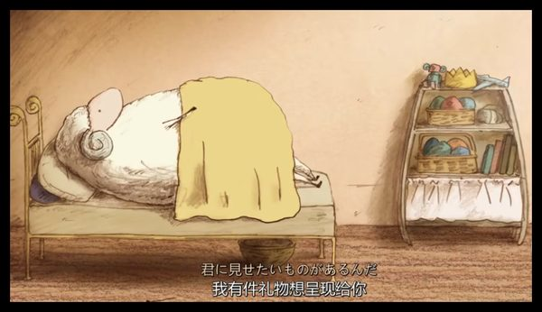
**判断：有保留** · 建议：未核实

**简介**：只在《尽管我们的手中空无一物》文末被点名。原文说它改编自国际大奖小说，并写到和平与两难时的抉择。没有年龄、集数和链接。

**研判**：同名短片与网络二创易混淆；准确版本、创作来源及危险行为尚未独立核验，不能据文章情感解读判断儿童适合度。

**证据状态**：证据不足，编辑保守初筛；置信度：低。

**视频链接**：未核实正版正片；不以同名页、预告、资源站或HTTP 200冒充可播正片。

**图片**：原公众号通用配图／重复封面，不能当本片海报。

原文年龄（不是本项目认可结论）：未标明年龄。

**独立依据**：未取得作品级独立证据；此条不是正向推荐。

豆瓣评分/人数：未核实；IMDb评分/人数：未核实。公众号里的评分仅为原文说法，不计作已验证数据。

**原文来源**：[文章9](https://mp.weixin.qq.com/s/llZzyHjpLUUGo9Nb-N6Kkw)

---

## 雨后

**判断：有保留** · 建议：未核实

**简介**：只在《午后时光》文末作为往期出现。原文写：法国获奖动画，关于自然循环、责任与传承。没有链接。

**研判**：“雨后”重名很多，尚无可靠作品身份与独立分龄。图片重复使用文章封面也不能证明找对了短片，暂不列入优选。

**证据状态**：证据不足，编辑保守初筛；置信度：低。

**视频链接**：未核实正版正片；不以同名页、预告、资源站或HTTP 200冒充可播正片。

**图片**：原公众号通用配图／重复封面，不能当本片海报。

原文年龄（不是本项目认可结论）：未标明年龄。

**独立依据**：未取得作品级独立证据；此条不是正向推荐。

豆瓣评分/人数：未核实；IMDb评分/人数：未核实。公众号里的评分仅为原文说法，不计作已验证数据。

**原文来源**：[文章21](https://mp.weixin.qq.com/s/ggJPptYppMBlsS4ui7jsqw)

---
