# 情感品格类

<!-- Generated by scripts/render_wechat_tables.py; edit data/catalog.json instead. -->

[返回首页](../../README.md) · [审核方法](review-method.md) · [不推荐](not-recommended.md) · [文章28待核验](pending-article-28.md)

本页 52 条，按强烈推荐→推荐→有保留排序。**有保留不等于推荐；年龄不等于听力难度；图片不证明适龄。**

每行一部，名称下的文章编号或“全网检索”链接到来源。适龄为审核建议；折叠的“原文说法”不代表采信。缩略图可点开放大，图下注明海报、旧图或文字封面；长简介可展开。

未注明已核实的豆瓣/IMDb评分和人数一律视为未核实；公众号评分不作独立证据。独立评测不等于教育效果证明，相关App/合集也不是单片认证。视频列仅保留官方入口等已记录地址，**不代表免费、完整或当地可播正片**；候选地址不展示。完整字段见[主目录数据](../../data/catalog.json)。

| 图片 | 名称 | 判断 | 适龄 | 简介 | 研判 | 证据状态 | 视频链接 |
| --- | --- | --- | --- | --- | --- | --- | --- |
| <a href="../../images/review/web-arthur.jpg">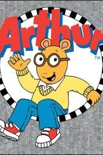</a> [评测页海报](<https://www.commonsensemedia.org/tv-reviews/arthur>) | 亚瑟 Arthur [全网检索](<https://pbskids.org/arthur>) | 强烈推荐 | 5+（CSM） 

原文说法
非公众号来源；适龄以本轮独立评测或官方栏目定位为准
 | PBS长期动画，改编自马克·布朗绘本，用小学生亚瑟和朋友、妹妹的日常讨论友谊、不安和家庭矛盾。可从PBS KIDS官方节目页进入。CSM评5+、编辑5/5。此次为2026年11月全网检索收录。 | CSM编辑5/5、评5+，评测页标注Common Sense Selection，认为其社交课题比多数卡通更具体，5岁以上更能理解。兄妹争吵有时会显得真实而吵闹，需要成人帮助讨论，而不是回避。不能因为画风可爱就降到学前最小龄。 | 作品级证据初审 置信度：中 [Common Sense Media](<https://www.commonsensemedia.org/tv-reviews/arthur>) | [官方入口（非已验证正片）](<https://pbskids.org/arthur>) |
| <a href="../../images/review/web-daniel-tiger.jpg">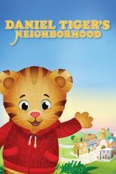</a> [评测页海报](<https://www.commonsensemedia.org/tv-reviews/daniel-tigers-neighborhood>) | 小老虎丹尼尔 Daniel Tiger&#x27;s Neighborhood [全网检索](<https://pbskids.org/daniel>) | 强烈推荐 | 3+（CSM；需共看练习） 

原文说法
非公众号来源；适龄以本轮独立评测或官方栏目定位为准
 | 

弗雷德·罗杰斯公司出品，把《罗杰斯先生的邻居》的温和社交策略做成学前动画，用短歌帮助孩子处理情绪和日常挑战。可从PBS KIDS官方节目页进入。CSM评3+、编…（展开）
弗雷德·罗杰斯公司出品，把《罗杰斯先生的邻居》的温和社交策略做成学前动画，用短歌帮助孩子处理情绪和日常挑战。可从PBS KIDS官方节目页进入。CSM评3+、编辑5/5。此次为2026年11月全网检索收录。
 | CSM编辑5/5、评3+，评测页标注Common Sense Selection，肯定其继承罗杰斯式的社交策略。价值主要在共看后一起练习那些短歌和说法，而不是把动画当情绪问题的自动治疗。有些集涉及打针、分离等真实压力，仍需成人在场。 | 作品级证据初审 置信度：中 [Common Sense Media](<https://www.commonsensemedia.org/tv-reviews/daniel-tigers-neighborhood>) | [官方入口（非已验证正片）](<https://pbskids.org/daniel>) |
|  [评测页海报](<https://www.commonsensemedia.org/tv-reviews/bluey>) | 布鲁伊 Bluey [文章23](<https://mp.weixin.qq.com/s/B2loD1DLgD3WS77WM1XkqQ>) · [全网检索](<https://github.com/iamorangedad/kids-video-picks/blob/main/docs/web-search-sources.md>) | 强烈推荐 | 4+（CSM；不因妹妹爱看降到2岁） 

原文说法
6岁，文章写两岁妹妹看画面也乐
 | 文章说豆瓣9.8，每集7分钟，讲澳洲一家四口怎么玩。作者认为它不是教英语的，而是教家长跟孩子玩什么，看完可以照着做亲子游戏。家里目前中文看得多，英文跟不上。 | 独立评测肯定想象游戏、耐心和支持性亲子关系。它不是STEM或系统英语课程，英语难度与适龄是两回事；看后一起玩，比连刷更符合其长处。 | 作品级证据初审 置信度：中 [Common Sense Media](<https://www.commonsensemedia.org/tv-reviews/bluey>) | [官方入口（非已验证正片）](<https://www.bluey.tv/>) |
| <a href="../../images/review/web-mister-rogers.jpg">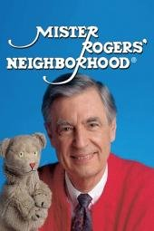</a> [评测页海报](<https://www.commonsensemedia.org/tv-reviews/mister-rogers-neighborhood>) | 罗杰斯先生的邻居 Mister Rogers&#x27; Neighborhood [全网检索](<https://www.misterrogers.org/>) | 强烈推荐 | 3+（CSM） 

原文说法
非公众号来源；适龄以本轮独立评测或官方栏目定位为准
 | 

1960年代起播出的经典儿童节目，用谈话、音乐和装扮剧场讨论尊重、诚实和自我价值。已核实官方网站可打开，站点写明现在也可在YouTube观看。CSM评3+、编辑…（展开）
1960年代起播出的经典儿童节目，用谈话、音乐和装扮剧场讨论尊重、诚实和自我价值。已核实官方网站可打开，站点写明现在也可在YouTube观看。CSM评3+、编辑5/5。此次为2026年11月全网检索收录。
 | CSM编辑5/5、评3+，评测页标注Common Sense Selection，肯定其关于责任、尊重和自尊的信息今天仍然成立。节奏慢、谈话多，对习惯快节奏剪辑的孩子可能需要适应，这不是缺点。官网入口不等于已在本机实测完整正片。 | 作品级证据初审 置信度：中 [Common Sense Media](<https://www.commonsensemedia.org/tv-reviews/mister-rogers-neighborhood>) | [官方入口（非已验证正片）](<https://www.misterrogers.org/>) |
|  [评测页海报](<https://www.commonsensemedia.org/movie-reviews/the-wild-robot>) | 荒野机器人 The Wild Robot [文章27](<https://mp.weixin.qq.com/s/5TG375Bph1OhKcTfKC1OMQ>) · [文章28](<https://mp.weixin.qq.com/s/kx7YqDwvnUhSYTM3Gh1f-Q>) | 强烈推荐 | 8+（CSM；非原文7+） 

原文说法
7岁+
 | 文章写机器人罗兹漂到荒岛，意外成了一只小雁的妈妈，要在秋天前教会它飞。她没有“当妈妈的程序”，是硬着头皮学会的。 | 独立评测肯定照料、合作与适应环境，也记录动物死亡、捕食和大规模动作险境。情感表达扎实，推荐共看，但不能把故事等同准确的野生动物行为教程。 | 作品级证据初审 置信度：中 [Common Sense Media](<https://www.commonsensemedia.org/movie-reviews/the-wild-robot>) | 未核实正版正片 |
|  [评测页海报](<https://www.commonsensemedia.org/movie-reviews/lost-and-found>) | 远在天边 [文章15](<https://mp.weixin.qq.com/s/mLsTKPOHMdEYURdaalx2HQ>) · [文章9](<https://mp.weixin.qq.com/s/llZzyHjpLUUGo9Nb-N6Kkw>) · [文章21](<https://mp.weixin.qq.com/s/ggJPptYppMBlsS4ui7jsqw>) | 强烈推荐 | 3+（CSM） 

原文说法
未标明年龄
 | 

文章说这是一个小男孩送企鹅回家的短片。男孩独自住在港口小镇，企鹅敲门而入。他起初厌烦，想把企鹅送到失物招领处或丢在宠物店，最后还是划船送它回南极。暴风雨里两人互…（展开）
文章说这是一个小男孩送企鹅回家的短片。男孩独自住在港口小镇，企鹅敲门而入。他起初厌烦，想把企鹅送到失物招领处或丢在宠物店，最后还是划船送它回南极。暴风雨里两人互相救援；章鱼没有攻击他们，只把行李放回船上，并把船推向企鹅的家。文章没有写年龄和英文名。另一篇在文末也点了这个名字。
 | 独立评测确认是Oliver Jeffers绘本改编的短片，友情主题清楚且无明显不当内容；短暂失散可能使敏感儿童难过。适合共看讨论陪伴，不夸大为认知训练。 | 作品级证据初审 置信度：中 [Common Sense Media](<https://www.commonsensemedia.org/movie-reviews/lost-and-found>) | 未核实正版正片 |
|  [评测页海报](<https://www.commonsensemedia.org/movie-reviews/klaus>) | 克劳斯：圣诞节的秘密 Klaus [文章24](<https://mp.weixin.qq.com/s/emCL8FTZgeWRNQoj8Fki6Q>) · [文章27](<https://mp.weixin.qq.com/s/5TG375Bph1OhKcTfKC1OMQ>) · [文章28](<https://mp.weixin.qq.com/s/kx7YqDwvnUhSYTM3Gh1f-Q>) | 推荐 | 6+（CSM） 

原文说法
文章24写6岁以上；文章27写6岁+
 | 

文章24：邮政学徒贾斯帕被派到常年对立的北极小岛，遇见做玩具的樵夫克劳斯，两人用送信和礼物慢慢化解小镇的对立。文章27补充英文名 Klaus，并引用 “A tr…（展开）
文章24：邮政学徒贾斯帕被派到常年对立的北极小岛，遇见做玩具的樵夫克劳斯，两人用送信和礼物慢慢化解小镇的对立。文章27补充英文名 Klaus，并引用 “A true selfless act always sparks another.”
 | 独立指南肯定善意改变关系的主题，同时提醒家族争斗、威胁及丧失。并非“纯粹快乐、没有沉重情节”，敏感儿童宜先预看。 | 作品级证据初审 置信度：中 [Common Sense Media](<https://www.commonsensemedia.org/movie-reviews/klaus>) | 未核实正版正片 |
|  [评测页海报](<https://www.commonsensemedia.org/movie-reviews/front-of-the-class>) | 叫我第一名 Front of the Class [文章40](<https://mp.weixin.qq.com/s/ySOlBb_APh8QBi6UUOZ9hg>) | 推荐 | 10+（CSM；原文8+偏低） 

原文说法
8岁+
 | 文章写豆瓣8.6、适合8岁+：患妥瑞氏症的布莱德被同学嘲笑、老师处罚、父亲嫌弃，立志当老师，被24所学校拒绝后获聘，成为年度最佳新教师。 | CSM评10+、编辑5/5，Hallmark电视电影，据真人Brad Cohen经历改编，有欺凌情节。适合讨论接纳差异与坚持；“你的缺陷不是你的错，但放弃是你的选择”这类口号可能对有障碍的孩子构成压力，宜引导。 | 作品级证据初审 置信度：中 [Common Sense Media](<https://www.commonsensemedia.org/movie-reviews/front-of-the-class>) | 未核实正版正片 |
|  [评测页海报](<https://www.commonsensemedia.org/movie-reviews/the-prince-of-egypt>) | 埃及王子 The Prince of Egypt [文章25](<https://mp.weixin.qq.com/s/MgcsNGCON5gTlKMhDjqGTQ>) | 推荐 | 8+（CSM；成人预看） 

原文说法
文章没有写岁数
 | 

文章写1998年梦工厂动画，豆瓣评分栏没有填数字。摩西本可以继续当埃及王子，却选择回到族人那边。十分钟红海镜头做了四年。配乐歌 When You Believe…（展开）
文章写1998年梦工厂动画，豆瓣评分栏没有填数字。摩西本可以继续当埃及王子，却选择回到族人那边。十分钟红海镜头做了四年。配乐歌 When You Believe 获奥斯卡最佳原创歌曲。文章写可以从腾讯视频或爱奇艺搜索，但没有给出具体播放地址。
 | 歌曲和叙事优秀不应遮住奴役、杀婴、灾难与死亡的强度。是宗教经典的艺术改编而非可直接当考古史实；家庭可解释不同信仰与历史证据。 | 作品级证据初审 置信度：中 [Common Sense Media](<https://www.commonsensemedia.org/movie-reviews/the-prince-of-egypt>) | 未核实正版正片 |
|  [评测页海报](<https://www.commonsensemedia.org/movie-reviews/the-big-bad-fox-and-other-tales>) | 大坏狐狸的故事 Le Grand Méchant Renard et autres contes... [文章24](<https://mp.weixin.qq.com/s/emCL8FTZgeWRNQoj8Fki6Q>) | 推荐 | 5+（CSM） 

原文说法
5岁以上
 | 文章写豆瓣8.2，手绘水彩，法国凯撒奖，入围奥斯卡。狐狸偷了三颗蛋，小鸡却认它当妈妈。三个农场小故事。文章没有给英文名。 英文名来自豆瓣该条目的外文名，不是文章原文。 | 独立指南肯定幽默与互助，但明确有摔打、摔落等卡通暴力。以娱乐和讨论关系为主，不把“看得开心”夸大为系统教育收益。 | 作品级证据初审 置信度：中 [Common Sense Media](<https://www.commonsensemedia.org/movie-reviews/the-big-bad-fox-and-other-tales>) | 未核实正版正片 |
|  [评测页海报](<https://www.commonsensemedia.org/movie-reviews/rons-gone-wrong>) | 天赐灵机 Ron&#x27;s Gone Wrong [文章24](<https://mp.weixin.qq.com/s/emCL8FTZgeWRNQoj8Fki6Q>) | 推荐 | 8+（CSM；非原文6+） 

原文说法
6岁以上
 | 

文章写豆瓣8.1。未来世界里每个孩子都有智能机器人，内向的巴尼分到一个会出错的“小笨蛋”。这个有缺陷的机器人陪他冒险，文章用它讲不必完美。文章没有给英文名。 英…（展开）
文章写豆瓣8.1。未来世界里每个孩子都有智能机器人，内向的巴尼分到一个会出错的“小笨蛋”。这个有缺陷的机器人陪他冒险，文章用它讲不必完美。文章没有给英文名。 英文名来自豆瓣该条目的外文名，不是文章原文。
 | 关于友谊、社交科技与不依赖算法的讨论有价值，但追逐冲突、欺凌和粗口增加强度。应讨论数字隐私与品牌营销，不把机器人当理想朋友模板。 | 作品级证据初审 置信度：中 [Common Sense Media](<https://www.commonsensemedia.org/movie-reviews/rons-gone-wrong>) | 未核实正版正片 |
|  [评测页海报](<https://www.commonsensemedia.org/tv-reviews/love-monster>) | 小怪兽阿蒙 Love Monster [文章6](<https://mp.weixin.qq.com/s/chL3s5Cy86w0a_Ykz0VNLg>) · [文章8](<https://mp.weixin.qq.com/s/DcF-aYLjzo5rt263kz0nXQ>) · [文章20](<https://mp.weixin.qq.com/s/-5VGJkhfqgD0lcveZ1_sbg>) | 推荐 | 3+（CSM） 

原文说法
未标明年龄
 | 

文章说这是 BBC 少儿频道的《Love Monster》，中文名《小怪兽阿蒙》，并在标题里写75集、中英文。毛茸茸的小怪兽住在可爱村，一直希望有人喜欢他、陪着…（展开）
文章说这是 BBC 少儿频道的《Love Monster》，中文名《小怪兽阿蒙》，并在标题里写75集、中英文。毛茸茸的小怪兽住在可爱村，一直希望有人喜欢他、陪着他、接受他本来的样子。文章用分食物等很小的事讲爱，没有写数字年龄。
 | 独立评测确认以分享、识别情绪与合作为主，只有很轻的害怕表现。可共看后练习表达，但不能把故事当情绪治疗，也不属于文章标题所说的医学或自然科普。 | 作品级证据初审 置信度：中 [Common Sense Media](<https://www.commonsensemedia.org/tv-reviews/love-monster>) | [官方入口（非已验证正片）](<https://www.bbc.co.uk/cbeebies/shows/love-monster>) |
|  [评测页海报](<https://www.commonsensemedia.org/movie-reviews/children-of-heaven>) | 小鞋子 [文章11](<https://mp.weixin.qq.com/s/oKG9Fhp_e-YAl2DMdq5_QQ>) | 推荐 | 10+（CSM） 

原文说法
未标明年龄
 | 文章用一句话推荐，没有写年龄和播放链接。文章写：清贫生活里兄妹互相体谅，想让孩子懂得知足和共情。 | 独立评测肯定亲情、责任与伊朗生活的呈现，风险主要是轻微事故和冲突。字幕、贫困背景与叙事节奏对小孩有门槛，不该用来羞辱孩子“不知足”。 | 作品级证据初审 置信度：中 [Common Sense Media](<https://www.commonsensemedia.org/movie-reviews/children-of-heaven>) | 未核实正版正片 |
| <a href="../../images/review/web-donkey-hodie.jpg">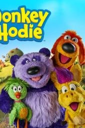</a> [评测页海报](<https://www.commonsensemedia.org/tv-reviews/donkey-hodie>) | 小驴霍迪 Donkey Hodie [全网检索](<https://pbskids.org/donkeyhodie>) | 推荐 | 2+（CSM；须共看） 

原文说法
非公众号来源；适龄以本轮独立评测或官方栏目定位为准
 | 

罗杰斯世界衍生的学前木偶剧，小驴霍迪和朋友一起解决问题，每集围绕“frustrated”“fair”一类可用的词。可从PBS KIDS官方节目页进入。CSM评2…（展开）
罗杰斯世界衍生的学前木偶剧，小驴霍迪和朋友一起解决问题，每集围绕“frustrated”“fair”一类可用的词。可从PBS KIDS官方节目页进入。CSM评2+、编辑4/5。此次为2026年11月全网检索收录。
 | CSM编辑4/5、评2+，评测页标注Common Sense Selection，肯定其坚持尝试和求助朋友的态度。2+仍须成人共看；它比《小老虎丹尼尔》更偏幽默试错，不能替代更系统的情绪语言练习，但作为学前社交短剧是稳妥选择。 | 作品级证据初审 置信度：中 [Common Sense Media](<https://www.commonsensemedia.org/tv-reviews/donkey-hodie>) | [官方入口（非已验证正片）](<https://pbskids.org/donkeyhodie>) |
| <a href="../../images/review/wx40-hachi.jpg">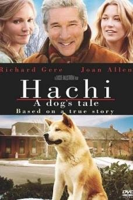</a> [评测页海报](<https://www.commonsensemedia.org/movie-reviews/hachi-a-dogs-tale>) | 忠犬八公的故事 Hachi: A Dog&#x27;s Tale [文章40](<https://mp.weixin.qq.com/s/ySOlBb_APh8QBi6UUOZ9hg>) | 推荐 | 10+（CSM；原文8+偏低） 

原文说法
8岁+
 | 文章写豆瓣9.4、适合8岁+：教授帕克收养走失的秋田犬八公，八公每天到车站等他；帕克病逝后八公仍等了九年。真实故事改编。 | CSM评10+、编辑4/5，称其温和但情感冲击强烈：主人猝逝与狗长年等待至死。对低龄或刚经历丧失的孩子可能过于悲伤，宜家长陪看并聊死亡与陪伴。原文8+偏低，豆瓣9.4未核实。 | 作品级证据初审 置信度：中 [Common Sense Media](<https://www.commonsensemedia.org/movie-reviews/hachi-a-dogs-tale>) | 未核实正版正片 |
|  [评测页海报](<https://www.commonsensemedia.org/movie-reviews/meet-the-robinsons>) | 拜见罗宾逊一家 Meet the Robinsons [文章27](<https://mp.weixin.qq.com/s/5TG375Bph1OhKcTfKC1OMQ>) · [文章28](<https://mp.weixin.qq.com/s/kx7YqDwvnUhSYTM3Gh1f-Q>) | 推荐 | 7+（CSM） 

原文说法
7岁+
 | 文章写孤儿院里的小发明家路易斯为了找母亲造记忆扫描机，被来自未来的威尔伯拉上时光机。金句 Keep moving forward。 | 独立评测支持面对失败继续尝试，但孤儿被拒绝、控制人的机械反派与未来险境可能吓人。可谈收养与多样家庭，不把坚持等同必须成功。 | 作品级证据初审 置信度：中 [Common Sense Media](<https://www.commonsensemedia.org/movie-reviews/meet-the-robinsons>) | 未核实正版正片 |
|  [评测页海报](<https://www.commonsensemedia.org/movie-reviews/lilo-stitch-0>) | 星际宝贝 Lilo &amp; Stitch [文章27](<https://mp.weixin.qq.com/s/5TG375Bph1OhKcTfKC1OMQ>) · [文章28](<https://mp.weixin.qq.com/s/kx7YqDwvnUhSYTM3Gh1f-Q>) | 推荐 | 6+（CSM，2002动画） 

原文说法
6岁+
 | 文章写夏威夷女孩莉萝和姐姐娜妮相依为命，把逃出来的外星实验体当成狗，取名史迪奇，教它的第一个词是家人。金句是 Ohana means family。 | 独立指南支持非血缘家庭与归属主题，也有破坏、追逐、离散和悲伤。明确是2002动画，未把2025真人重拍的评测套过来。 | 作品级证据初审 置信度：中 [Common Sense Media](<https://www.commonsensemedia.org/movie-reviews/lilo-stitch-0>) | 未核实正版正片 |
|  [公众号通用图（非本片海报）](<https://mmbiz.qpic.cn/mmbiz_jpg/Fb3Efks8pLTx10Zwdeayr61SAMmSxibMt9CWVZr9D0S3N16G3CQYJolJs3rRvFcCJHlz2T14WCN65DRuxjIicKJRoHibNRicvUYrAicPY4dAMUD8/0?wx_fmt=jpeg>) | 月神 [文章12](<https://mp.weixin.qq.com/s/Iy-SwhNQC6IFAAsECwqseQ>) | 推荐 | 4+（编辑暂议；合集CSM4+） 

原文说法
4岁以上
 | 文章写豆瓣9.0、适合4岁以上，是皮克斯约7分钟短片。男孩第一次跟爷爷和爸爸到月亮上清扫星辰。爷爷要用耙子，爸爸坚持用扫帚，男孩自己观察，敲开星辰。文章没有写英文名。 | 《月神》可用于讨论代际合作与自己的想法；核实的是包含此片的皮克斯短片合集评测，不是单片年龄认证。已排除同名马来西亚成人喜剧的错误匹配。 | 相关合集/App参考，不是单片独立适龄认证 置信度：低至中 [Common Sense Media](<https://www.commonsensemedia.org/movie-reviews/pixar-short-films-collection-volume-2>)（含此片的短片合集，不能当单片年龄认证） | 未核实正版正片 |
|  [评测页海报](<https://www.commonsensemedia.org/movie-reviews/the-sea-beast>) | 海兽猎人 The Sea Beast [文章27](<https://mp.weixin.qq.com/s/5TG375Bph1OhKcTfKC1OMQ>) | 推荐 | 8+（CSM；非原文7+） 

原文说法
7岁+
 | 文章写孤女梅茜溜上猎兽船，和传说中的大红海兽困在岛上，发现海兽和她听到的故事不一样。金句 Maybe you can be a hero and still be wrong. | 独立指南肯定质疑偏见、诚信和团队合作，但猎杀巨兽、战斗毁坏和酒精场面较强。应讨论谁定义“怪物”，而不是只接受英雄叙事。 | 作品级证据初审 置信度：中 [Common Sense Media](<https://www.commonsensemedia.org/movie-reviews/the-sea-beast>) | 未核实正版正片 |
|  [评测页海报](<https://www.commonsensemedia.org/movie-reviews/song-of-the-sea>) | 海洋之歌 Song of the Sea [文章27](<https://mp.weixin.qq.com/s/5TG375Bph1OhKcTfKC1OMQ>) · [文章28](<https://mp.weixin.qq.com/s/kx7YqDwvnUhSYTM3Gh1f-Q>) | 推荐 | 7+（CSM；非原文6+） 

原文说法
6岁+
 | 文章写爱尔兰灯塔边的兄妹。母亲在妹妹出生那夜回到海里。妹妹是海豹精灵，要找回被父亲扔进海里的海豹皮才能唱歌。文章说难过要留着，不是拿掉。 | 独立指南肯定兄妹合作和接纳悲伤，同时提醒母亲离开、溺水感和惊吓追逐。适合讨论神话与情绪，不是无忧、纯快乐的低龄片。 | 作品级证据初审 置信度：中 [Common Sense Media](<https://www.commonsensemedia.org/movie-reviews/song-of-the-sea>) | 未核实正版正片 |
| <a href="../../images/review/wx40-heidi-2015.jpg">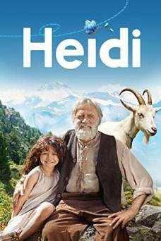</a> [评测页海报](<https://www.commonsensemedia.org/movie-reviews/heidi-2015>) | 海蒂和爷爷 Heidi (2015) [文章40](<https://mp.weixin.qq.com/s/ySOlBb_APh8QBi6UUOZ9hg>) | 推荐 | 7+（CSM；原文6+） 

原文说法
6岁+
 | 文章写豆瓣9.3、适合6岁+：海蒂失去双亲后与古怪的爷爷住在阿尔卑斯山，后被送到法兰克福陪伴克拉拉，因思念患梦游，最终回到山上，克拉拉也站了起来。 | CSM评7+、编辑4/5，2015年版是对原著的温和改编，有离别与思乡情绪及少量险情。注意CSM另有1937年秀兰·邓波儿版（6+），不要混淆。原文6+略低，豆瓣9.3未核实。 | 作品级证据初审 置信度：中 [Common Sense Media](<https://www.commonsensemedia.org/movie-reviews/heidi-2015>) | 未核实正版正片 |
|  [评测页海报](<https://www.commonsensemedia.org/movie-reviews/elemental>) | 疯狂元素城 Elemental [文章27](<https://mp.weixin.qq.com/s/5TG375Bph1OhKcTfKC1OMQ>) | 推荐 | 8+（沿用保守编辑建议；CSM6+） 

原文说法
8岁+
 | 文章写火族姑娘小焰被父亲当接班人，自己喜欢玻璃艺术却不敢说。水族男孩阿波闯进店里。父亲后来说：店从来不是梦想，你才是。 | 独立指南肯定移民家庭、同理心和代际沟通；有险境与浪漫关系。适合讨论刻板印象，但元素拟人不是物理科普，不能拿火水设定解释科学。 | 作品级证据初审 置信度：中 [Common Sense Media](<https://www.commonsensemedia.org/movie-reviews/elemental>) | 未核实正版正片 |
|  [评测页海报](<https://www.commonsensemedia.org/movie-reviews/the-secret-life-of-walter-mitty>) | 白日梦想家 The Secret Life of Walter Mitty [文章24](<https://mp.weixin.qq.com/s/emCL8FTZgeWRNQoj8Fki6Q>) · [文章40](<https://mp.weixin.qq.com/s/ySOlBb_APh8QBi6UUOZ9hg>) | 推荐 | 12+（CSM；非原文10+） 

原文说法
10岁以上
 | 文章写豆瓣8.7，并称它是治愈的成人励志片。内向的上班族沃特沉在白日梦里，一张底片失踪后他走出家门。文章没有说它是动画，也没有给英文名。 英文名来自豆瓣该条目的外文名，不是文章原文。 | 独立评测肯定行动与希望，同时有危险幻想、粗口、饮酒及醉酒驾驶直升机等表现。成人职场主线和真人动作不等于儿童英语启蒙片。 | 作品级证据初审 置信度：中 [Common Sense Media](<https://www.commonsensemedia.org/movie-reviews/the-secret-life-of-walter-mitty>) | 未核实正版正片 |
|  [评测页海报](<https://www.commonsensemedia.org/movie-reviews/mulan>) | 花木兰 Mulan [文章27](<https://mp.weixin.qq.com/s/5TG375Bph1OhKcTfKC1OMQ>) · [文章28](<https://mp.weixin.qq.com/s/kx7YqDwvnUhSYTM3Gh1f-Q>) | 推荐 | 6+（编辑从严；CSM5+） 

原文说法
6岁+
 | 文章写明是1998年动画版。父亲腿有旧伤，木兰夜里剪发，穿上父亲的盔甲去从军。文章用它谈“我是谁”和“我为谁而做”。 | 独立评测肯定勇气、勤奋与女性主动性，也提醒战争、武器和性别刻板玩笑。是1998迪士尼改编，不等于中国历史或完整传统文化教育。 | 作品级证据初审 置信度：中 [Common Sense Media](<https://www.commonsensemedia.org/movie-reviews/mulan>) | 未核实正版正片 |
|  [评测页海报](<https://www.commonsensemedia.org/movie-reviews/when-marnie-was-there>) | 记忆中的玛妮 [文章26](<https://mp.weixin.qq.com/s/FrkyAZYpTEqOreapJ-f3UA>) | 推荐 | 9+（CSM；非原文8+） 

原文说法
8岁+
 | 文章写豆瓣8.0，吉卜力。社恐的杏奈在乡下遇见金发女孩玛妮，结尾揭开陪伴以另一种方式回来。适合心思敏感的孩子。文章没有给英文名。 | 独立指南支持自我价值与家庭归属的讨论，同时有孤独、自我贬低、惊吓和饮酒等内容。不能凭“画风温柔”忽略心理负荷。 | 作品级证据初审 置信度：中 [Common Sense Media](<https://www.commonsensemedia.org/movie-reviews/when-marnie-was-there>) | 未核实正版正片 |
|  [评测页海报](<https://www.commonsensemedia.org/movie-reviews/turning-red>) | 青春变形记 Turning Red [文章24](<https://mp.weixin.qq.com/s/emCL8FTZgeWRNQoj8Fki6Q>) · [文章27](<https://mp.weixin.qq.com/s/5TG375Bph1OhKcTfKC1OMQ>) · [文章28](<https://mp.weixin.qq.com/s/kx7YqDwvnUhSYTM3Gh1f-Q>) | 推荐 | 10+（CSM；非原文7+/9+） 

原文说法
文章24写7岁以上；文章27写9岁+
 | 13岁的华裔女孩情绪激动时会变成红色小熊猫。文章24把它写成青春期和母女和解。文章27补充这是家族女性代代相传的变化，妈妈后来道歉，女孩选择把熊猫留下来。 | 青春期、月经暗示、同伴关系和亲子边界有讨论价值；不因文化争议一概否定。变身和冲突较强，不是低龄安抚片，原文适龄偏低。 | 作品级证据初审 置信度：中 [Common Sense Media](<https://www.commonsensemedia.org/movie-reviews/turning-red>) | 未核实正版正片 |
|  [评测页海报](<https://www.commonsensemedia.org/movie-reviews/maronas-fantastic-tale>) | 马茹娜的非凡旅程 L&#x27;extraordinaire voyage de Marona [文章26](<https://mp.weixin.qq.com/s/FrkyAZYpTEqOreapJ-f3UA>) | 推荐 | 10+（CSM；非原文7+） 

原文说法
7岁+
 | 文章写豆瓣8.6。小狗被马戏团小丑、建筑工人和独居老人先后捡到又遗弃，仍然相信人。文章没有给英文名。 英文名来自豆瓣该条目的外文名，不是文章原文。 | 独立指南肯定对动物关系的温柔哲学表达，也强调开场车祸、临终回忆和被遗弃带来的悲伤。爱宠或经历丧失的孩子应先由成人判断，不作为无负担治愈片。 | 作品级证据初审 置信度：中 [Common Sense Media](<https://www.commonsensemedia.org/movie-reviews/maronas-fantastic-tale>) | 未核实正版正片 |
|  [评测页海报](<https://www.commonsensemedia.org/movie-reviews/how-to-train-your-dragon>) | 驯龙高手 How to Train Your Dragon [文章22](<https://mp.weixin.qq.com/s/1zcUZOanOLPia36GlVYinA>) · [文章28](<https://mp.weixin.qq.com/s/kx7YqDwvnUhSYTM3Gh1f-Q>) · [文章41](<https://mp.weixin.qq.com/s/M-ZdobFaqohYn2I2BV7M8g>) | 推荐 | 6+（CSM；敏感儿童可后移） 

原文说法
未标明年龄
 | 

文章说孩子在趣配音里看了片段后想把整部电影看完，正文介绍的就是这一部。维京部落世世代代把龙当敌人。首领的儿子 Hiccup 瘦弱，不像其他维京人。他遇见罕见的夜…（展开）
文章说孩子在趣配音里看了片段后想把整部电影看完，正文介绍的就是这一部。维京部落世世代代把龙当敌人。首领的儿子 Hiccup 瘦弱，不像其他维京人。他遇见罕见的夜煞 Night Fury，给它取名 Toothless。两人从互相试探到互相信任，Hiccup 拒绝再屠龙，最后和 Toothless 一起对付真正的威胁。文章写电影和原著不完全对应。同页还介绍了 Cressida Cowell 的同名书，那是书，不是视频。文章没有写具体岁数。
 | 独立评测肯定同理心、合作和反对盲目敌对的主题；龙战斗、火焰及伤残仍有强度。已确认2010动画，不混用2025真人重拍的页面或评分。 | 作品级证据初审 置信度：中 [Common Sense Media](<https://www.commonsensemedia.org/movie-reviews/how-to-train-your-dragon>) | 未核实正版正片 |
|  [评测页海报](<https://www.commonsensemedia.org/movie-reviews/kubo-and-the-two-strings>) | 魔弦传说 Kubo and the Two Strings [文章27](<https://mp.weixin.qq.com/s/5TG375Bph1OhKcTfKC1OMQ>) · [文章28](<https://mp.weixin.qq.com/s/kx7YqDwvnUhSYTM3Gh1f-Q>) | 推荐 | 9+（CSM；非原文8+） 

原文说法
8岁+
 | 文章写独眼男孩库博用琴和会动的纸片在集市说书，天黑前必须回家。母亲被击倒后，他和会说话的猴子、甲虫去找父亲留下的盔甲。定格动画。 | 独立评测认可亲情、记忆与讲故事的力量，同时明确人物死亡、村落焚毁和强烈惊吓。审美成就不抵消内容强度，低龄或敏感儿童宜延后。 | 作品级证据初审 置信度：中 [Common Sense Media](<https://www.commonsensemedia.org/movie-reviews/kubo-and-the-two-strings>) | 未核实正版正片 |
| <a href="../../images/title-cards/wx40-margueritte.svg">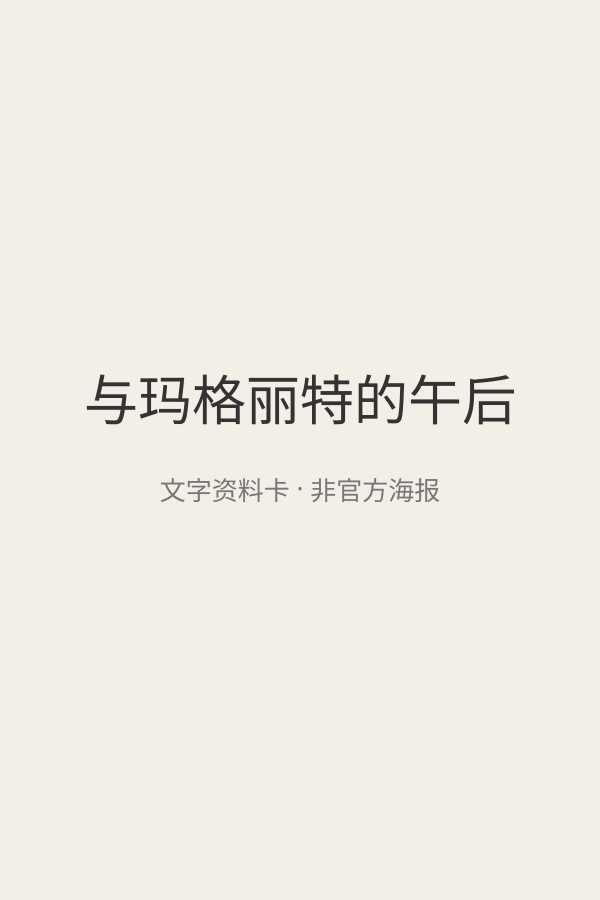</a> 文字封面（非官方海报） | 与玛格丽特的午后 My Afternoons with Margueritte [文章40](<https://mp.weixin.qq.com/s/ySOlBb_APh8QBi6UUOZ9hg>) | 有保留 | 未核实（原文10+） 

原文说法
10岁+
 | 文章写豆瓣9.0、适合10岁+：识字困难的大叔在公园偶遇95岁的玛格丽特，她为他读小说，两人结成忘年交，阅读打开了他的世界。 | 2010年法国剧情片，未取得独立儿童适龄评测；以成人生活、家庭创伤和衰老为主，节奏慢，更适合较大孩子或家长自看。豆瓣9.0未核实。 | 证据不足，编辑保守初筛 置信度：低 未取得作品级独立依据 | 未核实正版正片 |
| <a href="../../images/title-cards/wx40-central-station.svg">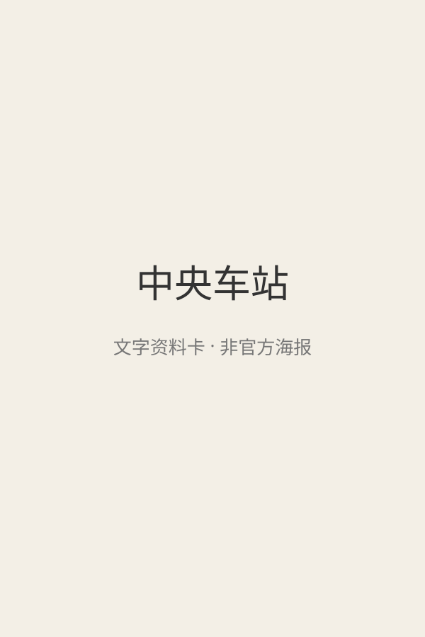</a> 文字封面（非官方海报） | 中央车站 Central Station [文章40](<https://mp.weixin.qq.com/s/ySOlBb_APh8QBi6UUOZ9hg>) | 有保留 | 未核实（原文10+） 

原文说法
10岁+
 | 文章写豆瓣8.7、适合10岁+：里约车站代写书信的退休女教师朵拉，冷漠甚至撕掉顾客的信，被迫带男孩约书亚踏上寻父之旅，两人逐渐互相信任。 | 1998年巴西剧情片，独立儿童适龄评测未取得。剧情涉及孩子母亲车祸身亡、贩卖儿童的情节与成人语言，需家长预看；豆瓣8.7未核实。 | 证据不足，编辑保守初筛 置信度：低 未取得作品级独立依据 | 未核实正版正片 |
|  旧图（未逐张鉴定） | 伦敦一家人 Ethel &amp; Ernest [文章26](<https://mp.weixin.qq.com/s/FrkyAZYpTEqOreapJ-f3UA>) · [文章42](<https://mp.weixin.qq.com/s/UA3H31bI8dTbVIbs-0m81A>) | 有保留 | 10+（编辑暂议；原文7+需谨慎） 

原文说法
7岁+
 | 

文章写豆瓣8.8，手绘水彩。1928年一个女仆和一个送奶工一见钟情，后来躲空袭、等儿子回家。台词来自作者父母说过的话，片尾有他们的照片。 英文名来自豆瓣该条目的…（展开）
文章写豆瓣8.8，手绘水彩。1928年一个女仆和一个送奶工一见钟情，后来躲空袭、等儿子回家。台词来自作者父母说过的话，片尾有他们的照片。 英文名来自豆瓣该条目的外文名，不是文章原文。 第42篇也推荐此片。
 | BBFC确认有空袭威胁、性暗示、粗口、重病与丧亲，也涉及旧时偏见。平静画风不等于只讲琐碎日常；成人历史背景较重，适龄需个别判断。 | 作品级证据初审 置信度：中 [BBFC 内容指南](<https://www.bbfc.co.uk/release/ethel-ernest-q29sbgvjdglvbjpwwc00mzqxota>) | 未核实正版正片 |
|  [公众号通用图（非本片海报）](<https://mmbiz.qpic.cn/mmbiz_png/6bfwibRiappSTYGJ6Qoj9DJZvQiaAiaBlBRlo5libZj13ib87bMtyM0tePj0CDJQ3dt9meCSrISfGd2YenmxhHicl18icOn3getSP1FqkAqmspcIFcM/640?wx_fmt=png>) | 午后时光 [文章21](<https://mp.weixin.qq.com/s/ggJPptYppMBlsS4ui7jsqw>) | 有保留 | 成人先看／未核实 

原文说法
未标明年龄
 | 

文章说这是一部约9分钟、几乎没有对白的动画。穿红衣服的老奶奶在客厅喝下午茶，她患有阿尔茨海默症，不断掉进回忆：海边的父亲、少女时代的朋友、热恋、有了女儿。结尾她…（展开）
文章说这是一部约9分钟、几乎没有对白的动画。穿红衣服的老奶奶在客厅喝下午茶，她患有阿尔茨海默症，不断掉进回忆：海边的父亲、少女时代的朋友、热恋、有了女儿。结尾她想起照顾自己的人就是女儿，两人相拥。文章特别写到回忆中的老奶奶没有脖子，用来表现记忆和身体的连接断了。没有写年龄和英文名。
 | 原文讨论父母、记忆与人生的价值不等于适合幼儿。缺乏独立儿童分龄，需核对是否为2017年Late Afternoon及其认知衰退、失落主题。 | 证据不足，编辑保守初筛 置信度：低 未取得作品级独立依据 | 未核实正版正片 |
|  旧图（未逐张鉴定） | 反叛的童谣 Revolting Rhymes [文章26](<https://mp.weixin.qq.com/s/FrkyAZYpTEqOreapJ-f3UA>) · [文章28](<https://mp.weixin.qq.com/s/kx7YqDwvnUhSYTM3Gh1f-Q>) | 有保留 | 8+仅为原文建议，独立年龄未核实 

原文说法
8岁+
 | 文章写豆瓣8.7，英国动画，约57分钟，奥斯卡提名。把《小红帽》《白雪公主》《灰姑娘》揉碎重讲。这三则是片中的童话，不是另外三部片子。文章没有给英文名。 英文名来自豆瓣该条目的外文名，不是文章原文。 | 原文自己提到枪和赌场，却又笼统称不黑暗；不能只因童话和奥斯卡提名便降龄。上下两部分和短片版本需区分，黑色幽默与暴力强度待独立核验。 | 证据不足，编辑保守初筛 置信度：低 未取得作品级独立依据 | 未核实正版正片 |
|  [旧图（未逐张鉴定）](<https://mmbiz.qpic.cn/mmbiz_jpg/TkPfDAMKaBiclianqbmatGK5utp1E2Vl6oJnOWeJUN1MYpAowkWy5r0HjfFUOBia2yrsuHg4PQ6e52Y0pqKbQf4SkUKQcjse8mzPrOujH1Px/0?wx_fmt=jpeg>) | 听见天堂 [文章11](<https://mp.weixin.qq.com/s/oKG9Fhp_e-YAl2DMdq5_QQ>) | 有保留 | 未核实 

原文说法
未标明年龄
 | 文章用一句话推荐，没有写年龄和播放链接。文章写：生活有缺憾，仍然可以用心感受世界。文章没有写这是哪一版电影的英文名。 | 需先锁定意大利《Red Like the Sky》的版本并取得独立儿童评测。残障经验值得理解，但创伤场景和成人压迫不宜因励志标签忽略。 | 证据不足，编辑保守初筛 置信度：低 未取得作品级独立依据 | 未核实正版正片 |
|  [评测页海报](<https://www.commonsensemedia.org/movie-reviews/taare-zameen-par>) | 地球上的星星 [文章11](<https://mp.weixin.qq.com/s/oKG9Fhp_e-YAl2DMdq5_QQ>) | 有保留 | 13+（CSM） 

原文说法
未标明年龄
 | 文章用一句话推荐，没有写年龄和播放链接。文章写：每个孩子都是不一样的星星，不必跟风比较。 | 对读写困难的同理心值得家长学习，但独立指南提醒体罚、羞辱和儿童自杀念头。主角8岁不等于受众8岁；不宜作为低龄“励志教育”直接播放。 | 作品级证据初审 置信度：中 [Common Sense Media](<https://www.commonsensemedia.org/movie-reviews/taare-zameen-par>) | 未核实正版正片 |
|  [旧图（未逐张鉴定）](<https://mmbiz.qpic.cn/sz_mmbiz_jpg/TkPfDAMKaB9bSOicHxmibP2wgSPicaia5jrian2ic4IlhmFG8b6vROPlDWd06eq9xVw3jAics5uxTJWI5ZHFXfE4eyua3sV1fGZXibeu0/0?wx_fmt=jpeg>) | 大卫·科波菲尔 [文章11](<https://mp.weixin.qq.com/s/oKG9Fhp_e-YAl2DMdq5_QQ>) | 有保留 | 未核实 

原文说法
未标明年龄
 | 文章用一句话推荐，没有写年龄和播放链接。文章写：生活有风雨，本心不能丢。文章没有写是哪一个改编版本。 | 多次影视改编年代、长度和强度不同，目前无法锁定文章说的版本。儿童劳动、虐待和困境不能仅因原著是名著便判为低龄优质。 | 证据不足，编辑保守初筛 置信度：低 未取得作品级独立依据 | 未核实正版正片 |
|  [评测页海报](<https://www.commonsensemedia.org/movie-reviews/cinema-paradiso>) | 天堂电影院 [文章11](<https://mp.weixin.qq.com/s/oKG9Fhp_e-YAl2DMdq5_QQ>) | 有保留 | 14+（CSM；还须区分剪辑版） 

原文说法
未标明年龄
 | 文章用一句话推荐，没有写年龄和播放链接。文章写：童年的光会照亮以后的路。 | 电影史与忘年友情值得讨论，但独立指南有裸露、青少年性行为暗示、吸烟和烧伤。院线版与加长版有差别，不得以“成长电影”一概推给儿童。 | 作品级证据初审 置信度：中 [Common Sense Media](<https://www.commonsensemedia.org/movie-reviews/cinema-paradiso>) | 未核实正版正片 |
| <a href="../../images/review/wx40-gifted.jpg">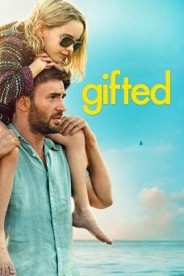</a> [评测页海报](<https://www.commonsensemedia.org/movie-reviews/gifted>) | 天才少女 Gifted [文章40](<https://mp.weixin.qq.com/s/ySOlBb_APh8QBi6UUOZ9hg>) | 有保留 | 12+（CSM；原文9+偏低） 

原文说法
9岁+
 | 文章写豆瓣8.3、适合9岁+：7岁数学天才玛丽，外婆想送她进特殊学校培养成数学家，舅舅弗兰克想让她过普通童年，引发监护权之争。 | CSM评12+：虽以二年级女孩为主角，但涉及自杀、父母遗弃，有亲吻及暗示性关系和粗口，更适合较大的少年。原文9+明显偏低；家庭讨论价值高，但不宜给低龄孩子当“治愈片”。 | 作品级证据初审 置信度：中 [Common Sense Media](<https://www.commonsensemedia.org/movie-reviews/gifted>) | 未核实正版正片 |
|  [公众号通用图（非本片海报）](<https://mmbiz.qpic.cn/mmbiz_jpg/Fb3Efks8pLTx10Zwdeayr61SAMmSxibMt9CWVZr9D0S3N16G3CQYJolJs3rRvFcCJHlz2T14WCN65DRuxjIicKJRoHibNRicvUYrAicPY4dAMUD8/0?wx_fmt=jpeg>) | 失物招领 [文章12](<https://mp.weixin.qq.com/s/Iy-SwhNQC6IFAAsECwqseQ>) | 有保留 | 未核实 

原文说法
5岁以上
 | 文章写豆瓣8.4、适合5岁以上。失物招领箱里的小精灵发现爱欺负人的男孩 JJ 自己的东西也曾被抢走，于是帮他把抢走的东西还回去，并找回毛绒玩具。文章没有英文名。 | 先确认是否为Shaun Tan《The Lost Thing》，而非同名寻物短片。疏离与归属主题有讨论潜力，不能只凭“失物招领”片名给5岁以上普推。 | 证据不足，编辑保守初筛 置信度：低 未取得作品级独立依据 | 未核实正版正片 |
|  [旧图（未逐张鉴定）](<https://mmbiz.qpic.cn/sz_mmbiz_jpg/QpEnBiadxtgiczYlsYreqNU4aFCo53NCqOuOGjKwia55no6Eiaqx8mT92T3OW8eBlEMqLvPLYdwiagyYRCJow2VnAAP6VDLuCNhI8m7HqHCMrS1Q/640?wx_fmt=jpeg>) | 姆明山谷 Moominvalley [文章4](<https://mp.weixin.qq.com/s/nVy3SrmgSITwT-6pOLgruA>) | 有保留 | 未核实 

原文说法
未标明年龄
 | 

文章推荐的是芬兰动画《姆明山谷》，并写豆瓣9.3。它说新版一共三季、每季13集、每集22分钟，讲害羞的白色小精灵姆明和家人、朋友在山谷里过日子，没有打打杀杀。姆…（展开）
文章推荐的是芬兰动画《姆明山谷》，并写豆瓣9.3。它说新版一共三季、每季13集、每集22分钟，讲害羞的白色小精灵姆明和家人、朋友在山谷里过日子，没有打打杀杀。姆明官网写这部剧由托芙·扬松的故事改编，第一季2019年播出。文章说成片是英文字幕，没有写明确年龄。
 | 不能把姆明这一品牌、不同年代改编与某一季的高分混用。暂缺与此版对应的独立适龄和内容评测，不因“治愈”文案自动升级。 | 证据不足，编辑保守初筛 置信度：低 未取得作品级独立依据 | [官方入口（非已验证正片）](<https://www.moomin.com/en/moominvalley/>) |
|  [公众号通用图（非本片海报）](<https://mmbiz.qpic.cn/mmbiz_png/6bfwibRiappSTsAVkOOBfpsae8bg1ZuG60JJaVMkEkKN5ibrhPaX4Mx8jbhTU8QqfLzNBamsqNRiagLwaf0A2k3F1BGy5ITPHkt9KiabJebaSroI/640?wx_fmt=png>) | 尽管我们的手中空无一物 [文章9](<https://mp.weixin.qq.com/s/llZzyHjpLUUGo9Nb-N6Kkw>) · [文章21](<https://mp.weixin.qq.com/s/ggJPptYppMBlsS4ui7jsqw>) | 有保留 | 未核实 

原文说法
未标明年龄
 | 

文章介绍的短片：小羊去世后在去天堂的路上排队，过天河时身上的东西都会消失。它剃掉羊毛搓成绳子逃回家，又被狼守卫抓回去。羊妈妈一直在屋外织毛衣。结尾是狼守卫顺着绳…（展开）
文章介绍的短片：小羊去世后在去天堂的路上排队，过天河时身上的东西都会消失。它剃掉羊毛搓成绳子逃回家，又被狼守卫抓回去。羊妈妈一直在屋外织毛衣。结尾是狼守卫顺着绳子把毛衣送到小羊身边，绳子化作满天繁星。文章说它表面上讲死亡，落点是爱。没有写年龄，也没有英文名。
 | 涉及丧失与死亡，不能因温暖画风就视为普适死亡教育。尚未核实准确制作版本、独立分龄与儿童理解情况；亲历丧亲的孩子尤其需成人判断。 | 证据不足，编辑保守初筛 置信度：低 未取得作品级独立依据 | 未核实正版正片 |
|  [公众号通用图（非本片海报）](<https://mmbiz.qpic.cn/sz_mmbiz_png/6bfwibRiappSSez8ibnGMiakMbic6HqQM8uRhbFklmTDNhRqauAZ1Q92x6ibpQXXRq5e3IxLfeBgIqZrs7x43AEfR444tvwkkTibkib7ZNa0EZIAzxs/640?wx_fmt=png>) | 悠悠长假 [文章15](<https://mp.weixin.qq.com/s/mLsTKPOHMdEYURdaalx2HQ>) | 有保留 | 未核实 

原文说法
未标明年龄
 | 只在《远在天边》文末被点名。原文写豆瓣9.5，画风明媚，并说它让孩子想到生活在和平环境里。没有年龄和链接。 | 文章的长假故事需要核实具体作品与战争背景。题材若涉及战乱，必须先看儿童受威胁和死亡强度；当前不足以普推。 | 证据不足，编辑保守初筛 置信度：低 未取得作品级独立依据 | 未核实正版正片 |
|  旧图（未逐张鉴定） | 我住在凡尔赛的日子 La vie de château - Mon enfance à Versailles [文章26](<https://mp.weixin.qq.com/s/FrkyAZYpTEqOreapJ-f3UA>) | 有保留 | 未核实；原文8+未采纳为权威年龄 

原文说法
8岁+
 | 文章写豆瓣8.2。8岁的维奥丽特失去父母，投奔在凡尔赛宫做维修的孤僻舅舅。法式水彩。提名法国凯撒奖最佳动画片。文章没有给英文名。 英文名来自豆瓣该条目的外文名，不是文章原文。 | 需区分2019短片和2025长片/系列；中文名和法文副标题不足以完成版本核验。丧亲及可能的恐袭背景需独立确认，不能只按凡尔赛冒险宣传。 | 证据不足，编辑保守初筛 置信度：低 未取得作品级独立依据 | 未核实正版正片 |
|  [评测页海报](<https://www.commonsensemedia.org/movie-reviews/the-chorus>) | 放牛班的春天 [文章11](<https://mp.weixin.qq.com/s/oKG9Fhp_e-YAl2DMdq5_QQ>) | 有保留 | 14+（CSM） 

原文说法
未标明年龄
 | 文章用一句话推荐，没有写年龄和播放链接。文章写：没有真正的坏孩子，只有需要被看见的孩子。 | 音乐与关怀有价值，独立指南同时指出体罚、禁闭、性暗示歌曲、吸烟和偷窃。温暖结局不能抵消这些内容，适合年长青少年在背景讨论中观看。 | 作品级证据初审 置信度：中 [Common Sense Media](<https://www.commonsensemedia.org/movie-reviews/the-chorus>) | 未核实正版正片 |
|  旧图（未逐张鉴定） | 朝花夕誓 [文章24](<https://mp.weixin.qq.com/s/emCL8FTZgeWRNQoj8Fki6Q>) | 有保留 | 13+（编辑暂议；非原文9+） 

原文说法
9岁以上
 | 文章写豆瓣7.3。寿命很长的少女玛奇亚在战乱中捡到婴儿，孩子会长大变老，她的样子却不变。文章用它讲陪伴、守护和放手，并引了“是你教会了我什么是爱”。没有给英文名。 | 独立影评与家长指南指向战争、血腥危险、被迫婚育及长期离别；母爱主题不自动适合儿童。未核实权威统一年龄，13+只是保守编辑建议。 | 作品级证据初审 置信度：低（只有检索到的独立线索） [IMDb Parents Guide（搜索结果）](<https://www.imdb.com/title/tt7339826/parentalguide/>) [Variety 独立影评](<https://variety.com/2018/film/reviews/maquia-when-the-promised-flower-blooms-review-1202879491/>) | 未核实正版正片 |
|  [公众号通用图（非本片海报）](<https://mmbiz.qpic.cn/mmbiz_jpg/Fb3Efks8pLTx10Zwdeayr61SAMmSxibMt9CWVZr9D0S3N16G3CQYJolJs3rRvFcCJHlz2T14WCN65DRuxjIicKJRoHibNRicvUYrAicPY4dAMUD8/0?wx_fmt=jpeg>) | 洞穴 [文章12](<https://mp.weixin.qq.com/s/Iy-SwhNQC6IFAAsECwqseQ>) | 有保留 | 未核实 

原文说法
4岁以上
 | 文章写豆瓣8.8、适合4岁以上，是皮克斯短片。怕社交的小兔子往地下挖洞，挖穿了鼹鼠、老鼠和蚂蚁的家，最后遇到麻烦才向邻居求助，大家一起把洞穴重建好。文章没有英文名。 | 应核实是否为皮克斯Burrow；借助别人不等于必须放弃边界。当前缺少此单片的独立分龄证据，不沿用文章“4+”作权威结论。 | 证据不足，编辑保守初筛 置信度：低 未取得作品级独立依据 | 未核实正版正片 |
| <a href="../../images/title-cards/wx40-kikujiro.svg">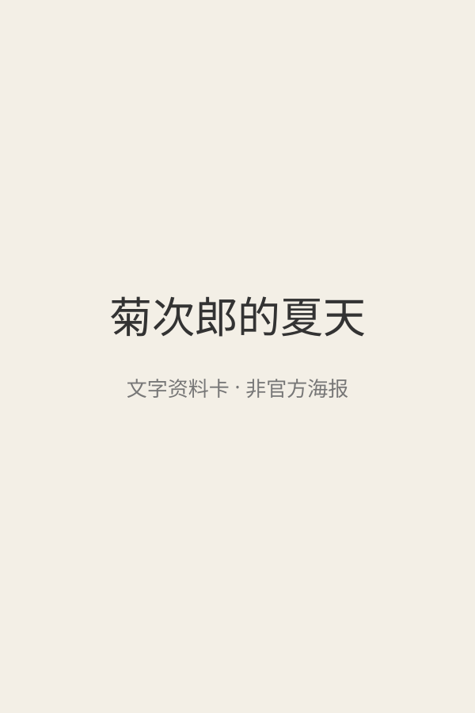</a> 文字封面（非官方海报） | 菊次郎的夏天 Kikujiro [文章40](<https://mp.weixin.qq.com/s/ySOlBb_APh8QBi6UUOZ9hg>) | 有保留 | 未核实（原文8+） 

原文说法
8岁+
 | 文章写豆瓣8.8、适合8岁+：孤独男孩正男暑假想去找妈妈，邻居的游手好闲丈夫菊次郎陪他上路，两人在旅途中互相陪伴；久石让配乐。 | 1999年北野武作品，未取得独立儿童适龄评测。片中成人角色有赌博、粗暴言行、暴力，并有陌生成人对孩子图谋不轨的段落，母亲另组家庭的结局也可能令孩子难过；原文8+需家长先看再决定。豆瓣8.8未核实。 | 证据不足，编辑保守初筛 置信度：低 未取得作品级独立依据 | 未核实正版正片 |
| <a href="../../images/review/wx42-zucchini.jpg">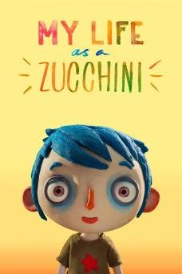</a> [评测页海报](<https://www.commonsensemedia.org/movie-reviews/my-life-as-a-zucchini>) | 西葫芦的生活 My Life as a Zucchini (2016) [文章42](<https://mp.weixin.qq.com/s/UA3H31bI8dTbVIbs-0m81A>) | 有保留 | 11+（CSM） 

原文说法
8岁+
 | 瑞法定格动画：失去母亲的男孩“西葫芦”进入寄养机构，与有创伤经历的孩子们相处。 | CSM评11+、编辑4/5，有家庭、友谊和同理心主题和圆满结局；但涉及酗酒母亲之死，并提及性、虐待、暴力、自杀、驱逐出境，孩子们会搞笑讨论性。文章8+明显偏低，适合大龄儿童且最好家长陪看。 | 作品级证据初审 置信度：中 [Common Sense Media](<https://www.commonsensemedia.org/movie-reviews/my-life-as-a-zucchini>) | 未核实正版正片 |
|  [公众号通用图（非本片海报）](<https://mmbiz.qpic.cn/mmbiz_png/6bfwibRiappSTYGJ6Qoj9DJZvQiaAiaBlBRlo5libZj13ib87bMtyM0tePj0CDJQ3dt9meCSrISfGd2YenmxhHicl18icOn3getSP1FqkAqmspcIFcM/640?wx_fmt=png>) | 超级肥皂 [文章21](<https://mp.weixin.qq.com/s/ggJPptYppMBlsS4ui7jsqw>) | 有保留 | 未核实 

原文说法
未标明年龄
 | 只在《午后时光》文末作为往期出现。原文写：40年前的国产动画，讲消费主义、营销套路和群体盲从。没有链接。 | 需确认原作年份和作者，不能把超现实隐喻自动解释为儿童品格课。还应检查是否存在物化他人或消费主义等需要讨论的表达。 | 证据不足，编辑保守初筛 置信度：低 未取得作品级独立依据 | 未核实正版正片 |
|  [公众号通用图（非本片海报）](<https://mmbiz.qpic.cn/mmbiz_png/6bfwibRiappSTsAVkOOBfpsae8bg1ZuG60JJaVMkEkKN5ibrhPaX4Mx8jbhTU8QqfLzNBamsqNRiagLwaf0A2k3F1BGy5ITPHkt9KiabJebaSroI/640?wx_fmt=png>) | 逃跑机器人 [文章9](<https://mp.weixin.qq.com/s/llZzyHjpLUUGo9Nb-N6Kkw>) | 有保留 | 未核实 

原文说法
未标明年龄
 | 只在《尽管我们的手中空无一物》文末被点名。原文说它改编自国际大奖小说，并写到和平与两难时的抉择。没有年龄、集数和链接。 | 同名短片与网络二创易混淆；准确版本、创作来源及危险行为尚未独立核验，不能据文章情感解读判断儿童适合度。 | 证据不足，编辑保守初筛 置信度：低 未取得作品级独立依据 | 未核实正版正片 |
|  [公众号通用图（非本片海报）](<https://mmbiz.qpic.cn/mmbiz_png/6bfwibRiappSTYGJ6Qoj9DJZvQiaAiaBlBRlo5libZj13ib87bMtyM0tePj0CDJQ3dt9meCSrISfGd2YenmxhHicl18icOn3getSP1FqkAqmspcIFcM/640?wx_fmt=png>) | 雨后 [文章21](<https://mp.weixin.qq.com/s/ggJPptYppMBlsS4ui7jsqw>) | 有保留 | 未核实 

原文说法
未标明年龄
 | 只在《午后时光》文末作为往期出现。原文写：法国获奖动画，关于自然循环、责任与传承。没有链接。 | “雨后”重名很多，尚无可靠作品身份与独立分龄。图片重复使用文章封面也不能证明找对了短片，暂不列入优选。 | 证据不足，编辑保守初筛 置信度：低 未取得作品级独立依据 | 未核实正版正片 |
