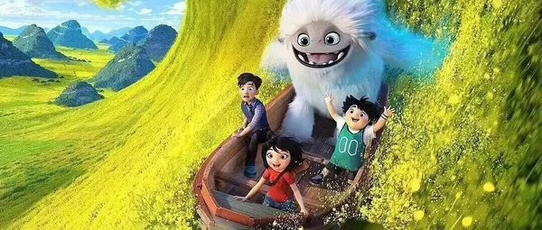

# 益智动画类

[返回首页](../../README.md) · [方法](review-method.md) · [不推荐](not-recommended.md) · [文章28待核验](pending-article-28.md)

本页 1 条，按判断排序。**有保留不等于推荐；年龄不等于听力难度；图片不证明适龄。**

## 雨果带你看世界

**判断：有保留** · 建议：未核实

**简介**：文章把它放在思维启蒙，写豆瓣9.2、适合3–8岁、BBC 出品、单集约5分钟。它问什么是朋友、什么是公平、害怕是什么、什么才算大，雨果不给标准答案。文章没有英文名。

**研判**：文章称3—8岁，但哲学概念、语言表达和具体制作版本缺少独立核验。先用一集观察能否复述和讨论，不把“开窍”当效果证据。

**证据状态**：证据不足，编辑保守初筛；置信度：低。

**视频链接**：未核实正版正片；不以同名页、预告、资源站或HTTP 200冒充可播正片。

**图片**：原公众号通用配图／重复封面，不能当本片海报。

原文年龄（不是本项目认可结论）：3-8岁。

**独立依据**：未取得作品级独立证据；此条不是正向推荐。

豆瓣评分/人数：未核实；IMDb评分/人数：未核实。公众号里的评分仅为原文说法，不计作已验证数据。

**原文来源**：[文章12](https://mp.weixin.qq.com/s/Iy-SwhNQC6IFAAsECwqseQ)

---
