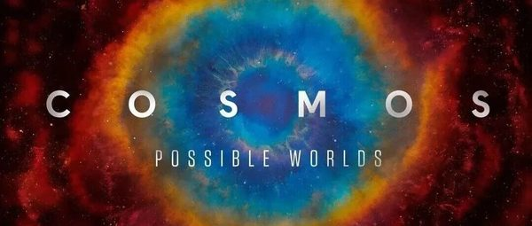
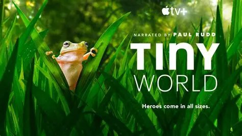
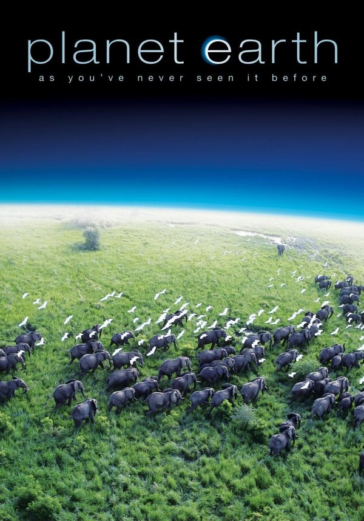
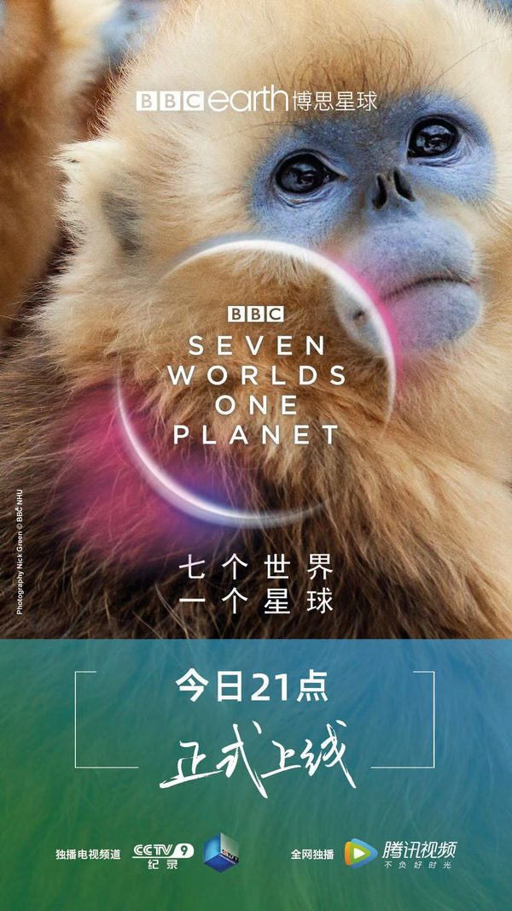
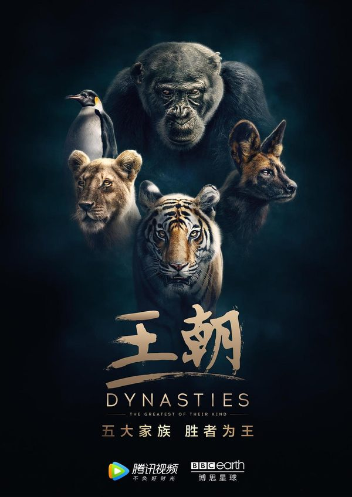
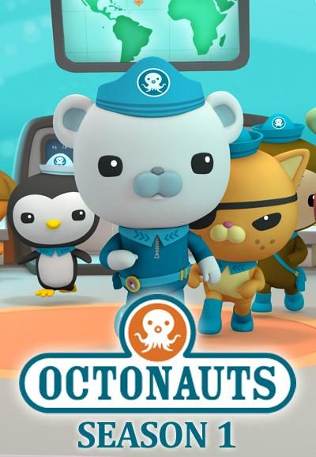

# 自然类

自然、动物、地球和宇宙纪录片，以及讲自然现象的科普片。

30 条。年龄写在每条上。

### 宇宙时空之旅（Cosmos: A SpaceTime Odyssey）

- **分类**：{e['category']}
- **类型**：{e.get('kind') or '—'}
- **文章里的年龄**：{e.get('age_group') or '文章没有写'}

单篇介绍文的封面。

文章写解说是泰森，用“想象号飞船”从微观走到宇宙边缘，并把138亿年压成一年：1月1日大爆炸，人类文明只有这年的最后14秒。也讲了哈雷和彗星、法拉第让观众看见磁场。文章写豆瓣9.7、已播出两季，标题里写25集。主持者本人的节目页写2014年3月开播、共13集。集数以文章和该页各自的说法并列，这里不把两边合成一个数字。文章没有写年龄。36部纪录片清单里也有这个名字。

**观看**：[https://neildegrassetyson.com/shows/2014-03-cosmos-spacetime-odyssey/](https://neildegrassetyson.com/shows/2014-03-cosmos-spacetime-odyssey/)

主持者 Neil deGrasse Tyson 官网的节目介绍，不是播放器。该页写13集、2014年3月由国家地理与福克斯首播。

**来源文章**：
- [豆瓣 9.7 科普《宇宙时空之旅》（25集）孩子的宇宙启蒙课，看这一部就够了](https://mp.weixin.qq.com/s/-5VGJkhfqgD0lcveZ1_sbg)
- [强烈推荐36部儿童必看顶级纪录片](https://mp.weixin.qq.com/s/N7tY4wyBz8yLYPtZCo3ENg)

### 喜马拉雅

- **分类**：{e['category']}
- **类型**：{e.get('kind') or '—'}
- **文章里的年龄**：{e.get('age_group') or '文章没有写'}

豆瓣条目《喜马拉雅》（1999）的海报。

文章写豆瓣9.6。雪豹在岩壁上等猎物，金雕迎风飞，用来讲高原上的坚持。文章没有英文名，也没有年龄。

**观看**：未找到可打开的正版播放页。

**来源文章**：
- [影响孩子一生的5部纪录片，唤醒他内心的力量](https://mp.weixin.qq.com/s/iJUG9KyR1p1kObJEEZ_oPQ)

### 亚马逊深渊

- **分类**：{e['category']}
- **类型**：{e.get('kind') or '—'}
- **文章里的年龄**：{e.get('age_group') or '文章没有写'}

豆瓣条目《亚马逊深渊》（2005）的海报。

文章写豆瓣9.3。镜头进到亚马逊雨林和水下，用来讲好奇和探索。没有英文名，也没有年龄。

**观看**：[https://www.iqiyi.com/v_19rrklgd6w.html](https://www.iqiyi.com/v_19rrklgd6w.html)

爱奇艺搜索结果里标题正好是《亚马逊深渊》的页面（频道：纪录片,3）。

**来源文章**：
- [影响孩子一生的5部纪录片，唤醒他内心的力量](https://mp.weixin.qq.com/s/iJUG9KyR1p1kObJEEZ_oPQ)

### 大堡礁

- **分类**：{e['category']}
- **类型**：{e.get('kind') or '—'}
- **文章里的年龄**：{e.get('age_group') or '文章没有写'}

豆瓣条目《大堡礁》（2012）的海报。

文章写豆瓣9.4。珊瑚礁和海洋生物，并写到珊瑚白化。正文这一条没有单独配图。没有英文名，也没有年龄。

**观看**：[https://www.iqiyi.com/v_1higiumhhnc.html?playertype=immersiveShort](https://www.iqiyi.com/v_1higiumhhnc.html?playertype=immersiveShort)

爱奇艺搜索结果里标题正好是《大堡礁》的页面（频道：少儿综艺,15）。

**来源文章**：
- [影响孩子一生的5部纪录片，唤醒他内心的力量](https://mp.weixin.qq.com/s/iJUG9KyR1p1kObJEEZ_oPQ)

### 野性非洲

- **分类**：{e['category']}
- **类型**：{e.get('kind') or '—'}
- **文章里的年龄**：{e.get('age_group') or '文章没有写'}

豆瓣条目《野性非洲》（2001）的海报。

文章写豆瓣9.7。草原上的迁徙、捕猎和抢领地。没有英文名，也没有年龄。

**观看**：[https://www.iqiyi.com/v_1hn0p06sn0o.html](https://www.iqiyi.com/v_1hn0p06sn0o.html)

爱奇艺搜索结果里标题正好是《野性非洲》的页面（频道：纪录片,3）。

**来源文章**：
- [影响孩子一生的5部纪录片，唤醒他内心的力量](https://mp.weixin.qq.com/s/iJUG9KyR1p1kObJEEZ_oPQ)

### 黄石公园

- **分类**：{e['category']}
- **类型**：{e.get('kind') or '—'}
- **文章里的年龄**：{e.get('age_group') or '文章没有写'}

**图片**：未找到可下载的海报或标题图。

文章写豆瓣9.5。间歇泉、森林、野生动物和四季。没有英文名，也没有年龄。

**观看**：未找到可打开的正版播放页。

**来源文章**：
- [影响孩子一生的5部纪录片，唤醒他内心的力量](https://mp.weixin.qq.com/s/iJUG9KyR1p1kObJEEZ_oPQ)

### 企鹅群里有特务（Penguins: Spy in the Huddle）

- **分类**：{e['category']}
- **类型**：{e.get('kind') or '—'}
- **文章里的年龄**：{e.get('age_group') or '文章没有写'}

图来自该微信文章。

文章写语言是汉语普通话，适合3–6岁。BBC 摄影队用近一年跟踪洪堡企鹅、跳岩企鹅和帝企鹅。三集标题被写成《漫漫长路》《蹒跚学步》《成长的烦恼》。BBC 纪录片页写2013年、3集，导演 John Downer。36部清单里也有这个名字。

**观看**：[https://www.bbc.com/video/docs/series/10167741](https://www.bbc.com/video/docs/series/10167741)

BBC 纪录片系列页，列出3集。能否播放取决于地区。

**来源文章**：
- [这些高分纪录片，唤醒孩子学习内驱力（附观看链接）](https://mp.weixin.qq.com/s/Dnb9KDiYCP9RZzQSdzqETw)
- [强烈推荐36部儿童必看顶级纪录片](https://mp.weixin.qq.com/s/N7tY4wyBz8yLYPtZCo3ENg)

### 小小世界（Tiny World）

- **分类**：{e['category']}
- **类型**：{e.get('kind') or '—'}
- **文章里的年龄**：{e.get('age_group') or '文章没有写'}

图来自该微信文章。

文章写语言是英语，适合4–8岁，并写它在 Apple TV。用很小的动物走一段“英雄旅程”。列出的章节是草原、丛林、岛屿、内陆、林地。

**观看**：[https://www.iqiyi.com/v_1hmit867sy0.html?playertype=immersiveShort](https://www.iqiyi.com/v_1hmit867sy0.html?playertype=immersiveShort)

爱奇艺搜索结果里标题正好是《小小世界》的页面（频道：教育,12）。

**来源文章**：
- [这些高分纪录片，唤醒孩子学习内驱力（附观看链接）](https://mp.weixin.qq.com/s/Dnb9KDiYCP9RZzQSdzqETw)

### 万物与虚无（Everything and Nothing）

- **分类**：{e['category']}
- **类型**：{e.get('kind') or '—'}
- **文章里的年龄**：{e.get('age_group') or '文章没有写'}

图来自该微信文章。

文章写语言是英语，适合8岁以上。吉姆·阿尔-哈利里讲“万物是什么、虚无是什么”，分上部《万物》和下部《虚无》。BBC Four 节目页的介绍与此相符，并写目前不在 iPlayer 上。

**观看**：[https://www.bbc.co.uk/programmes/b00zw0n6](https://www.bbc.co.uk/programmes/b00zw0n6)

BBC 节目页。页面写 On iPlayer: Not available。

**来源文章**：
- [这些高分纪录片，唤醒孩子学习内驱力（附观看链接）](https://mp.weixin.qq.com/s/Dnb9KDiYCP9RZzQSdzqETw)

### 鸟瞰地球

- **分类**：{e['category']}
- **类型**：{e.get('kind') or '—'}
- **文章里的年龄**：{e.get('age_group') or '文章没有写'}

豆瓣条目《鸟瞰地球》（2011）的海报。

文章的推荐理由是换一种视角看世界：航拍飞越六大洲，记录动物迁徙和地貌。没有英文名，也没有年龄。

**观看**：未找到可打开的正版播放页。

**来源文章**：
- [影响孩子一生的5部纪录片：见过世面的孩子，内心更强大](https://mp.weixin.qq.com/s/kRsiPOrFLWvTttOiqRRL6w)

### 隐形世界

- **分类**：{e['category']}
- **类型**：{e.get('kind') or '—'}
- **文章里的年龄**：{e.get('age_group') or '文章没有写'}

豆瓣条目《隐形世界》（1979）的海报。

文章写用高速摄影和显微镜头看昆虫翅膀、碎掉的水滴和植物的细小结构。没有英文名，也没有年龄。

**观看**：未找到可打开的正版播放页。

**来源文章**：
- [影响孩子一生的5部纪录片：见过世面的孩子，内心更强大](https://mp.weixin.qq.com/s/kRsiPOrFLWvTttOiqRRL6w)

### 南太平洋

- **分类**：{e['category']}
- **类型**：{e.get('kind') or '—'}
- **文章里的年龄**：{e.get('age_group') or '文章没有写'}

豆瓣条目《南太平洋》（2009）的海报。

文章写镜头去南太平洋孤岛，看生命在隔绝环境里长成别的样子。没有英文名，也没有年龄。

**观看**：[https://www.iqiyi.com/v_19rrkfkngc.html](https://www.iqiyi.com/v_19rrkfkngc.html)

爱奇艺搜索结果里标题正好是《南太平洋》的页面（频道：纪录片,3）。

**来源文章**：
- [影响孩子一生的5部纪录片：见过世面的孩子，内心更强大](https://mp.weixin.qq.com/s/kRsiPOrFLWvTttOiqRRL6w)

### 地球一年

- **分类**：{e['category']}
- **类型**：{e.get('kind') or '—'}
- **文章里的年龄**：{e.get('age_group') or '文章没有写'}

**图片**：未找到可下载的海报或标题图。

文章写跟着四季看动植物生长、繁殖和蛰伏。没有英文名，也没有年龄。

**观看**：未找到可打开的正版播放页。

**来源文章**：
- [影响孩子一生的5部纪录片：见过世面的孩子，内心更强大](https://mp.weixin.qq.com/s/kRsiPOrFLWvTttOiqRRL6w)

### 极地

- **分类**：{e['category']}
- **类型**：{e.get('kind') or '—'}
- **文章里的年龄**：{e.get('age_group') or '文章没有写'}

豆瓣条目《极地》（2017）的海报。

文章称它是国产纪录片，记录极寒地方的人怎样和自然一起生活。没有英文名，也没有年龄。

**观看**：未找到可打开的正版播放页。

**来源文章**：
- [影响孩子一生的5部纪录片：见过世面的孩子，内心更强大](https://mp.weixin.qq.com/s/kRsiPOrFLWvTttOiqRRL6w)

### 地球脉动

- **分类**：{e['category']}
- **类型**：{e.get('kind') or '—'}
- **文章里的年龄**：{e.get('age_group') or '文章没有写'}

豆瓣条目《地球脉动 第一季》（2006）的海报。

文章用一句话推荐，没有写年龄和播放链接。文章写：万物生长各有快慢，孩子的成长也一样。36部清单里也有这个名字。

**观看**：[https://www.iqiyi.com/v_19rrkrq74k.html](https://www.iqiyi.com/v_19rrkrq74k.html)

爱奇艺搜索结果里标题正好是《地球脉动》的页面（频道：纪录片,3）。

**来源文章**：
- [9部孩子必看的成长电影，治愈孩子一生](https://mp.weixin.qq.com/s/oKG9Fhp_e-YAl2DMdq5_QQ)
- [强烈推荐36部儿童必看顶级纪录片](https://mp.weixin.qq.com/s/N7tY4wyBz8yLYPtZCo3ENg)

### 宇宙的奇迹

- **分类**：{e['category']}
- **类型**：{e.get('kind') or '—'}
- **文章里的年龄**：{e.get('age_group') or '文章没有写'}

豆瓣条目《宇宙的奇迹》（2011）的海报。

文章《强烈推荐36部儿童必看顶级纪录片》把它列在「宇宙探索」。全文只有名单和主题，没有这一部的剧情、年龄或播放链接。

**观看**：[https://www.iqiyi.com/v_19rrkljxvs.html](https://www.iqiyi.com/v_19rrkljxvs.html)

爱奇艺搜索结果里标题正好是《宇宙的奇迹》的页面（频道：纪录片,3）。

**来源文章**：
- [强烈推荐36部儿童必看顶级纪录片](https://mp.weixin.qq.com/s/N7tY4wyBz8yLYPtZCo3ENg)

### 生命的奇迹

- **分类**：{e['category']}
- **类型**：{e.get('kind') or '—'}
- **文章里的年龄**：{e.get('age_group') or '文章没有写'}

豆瓣条目《生命的奇迹》（2017）的海报。

文章《强烈推荐36部儿童必看顶级纪录片》把它列在「宇宙探索」。全文只有名单和主题，没有这一部的剧情、年龄或播放链接。

**观看**：[https://www.iqiyi.com/v_cuba3w9gt4.html](https://www.iqiyi.com/v_cuba3w9gt4.html)

爱奇艺搜索结果里标题正好是《生命的奇迹》的页面（频道：纪录片,3）。

**来源文章**：
- [强烈推荐36部儿童必看顶级纪录片](https://mp.weixin.qq.com/s/N7tY4wyBz8yLYPtZCo3ENg)

### 从太空看地球

- **分类**：{e['category']}
- **类型**：{e.get('kind') or '—'}
- **文章里的年龄**：{e.get('age_group') or '文章没有写'}

豆瓣条目《从太空看地球》（2019）的海报。

文章《强烈推荐36部儿童必看顶级纪录片》把它列在「宇宙探索」。全文只有名单和主题，没有这一部的剧情、年龄或播放链接。

**观看**：[https://v.qq.com/x/cover/d9e6n4htz2yliu2/f0031yjtqtq.html](https://v.qq.com/x/cover/d9e6n4htz2yliu2/f0031yjtqtq.html)

腾讯视频页面。爱奇艺搜索里标题正好是《从太空看地球》，并跳到这个地址。

**来源文章**：
- [强烈推荐36部儿童必看顶级纪录片](https://mp.weixin.qq.com/s/N7tY4wyBz8yLYPtZCo3ENg)

### 太阳系的奇迹

- **分类**：{e['category']}
- **类型**：{e.get('kind') or '—'}
- **文章里的年龄**：{e.get('age_group') or '文章没有写'}

豆瓣条目《太阳系的奇迹》（2010）的海报。

文章《强烈推荐36部儿童必看顶级纪录片》把它列在「宇宙探索」。全文只有名单和主题，没有这一部的剧情、年龄或播放链接。

**观看**：未找到可打开的正版播放页。

**来源文章**：
- [强烈推荐36部儿童必看顶级纪录片](https://mp.weixin.qq.com/s/N7tY4wyBz8yLYPtZCo3ENg)

### 人类宇宙

- **分类**：{e['category']}
- **类型**：{e.get('kind') or '—'}
- **文章里的年龄**：{e.get('age_group') or '文章没有写'}

豆瓣条目《人类宇宙》（2014）的海报。

文章《强烈推荐36部儿童必看顶级纪录片》把它列在「宇宙探索」。全文只有名单和主题，没有这一部的剧情、年龄或播放链接。

**观看**：未找到可打开的正版播放页。

**来源文章**：
- [强烈推荐36部儿童必看顶级纪录片](https://mp.weixin.qq.com/s/N7tY4wyBz8yLYPtZCo3ENg)

### 生命之色

- **分类**：{e['category']}
- **类型**：{e.get('kind') or '—'}
- **文章里的年龄**：{e.get('age_group') or '文章没有写'}

豆瓣条目《生命之色》（2021）的海报。

文章《强烈推荐36部儿童必看顶级纪录片》把它列在「自然科普」。全文只有名单和主题，没有这一部的剧情、年龄或播放链接。

**观看**：未找到可打开的正版播放页。

**来源文章**：
- [强烈推荐36部儿童必看顶级纪录片](https://mp.weixin.qq.com/s/N7tY4wyBz8yLYPtZCo3ENg)

### 地球改变之年

- **分类**：{e['category']}
- **类型**：{e.get('kind') or '—'}
- **文章里的年龄**：{e.get('age_group') or '文章没有写'}

豆瓣条目《地球改变之年》（2021）的海报。

文章《强烈推荐36部儿童必看顶级纪录片》把它列在「自然科普」。全文只有名单和主题，没有这一部的剧情、年龄或播放链接。

**观看**：[https://www.iqiyi.com/v_f04zzex7h0.html?playertype=immersiveShort](https://www.iqiyi.com/v_f04zzex7h0.html?playertype=immersiveShort)

爱奇艺搜索结果里标题正好是《地球改变之年》的页面（频道：片花,10）。

**来源文章**：
- [强烈推荐36部儿童必看顶级纪录片](https://mp.weixin.qq.com/s/N7tY4wyBz8yLYPtZCo3ENg)

### 绿色星球

- **分类**：{e['category']}
- **类型**：{e.get('kind') or '—'}
- **文章里的年龄**：{e.get('age_group') or '文章没有写'}

豆瓣条目《绿色星球》（2022）的海报。

文章《强烈推荐36部儿童必看顶级纪录片》把它列在「自然科普」。全文只有名单和主题，没有这一部的剧情、年龄或播放链接。

**观看**：[https://www.iqiyi.com/v_j3j8483uok.html](https://www.iqiyi.com/v_j3j8483uok.html)

爱奇艺搜索结果里标题正好是《绿色星球》的页面（频道：纪录片,3）。

**来源文章**：
- [强烈推荐36部儿童必看顶级纪录片](https://mp.weixin.qq.com/s/N7tY4wyBz8yLYPtZCo3ENg)

### 家园

- **分类**：{e['category']}
- **类型**：{e.get('kind') or '—'}
- **文章里的年龄**：{e.get('age_group') or '文章没有写'}

豆瓣条目《家园》（2009）的海报。

文章《强烈推荐36部儿童必看顶级纪录片》把它列在「自然科普」。全文只有名单和主题，没有这一部的剧情、年龄或播放链接。

**观看**：未找到可打开的正版播放页。

**来源文章**：
- [强烈推荐36部儿童必看顶级纪录片](https://mp.weixin.qq.com/s/N7tY4wyBz8yLYPtZCo3ENg)

### 自然的力量

- **分类**：{e['category']}
- **类型**：{e.get('kind') or '—'}
- **文章里的年龄**：{e.get('age_group') or '文章没有写'}

豆瓣条目《自然的力量》（2016）的海报。

文章《强烈推荐36部儿童必看顶级纪录片》把它列在「自然科普」。全文只有名单和主题，没有这一部的剧情、年龄或播放链接。

**观看**：[https://www.iqiyi.com/v_120jhgchoog.html?playertype=immersiveShort](https://www.iqiyi.com/v_120jhgchoog.html?playertype=immersiveShort)

爱奇艺搜索结果里标题正好是《自然的力量》的页面（频道：unknown,-1）。

**来源文章**：
- [强烈推荐36部儿童必看顶级纪录片](https://mp.weixin.qq.com/s/N7tY4wyBz8yLYPtZCo3ENg)

### 七个世界，一个星球

- **分类**：{e['category']}
- **类型**：{e.get('kind') or '—'}
- **文章里的年龄**：{e.get('age_group') or '文章没有写'}

豆瓣条目《七个世界，一个星球》（2019）的海报。

文章《强烈推荐36部儿童必看顶级纪录片》把它列在「植物动物世界」。全文只有名单和主题，没有这一部的剧情、年龄或播放链接。

**观看**：未找到可打开的正版播放页。

**来源文章**：
- [强烈推荐36部儿童必看顶级纪录片](https://mp.weixin.qq.com/s/N7tY4wyBz8yLYPtZCo3ENg)

### 王朝

- **分类**：{e['category']}
- **类型**：{e.get('kind') or '—'}
- **文章里的年龄**：{e.get('age_group') or '文章没有写'}

豆瓣条目《王朝 第一季》（2018）的海报。

文章《强烈推荐36部儿童必看顶级纪录片》把它列在「植物动物世界」。全文只有名单和主题，没有这一部的剧情、年龄或播放链接。

**观看**：未找到可打开的正版播放页。

**来源文章**：
- [强烈推荐36部儿童必看顶级纪录片](https://mp.weixin.qq.com/s/N7tY4wyBz8yLYPtZCo3ENg)

### 植物王国

- **分类**：{e['category']}
- **类型**：{e.get('kind') or '—'}
- **文章里的年龄**：{e.get('age_group') or '文章没有写'}

豆瓣条目《植物王国》（2012）的海报。

文章《强烈推荐36部儿童必看顶级纪录片》把它列在「植物动物世界」。全文只有名单和主题，没有这一部的剧情、年龄或播放链接。

**观看**：未找到可打开的正版播放页。

**来源文章**：
- [强烈推荐36部儿童必看顶级纪录片](https://mp.weixin.qq.com/s/N7tY4wyBz8yLYPtZCo3ENg)

### 种出个地球

- **分类**：{e['category']}
- **类型**：{e.get('kind') or '—'}
- **文章里的年龄**：{e.get('age_group') or '文章没有写'}

豆瓣条目《种出个地球》（2012）的海报。

文章《强烈推荐36部儿童必看顶级纪录片》把它列在「植物动物世界」。全文只有名单和主题，没有这一部的剧情、年龄或播放链接。

**观看**：未找到可打开的正版播放页。

**来源文章**：
- [强烈推荐36部儿童必看顶级纪录片](https://mp.weixin.qq.com/s/N7tY4wyBz8yLYPtZCo3ENg)

### 海底小纵队（Octonauts）

- **分类**：{e['category']}
- **类型**：{e.get('kind') or '—'}
- **文章里的年龄**：{e.get('age_group') or '文章没有写'}

豆瓣条目《海底小纵队 第一季》（2014）的海报。

文章说它偏科普，海洋动物知识多，但语速偏快，作者暂时不给现在的孩子看。

**观看**：[https://www.iqiyi.com/v_19rrhnf7go.html](https://www.iqiyi.com/v_19rrhnf7go.html)

爱奇艺搜索结果里标题正好是《海底小纵队》的页面（频道：少儿综艺,15）。

**来源文章**：
- [两个女儿6岁和2岁，我们只看这8部动画片](https://mp.weixin.qq.com/s/B2loD1DLgD3WS77WM1XkqQ)

返回 [分类目录](catalog.md)。
