# 自然类

[返回首页](../../README.md) · [方法](review-method.md) · [不推荐](not-recommended.md) · [文章28待核验](pending-article-28.md)

本页 30 条，按判断排序。**有保留不等于推荐；年龄不等于听力难度；图片不证明适龄。**

## 地球脉动
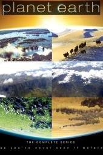
**判断：强烈推荐** · 建议：6+（CSM；敏感儿童先预看）

**简介**：文章用一句话推荐，没有写年龄和播放链接。文章写：万物生长各有快慢，孩子的成长也一样。36部清单里也有这个名字。

**研判**：独立评测高度肯定摄影、动物与栖息地知识；同时明确有近距离捕食、杀死猎物等镜头。推荐的是有成人解释的自然观察，不是无惊吓的安抚背景视频。

**证据状态**：作品级证据初审；置信度：中。

**视频链接**：未核实正版正片；不以同名页、预告、资源站或HTTP 200冒充可播正片。

**图片**：独立评测页所标本片海报（版权归原权利人）。 [图源](https://www.commonsensemedia.org/tv-reviews/planet-earth)

原文年龄（不是本项目认可结论）：未标明年龄。

**独立依据**：[Common Sense Media](https://www.commonsensemedia.org/tv-reviews/planet-earth)

豆瓣评分/人数：未核实；IMDb评分/人数：未核实。公众号里的评分仅为原文说法，不计作已验证数据。

**原文来源**：[文章11](https://mp.weixin.qq.com/s/oKG9Fhp_e-YAl2DMdq5_QQ)；[文章17](https://mp.weixin.qq.com/s/N7tY4wyBz8yLYPtZCo3ENg)

---

## 七个世界，一个星球
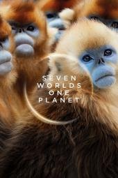
**判断：推荐** · 建议：9+（CSM）

**简介**：文章《强烈推荐36部儿童必看顶级纪录片》把它列在「植物动物世界」。全文只有名单和主题，没有这一部的剧情、年龄或播放链接。

**研判**：独立评测肯定生态观察，同时明确捕食会真实结束动物生命，故事具有生存悬念。适合能区分纪录片与童话的孩子，敏感儿童可跳过相关段落。

**证据状态**：作品级证据初审；置信度：中。

**视频链接**：未核实正版正片；不以同名页、预告、资源站或HTTP 200冒充可播正片。

**图片**：独立评测页所标本片海报（版权归原权利人）。 [图源](https://www.commonsensemedia.org/tv-reviews/seven-worlds-one-planet)

原文年龄（不是本项目认可结论）：只列片名。

**独立依据**：[Common Sense Media](https://www.commonsensemedia.org/tv-reviews/seven-worlds-one-planet)

豆瓣评分/人数：未核实；IMDb评分/人数：未核实。公众号里的评分仅为原文说法，不计作已验证数据。

**原文来源**：[文章17](https://mp.weixin.qq.com/s/N7tY4wyBz8yLYPtZCo3ENg)

---

## 宇宙时空之旅 / Cosmos: A SpaceTime Odyssey

**判断：推荐** · 建议：10+（CSM）

**简介**：文章写解说是泰森，用“想象号飞船”从微观走到宇宙边缘，并把138亿年压成一年：1月1日大爆炸，人类文明只有这年的最后14秒。也讲了哈雷和彗星、法拉第让观众看见磁场。文章写豆瓣9.7、已播出两季，标题里写25集。主持者本人的节目页写2014年3月开播、共13集。集数以文章和该页各自的说法并列，这里不把两边合成一个数字。文章没有写年龄。36部纪录片清单里也有这个名字。

**研判**：科学方法、宇宙尺度与好奇心有独立评测支持；历史迫害、处决与宇宙爆炸可能惊吓。此处仅确认2014版，文章“25集”可能混入另一季，不能合用一个评分。

**证据状态**：作品级证据初审；置信度：中。

**视频链接**：未核实正版正片；不以同名页、预告、资源站或HTTP 200冒充可播正片。

**图片**：独立评测页所标本片海报（版权归原权利人）。 [图源](https://www.commonsensemedia.org/tv-reviews/cosmos-a-spacetime-odyssey)

原文年龄（不是本项目认可结论）：未标明年龄。

**独立依据**：[Common Sense Media](https://www.commonsensemedia.org/tv-reviews/cosmos-a-spacetime-odyssey)

豆瓣评分/人数：未核实；IMDb评分/人数：未核实。公众号里的评分仅为原文说法，不计作已验证数据。

**原文来源**：[文章20](https://mp.weixin.qq.com/s/-5VGJkhfqgD0lcveZ1_sbg)；[文章17](https://mp.weixin.qq.com/s/N7tY4wyBz8yLYPtZCo3ENg)

---

## 小小世界 / Tiny World

**判断：推荐** · 建议：6+（CSM；非原文4+）

**简介**：文章写语言是英语，适合4–8岁，并写它在 Apple TV。用很小的动物走一段“英雄旅程”。列出的章节是草原、丛林、岛屿、内陆、林地。

**研判**：独立评测肯定微小动物和栖息地知识，也提醒捕食追逐与险境带来的惊吓。原文4岁起不宜普推；成人可先筛较平和的段落。

**证据状态**：作品级证据初审；置信度：中。

**视频链接**：未核实正版正片；不以同名页、预告、资源站或HTTP 200冒充可播正片。

**图片**：独立评测页所标本片海报（版权归原权利人）。 [图源](https://www.commonsensemedia.org/tv-reviews/tiny-world)

原文年龄（不是本项目认可结论）：4-8岁。

**独立依据**：[Common Sense Media](https://www.commonsensemedia.org/tv-reviews/tiny-world)

豆瓣评分/人数：未核实；IMDb评分/人数：未核实。公众号里的评分仅为原文说法，不计作已验证数据。

**原文来源**：[文章16](https://mp.weixin.qq.com/s/Dnb9KDiYCP9RZzQSdzqETw)

---

## 海底小纵队 / Octonauts

**判断：推荐** · 建议：4+（CSM）

**简介**：文章说它偏科普，海洋动物知识多，但语速偏快，作者暂时不给现在的孩子看。

**研判**：独立评测支持海洋生物事实、团队合作与关怀主题；是拟人化冒险，不是海洋研究纪录。英语词汇有门槛，适龄不代表听力水平已足够。

**证据状态**：作品级证据初审；置信度：中。

**视频链接**：未核实正版正片；不以同名页、预告、资源站或HTTP 200冒充可播正片。

**图片**：独立评测页所标本片海报（版权归原权利人）。 [图源](https://www.commonsensemedia.org/tv-reviews/octonauts)

原文年龄（不是本项目认可结论）：文章说先放着，等词汇量上来再看。

**独立依据**：[Common Sense Media](https://www.commonsensemedia.org/tv-reviews/octonauts)

豆瓣评分/人数：未核实；IMDb评分/人数：未核实。公众号里的评分仅为原文说法，不计作已验证数据。

**原文来源**：[文章23](https://mp.weixin.qq.com/s/B2loD1DLgD3WS77WM1XkqQ)

---

## 王朝
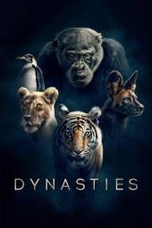
**判断：推荐** · 建议：6+（CSM；敏感儿童先预看）

**简介**：文章《强烈推荐36部儿童必看顶级纪录片》把它列在「植物动物世界」。全文只有名单和主题，没有这一部的剧情、年龄或播放链接。

**研判**：独立指南确认动物群体与生存行为的教育价值，也记录追猎、打斗和死亡。不能把旁白的家族故事当动物具有人类道德或作为育儿范本。

**证据状态**：作品级证据初审；置信度：中。

**视频链接**：未核实正版正片；不以同名页、预告、资源站或HTTP 200冒充可播正片。

**图片**：独立评测页所标本片海报（版权归原权利人）。 [图源](https://www.commonsensemedia.org/tv-reviews/dynasties)

原文年龄（不是本项目认可结论）：只列片名。

**独立依据**：[Common Sense Media](https://www.commonsensemedia.org/tv-reviews/dynasties)

豆瓣评分/人数：未核实；IMDb评分/人数：未核实。公众号里的评分仅为原文说法，不计作已验证数据。

**原文来源**：[文章17](https://mp.weixin.qq.com/s/N7tY4wyBz8yLYPtZCo3ENg)

---

## 万物与虚无 / Everything and Nothing

**判断：有保留** · 建议：12+（编辑暂议）

**简介**：文章写语言是英语，适合8岁以上。吉姆·阿尔-哈利里讲“万物是什么、虚无是什么”，分上部《万物》和下部《虚无》。BBC Four 节目页的介绍与此相符，并写目前不在 iPlayer 上。

**研判**：物理学中的虚无、量子和宇宙尺度较抽象，“8岁以上”缺少独立依据。没有证据证明观看即能理解，应配图解、讨论并区分模型与事实。

**证据状态**：证据不足，编辑保守初筛；置信度：低。

**视频/官方入口**：[查看官方页](https://www.bbc.co.uk/programmes/b00zw0n6)。已核实官方作品页或节目页，不代表能免费播放、包含完整影片或在当前地区可播。

**图片**：原库图片（来源说明保留，非本轮逐张鉴定）。

原文年龄（不是本项目认可结论）：8岁以上。

**独立依据**：未取得作品级独立证据；此条不是正向推荐。

豆瓣评分/人数：未核实；IMDb评分/人数：未核实。公众号里的评分仅为原文说法，不计作已验证数据。

**原文来源**：[文章16](https://mp.weixin.qq.com/s/Dnb9KDiYCP9RZzQSdzqETw)

---

## 亚马逊深渊
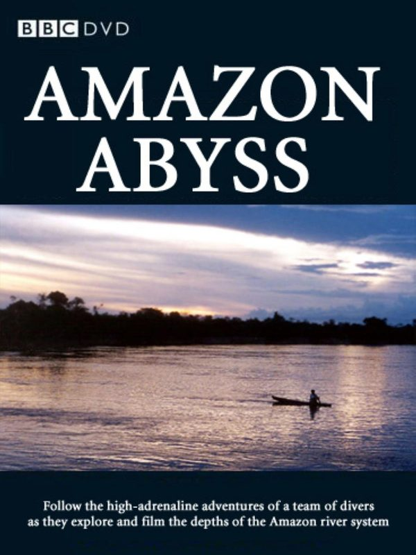
**判断：有保留** · 建议：未核实

**简介**：文章写豆瓣9.3。镜头进到亚马逊雨林和水下，用来讲好奇和探索。没有英文名，也没有年龄。

**研判**：片名可能对应不同亚马逊专题，独立来源和版本未锁定。探险风险、动物捕食与对当地族群的呈现须逐集核对，不能凭标题升级。

**证据状态**：证据不足，编辑保守初筛；置信度：低。

**视频链接**：未核实正版正片；不以同名页、预告、资源站或HTTP 200冒充可播正片。

**图片**：原库图片（来源说明保留，非本轮逐张鉴定）。

原文年龄（不是本项目认可结论）：未标明年龄。

**独立依据**：未取得作品级独立证据；此条不是正向推荐。

豆瓣评分/人数：未核实；IMDb评分/人数：未核实。公众号里的评分仅为原文说法，不计作已验证数据。

**原文来源**：[文章10](https://mp.weixin.qq.com/s/iJUG9KyR1p1kObJEEZ_oPQ)

---

## 人类宇宙
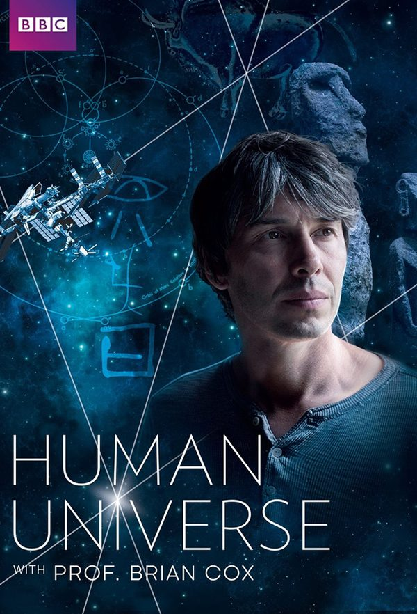
**判断：有保留** · 建议：12+（编辑暂议）

**简介**：文章《强烈推荐36部儿童必看顶级纪录片》把它列在「宇宙探索」。全文只有名单和主题，没有这一部的剧情、年龄或播放链接。

**研判**：人类与宇宙的跨学科叙述可能引发思考，也更依赖历史和科学背景。原文只列片名，需避免把主持人的哲学推论当已证实的自然科学结论。

**证据状态**：证据不足，编辑保守初筛；置信度：低。

**视频链接**：未核实正版正片；不以同名页、预告、资源站或HTTP 200冒充可播正片。

**图片**：原库图片（来源说明保留，非本轮逐张鉴定）。

原文年龄（不是本项目认可结论）：只列片名。

**独立依据**：未取得作品级独立证据；此条不是正向推荐。

豆瓣评分/人数：未核实；IMDb评分/人数：未核实。公众号里的评分仅为原文说法，不计作已验证数据。

**原文来源**：[文章17](https://mp.weixin.qq.com/s/N7tY4wyBz8yLYPtZCo3ENg)

---

## 从太空看地球
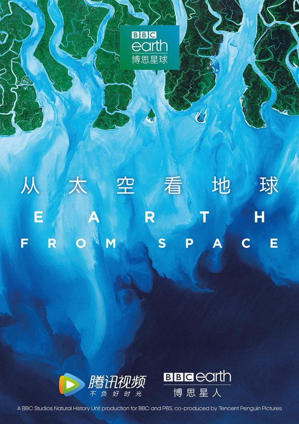
**判断：有保留** · 建议：未核实

**简介**：文章《强烈推荐36部儿童必看顶级纪录片》把它列在「宇宙探索」。全文只有名单和主题，没有这一部的剧情、年龄或播放链接。

**研判**：需要锁定《Earth from Space》的制作年份与版本；卫星画面可很吸引人，但需解释影像处理和尺度。具体灾难、风险内容未独立核实。

**证据状态**：证据不足，编辑保守初筛；置信度：低。

**视频链接**：未核实正版正片；不以同名页、预告、资源站或HTTP 200冒充可播正片。

**图片**：原库图片（来源说明保留，非本轮逐张鉴定）。

原文年龄（不是本项目认可结论）：只列片名。

**独立依据**：未取得作品级独立证据；此条不是正向推荐。

豆瓣评分/人数：未核实；IMDb评分/人数：未核实。公众号里的评分仅为原文说法，不计作已验证数据。

**原文来源**：[文章17](https://mp.weixin.qq.com/s/N7tY4wyBz8yLYPtZCo3ENg)

---

## 企鹅群里有特务 / Penguins: Spy in the Huddle

**判断：有保留** · 建议：6+（编辑暂议）

**简介**：文章写语言是汉语普通话，适合3–6岁。BBC 摄影队用近一年跟踪洪堡企鹅、跳岩企鹅和帝企鹅。三集标题被写成《漫漫长路》《蹒跚学步》《成长的烦恼》。BBC 纪录片页写2013年、3集，导演 John Downer。36部清单里也有这个名字。

**研判**：动物观察有价值，但拟人化叙述和间谍摄像装置不是动物真实“想法”。尚无与此版对应的独立适龄依据，原文3—6岁不应未经核验沿用。

**证据状态**：证据不足，编辑保守初筛；置信度：低。

**视频/官方入口**：[查看官方页](https://www.bbc.com/video/docs/series/10167741)。已核实官方作品页或节目页，不代表能免费播放、包含完整影片或在当前地区可播。

**图片**：原库图片（来源说明保留，非本轮逐张鉴定）。

原文年龄（不是本项目认可结论）：3-6岁。

**独立依据**：未取得作品级独立证据；此条不是正向推荐。

豆瓣评分/人数：未核实；IMDb评分/人数：未核实。公众号里的评分仅为原文说法，不计作已验证数据。

**原文来源**：[文章16](https://mp.weixin.qq.com/s/Dnb9KDiYCP9RZzQSdzqETw)；[文章17](https://mp.weixin.qq.com/s/N7tY4wyBz8yLYPtZCo3ENg)

---

## 南太平洋
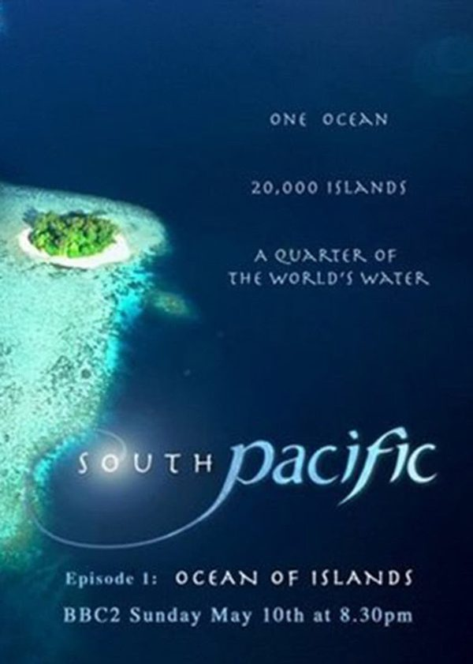
**判断：有保留** · 建议：未核实

**简介**：文章写镜头去南太平洋孤岛，看生命在隔绝环境里长成别的样子。没有英文名，也没有年龄。

**研判**：海洋专题不是天然低龄安全；捕食和生态危机的具体强度尚未核实。需锁定年份、集数和发行方，避免同名评分与海报错配。

**证据状态**：证据不足，编辑保守初筛；置信度：低。

**视频链接**：未核实正版正片；不以同名页、预告、资源站或HTTP 200冒充可播正片。

**图片**：原库图片（来源说明保留，非本轮逐张鉴定）。

原文年龄（不是本项目认可结论）：未标明年龄。

**独立依据**：未取得作品级独立证据；此条不是正向推荐。

豆瓣评分/人数：未核实；IMDb评分/人数：未核实。公众号里的评分仅为原文说法，不计作已验证数据。

**原文来源**：[文章19](https://mp.weixin.qq.com/s/kRsiPOrFLWvTttOiqRRL6w)

---

## 喜马拉雅
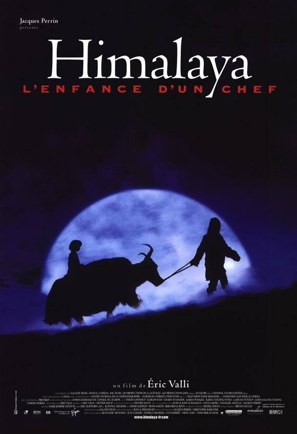
**判断：有保留** · 建议：未核实

**简介**：文章写豆瓣9.6。雪豹在岩壁上等猎物，金雕迎风飞，用来讲高原上的坚持。文章没有英文名，也没有年龄。

**研判**：同名电影、山脉专题和纪录片易混淆，尚未锁定制作年份。不能把壮美画面直接等同低龄自然启蒙，需核查生存危险、死亡和时长。

**证据状态**：证据不足，编辑保守初筛；置信度：低。

**视频链接**：未核实正版正片；不以同名页、预告、资源站或HTTP 200冒充可播正片。

**图片**：原库图片（来源说明保留，非本轮逐张鉴定）。

原文年龄（不是本项目认可结论）：未标明年龄。

**独立依据**：未取得作品级独立证据；此条不是正向推荐。

豆瓣评分/人数：未核实；IMDb评分/人数：未核实。公众号里的评分仅为原文说法，不计作已验证数据。

**原文来源**：[文章10](https://mp.weixin.qq.com/s/iJUG9KyR1p1kObJEEZ_oPQ)

---

## 地球一年

**判断：有保留** · 建议：未核实

**简介**：文章写跟着四季看动植物生长、繁殖和蛰伏。没有英文名，也没有年龄。

**研判**：“地球一年”名称和译名尚需核实；不能仅凭自然题材判优。需确认叙事是否混合不同时间地点、动物危险镜头及目标年龄。

**证据状态**：证据不足，编辑保守初筛；置信度：低。

**视频链接**：未核实正版正片；不以同名页、预告、资源站或HTTP 200冒充可播正片。

**图片**：自制文字封面（非官方海报／剧照）。

原文年龄（不是本项目认可结论）：未标明年龄。

**独立依据**：未取得作品级独立证据；此条不是正向推荐。

豆瓣评分/人数：未核实；IMDb评分/人数：未核实。公众号里的评分仅为原文说法，不计作已验证数据。

**原文来源**：[文章19](https://mp.weixin.qq.com/s/kRsiPOrFLWvTttOiqRRL6w)

---

## 地球改变之年
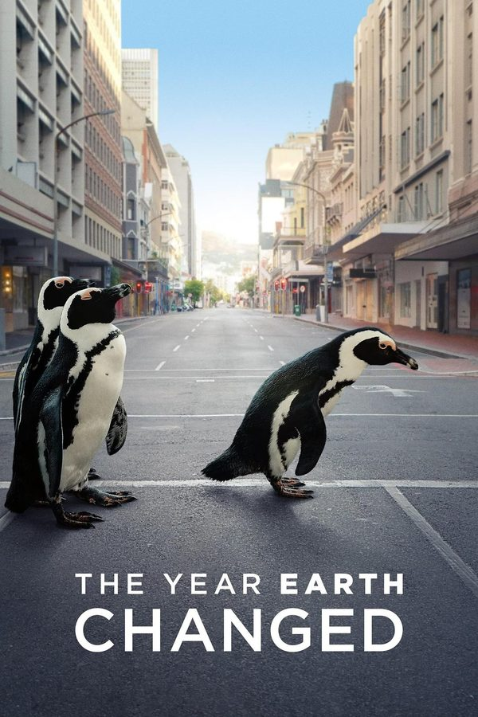
**判断：有保留** · 建议：8+（编辑暂议）

**简介**：文章《强烈推荐36部儿童必看顶级纪录片》把它列在「自然科普」。全文只有名单和主题，没有这一部的剧情、年龄或播放链接。

**研判**：疫情停摆与动物环境变化是讨论契机，但单部纪实无法证明长期因果。需说明观察时间、地区差异和人类活动恢复后的变化；儿童指南未核实。

**证据状态**：证据不足，编辑保守初筛；置信度：低。

**视频链接**：未核实正版正片；不以同名页、预告、资源站或HTTP 200冒充可播正片。

**图片**：原库图片（来源说明保留，非本轮逐张鉴定）。

原文年龄（不是本项目认可结论）：只列片名。

**独立依据**：未取得作品级独立证据；此条不是正向推荐。

豆瓣评分/人数：未核实；IMDb评分/人数：未核实。公众号里的评分仅为原文说法，不计作已验证数据。

**原文来源**：[文章17](https://mp.weixin.qq.com/s/N7tY4wyBz8yLYPtZCo3ENg)

---

## 大堡礁
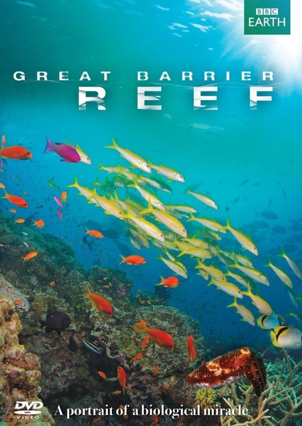
**判断：有保留** · 建议：未核实

**简介**：文章写豆瓣9.4。珊瑚礁和海洋生物，并写到珊瑚白化。正文这一条没有单独配图。没有英文名，也没有年龄。

**研判**：大堡礁有多个纪录片版本；没有制作年份和对应独立评测，不能笼统套用某版口碑。可候选，但需核对捕食镜头和生态知识更新。

**证据状态**：证据不足，编辑保守初筛；置信度：低。

**视频链接**：未核实正版正片；不以同名页、预告、资源站或HTTP 200冒充可播正片。

**图片**：原库图片（来源说明保留，非本轮逐张鉴定）。

原文年龄（不是本项目认可结论）：未标明年龄。

**独立依据**：未取得作品级独立证据；此条不是正向推荐。

豆瓣评分/人数：未核实；IMDb评分/人数：未核实。公众号里的评分仅为原文说法，不计作已验证数据。

**原文来源**：[文章10](https://mp.weixin.qq.com/s/iJUG9KyR1p1kObJEEZ_oPQ)

---

## 太阳系的奇迹
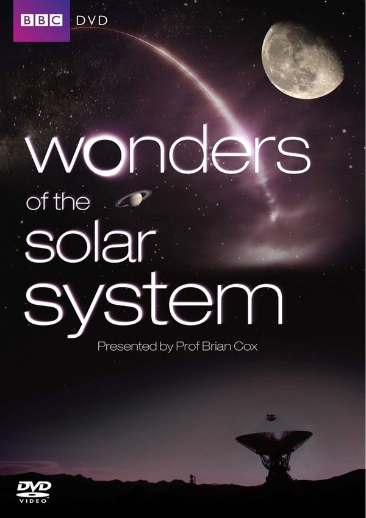
**判断：有保留** · 建议：10+（编辑暂议）

**简介**：文章《强烈推荐36部儿童必看顶级纪录片》把它列在「宇宙探索」。全文只有名单和主题，没有这一部的剧情、年龄或播放链接。

**研判**：太阳系科普有候选价值，但旧节目中的探测成果需更新；仅凭片名无法核验知识准确性与课堂适配。尚无作品级独立儿童年龄证据。

**证据状态**：证据不足，编辑保守初筛；置信度：低。

**视频链接**：未核实正版正片；不以同名页、预告、资源站或HTTP 200冒充可播正片。

**图片**：原库图片（来源说明保留，非本轮逐张鉴定）。

原文年龄（不是本项目认可结论）：只列片名。

**独立依据**：未取得作品级独立证据；此条不是正向推荐。

豆瓣评分/人数：未核实；IMDb评分/人数：未核实。公众号里的评分仅为原文说法，不计作已验证数据。

**原文来源**：[文章17](https://mp.weixin.qq.com/s/N7tY4wyBz8yLYPtZCo3ENg)

---

## 宇宙的奇迹
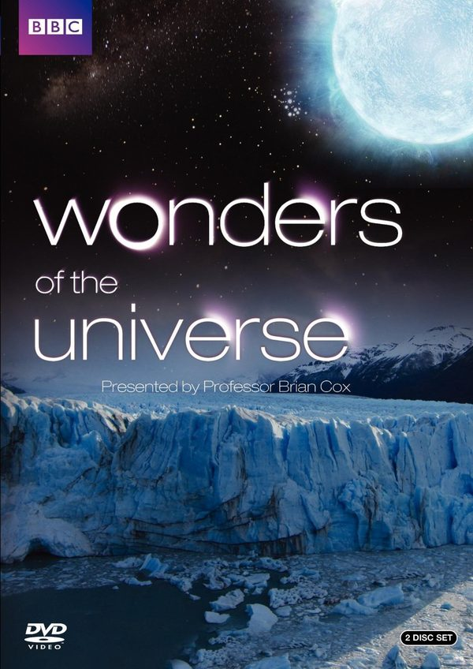
**判断：有保留** · 建议：12+（编辑暂议）

**简介**：文章《强烈推荐36部儿童必看顶级纪录片》把它列在「宇宙探索」。全文只有名单和主题，没有这一部的剧情、年龄或播放链接。

**研判**：宇宙演化涉及抽象尺度和物理模型；文章只有片名，无独立适龄和学习效果证据。需核对具体版本，并把旧时科学表述与现行资料对照。

**证据状态**：证据不足，编辑保守初筛；置信度：低。

**视频链接**：未核实正版正片；不以同名页、预告、资源站或HTTP 200冒充可播正片。

**图片**：原库图片（来源说明保留，非本轮逐张鉴定）。

原文年龄（不是本项目认可结论）：只列片名。

**独立依据**：未取得作品级独立证据；此条不是正向推荐。

豆瓣评分/人数：未核实；IMDb评分/人数：未核实。公众号里的评分仅为原文说法，不计作已验证数据。

**原文来源**：[文章17](https://mp.weixin.qq.com/s/N7tY4wyBz8yLYPtZCo3ENg)

---

## 家园
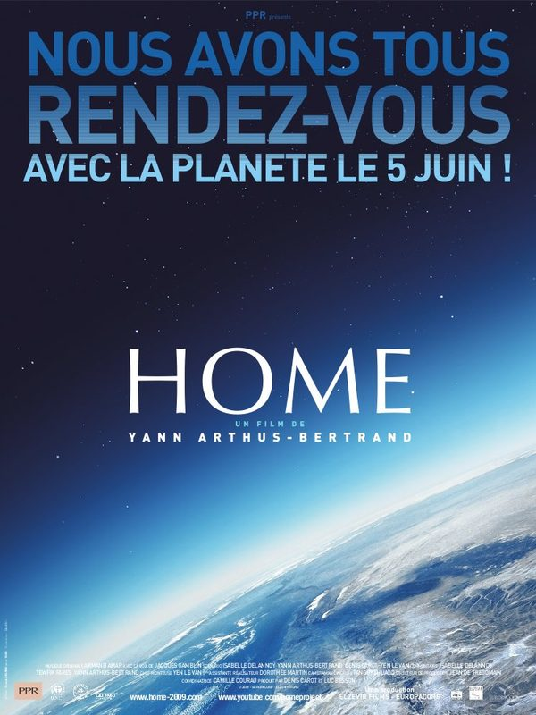
**判断：有保留** · 建议：12+（编辑暂议）

**简介**：文章《强烈推荐36部儿童必看顶级纪录片》把它列在「自然科普」。全文只有名单和主题，没有这一部的剧情、年龄或播放链接。

**研判**：如果是2009年《Home》，环境议题值得讨论，但这也是立场鲜明的倡议影像；数据年份、灾难焦虑及解决方案应补充核对，具体版本未最终确认。

**证据状态**：证据不足，编辑保守初筛；置信度：低。

**视频链接**：未核实正版正片；不以同名页、预告、资源站或HTTP 200冒充可播正片。

**图片**：原库图片（来源说明保留，非本轮逐张鉴定）。

原文年龄（不是本项目认可结论）：只列片名。

**独立依据**：未取得作品级独立证据；此条不是正向推荐。

豆瓣评分/人数：未核实；IMDb评分/人数：未核实。公众号里的评分仅为原文说法，不计作已验证数据。

**原文来源**：[文章17](https://mp.weixin.qq.com/s/N7tY4wyBz8yLYPtZCo3ENg)

---

## 极地
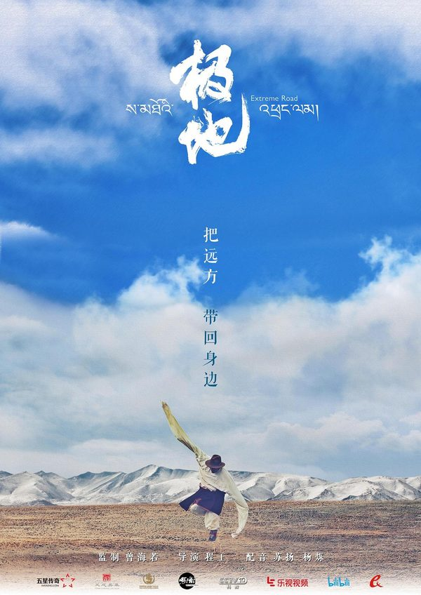
**判断：有保留** · 建议：未核实

**简介**：文章称它是国产纪录片，记录极寒地方的人怎样和自然一起生活。没有英文名，也没有年龄。

**研判**：“极地”同名节目多，可能偏人文而非动物纪录。未确认版本前不推断内容或使用其他作品分龄，先核验制作信息。

**证据状态**：证据不足，编辑保守初筛；置信度：低。

**视频链接**：未核实正版正片；不以同名页、预告、资源站或HTTP 200冒充可播正片。

**图片**：原库图片（来源说明保留，非本轮逐张鉴定）。

原文年龄（不是本项目认可结论）：未标明年龄。

**独立依据**：未取得作品级独立证据；此条不是正向推荐。

豆瓣评分/人数：未核实；IMDb评分/人数：未核实。公众号里的评分仅为原文说法，不计作已验证数据。

**原文来源**：[文章19](https://mp.weixin.qq.com/s/kRsiPOrFLWvTttOiqRRL6w)

---

## 植物王国
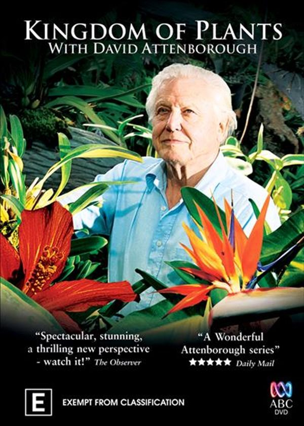
**判断：有保留** · 建议：未核实

**简介**：文章《强烈推荐36部儿童必看顶级纪录片》把它列在「植物动物世界」。全文只有名单和主题，没有这一部的剧情、年龄或播放链接。

**研判**：植物题材也需解释延时、显微摄影与实验条件；文章只列片名，尚无相应独立儿童指南或准确集目，不能直接升级为优选。

**证据状态**：证据不足，编辑保守初筛；置信度：低。

**视频链接**：未核实正版正片；不以同名页、预告、资源站或HTTP 200冒充可播正片。

**图片**：原库图片（来源说明保留，非本轮逐张鉴定）。

原文年龄（不是本项目认可结论）：只列片名。

**独立依据**：未取得作品级独立证据；此条不是正向推荐。

豆瓣评分/人数：未核实；IMDb评分/人数：未核实。公众号里的评分仅为原文说法，不计作已验证数据。

**原文来源**：[文章17](https://mp.weixin.qq.com/s/N7tY4wyBz8yLYPtZCo3ENg)

---

## 生命之色
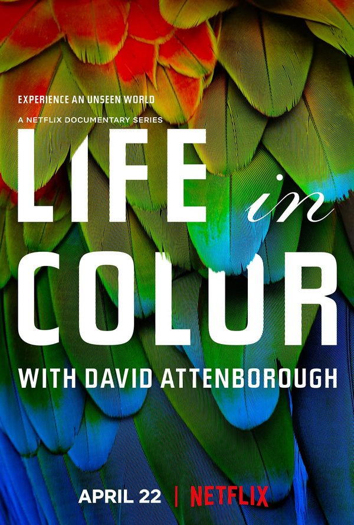
**判断：有保留** · 建议：未核实

**简介**：文章《强烈推荐36部儿童必看顶级纪录片》把它列在「自然科普」。全文只有名单和主题，没有这一部的剧情、年龄或播放链接。

**研判**：颜色与动物视觉有潜力，但须区分实际可见影像和技术重建。尚未核实年份、捕食强度及独立儿童指南，不因鲜艳画面判优。

**证据状态**：证据不足，编辑保守初筛；置信度：低。

**视频链接**：未核实正版正片；不以同名页、预告、资源站或HTTP 200冒充可播正片。

**图片**：原库图片（来源说明保留，非本轮逐张鉴定）。

原文年龄（不是本项目认可结论）：只列片名。

**独立依据**：未取得作品级独立证据；此条不是正向推荐。

豆瓣评分/人数：未核实；IMDb评分/人数：未核实。公众号里的评分仅为原文说法，不计作已验证数据。

**原文来源**：[文章17](https://mp.weixin.qq.com/s/N7tY4wyBz8yLYPtZCo3ENg)

---

## 生命的奇迹
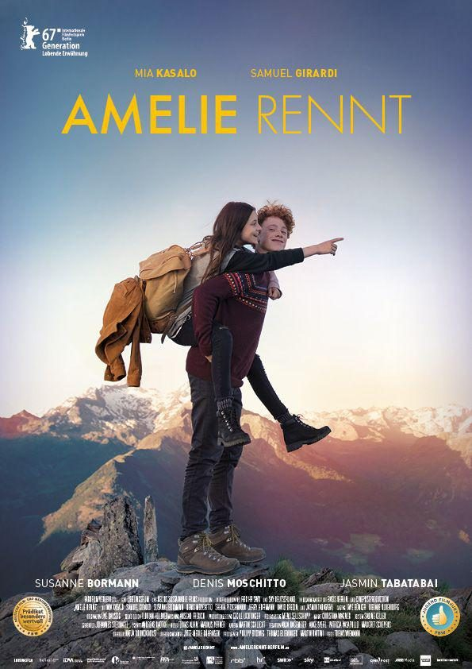
**判断：有保留** · 建议：10+（编辑暂议）

**简介**：文章《强烈推荐36部儿童必看顶级纪录片》把它列在「宇宙探索」。全文只有名单和主题，没有这一部的剧情、年龄或播放链接。

**研判**：生命演化与生物物理可能适合有基础的孩子，但未取得对应独立儿童评测。不能把成人纪录片自动当小学启蒙，更不能把类比当机制本身。

**证据状态**：证据不足，编辑保守初筛；置信度：低。

**视频链接**：未核实正版正片；不以同名页、预告、资源站或HTTP 200冒充可播正片。

**图片**：原库图片（来源说明保留，非本轮逐张鉴定）。

原文年龄（不是本项目认可结论）：只列片名。

**独立依据**：未取得作品级独立证据；此条不是正向推荐。

豆瓣评分/人数：未核实；IMDb评分/人数：未核实。公众号里的评分仅为原文说法，不计作已验证数据。

**原文来源**：[文章17](https://mp.weixin.qq.com/s/N7tY4wyBz8yLYPtZCo3ENg)

---

## 种出个地球
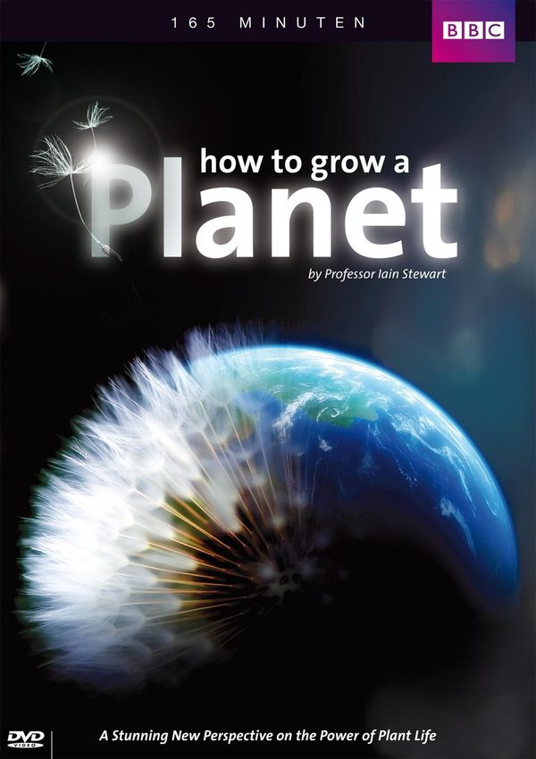
**判断：有保留** · 建议：未核实

**简介**：文章《强烈推荐36部儿童必看顶级纪录片》把它列在「植物动物世界」。全文只有名单和主题，没有这一部的剧情、年龄或播放链接。

**研判**：“种出个地球”可能涉及植物与地球演化，但译名和版本需先核对。地史推断、模型及证据应区分，独立儿童适龄未核实。

**证据状态**：证据不足，编辑保守初筛；置信度：低。

**视频链接**：未核实正版正片；不以同名页、预告、资源站或HTTP 200冒充可播正片。

**图片**：原库图片（来源说明保留，非本轮逐张鉴定）。

原文年龄（不是本项目认可结论）：只列片名。

**独立依据**：未取得作品级独立证据；此条不是正向推荐。

豆瓣评分/人数：未核实；IMDb评分/人数：未核实。公众号里的评分仅为原文说法，不计作已验证数据。

**原文来源**：[文章17](https://mp.weixin.qq.com/s/N7tY4wyBz8yLYPtZCo3ENg)

---

## 绿色星球
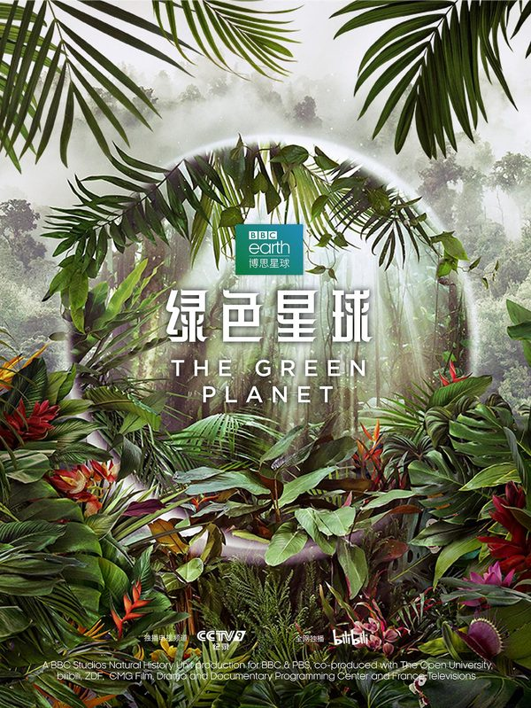
**判断：有保留** · 建议：未核实

**简介**：文章《强烈推荐36部儿童必看顶级纪录片》把它列在「自然科普」。全文只有名单和主题，没有这一部的剧情、年龄或播放链接。

**研判**：植物生态题材不等于没有紧张或捕食内容；需先核对具体版本和每集时长。独立儿童分龄与学习效果尚未取得，不沿用笼统“必看”。

**证据状态**：证据不足，编辑保守初筛；置信度：低。

**视频链接**：未核实正版正片；不以同名页、预告、资源站或HTTP 200冒充可播正片。

**图片**：原库图片（来源说明保留，非本轮逐张鉴定）。

原文年龄（不是本项目认可结论）：只列片名。

**独立依据**：未取得作品级独立证据；此条不是正向推荐。

豆瓣评分/人数：未核实；IMDb评分/人数：未核实。公众号里的评分仅为原文说法，不计作已验证数据。

**原文来源**：[文章17](https://mp.weixin.qq.com/s/N7tY4wyBz8yLYPtZCo3ENg)

---

## 自然的力量
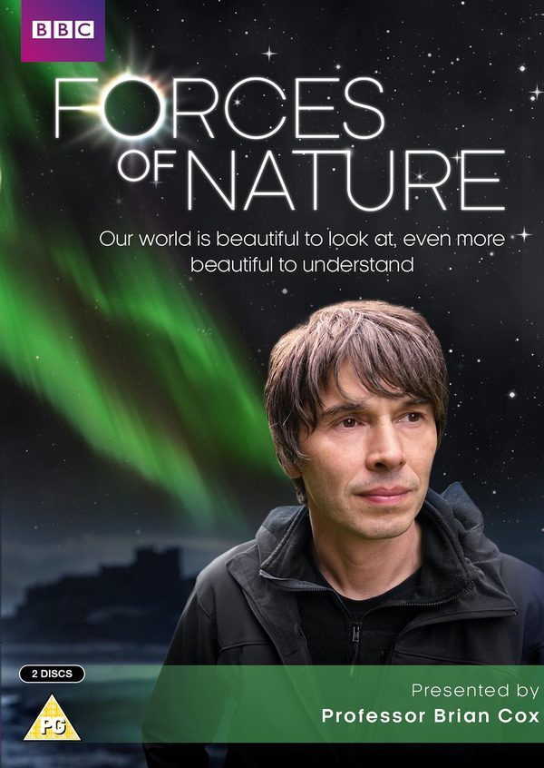
**判断：有保留** · 建议：未核实

**简介**：文章《强烈推荐36部儿童必看顶级纪录片》把它列在「自然科普」。全文只有名单和主题，没有这一部的剧情、年龄或播放链接。

**研判**：同名或近名自然纪录片较多，现有片名不足以确认具体出品。科学解释、地域覆盖和惊吓程度均未独立核实，暂作候选。

**证据状态**：证据不足，编辑保守初筛；置信度：低。

**视频链接**：未核实正版正片；不以同名页、预告、资源站或HTTP 200冒充可播正片。

**图片**：原库图片（来源说明保留，非本轮逐张鉴定）。

原文年龄（不是本项目认可结论）：只列片名。

**独立依据**：未取得作品级独立证据；此条不是正向推荐。

豆瓣评分/人数：未核实；IMDb评分/人数：未核实。公众号里的评分仅为原文说法，不计作已验证数据。

**原文来源**：[文章17](https://mp.weixin.qq.com/s/N7tY4wyBz8yLYPtZCo3ENg)

---

## 野性非洲
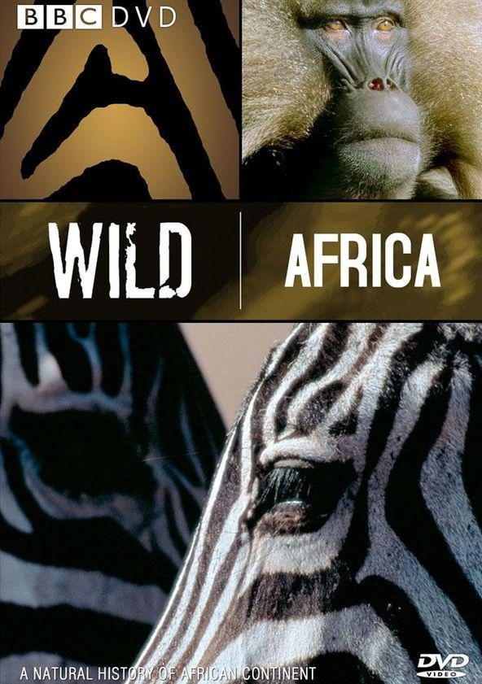
**判断：有保留** · 建议：未核实

**简介**：文章写豆瓣9.7。草原上的迁徙、捕猎和抢领地。没有英文名，也没有年龄。

**研判**：先确认具体系列与年份，不能把非洲拍成单一“野性”景观。动物追逐、死亡及地域文化的呈现需要预看，暂缺作品级独立儿童指南。

**证据状态**：证据不足，编辑保守初筛；置信度：低。

**视频链接**：未核实正版正片；不以同名页、预告、资源站或HTTP 200冒充可播正片。

**图片**：原库图片（来源说明保留，非本轮逐张鉴定）。

原文年龄（不是本项目认可结论）：未标明年龄。

**独立依据**：未取得作品级独立证据；此条不是正向推荐。

豆瓣评分/人数：未核实；IMDb评分/人数：未核实。公众号里的评分仅为原文说法，不计作已验证数据。

**原文来源**：[文章10](https://mp.weixin.qq.com/s/iJUG9KyR1p1kObJEEZ_oPQ)

---

## 隐形世界
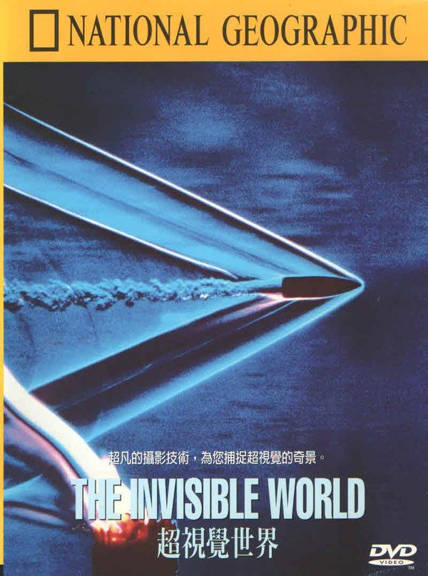
**判断：有保留** · 建议：未核实

**简介**：文章写用高速摄影和显微镜头看昆虫翅膀、碎掉的水滴和植物的细小结构。没有英文名，也没有年龄。

**研判**：《隐形世界》可能指不同显微、物理或摄影节目。版本不清时无法可靠评估科学准确性和刺激程度，暂不列入优选。

**证据状态**：证据不足，编辑保守初筛；置信度：低。

**视频链接**：未核实正版正片；不以同名页、预告、资源站或HTTP 200冒充可播正片。

**图片**：原库图片（来源说明保留，非本轮逐张鉴定）。

原文年龄（不是本项目认可结论）：未标明年龄。

**独立依据**：未取得作品级独立证据；此条不是正向推荐。

豆瓣评分/人数：未核实；IMDb评分/人数：未核实。公众号里的评分仅为原文说法，不计作已验证数据。

**原文来源**：[文章19](https://mp.weixin.qq.com/s/kRsiPOrFLWvTttOiqRRL6w)

---

## 鸟瞰地球
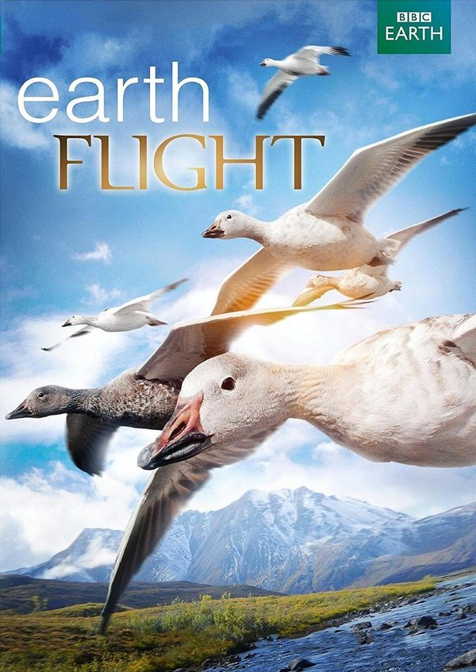
**判断：有保留** · 建议：未核实

**简介**：文章的推荐理由是换一种视角看世界：航拍飞越六大洲，记录动物迁徙和地貌。没有英文名，也没有年龄。

**研判**：尚未独立确认具体版本；鸟类迁徙可作观察主题，但航拍壮观和拟人化旁白不等于儿童能掌握生态知识。先核查捕食、危险和地理信息。

**证据状态**：证据不足，编辑保守初筛；置信度：低。

**视频链接**：未核实正版正片；不以同名页、预告、资源站或HTTP 200冒充可播正片。

**图片**：原库图片（来源说明保留，非本轮逐张鉴定）。

原文年龄（不是本项目认可结论）：未标明年龄。

**独立依据**：未取得作品级独立证据；此条不是正向推荐。

豆瓣评分/人数：未核实；IMDb评分/人数：未核实。公众号里的评分仅为原文说法，不计作已验证数据。

**原文来源**：[文章19](https://mp.weixin.qq.com/s/kRsiPOrFLWvTttOiqRRL6w)

---

## 黄石公园

**判断：有保留** · 建议：未核实

**简介**：文章写豆瓣9.5。间歇泉、森林、野生动物和四季。没有英文名，也没有年龄。

**研判**：《黄石公园》同名纪录片和其他节目容易混淆；必须确认年份和主创，不能用另一部的海报或评分。雪季动物死亡等风险尚待逐集核实。

**证据状态**：证据不足，编辑保守初筛；置信度：低。

**视频链接**：未核实正版正片；不以同名页、预告、资源站或HTTP 200冒充可播正片。

**图片**：自制文字封面（非官方海报／剧照）。

原文年龄（不是本项目认可结论）：未标明年龄。

**独立依据**：未取得作品级独立证据；此条不是正向推荐。

豆瓣评分/人数：未核实；IMDb评分/人数：未核实。公众号里的评分仅为原文说法，不计作已验证数据。

**原文来源**：[文章10](https://mp.weixin.qq.com/s/iJUG9KyR1p1kObJEEZ_oPQ)

---
