# 自然类

<!-- Generated by scripts/render_wechat_tables.py; edit data/catalog.json instead. -->

[返回首页](../../README.md) · [审核方法](review-method.md) · [不推荐](not-recommended.md) · [文章28待核验](pending-article-28.md)

本页 42 条，按强烈推荐→推荐→有保留排序。**有保留不等于推荐；年龄不等于听力难度；图片不证明适龄。**

每行一部，名称下的文章编号或“全网检索”链接到来源。适龄为审核建议；折叠的“原文说法”不代表采信。缩略图可点开放大，图下注明海报、旧图或文字封面；长简介可展开。

未注明已核实的豆瓣/IMDb评分和人数一律视为未核实；公众号评分不作独立证据。独立评测不等于教育效果证明，相关App/合集也不是单片认证。视频列仅保留官方入口等已记录地址，**不代表免费、完整或当地可播正片**；候选地址不展示。完整字段见[主目录数据](../../data/catalog.json)。

| 图片 | 名称 | 判断 | 适龄 | 简介 | 研判 | 证据状态 | 视频链接 |
| --- | --- | --- | --- | --- | --- | --- | --- |
|  [评测页海报](<https://www.commonsensemedia.org/tv-reviews/planet-earth>) | 地球脉动 [文章11](<https://mp.weixin.qq.com/s/oKG9Fhp_e-YAl2DMdq5_QQ>) · [文章17](<https://mp.weixin.qq.com/s/N7tY4wyBz8yLYPtZCo3ENg>) | 强烈推荐 | 6+（CSM；敏感儿童先预看） 

原文说法
未标明年龄
 | 文章用一句话推荐，没有写年龄和播放链接。文章写：万物生长各有快慢，孩子的成长也一样。36部清单里也有这个名字。 | 独立评测高度肯定摄影、动物与栖息地知识；同时明确有近距离捕食、杀死猎物等镜头。推荐的是有成人解释的自然观察，不是无惊吓的安抚背景视频。 | 作品级证据初审 置信度：中 [Common Sense Media](<https://www.commonsensemedia.org/tv-reviews/planet-earth>) | 未核实正版正片 |
|  [评测页海报](<https://www.commonsensemedia.org/tv-reviews/seven-worlds-one-planet>) | 七个世界，一个星球 [文章17](<https://mp.weixin.qq.com/s/N7tY4wyBz8yLYPtZCo3ENg>) | 推荐 | 9+（CSM） 

原文说法
只列片名
 | 文章《强烈推荐36部儿童必看顶级纪录片》把它列在「植物动物世界」。全文只有名单和主题，没有这一部的剧情、年龄或播放链接。 | 独立评测肯定生态观察，同时明确捕食会真实结束动物生命，故事具有生存悬念。适合能区分纪录片与童话的孩子，敏感儿童可跳过相关段落。 | 作品级证据初审 置信度：中 [Common Sense Media](<https://www.commonsensemedia.org/tv-reviews/seven-worlds-one-planet>) | 未核实正版正片 |
| <a href="../../images/review/web-jonathan-bird-blue-world.jpg">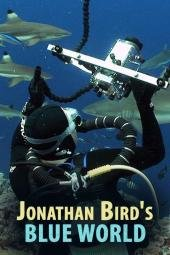</a> [评测页海报](<https://www.commonsensemedia.org/tv-reviews/jonathan-birds-blue-world>) | 乔纳森·伯德的蓝色世界 Jonathan Bird&#x27;s Blue World [全网检索](<https://www.blueworldtv.com/>) | 推荐 | 5+（CSM） 

原文说法
非公众号来源；适龄以本轮独立评测或官方栏目定位为准
 | 水下摄影师乔纳森·伯德主持的家庭向海洋探险系列，介绍鲨鱼、海牛、鲸等海洋生物。已核实官方网站可打开。CSM评5+、编辑4/5，电视分级TV-G。此次为2026年11月全网检索收录。 | CSM编辑4/5、评5+，肯定其把海洋生物多样性讲得适合全家。片中会近距离出现大型海洋动物，对怕水或怕鲨鱼的孩子需要预告。官网是节目与教育资源入口，不代表当前地区可免费看完全部正片。 | 作品级证据初审 置信度：中 [Common Sense Media](<https://www.commonsensemedia.org/tv-reviews/jonathan-birds-blue-world>) | [官方入口（非已验证正片）](<https://www.blueworldtv.com/>) |
| <a href="../../images/review/web-wild-kratts.jpg">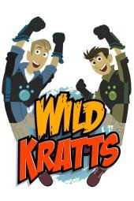</a> [评测页海报](<https://www.commonsensemedia.org/tv-reviews/wild-kratts>) | 克拉特兄弟 Wild Kratts [全网检索](<https://pbskids.org/wildkratts>) | 推荐 | 6+（CSM） 

原文说法
非公众号来源；适龄以本轮独立评测或官方栏目定位为准
 | 真实动物学家克里斯与马丁·克拉特为动画中的自己配音，讲野生动物行为、栖息地和适应。可从PBS KIDS官方节目页进入。CSM评6+、编辑4/5。此次为2026年11月全网检索收录。 | CSM编辑4/5、评6+，肯定其动物与科学内容。这是带着冒险情节的科普动画，不是纯粹纪录，可能有追逐或看似危险的场面，因此起点高于许多学前自然片。不能用它代替户外观察，英语词汇对低龄听力也有门槛。 | 作品级证据初审 置信度：中 [Common Sense Media](<https://www.commonsensemedia.org/tv-reviews/wild-kratts>) | [官方入口（非已验证正片）](<https://pbskids.org/wildkratts>) |
| <a href="../../images/review/cosmos-odyssey.jpg">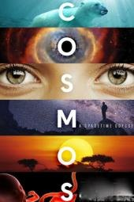</a> [评测页海报](<https://www.commonsensemedia.org/tv-reviews/cosmos-a-spacetime-odyssey>) | 宇宙时空之旅 Cosmos: A SpaceTime Odyssey [文章20](<https://mp.weixin.qq.com/s/-5VGJkhfqgD0lcveZ1_sbg>) · [文章17](<https://mp.weixin.qq.com/s/N7tY4wyBz8yLYPtZCo3ENg>) · [文章34](<https://mp.weixin.qq.com/s/Ky-may7qF1IUAu_wEnloCQ>) | 推荐 | 10+（CSM） 

原文说法
未标明年龄
 | 

文章写解说是泰森，用“想象号飞船”从微观走到宇宙边缘，并把138亿年压成一年：1月1日大爆炸，人类文明只有这年的最后14秒。也讲了哈雷和彗星、法拉第让观众看见磁…（展开）
文章写解说是泰森，用“想象号飞船”从微观走到宇宙边缘，并把138亿年压成一年：1月1日大爆炸，人类文明只有这年的最后14秒。也讲了哈雷和彗星、法拉第让观众看见磁场。文章写豆瓣9.7、已播出两季，标题里写25集。主持者本人的节目页写2014年3月开播、共13集。集数以文章和该页各自的说法并列，这里不把两边合成一个数字。文章没有写年龄。36部纪录片清单里也有这个名字。
 | 科学方法、宇宙尺度与好奇心有独立评测支持；历史迫害、处决与宇宙爆炸可能惊吓。此处仅确认2014版，文章“25集”可能混入另一季，不能合用一个评分。 | 作品级证据初审 置信度：中 [Common Sense Media](<https://www.commonsensemedia.org/tv-reviews/cosmos-a-spacetime-odyssey>) | 未核实正版正片 |
| <a href="../../images/review/tiny-world.jpg">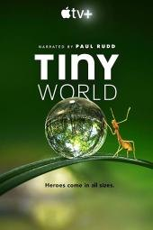</a> [评测页海报](<https://www.commonsensemedia.org/tv-reviews/tiny-world>) | 小小世界 Tiny World [文章16](<https://mp.weixin.qq.com/s/Dnb9KDiYCP9RZzQSdzqETw>) | 推荐 | 6+（CSM；非原文4+） 

原文说法
4-8岁
 | 文章写语言是英语，适合4–8岁，并写它在 Apple TV。用很小的动物走一段“英雄旅程”。列出的章节是草原、丛林、岛屿、内陆、林地。 | 独立评测肯定微小动物和栖息地知识，也提醒捕食追逐与险境带来的惊吓。原文4岁起不宜普推；成人可先筛较平和的段落。 | 作品级证据初审 置信度：中 [Common Sense Media](<https://www.commonsensemedia.org/tv-reviews/tiny-world>) | 未核实正版正片 |
| <a href="../../images/review/web-dinosaur-train.jpg">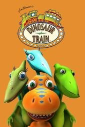</a> [评测页海报](<https://www.commonsensemedia.org/tv-reviews/dinosaur-train>) | 恐龙列车 Dinosaur Train [全网检索](<https://pbskids.org/dinosaurtrain>) | 推荐 | 3+（CSM） 

原文说法
非公众号来源；适龄以本轮独立评测或官方栏目定位为准
 | PBS学前动画，小恐龙乘火车认识不同史前物种，并介绍假设、食性等简单科学词。可从PBS KIDS官方节目页进入。CSM评3+、编辑4/5。此次为2026年11月全网检索收录。 | CSM编辑4/5、评3+，肯定它保护好奇心并用故事解释基础科学词语。内容是古生物科普故事，不是最新古生物学论文；部分物种或场景仍可能让特别敏感的幼儿紧张，成人可按集预看。 | 作品级证据初审 置信度：中 [Common Sense Media](<https://www.commonsensemedia.org/tv-reviews/dinosaur-train>) | [官方入口（非已验证正片）](<https://pbskids.org/dinosaurtrain>) |
| <a href="../../images/review/octonauts-wx.jpg">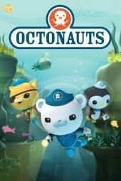</a> [评测页海报](<https://www.commonsensemedia.org/tv-reviews/octonauts>) | 海底小纵队 Octonauts [文章23](<https://mp.weixin.qq.com/s/B2loD1DLgD3WS77WM1XkqQ>) | 推荐 | 4+（CSM） 

原文说法
文章说先放着，等词汇量上来再看
 | 文章说它偏科普，海洋动物知识多，但语速偏快，作者暂时不给现在的孩子看。 | 独立评测支持海洋生物事实、团队合作与关怀主题；是拟人化冒险，不是海洋研究纪录。英语词汇有门槛，适龄不代表听力水平已足够。 | 作品级证据初审 置信度：中 [Common Sense Media](<https://www.commonsensemedia.org/tv-reviews/octonauts>) | 未核实正版正片 |
| <a href="../../images/review/web-puffin-rock.jpg">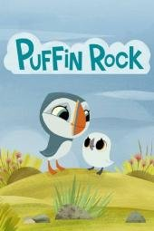</a> [评测页海报](<https://www.commonsensemedia.org/tv-reviews/puffin-rock>) | 海鹦岩 Puffin Rock [全网检索](<https://puffinrock.com/>) | 推荐 | 3+（CSM） 

原文说法
非公众号来源；适龄以本轮独立评测或官方栏目定位为准
 | 爱尔兰学前动画，小海鹦乌娜和弟弟在岛上认识不同动物的习性与关系，叙事温和。已核实官方网站可打开。CSM评3+、编辑4/5。此次为2026年11月全网检索收录。 | CSM编辑4/5、评3+，评测页标注Common Sense Selection，肯定其用探索介绍基本自然概念，并呈现关爱的家庭和朋友关系。它是温柔的拟人故事，不是野生动物纪录。官网有观看入口说明，仍不代表当前地区可免费看完全部季集。 | 作品级证据初审 置信度：中 [Common Sense Media](<https://www.commonsensemedia.org/tv-reviews/puffin-rock>) | [官方入口（非已验证正片）](<https://puffinrock.com/>) |
|  [评测页海报](<https://www.commonsensemedia.org/tv-reviews/dynasties>) | 王朝 [文章17](<https://mp.weixin.qq.com/s/N7tY4wyBz8yLYPtZCo3ENg>) | 推荐 | 6+（CSM；敏感儿童先预看） 

原文说法
只列片名
 | 文章《强烈推荐36部儿童必看顶级纪录片》把它列在「植物动物世界」。全文只有名单和主题，没有这一部的剧情、年龄或播放链接。 | 独立指南确认动物群体与生存行为的教育价值，也记录追猎、打斗和死亡。不能把旁白的家族故事当动物具有人类道德或作为育儿范本。 | 作品级证据初审 置信度：中 [Common Sense Media](<https://www.commonsensemedia.org/tv-reviews/dynasties>) | 未核实正版正片 |
| <a href="../../images/review/web-nature-pbs.jpg">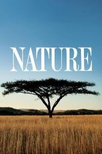</a> [评测页海报](<https://www.commonsensemedia.org/tv-reviews/nature>) | 自然（PBS） Nature [全网检索](<https://www.pbs.org/wnet/nature/>) | 推荐 | 7+（CSM；须按集预看） 

原文说法
非公众号来源；适龄以本轮独立评测或官方栏目定位为准
 | 

PBS长期自然纪录片系列，题材跨动物、地质与气象，画面精美，也不回避残酷一面。已核实官方站点可打开。CSM评7+、编辑4/5，分级TV-PG。官方站另有Natu…（展开）
PBS长期自然纪录片系列，题材跨动物、地质与气象，画面精美，也不回避残酷一面。已核实官方站点可打开。CSM评7+、编辑4/5，分级TV-PG。官方站另有Nature Jr.等合集，本条只评主系列，不把Jr.的适龄套用过来。此次为2026年11月全网检索收录。
 | CSM编辑4/5、评7+，称其为出色的自然观察，同时明确提醒可能出现动物被杀和灾难场面，建议先在官网预看集目。内容深浅不一，不适合作为幼儿日常自然启蒙。主系列与Nature Jr.不能混为一个年龄。 | 作品级证据初审 置信度：中 [Common Sense Media](<https://www.commonsensemedia.org/tv-reviews/nature>) | [官方入口（非已验证正片）](<https://www.pbs.org/wnet/nature/>) |
| <a href="../../images/w-everything-nothing.jpg">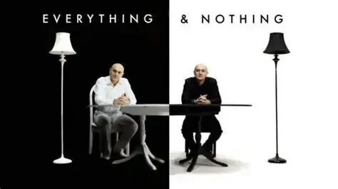</a> [旧图（未逐张鉴定）](<https://mmbiz.qpic.cn/sz_mmbiz_jpg/Wc7QXicfZyvlAzGx9AA7BVXb6k2HepN34X4513A2k63cTp2rT71yDej1SzP4j3t31DR6VdMebgYjiaTfA3zFIkBhmwlfdx1iac64NaJhiaKSIxQ/640?wx_fmt=jpeg>) | 万物与虚无 Everything and Nothing [文章16](<https://mp.weixin.qq.com/s/Dnb9KDiYCP9RZzQSdzqETw>) | 有保留 | 12+（编辑暂议） 

原文说法
8岁以上
 | 文章写语言是英语，适合8岁以上。吉姆·阿尔-哈利里讲“万物是什么、虚无是什么”，分上部《万物》和下部《虚无》。BBC Four 节目页的介绍与此相符，并写目前不在 iPlayer 上。 | 物理学中的虚无、量子和宇宙尺度较抽象，“8岁以上”缺少独立依据。没有证据证明观看即能理解，应配图解、讨论并区分模型与事实。 | 证据不足，编辑保守初筛 置信度：低 未取得作品级独立依据 | [官方入口（非已验证正片）](<https://www.bbc.co.uk/programmes/b00zw0n6>) |
|  [旧图（未逐张鉴定）](<https://mmbiz.qpic.cn/mmbiz_png/iceBicGYj4xsASNs8PicFFrg3VvF2Tb8qoAqiaEvbXibo89FeR9Yliaic9WDhyC141SpiaNCOZ3qS8K3QgmYGVaSY7m7zhwQs9bNaw27Yv6TkMqCzAE/640?wx_fmt=png>) | 亚马逊深渊 [文章10](<https://mp.weixin.qq.com/s/iJUG9KyR1p1kObJEEZ_oPQ>) | 有保留 | 未核实 

原文说法
未标明年龄
 | 文章写豆瓣9.3。镜头进到亚马逊雨林和水下，用来讲好奇和探索。没有英文名，也没有年龄。 | 片名可能对应不同亚马逊专题，独立来源和版本未锁定。探险风险、动物捕食与对当地族群的呈现须逐集核对，不能凭标题升级。 | 证据不足，编辑保守初筛 置信度：低 未取得作品级独立依据 | 未核实正版正片 |
|  [旧图（未逐张鉴定）](<https://mmbiz.qpic.cn/sz_mmbiz_jpg/Dbr7hULyqPKPAvxQwEfYAJCeqmn38CIlyC5Cpz9R5Sd45wS16x5HHEXPVXtoUmZDzvAVXIJBXA6YAiaia9Z8Ygp4t6zrdyjWLqzib4KRv/0?wx_fmt=jpeg>) | 人类宇宙 [文章17](<https://mp.weixin.qq.com/s/N7tY4wyBz8yLYPtZCo3ENg>) | 有保留 | 12+（编辑暂议） 

原文说法
只列片名
 | 文章《强烈推荐36部儿童必看顶级纪录片》把它列在「宇宙探索」。全文只有名单和主题，没有这一部的剧情、年龄或播放链接。 | 人类与宇宙的跨学科叙述可能引发思考，也更依赖历史和科学背景。原文只列片名，需避免把主持人的哲学推论当已证实的自然科学结论。 | 证据不足，编辑保守初筛 置信度：低 未取得作品级独立依据 | 未核实正版正片 |
|  [旧图（未逐张鉴定）](<https://mmbiz.qpic.cn/sz_mmbiz_jpg/Dbr7hULyqPKPAvxQwEfYAJCeqmn38CIlyC5Cpz9R5Sd45wS16x5HHEXPVXtoUmZDzvAVXIJBXA6YAiaia9Z8Ygp4t6zrdyjWLqzib4KRv/0?wx_fmt=jpeg>) | 从太空看地球 [文章17](<https://mp.weixin.qq.com/s/N7tY4wyBz8yLYPtZCo3ENg>) | 有保留 | 未核实 

原文说法
只列片名
 | 文章《强烈推荐36部儿童必看顶级纪录片》把它列在「宇宙探索」。全文只有名单和主题，没有这一部的剧情、年龄或播放链接。 | 需要锁定《Earth from Space》的制作年份与版本；卫星画面可很吸引人，但需解释影像处理和尺度。具体灾难、风险内容未独立核实。 | 证据不足，编辑保守初筛 置信度：低 未取得作品级独立依据 | 未核实正版正片 |
| <a href="../../images/w-penguins-spy.jpg">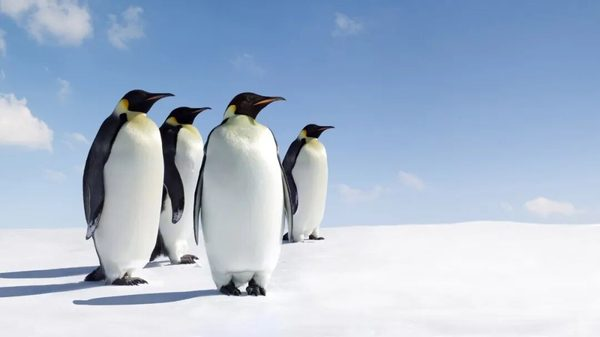</a> [旧图（未逐张鉴定）](<https://mmbiz.qpic.cn/mmbiz_jpg/Wc7QXicfZyvkSpbiaMevGf1N1nAhNB3uaB8pqIuLfHL9vAvb4697iabGvYGFBft3eP2PFA8mqN8UQQdPMCFZ2rHkAE3ZEGDuWc9B1u30S6QFPM/640?wx_fmt=jpeg>) | 企鹅群里有特务 Penguins: Spy in the Huddle [文章16](<https://mp.weixin.qq.com/s/Dnb9KDiYCP9RZzQSdzqETw>) · [文章17](<https://mp.weixin.qq.com/s/N7tY4wyBz8yLYPtZCo3ENg>) | 有保留 | 6+（编辑暂议） 

原文说法
3-6岁
 | 

文章写语言是汉语普通话，适合3–6岁。BBC 摄影队用近一年跟踪洪堡企鹅、跳岩企鹅和帝企鹅。三集标题被写成《漫漫长路》《蹒跚学步》《成长的烦恼》。BBC 纪录片…（展开）
文章写语言是汉语普通话，适合3–6岁。BBC 摄影队用近一年跟踪洪堡企鹅、跳岩企鹅和帝企鹅。三集标题被写成《漫漫长路》《蹒跚学步》《成长的烦恼》。BBC 纪录片页写2013年、3集，导演 John Downer。36部清单里也有这个名字。
 | 动物观察有价值，但拟人化叙述和间谍摄像装置不是动物真实“想法”。尚无与此版对应的独立适龄依据，原文3—6岁不应未经核验沿用。 | 证据不足，编辑保守初筛 置信度：低 未取得作品级独立依据 | [官方入口（非已验证正片）](<https://www.bbc.com/video/docs/series/10167741>) |
| <a href="../../images/review/wx32-minuteearth.jpg">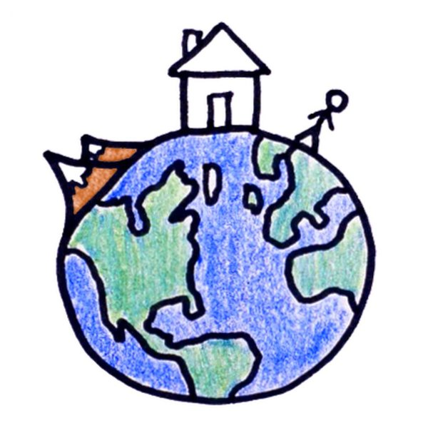</a> [官方频道头像（版权归原权利人）](<https://www.youtube.com/@MinuteEarth>) | 分钟地球 MinuteEarth [文章32](<https://mp.weixin.qq.com/s/_1jigH8MZdLofsaUiUXMLg>) | 有保留 | 8+（编辑暂议；低龄需共看） 

原文说法
文章以女儿（年龄未写）和儿子为例，未明确年龄
 | 

文章称2013年起更新、300多集、每集2—3分钟、中英文。举例讲河流为何弯曲（侵蚀、沉积、截弯取直形成牛轭湖）、雷声长短、树叶为何是绿的、蜜蜂跳舞等；称兼作英…（展开）
文章称2013年起更新、300多集、每集2—3分钟、中英文。举例讲河流为何弯曲（侵蚀、沉积、截弯取直形成牛轭湖）、雷声长短、树叶为何是绿的、蜜蜂跳舞等；称兼作英语输入。文末“后台回复【地球】”领取资源。
 | 官方YouTube频道免费、单集2—3分钟，选题从生活疑问出发，河流弯曲、雷声等解释有科学依据；但无CSM等独立适龄评测，“全球好几亿人看过”“YouTube高分”未核实。旁白信息密度高、语速偏快，与文章“语速不快”的说法不符（未测量），低龄孩子需家长暂停讲解；部分集涉及死亡、气候灾害等，宜挑集。 | 官方来源核实，无独立适龄评测 置信度：低至中 [MinuteEarth官方YouTube频道](<https://www.youtube.com/@MinuteEarth>)（制作方官方页面，不是独立评测） [MinuteEarth官网](<https://www.minuteearth.com/>)（制作方官方页面，不是独立评测） | [官方入口（非已验证正片）](<https://www.youtube.com/@MinuteEarth>) |
| <a href="../../images/title-cards/wx38-galapagos.svg">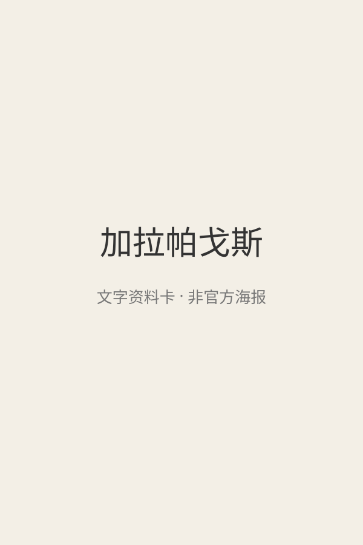</a> 文字封面（非官方海报） | 加拉帕戈斯 [文章38](<https://mp.weixin.qq.com/s/-JA3Qvw8Jv0qHDrT41bGvw>) | 有保留 | 未核实（自然纪录片一般8+共看） 

原文说法
文章未写年龄
 | 文章写豆瓣9.6，介绍达尔文进化思想之岛，海鬣蜥、蓝脚鲣鸟；推荐理由为“打破固有认知”“积累作文素材”等。文章没有写出品方、年份、英文名、年龄或播放链接。 | 同名自然纪录片有多个版本（BBC等），文章未给出品方和年份，作品身份未核实，豆瓣9.6也未核实。自然纪录片通常含捕食与死亡镜头，需按具体版本预看；“影响一生”“作文更有灵气”是无证据的营销说法。 | 证据不足，编辑保守初筛 置信度：低 未取得作品级独立依据 | 未核实正版正片 |
|  [旧图（未逐张鉴定）](<https://mmbiz.qpic.cn/sz_mmbiz_png/tJMoMaNt35iczwYdgwR19icLH8ZFs5gib4reVsicVGMHkldqo6Homw4DJ1T0iaZsHzJ2hUNYVvYSFz5XNSgQjOj3ys7lgqFypWdcz9wth30rmyc4/640?wx_fmt=png>) | 南太平洋 [文章19](<https://mp.weixin.qq.com/s/kRsiPOrFLWvTttOiqRRL6w>) | 有保留 | 未核实 

原文说法
未标明年龄
 | 文章写镜头去南太平洋孤岛，看生命在隔绝环境里长成别的样子。没有英文名，也没有年龄。 | 海洋专题不是天然低龄安全；捕食和生态危机的具体强度尚未核实。需锁定年份、集数和发行方，避免同名评分与海报错配。 | 证据不足，编辑保守初筛 置信度：低 未取得作品级独立依据 | 未核实正版正片 |
|  [旧图（未逐张鉴定）](<https://mmbiz.qpic.cn/mmbiz_png/iceBicGYj4xsDb1lwdoEpfhsPRialLBicIhESP7FpibFZUiajAZVzLWBvsHJQiaxLicjl4ibD0SUV6R9cMTkO2hmkHVzsUIyh3jho3N6mcwGX8BuuC14/640?wx_fmt=png>) | 喜马拉雅 [文章10](<https://mp.weixin.qq.com/s/iJUG9KyR1p1kObJEEZ_oPQ>) | 有保留 | 未核实 

原文说法
未标明年龄
 | 文章写豆瓣9.6。雪豹在岩壁上等猎物，金雕迎风飞，用来讲高原上的坚持。文章没有英文名，也没有年龄。 | 同名电影、山脉专题和纪录片易混淆，尚未锁定制作年份。不能把壮美画面直接等同低龄自然启蒙，需核查生存危险、死亡和时长。 | 证据不足，编辑保守初筛 置信度：低 未取得作品级独立依据 | 未核实正版正片 |
| <a href="../../images/review/web-nat-geo-kids.jpg">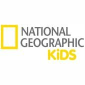</a> [评测页海报](<https://www.commonsensemedia.org/website-reviews/national-geographic-kids>) | 国家地理儿童 National Geographic Kids [全网检索](<https://kids.nationalgeographic.com/>) | 有保留 | 8+（CSM网站评测） 

原文说法
非公众号来源；适龄以本轮独立评测或官方栏目定位为准
 | 

国家地理面向儿童的网站，有短视频、动物资料、游戏和杂志相关内容。已核实官网可打开。CSM对网站评8+、编辑4/5，指出广告和推广多，部分视频有捕食场面，部分内容…（展开）
国家地理面向儿童的网站，有短视频、动物资料、游戏和杂志相关内容。已核实官网可打开。CSM对网站评8+、编辑4/5，指出广告和推广多，部分视频有捕食场面，部分内容需付费订阅。此次为2026年11月全网检索收录。这不是单一部剧集。
 | CSM肯定其动物和地理内容质量，也明确批评广告、促销和付费墙，并提醒有动物捕猎画面。作为网站整体评测，不能给每一条视频或游戏同一个年龄。不宜让儿童独自在充满推广信息的页面里自由点选。 | 作品级证据初审 置信度：中 [Common Sense Media](<https://www.commonsensemedia.org/website-reviews/national-geographic-kids>)（网站整体，不是单部影片认证） | [官方入口（非已验证正片）](<https://kids.nationalgeographic.com/>) |
|  文字封面（非官方海报） | 地球一年 [文章19](<https://mp.weixin.qq.com/s/kRsiPOrFLWvTttOiqRRL6w>) | 有保留 | 未核实 

原文说法
未标明年龄
 | 文章写跟着四季看动植物生长、繁殖和蛰伏。没有英文名，也没有年龄。 | “地球一年”名称和译名尚需核实；不能仅凭自然题材判优。需确认叙事是否混合不同时间地点、动物危险镜头及目标年龄。 | 证据不足，编辑保守初筛 置信度：低 未取得作品级独立依据 | 未核实正版正片 |
|  [旧图（未逐张鉴定）](<https://mmbiz.qpic.cn/sz_mmbiz_jpg/Dbr7hULyqPLFibl5iaCML3icOGhmxkE6rhtSxslcD42lWVJ5Dko4LKKB93Ih9nI7qb5gtNjz9sxBD8ahIbQ7CALIRB6kDZSibLepN4aib/0?wx_fmt=jpeg>) | 地球改变之年 [文章17](<https://mp.weixin.qq.com/s/N7tY4wyBz8yLYPtZCo3ENg>) | 有保留 | 8+（编辑暂议） 

原文说法
只列片名
 | 文章《强烈推荐36部儿童必看顶级纪录片》把它列在「自然科普」。全文只有名单和主题，没有这一部的剧情、年龄或播放链接。 | 疫情停摆与动物环境变化是讨论契机，但单部纪实无法证明长期因果。需说明观察时间、地区差异和人类活动恢复后的变化；儿童指南未核实。 | 证据不足，编辑保守初筛 置信度：低 未取得作品级独立依据 | 未核实正版正片 |
|  [旧图（未逐张鉴定）](<https://mmbiz.qpic.cn/sz_mmbiz_jpg/iceBicGYj4xsBJZXfUIQWmqiaHFuk04H8nCbymZq4KL6YuCm5ecx2P7rGz8z7L7Bic5XaBJ7MogCK6vwW8DYt1ib58WntKYxYyXDAsvJlURIgrLU/0?wx_fmt=jpeg>) | 大堡礁 [文章10](<https://mp.weixin.qq.com/s/iJUG9KyR1p1kObJEEZ_oPQ>) | 有保留 | 未核实 

原文说法
未标明年龄
 | 文章写豆瓣9.4。珊瑚礁和海洋生物，并写到珊瑚白化。正文这一条没有单独配图。没有英文名，也没有年龄。 | 大堡礁有多个纪录片版本；没有制作年份和对应独立评测，不能笼统套用某版口碑。可候选，但需核对捕食镜头和生态知识更新。 | 证据不足，编辑保守初筛 置信度：低 未取得作品级独立依据 | 未核实正版正片 |
|  [旧图（未逐张鉴定）](<https://mmbiz.qpic.cn/sz_mmbiz_jpg/Dbr7hULyqPKPAvxQwEfYAJCeqmn38CIlyC5Cpz9R5Sd45wS16x5HHEXPVXtoUmZDzvAVXIJBXA6YAiaia9Z8Ygp4t6zrdyjWLqzib4KRv/0?wx_fmt=jpeg>) | 太阳系的奇迹 [文章17](<https://mp.weixin.qq.com/s/N7tY4wyBz8yLYPtZCo3ENg>) | 有保留 | 10+（编辑暂议） 

原文说法
只列片名
 | 文章《强烈推荐36部儿童必看顶级纪录片》把它列在「宇宙探索」。全文只有名单和主题，没有这一部的剧情、年龄或播放链接。 | 太阳系科普有候选价值，但旧节目中的探测成果需更新；仅凭片名无法核验知识准确性与课堂适配。尚无作品级独立儿童年龄证据。 | 证据不足，编辑保守初筛 置信度：低 未取得作品级独立依据 | 未核实正版正片 |
|  [旧图（未逐张鉴定）](<https://mmbiz.qpic.cn/sz_mmbiz_jpg/Dbr7hULyqPKPAvxQwEfYAJCeqmn38CIlyC5Cpz9R5Sd45wS16x5HHEXPVXtoUmZDzvAVXIJBXA6YAiaia9Z8Ygp4t6zrdyjWLqzib4KRv/0?wx_fmt=jpeg>) | 宇宙的奇迹 [文章17](<https://mp.weixin.qq.com/s/N7tY4wyBz8yLYPtZCo3ENg>) | 有保留 | 12+（编辑暂议） 

原文说法
只列片名
 | 文章《强烈推荐36部儿童必看顶级纪录片》把它列在「宇宙探索」。全文只有名单和主题，没有这一部的剧情、年龄或播放链接。 | 宇宙演化涉及抽象尺度和物理模型；文章只有片名，无独立适龄和学习效果证据。需核对具体版本，并把旧时科学表述与现行资料对照。 | 证据不足，编辑保守初筛 置信度：低 未取得作品级独立依据 | 未核实正版正片 |
| <a href="../../images/title-cards/wx38-andes.svg">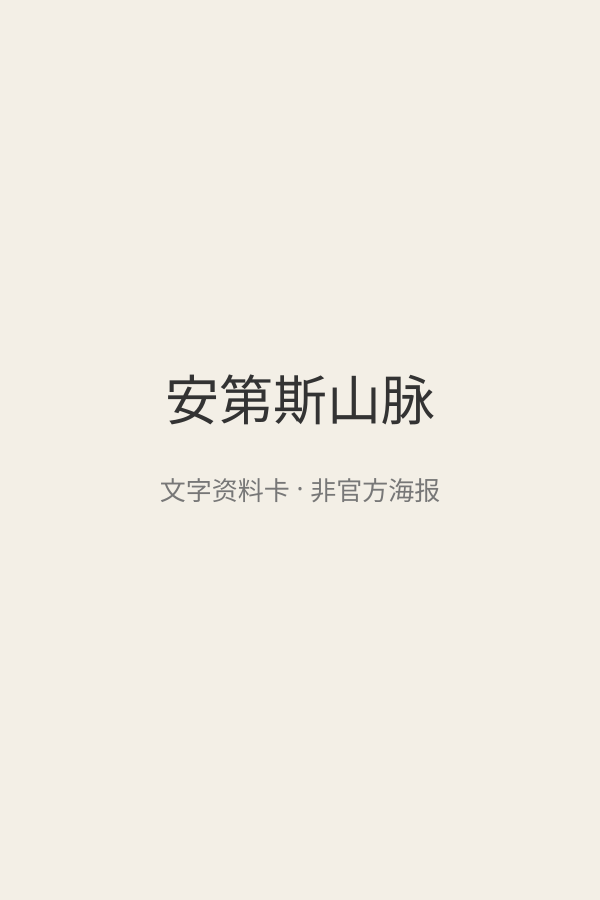</a> 文字封面（非官方海报） | 安第斯山脉 [文章38](<https://mp.weixin.qq.com/s/-JA3Qvw8Jv0qHDrT41bGvw>) | 有保留 | 未核实（自然纪录片一般8+共看） 

原文说法
文章未写年龄
 | 文章写豆瓣9.5，介绍绵延七千多公里的山脉、地貌及人与野生动物；推荐理由为“打破固有认知”“积累作文素材”等。文章没有写出品方、年份、英文名、年龄或播放链接。 | 同名自然纪录片有多个版本（BBC等），文章未给出品方和年份，作品身份未核实，豆瓣9.5也未核实。自然纪录片通常含捕食与死亡镜头，需按具体版本预看；“影响一生”“作文更有灵气”是无证据的营销说法。 | 证据不足，编辑保守初筛 置信度：低 未取得作品级独立依据 | 未核实正版正片 |
|  [旧图（未逐张鉴定）](<https://mmbiz.qpic.cn/sz_mmbiz_jpg/Dbr7hULyqPLFibl5iaCML3icOGhmxkE6rhtSxslcD42lWVJ5Dko4LKKB93Ih9nI7qb5gtNjz9sxBD8ahIbQ7CALIRB6kDZSibLepN4aib/0?wx_fmt=jpeg>) | 家园 [文章17](<https://mp.weixin.qq.com/s/N7tY4wyBz8yLYPtZCo3ENg>) | 有保留 | 12+（编辑暂议） 

原文说法
只列片名
 | 文章《强烈推荐36部儿童必看顶级纪录片》把它列在「自然科普」。全文只有名单和主题，没有这一部的剧情、年龄或播放链接。 | 如果是2009年《Home》，环境议题值得讨论，但这也是立场鲜明的倡议影像；数据年份、灾难焦虑及解决方案应补充核对，具体版本未最终确认。 | 证据不足，编辑保守初筛 置信度：低 未取得作品级独立依据 | 未核实正版正片 |
|  [旧图（未逐张鉴定）](<https://mmbiz.qpic.cn/sz_mmbiz_png/tJMoMaNt35ib7rAXSvywk5ibCErMGzqObYnnZK3ibHHFichoSXDIr3bnQmLSxLFeaBoicO4AmcxFTAXiaAjIeGL7bvQHlHClpE2ORlzYy35wpyYt0/640?wx_fmt=png>) | 极地 [文章19](<https://mp.weixin.qq.com/s/kRsiPOrFLWvTttOiqRRL6w>) | 有保留 | 未核实 

原文说法
未标明年龄
 | 文章称它是国产纪录片，记录极寒地方的人怎样和自然一起生活。没有英文名，也没有年龄。 | “极地”同名节目多，可能偏人文而非动物纪录。未确认版本前不推断内容或使用其他作品分龄，先核验制作信息。 | 证据不足，编辑保守初筛 置信度：低 未取得作品级独立依据 | 未核实正版正片 |
|  [旧图（未逐张鉴定）](<https://mmbiz.qpic.cn/mmbiz_jpg/Dbr7hULyqPIuDpBLPMWBTVUoGhnew2PxC4cIf3po4t3h4yPDjwSicDLT39DFx8FjIfbO34iaqsSUjd0QPicF4HewA2GDLhYlkb7iczOZAhzW/0?wx_fmt=jpeg>) | 植物王国 [文章17](<https://mp.weixin.qq.com/s/N7tY4wyBz8yLYPtZCo3ENg>) | 有保留 | 未核实 

原文说法
只列片名
 | 文章《强烈推荐36部儿童必看顶级纪录片》把它列在「植物动物世界」。全文只有名单和主题，没有这一部的剧情、年龄或播放链接。 | 植物题材也需解释延时、显微摄影与实验条件；文章只列片名，尚无相应独立儿童指南或准确集目，不能直接升级为优选。 | 证据不足，编辑保守初筛 置信度：低 未取得作品级独立依据 | 未核实正版正片 |
|  [旧图（未逐张鉴定）](<https://mmbiz.qpic.cn/sz_mmbiz_jpg/Dbr7hULyqPLFibl5iaCML3icOGhmxkE6rhtSxslcD42lWVJ5Dko4LKKB93Ih9nI7qb5gtNjz9sxBD8ahIbQ7CALIRB6kDZSibLepN4aib/0?wx_fmt=jpeg>) | 生命之色 [文章17](<https://mp.weixin.qq.com/s/N7tY4wyBz8yLYPtZCo3ENg>) | 有保留 | 未核实 

原文说法
只列片名
 | 文章《强烈推荐36部儿童必看顶级纪录片》把它列在「自然科普」。全文只有名单和主题，没有这一部的剧情、年龄或播放链接。 | 颜色与动物视觉有潜力，但须区分实际可见影像和技术重建。尚未核实年份、捕食强度及独立儿童指南，不因鲜艳画面判优。 | 证据不足，编辑保守初筛 置信度：低 未取得作品级独立依据 | 未核实正版正片 |
|  [旧图（未逐张鉴定）](<https://mmbiz.qpic.cn/sz_mmbiz_jpg/Dbr7hULyqPKPAvxQwEfYAJCeqmn38CIlyC5Cpz9R5Sd45wS16x5HHEXPVXtoUmZDzvAVXIJBXA6YAiaia9Z8Ygp4t6zrdyjWLqzib4KRv/0?wx_fmt=jpeg>) | 生命的奇迹 [文章17](<https://mp.weixin.qq.com/s/N7tY4wyBz8yLYPtZCo3ENg>) | 有保留 | 10+（编辑暂议） 

原文说法
只列片名
 | 文章《强烈推荐36部儿童必看顶级纪录片》把它列在「宇宙探索」。全文只有名单和主题，没有这一部的剧情、年龄或播放链接。 | 生命演化与生物物理可能适合有基础的孩子，但未取得对应独立儿童评测。不能把成人纪录片自动当小学启蒙，更不能把类比当机制本身。 | 证据不足，编辑保守初筛 置信度：低 未取得作品级独立依据 | 未核实正版正片 |
|  [旧图（未逐张鉴定）](<https://mmbiz.qpic.cn/mmbiz_jpg/Dbr7hULyqPIuDpBLPMWBTVUoGhnew2PxC4cIf3po4t3h4yPDjwSicDLT39DFx8FjIfbO34iaqsSUjd0QPicF4HewA2GDLhYlkb7iczOZAhzW/0?wx_fmt=jpeg>) | 种出个地球 [文章17](<https://mp.weixin.qq.com/s/N7tY4wyBz8yLYPtZCo3ENg>) | 有保留 | 未核实 

原文说法
只列片名
 | 文章《强烈推荐36部儿童必看顶级纪录片》把它列在「植物动物世界」。全文只有名单和主题，没有这一部的剧情、年龄或播放链接。 | “种出个地球”可能涉及植物与地球演化，但译名和版本需先核对。地史推断、模型及证据应区分，独立儿童适龄未核实。 | 证据不足，编辑保守初筛 置信度：低 未取得作品级独立依据 | 未核实正版正片 |
|  [旧图（未逐张鉴定）](<https://mmbiz.qpic.cn/sz_mmbiz_jpg/Dbr7hULyqPLFibl5iaCML3icOGhmxkE6rhtSxslcD42lWVJ5Dko4LKKB93Ih9nI7qb5gtNjz9sxBD8ahIbQ7CALIRB6kDZSibLepN4aib/0?wx_fmt=jpeg>) | 绿色星球 [文章17](<https://mp.weixin.qq.com/s/N7tY4wyBz8yLYPtZCo3ENg>) | 有保留 | 未核实 

原文说法
只列片名
 | 文章《强烈推荐36部儿童必看顶级纪录片》把它列在「自然科普」。全文只有名单和主题，没有这一部的剧情、年龄或播放链接。 | 植物生态题材不等于没有紧张或捕食内容；需先核对具体版本和每集时长。独立儿童分龄与学习效果尚未取得，不沿用笼统“必看”。 | 证据不足，编辑保守初筛 置信度：低 未取得作品级独立依据 | 未核实正版正片 |
|  [旧图（未逐张鉴定）](<https://mmbiz.qpic.cn/sz_mmbiz_jpg/Dbr7hULyqPLFibl5iaCML3icOGhmxkE6rhtSxslcD42lWVJ5Dko4LKKB93Ih9nI7qb5gtNjz9sxBD8ahIbQ7CALIRB6kDZSibLepN4aib/0?wx_fmt=jpeg>) | 自然的力量 [文章17](<https://mp.weixin.qq.com/s/N7tY4wyBz8yLYPtZCo3ENg>) | 有保留 | 未核实 

原文说法
只列片名
 | 文章《强烈推荐36部儿童必看顶级纪录片》把它列在「自然科普」。全文只有名单和主题，没有这一部的剧情、年龄或播放链接。 | 同名或近名自然纪录片较多，现有片名不足以确认具体出品。科学解释、地域覆盖和惊吓程度均未独立核实，暂作候选。 | 证据不足，编辑保守初筛 置信度：低 未取得作品级独立依据 | 未核实正版正片 |
| <a href="../../images/title-cards/wx38-wild-caribbean.svg">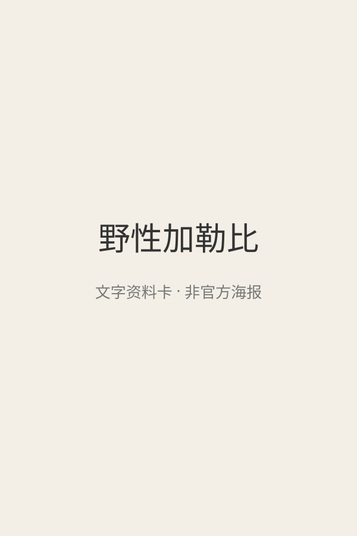</a> 文字封面（非官方海报） | 野性加勒比 [文章38](<https://mp.weixin.qq.com/s/-JA3Qvw8Jv0qHDrT41bGvw>) | 有保留 | 未核实（自然纪录片一般8+共看） 

原文说法
文章未写年龄
 | 文章写豆瓣9.2，介绍珊瑚与海洋生物；推荐理由为“打破固有认知”“积累作文素材”等。文章没有写出品方、年份、英文名、年龄或播放链接。 | 同名自然纪录片有多个版本（BBC等），文章未给出品方和年份，作品身份未核实，豆瓣9.2也未核实。自然纪录片通常含捕食与死亡镜头，需按具体版本预看；“影响一生”“作文更有灵气”是无证据的营销说法。 | 证据不足，编辑保守初筛 置信度：低 未取得作品级独立依据 | 未核实正版正片 |
| <a href="../../images/title-cards/wx38-wild-south-america.svg">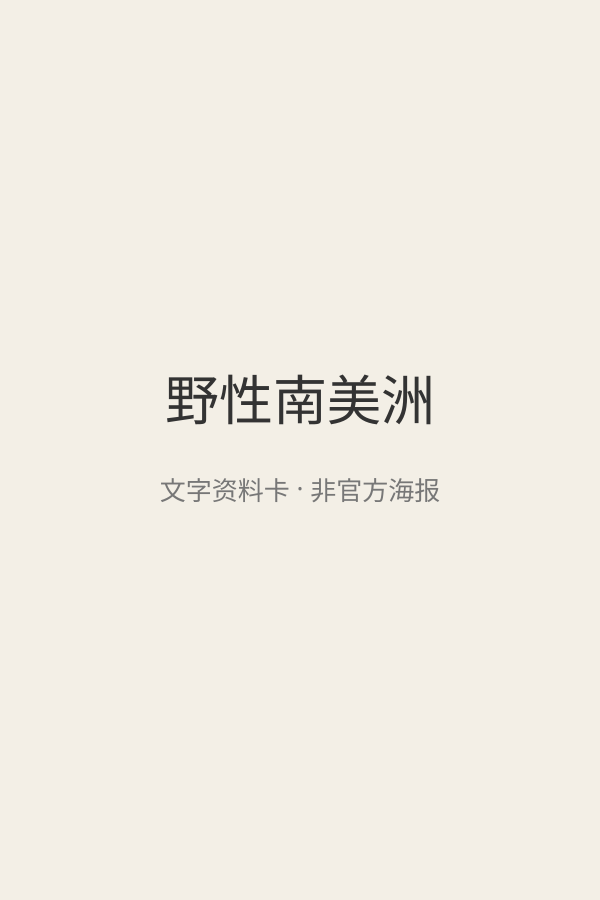</a> 文字封面（非官方海报） | 野性南美洲 [文章38](<https://mp.weixin.qq.com/s/-JA3Qvw8Jv0qHDrT41bGvw>) | 有保留 | 未核实（自然纪录片一般8+共看） 

原文说法
文章未写年龄
 | 文章写豆瓣9.3，介绍安第斯山脉、亚马逊雨林等物种丰富的大陆；推荐理由为“打破固有认知”“积累作文素材”等。文章没有写出品方、年份、英文名、年龄或播放链接。 | 同名自然纪录片有多个版本（BBC等），文章未给出品方和年份，作品身份未核实，豆瓣9.3也未核实。自然纪录片通常含捕食与死亡镜头，需按具体版本预看；“影响一生”“作文更有灵气”是无证据的营销说法。 | 证据不足，编辑保守初筛 置信度：低 未取得作品级独立依据 | 未核实正版正片 |
| <a href="../../images/title-cards/wx38-wild-australia.svg">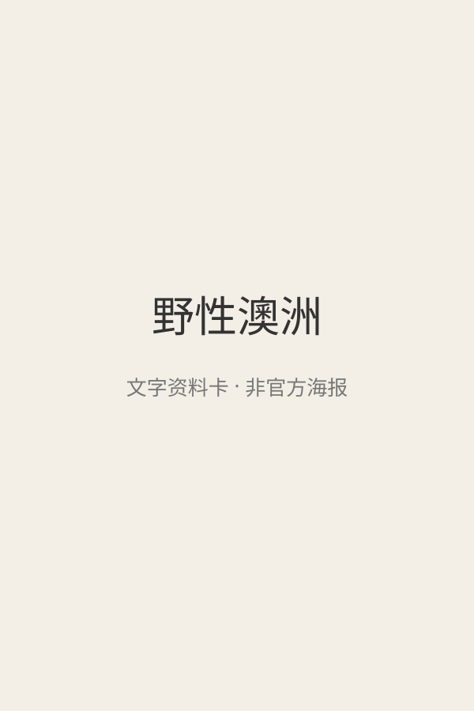</a> 文字封面（非官方海报） | 野性澳洲 [文章38](<https://mp.weixin.qq.com/s/-JA3Qvw8Jv0qHDrT41bGvw>) | 有保留 | 未核实（自然纪录片一般8+共看） 

原文说法
文章未写年龄
 | 文章写豆瓣9.4，介绍长期隔离的澳洲大陆与袋鼠、考拉等有袋动物；推荐理由为“打破固有认知”“积累作文素材”等。文章没有写出品方、年份、英文名、年龄或播放链接。 | 同名自然纪录片有多个版本（BBC等），文章未给出品方和年份，作品身份未核实，豆瓣9.4也未核实。自然纪录片通常含捕食与死亡镜头，需按具体版本预看；“影响一生”“作文更有灵气”是无证据的营销说法。 | 证据不足，编辑保守初筛 置信度：低 未取得作品级独立依据 | 未核实正版正片 |
|  [旧图（未逐张鉴定）](<https://mmbiz.qpic.cn/mmbiz_jpg/iceBicGYj4xsDiaiciaNJib2hw00wsTLAxibicQKRkQLibUDt2NQxgjeEwUmcHicvibiarTAmFORxSBT5XxZfBkN1D3Sq4eb5U33OqiclaY7h7iasFLMEeP1c/640?wx_fmt=jpeg>) | 野性非洲 [文章10](<https://mp.weixin.qq.com/s/iJUG9KyR1p1kObJEEZ_oPQ>) | 有保留 | 未核实 

原文说法
未标明年龄
 | 文章写豆瓣9.7。草原上的迁徙、捕猎和抢领地。没有英文名，也没有年龄。 | 先确认具体系列与年份，不能把非洲拍成单一“野性”景观。动物追逐、死亡及地域文化的呈现需要预看，暂缺作品级独立儿童指南。 | 证据不足，编辑保守初筛 置信度：低 未取得作品级独立依据 | 未核实正版正片 |
|  [旧图（未逐张鉴定）](<https://mmbiz.qpic.cn/sz_mmbiz_png/tJMoMaNt3598qPTiawvXqfCow70WWfxoynNtUPy70AHByI8YlM9Lxll2NA5uKnQQ6rNZDoJqlv0xGYlyY03cp9dDarIfcW2Em2cmO3S5t8nM/640?wx_fmt=png>) | 隐形世界 [文章19](<https://mp.weixin.qq.com/s/kRsiPOrFLWvTttOiqRRL6w>) | 有保留 | 未核实 

原文说法
未标明年龄
 | 文章写用高速摄影和显微镜头看昆虫翅膀、碎掉的水滴和植物的细小结构。没有英文名，也没有年龄。 | 《隐形世界》可能指不同显微、物理或摄影节目。版本不清时无法可靠评估科学准确性和刺激程度，暂不列入优选。 | 证据不足，编辑保守初筛 置信度：低 未取得作品级独立依据 | 未核实正版正片 |
|  [旧图（未逐张鉴定）](<https://mmbiz.qpic.cn/sz_mmbiz_png/tJMoMaNt359QSibNSKNdXwPBFU5Y35TA50DttKCG9u2YMdlrOIq4KrPrjegD5xSuzmfJ8uGyotCmibb2egtBPF4g8at64SpEic8I0XETyC11rI/640?wx_fmt=png>) | 鸟瞰地球 [文章19](<https://mp.weixin.qq.com/s/kRsiPOrFLWvTttOiqRRL6w>) | 有保留 | 未核实 

原文说法
未标明年龄
 | 文章的推荐理由是换一种视角看世界：航拍飞越六大洲，记录动物迁徙和地貌。没有英文名，也没有年龄。 | 尚未独立确认具体版本；鸟类迁徙可作观察主题，但航拍壮观和拟人化旁白不等于儿童能掌握生态知识。先核查捕食、危险和地理信息。 | 证据不足，编辑保守初筛 置信度：低 未取得作品级独立依据 | 未核实正版正片 |
|  文字封面（非官方海报） | 黄石公园 [文章10](<https://mp.weixin.qq.com/s/iJUG9KyR1p1kObJEEZ_oPQ>) | 有保留 | 未核实 

原文说法
未标明年龄
 | 文章写豆瓣9.5。间歇泉、森林、野生动物和四季。没有英文名，也没有年龄。 | 《黄石公园》同名纪录片和其他节目容易混淆；必须确认年份和主创，不能用另一部的海报或评分。雪季动物死亡等风险尚待逐集核实。 | 证据不足，编辑保守初筛 置信度：低 未取得作品级独立依据 | 未核实正版正片 |
